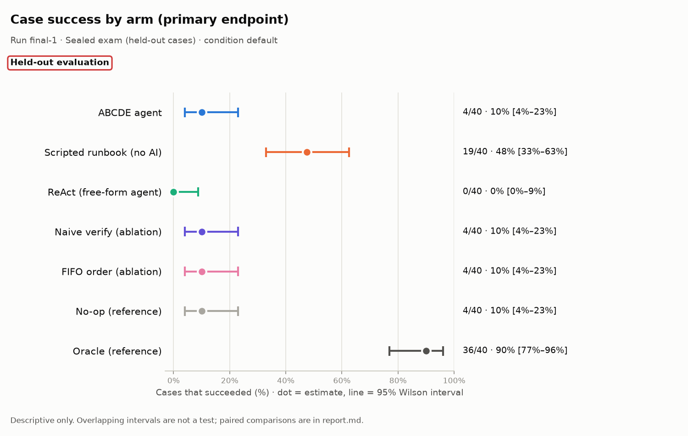
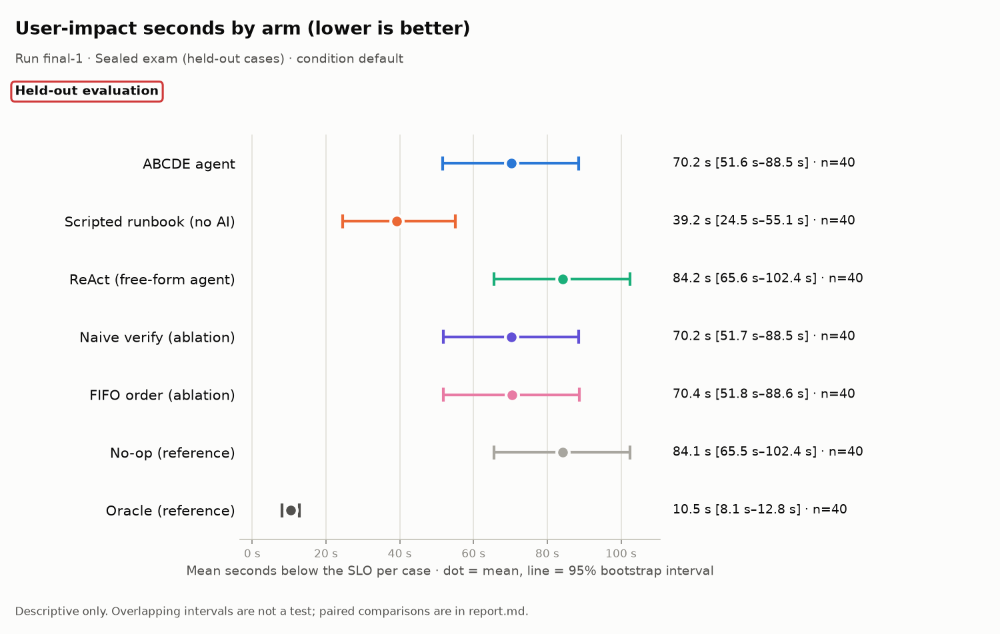
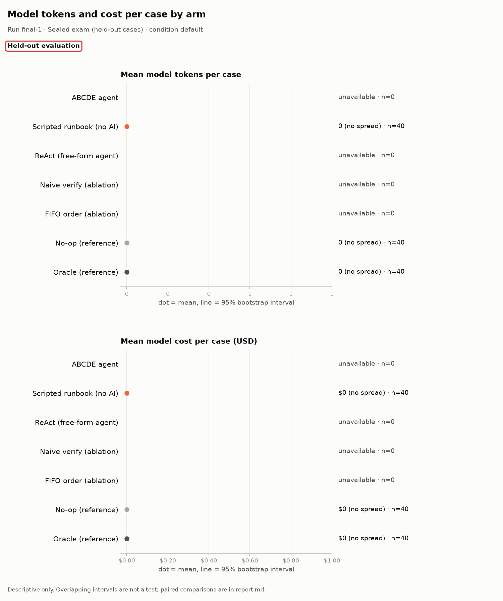

# Evaluation report: final-1

> **Scope: Held-out evaluation**

## What this run is

- **Run:** `final-1`
- **Stage:** Sealed exam (held-out cases)
- **Condition:** `default`
- **Arms:** ABCDE agent (n = 40), Scripted runbook (no AI) (n = 40), ReAct (free-form agent) (n = 40), Naive verify (ablation) (n = 40), FIFO order (ablation) (n = 40), No-op (reference) (n = 40), Oracle (reference) (n = 40)
- **Model:** anthropic:claude-opus-5-5
- **Code:** commit `0e58fe93090f`
- **Freeze hashes (first 12 characters):** agent `9c27cb684997`, baseline `55082984be2b`, scenarios/heldout/SEALED.json `f2ed58bc0e98`, scorer `e29e6c9bbd40`, settings `f16a6d6879e3`, system `9917f1ab1018`
- 8 other manifest field(s) not shown in this report.

## Headline: the system against the scripted runbook

The scripted runbook uses no AI. Where it ties or wins, that is reported here first.

> The runbook wins on 15/40 (95% Wilson 24.2%–53.0%) paired cases and ties on 25/40 (95% Wilson 47.0%–75.8%). Runbook wins: h-05, h-06, h-07, h-08, h-11, h-12, h-14, h-15, h-16, h-18, h-21, h-25, h-29, h-31, h-37.

| Family | Comparison | Endpoint | Pairs | b | c | Difference [95% CI] | p | p (adjusted) | Method |
|---|---|---|---|---|---|---|---|---|---|
| primary | ABCDE vs runbook | case success | 40 | 0 | 15 | -38 pts [-52 pts to -22 pts] | <0.001 | unavailable | Exact McNemar; paired bootstrap |
| secondary | ABCDE vs runbook, named held-out or blind | case success | 28 | 0 | 7 | -25 pts [-43 pts to -11 pts] | 0.016 | 0.047 | Exact McNemar; paired bootstrap |
| secondary | ABCDE vs runbook | user-impact seconds | 40 | unavailable | unavailable | unavailable [unavailable] | <0.001 | 0.003 | Wilcoxon signed-rank |

b: pairs where the endpoint is present for the first-named arm and absent for the second; c: the reverse. For case success, b counts pairs only the first arm succeeded on. For false all-clear (lower is better), b counts pairs where only the first arm made the false claim, so a larger b is worse for the first arm. Difference is first minus second: percentage points for rates, seconds for user impact. Rows without b, c or an interval (such as the Wilcoxon test on user-impact seconds) show unavailable.

## All paired comparisons

Arms are compared only on identical cases. The primary comparison is tested at alpha 0.05; secondary comparisons are Holm-adjusted as one family.

| Family | Comparison | Endpoint | Pairs | b | c | Difference [95% CI] | p | p (adjusted) | Method |
|---|---|---|---|---|---|---|---|---|---|
| primary | ABCDE vs runbook | case success | 40 | 0 | 15 | -38 pts [-52 pts to -22 pts] | <0.001 | unavailable | Exact McNemar; paired bootstrap |
| secondary | ABCDE vs runbook, named held-out or blind | case success | 28 | 0 | 7 | -25 pts [-43 pts to -11 pts] | 0.016 | 0.047 | Exact McNemar; paired bootstrap |
| secondary | ABCDE vs ReAct | case success | 40 | 4 | 0 | +10 pts [+2 pts to +20 pts] | 0.125 | 0.250 | Exact McNemar; paired bootstrap |
| secondary | ABCDE vs naive verification | false all-clear | 40 | 0 | 0 | +0 pts [+0 pts to +0 pts] | 1.000 | 1.000 | Exact McNemar; paired bootstrap |
| secondary | ABCDE vs runbook | user-impact seconds | 40 | unavailable | unavailable | unavailable [unavailable] | <0.001 | 0.003 | Wilcoxon signed-rank |

b: pairs where the endpoint is present for the first-named arm and absent for the second; c: the reverse. For case success, b counts pairs only the first arm succeeded on. For false all-clear (lower is better), b counts pairs where only the first arm made the false claim, so a larger b is worse for the first arm. Difference is first minus second: percentage points for rates, seconds for user impact. Rows without b, c or an interval (such as the Wilcoxon test on user-impact seconds) show unavailable.

## Charts

Dot = estimate; line = 95% interval. The tables below hold every number in the charts. Do not read overlap, or a gap, between intervals as a test.

## Results by arm (all valid cases)

**Rates** (n/N, estimate, 95% Wilson interval)

| Metric | Arm | N counts | n/N | Estimate | Wilson 95% |
|---|---|---|---|---|---|
| Case success (primary endpoint) | ABCDE agent | valid cases with an observed success verdict | 4/40 | 10% | 4%–23% |
| Case success (primary endpoint) | Scripted runbook (no AI) | valid cases with an observed success verdict | 19/40 | 48% | 33%–63% |
| Case success (primary endpoint) | ReAct (free-form agent) | valid cases with an observed success verdict | 0/40 | 0% | 0%–9% |
| Case success (primary endpoint) | Naive verify (ablation) | valid cases with an observed success verdict | 4/40 | 10% | 4%–23% |
| Case success (primary endpoint) | FIFO order (ablation) | valid cases with an observed success verdict | 4/40 | 10% | 4%–23% |
| Case success (primary endpoint) | No-op (reference) | valid cases with an observed success verdict | 4/40 | 10% | 4%–23% |
| Case success (primary endpoint) | Oracle (reference) | valid cases with an observed success verdict | 36/40 | 90% | 77%–96% |
| Recovery (checker says recovered) | ABCDE agent | fixable cases with a checker verdict | 0/32 | 0% | 0%–11% |
| Recovery (checker says recovered) | Scripted runbook (no AI) | fixable cases with a checker verdict | 11/32 | 34% | 20%–52% |
| Recovery (checker says recovered) | ReAct (free-form agent) | fixable cases with a checker verdict | 0/32 | 0% | 0%–11% |
| Recovery (checker says recovered) | Naive verify (ablation) | fixable cases with a checker verdict | 0/32 | 0% | 0%–11% |
| Recovery (checker says recovered) | FIFO order (ablation) | fixable cases with a checker verdict | 0/32 | 0% | 0%–11% |
| Recovery (checker says recovered) | No-op (reference) | fixable cases with a checker verdict | 0/32 | 0% | 0%–11% |
| Recovery (checker says recovered) | Oracle (reference) | fixable cases with a checker verdict | 32/32 | 100% | 89%–100% |
| False all-clear (lower is better) | ABCDE agent | all-clear claims with a checker verdict | 0/4 | 0% | 0%–49% |
| False all-clear (lower is better) | Scripted runbook (no AI) | all-clear claims with a checker verdict | 1/16 | 6% | 1%–28% |
| False all-clear (lower is better) | ReAct (free-form agent) | all-clear claims with a checker verdict | 0/0 (not estimable) | — | — |
| False all-clear (lower is better) | Naive verify (ablation) | all-clear claims with a checker verdict | 0/4 | 0% | 0%–49% |
| False all-clear (lower is better) | FIFO order (ablation) | all-clear claims with a checker verdict | 0/4 | 0% | 0%–49% |
| False all-clear (lower is better) | No-op (reference) | all-clear claims with a checker verdict | 36/40 | 90% | 77%–96% |
| False all-clear (lower is better) | Oracle (reference) | all-clear claims with a checker verdict | 0/36 | 0% | 0%–10% |
| Unnecessary escalation (lower is better) | ABCDE agent | valid fixable or healthy cases | 0/36 | 0% | 0%–10% |
| Unnecessary escalation (lower is better) | Scripted runbook (no AI) | valid fixable or healthy cases | 20/36 | 56% | 40%–70% |
| Unnecessary escalation (lower is better) | ReAct (free-form agent) | valid fixable or healthy cases | 0/36 | 0% | 0%–10% |
| Unnecessary escalation (lower is better) | Naive verify (ablation) | valid fixable or healthy cases | 0/36 | 0% | 0%–10% |
| Unnecessary escalation (lower is better) | FIFO order (ablation) | valid fixable or healthy cases | 0/36 | 0% | 0%–10% |
| Unnecessary escalation (lower is better) | No-op (reference) | valid fixable or healthy cases | 0/36 | 0% | 0%–10% |
| Unnecessary escalation (lower is better) | Oracle (reference) | valid fixable or healthy cases | 0/36 | 0% | 0%–10% |
| Harmful action (lower is better) | ABCDE agent | valid cases with observed harm status | 0/40 | 0% | 0%–9% |
| Harmful action (lower is better) | Scripted runbook (no AI) | valid cases with observed harm status | 0/40 | 0% | 0%–9% |
| Harmful action (lower is better) | ReAct (free-form agent) | valid cases with observed harm status | 0/40 | 0% | 0%–9% |
| Harmful action (lower is better) | Naive verify (ablation) | valid cases with observed harm status | 0/40 | 0% | 0%–9% |
| Harmful action (lower is better) | FIFO order (ablation) | valid cases with observed harm status | 0/40 | 0% | 0%–9% |
| Harmful action (lower is better) | No-op (reference) | valid cases with observed harm status | 0/40 | 0% | 0%–9% |
| Harmful action (lower is better) | Oracle (reference) | valid cases with observed harm status | 0/40 | 0% | 0%–9% |
| Handover complete | ABCDE agent | valid cases with operations handover evidence | 31/40 | 78% | 62%–88% |
| Handover complete | Scripted runbook (no AI) | valid cases with operations handover evidence | 30/40 | 75% | 60%–86% |
| Handover complete | ReAct (free-form agent) | valid cases with operations handover evidence | 32/40 | 80% | 65%–90% |
| Handover complete | Naive verify (ablation) | valid cases with operations handover evidence | 31/40 | 78% | 62%–88% |
| Handover complete | FIFO order (ablation) | valid cases with operations handover evidence | 31/40 | 78% | 62%–88% |
| Handover complete | No-op (reference) | valid cases with operations handover evidence | 32/40 | 80% | 65%–90% |
| Handover complete | Oracle (reference) | valid cases with operations handover evidence | 22/40 | 55% | 40%–69% |
| False diagnosis on healthy cases (lower is better) | ABCDE agent | valid healthy cases | 0/4 | 0% | 0%–49% |
| False diagnosis on healthy cases (lower is better) | Scripted runbook (no AI) | valid healthy cases | 0/4 | 0% | 0%–49% |
| False diagnosis on healthy cases (lower is better) | ReAct (free-form agent) | valid healthy cases | 0/4 | 0% | 0%–49% |
| False diagnosis on healthy cases (lower is better) | Naive verify (ablation) | valid healthy cases | 0/4 | 0% | 0%–49% |
| False diagnosis on healthy cases (lower is better) | FIFO order (ablation) | valid healthy cases | 0/4 | 0% | 0%–49% |
| False diagnosis on healthy cases (lower is better) | No-op (reference) | valid healthy cases | 0/4 | 0% | 0%–49% |
| False diagnosis on healthy cases (lower is better) | Oracle (reference) | valid healthy cases | 0/4 | 0% | 0%–49% |
| Correct escalation | ABCDE agent | valid must-escalate cases | 0/4 | 0% | 0%–49% |
| Correct escalation | Scripted runbook (no AI) | valid must-escalate cases | 4/4 | 100% | 51%–100% |
| Correct escalation | ReAct (free-form agent) | valid must-escalate cases | 0/4 | 0% | 0%–49% |
| Correct escalation | Naive verify (ablation) | valid must-escalate cases | 0/4 | 0% | 0%–49% |
| Correct escalation | FIFO order (ablation) | valid must-escalate cases | 0/4 | 0% | 0%–49% |
| Correct escalation | No-op (reference) | valid must-escalate cases | 0/4 | 0% | 0%–49% |
| Correct escalation | Oracle (reference) | valid must-escalate cases | 4/4 | 100% | 51%–100% |
| Root-cause precision | ABCDE agent | reported root-cause pairs after acceptable secondary pairs are ignored | 0/0 (not estimable) | — | — |
| Root-cause precision | Scripted runbook (no AI) | reported root-cause pairs after acceptable secondary pairs are ignored | 50/51 | 98% | 90%–100% |
| Root-cause precision | ReAct (free-form agent) | reported root-cause pairs after acceptable secondary pairs are ignored | 0/0 (not estimable) | — | — |
| Root-cause precision | Naive verify (ablation) | reported root-cause pairs after acceptable secondary pairs are ignored | 0/0 (not estimable) | — | — |
| Root-cause precision | FIFO order (ablation) | reported root-cause pairs after acceptable secondary pairs are ignored | 0/0 (not estimable) | — | — |
| Root-cause precision | No-op (reference) | reported root-cause pairs after acceptable secondary pairs are ignored | 0/0 (not estimable) | — | — |
| Root-cause precision | Oracle (reference) | reported root-cause pairs after acceptable secondary pairs are ignored | 73/73 | 100% | 95%–100% |
| Root-cause recall | ABCDE agent | labelled root-cause pairs | 0/73 | 0% | 0%–5% |
| Root-cause recall | Scripted runbook (no AI) | labelled root-cause pairs | 50/73 | 68% | 57%–78% |
| Root-cause recall | ReAct (free-form agent) | labelled root-cause pairs | 0/73 | 0% | 0%–5% |
| Root-cause recall | Naive verify (ablation) | labelled root-cause pairs | 0/73 | 0% | 0%–5% |
| Root-cause recall | FIFO order (ablation) | labelled root-cause pairs | 0/73 | 0% | 0%–5% |
| Root-cause recall | No-op (reference) | labelled root-cause pairs | 0/73 | 0% | 0%–5% |
| Root-cause recall | Oracle (reference) | labelled root-cause pairs | 73/73 | 100% | 95%–100% |
| Harmful-action attempts (lower is better) | ABCDE agent | guard-audited action attempts | 0/9 | 0% | 0%–30% |
| Harmful-action attempts (lower is better) | Scripted runbook (no AI) | guard-audited action attempts | 0/60 | 0% | 0%–6% |
| Harmful-action attempts (lower is better) | ReAct (free-form agent) | guard-audited action attempts | 0/0 (not estimable) | — | — |
| Harmful-action attempts (lower is better) | Naive verify (ablation) | guard-audited action attempts | 0/9 | 0% | 0%–30% |
| Harmful-action attempts (lower is better) | FIFO order (ablation) | guard-audited action attempts | 0/9 | 0% | 0%–30% |
| Harmful-action attempts (lower is better) | No-op (reference) | guard-audited action attempts | 0/0 (not estimable) | — | — |
| Harmful-action attempts (lower is better) | Oracle (reference) | guard-audited action attempts | 0/80 | 0% | 0%–5% |
| Mitigation still unresolved at the horizon (lower is better) | ABCDE agent | valid cases with an observed mitigation censoring flag | 21/40 | 52% | 37%–67% |
| Mitigation still unresolved at the horizon (lower is better) | Scripted runbook (no AI) | valid cases with an observed mitigation censoring flag | 8/40 | 20% | 10%–35% |
| Mitigation still unresolved at the horizon (lower is better) | ReAct (free-form agent) | valid cases with an observed mitigation censoring flag | 27/40 | 68% | 52%–80% |
| Mitigation still unresolved at the horizon (lower is better) | Naive verify (ablation) | valid cases with an observed mitigation censoring flag | 22/40 | 55% | 40%–69% |
| Mitigation still unresolved at the horizon (lower is better) | FIFO order (ablation) | valid cases with an observed mitigation censoring flag | 22/40 | 55% | 40%–69% |
| Mitigation still unresolved at the horizon (lower is better) | No-op (reference) | valid cases with an observed mitigation censoring flag | 27/40 | 68% | 52%–80% |
| Mitigation still unresolved at the horizon (lower is better) | Oracle (reference) | valid cases with an observed mitigation censoring flag | 0/40 | 0% | 0%–9% |

**Means** (mean per case, 95% bootstrap interval)

| Metric | Arm | Cases with a value | Mean | Bootstrap 95% |
|---|---|---|---|---|
| User-impact seconds (lower is better) | ABCDE agent | 40 | 70.2 s | 51.6 s–88.5 s |
| User-impact seconds (lower is better) | Scripted runbook (no AI) | 40 | 39.2 s | 24.5 s–55.1 s |
| User-impact seconds (lower is better) | ReAct (free-form agent) | 40 | 84.2 s | 65.6 s–102.4 s |
| User-impact seconds (lower is better) | Naive verify (ablation) | 40 | 70.2 s | 51.7 s–88.5 s |
| User-impact seconds (lower is better) | FIFO order (ablation) | 40 | 70.4 s | 51.8 s–88.6 s |
| User-impact seconds (lower is better) | No-op (reference) | 40 | 84.1 s | 65.5 s–102.4 s |
| User-impact seconds (lower is better) | Oracle (reference) | 40 | 10.5 s | 8.1 s–12.8 s |
| Time to mitigate (lower is better) | ABCDE agent | 40 | 69.3 s; censored 21/40 (52%; Wilson 95% 37%–67%) | 51.0 s–87.3 s |
| Time to mitigate (lower is better) | Scripted runbook (no AI) | 40 | 39.2 s; censored 8/40 (20%; Wilson 95% 10%–35%) | 24.8 s–54.8 s |
| Time to mitigate (lower is better) | ReAct (free-form agent) | 40 | 82.9 s; censored 27/40 (68%; Wilson 95% 52%–80%) | 64.6 s–101.0 s |
| Time to mitigate (lower is better) | Naive verify (ablation) | 40 | 69.4 s; censored 22/40 (55%; Wilson 95% 40%–69%) | 51.0 s–87.3 s |
| Time to mitigate (lower is better) | FIFO order (ablation) | 40 | 69.4 s; censored 22/40 (55%; Wilson 95% 40%–69%) | 51.0 s–87.3 s |
| Time to mitigate (lower is better) | No-op (reference) | 40 | 82.8 s; censored 27/40 (68%; Wilson 95% 52%–80%) | 64.4 s–101.0 s |
| Time to mitigate (lower is better) | Oracle (reference) | 40 | 10.6 s; censored 0/40 (0%; Wilson 95% 0%–9%) | 8.2 s–12.9 s |
| Failed user journeys per case (lower is better) | ABCDE agent | 40 | 292.9 | 185.0–409.2 |
| Failed user journeys per case (lower is better) | Scripted runbook (no AI) | 40 | 106.7 | 66.5–150.1 |
| Failed user journeys per case (lower is better) | ReAct (free-form agent) | 40 | 335.4 | 231.2–449.0 |
| Failed user journeys per case (lower is better) | Naive verify (ablation) | 40 | 292.8 | 185.0–409.0 |
| Failed user journeys per case (lower is better) | FIFO order (ablation) | 40 | 293.2 | 185.2–409.1 |
| Failed user journeys per case (lower is better) | No-op (reference) | 40 | 335.5 | 231.1–449.0 |
| Failed user journeys per case (lower is better) | Oracle (reference) | 40 | 34.5 | 22.7–47.5 |
| Model tokens per case | ABCDE agent | 0 | unavailable | unavailable |
| Model tokens per case | Scripted runbook (no AI) | 40 | 0 | 0–0 |
| Model tokens per case | ReAct (free-form agent) | 0 | unavailable | unavailable |
| Model tokens per case | Naive verify (ablation) | 0 | unavailable | unavailable |
| Model tokens per case | FIFO order (ablation) | 0 | unavailable | unavailable |
| Model tokens per case | No-op (reference) | 40 | 0 | 0–0 |
| Model tokens per case | Oracle (reference) | 40 | 0 | 0–0 |
| Model input tokens per case | ABCDE agent | 0 | unavailable | unavailable |
| Model input tokens per case | Scripted runbook (no AI) | 40 | 0 | 0–0 |
| Model input tokens per case | ReAct (free-form agent) | 0 | unavailable | unavailable |
| Model input tokens per case | Naive verify (ablation) | 0 | unavailable | unavailable |
| Model input tokens per case | FIFO order (ablation) | 0 | unavailable | unavailable |
| Model input tokens per case | No-op (reference) | 40 | 0 | 0–0 |
| Model input tokens per case | Oracle (reference) | 40 | 0 | 0–0 |
| Model output tokens per case | ABCDE agent | 0 | unavailable | unavailable |
| Model output tokens per case | Scripted runbook (no AI) | 40 | 0 | 0–0 |
| Model output tokens per case | ReAct (free-form agent) | 0 | unavailable | unavailable |
| Model output tokens per case | Naive verify (ablation) | 0 | unavailable | unavailable |
| Model output tokens per case | FIFO order (ablation) | 0 | unavailable | unavailable |
| Model output tokens per case | No-op (reference) | 40 | 0 | 0–0 |
| Model output tokens per case | Oracle (reference) | 40 | 0 | 0–0 |
| Model cost per case (USD) | ABCDE agent | 0 | unavailable | unavailable |
| Model cost per case (USD) | Scripted runbook (no AI) | 40 | $0 | $0–$0 |
| Model cost per case (USD) | ReAct (free-form agent) | 0 | unavailable | unavailable |
| Model cost per case (USD) | Naive verify (ablation) | 0 | unavailable | unavailable |
| Model cost per case (USD) | FIFO order (ablation) | 0 | unavailable | unavailable |
| Model cost per case (USD) | No-op (reference) | 40 | $0 | $0–$0 |
| Model cost per case (USD) | Oracle (reference) | 40 | $0 | $0–$0 |
| Model calls per case | ABCDE agent | 40 | 1.9 | 1.8–2.0 |
| Model calls per case | Scripted runbook (no AI) | 40 | 0.0 | 0.0–0.0 |
| Model calls per case | ReAct (free-form agent) | 40 | 2.0 | 2.0–2.0 |
| Model calls per case | Naive verify (ablation) | 40 | 1.9 | 1.8–2.0 |
| Model calls per case | FIFO order (ablation) | 40 | 1.9 | 1.8–2.0 |
| Model calls per case | No-op (reference) | 40 | 0.0 | 0.0–0.0 |
| Model calls per case | Oracle (reference) | 40 | 0.0 | 0.0–0.0 |
| Root-cause F1 | ABCDE agent | 36 | 0.00 | 0.00–0.00 |
| Root-cause F1 | Scripted runbook (no AI) | 36 | 0.75 | 0.64–0.84 |
| Root-cause F1 | ReAct (free-form agent) | 36 | 0.00 | 0.00–0.00 |
| Root-cause F1 | Naive verify (ablation) | 36 | 0.00 | 0.00–0.00 |
| Root-cause F1 | FIFO order (ablation) | 36 | 0.00 | 0.00–0.00 |
| Root-cause F1 | No-op (reference) | 36 | 0.00 | 0.00–0.00 |
| Root-cause F1 | Oracle (reference) | 36 | 1.00 | 1.00–1.00 |
| Successful actions per case | ABCDE agent | 40 | 0.2 | 0.1–0.3 |
| Successful actions per case | Scripted runbook (no AI) | 40 | 1.2 | 0.9–1.5 |
| Successful actions per case | ReAct (free-form agent) | 40 | 0.0 | 0.0–0.0 |
| Successful actions per case | Naive verify (ablation) | 40 | 0.2 | 0.1–0.3 |
| Successful actions per case | FIFO order (ablation) | 40 | 0.2 | 0.1–0.3 |
| Successful actions per case | No-op (reference) | 40 | 0.0 | 0.0–0.0 |
| Successful actions per case | Oracle (reference) | 40 | 2.0 | 1.6–2.4 |
| Wasted actions per case (lower is better) | ABCDE agent | 40 | 0.0 | 0.0–0.0 |
| Wasted actions per case (lower is better) | Scripted runbook (no AI) | 40 | 0.0 | 0.0–0.0 |
| Wasted actions per case (lower is better) | ReAct (free-form agent) | 40 | 0.0 | 0.0–0.0 |
| Wasted actions per case (lower is better) | Naive verify (ablation) | 40 | 0.0 | 0.0–0.0 |
| Wasted actions per case (lower is better) | FIFO order (ablation) | 40 | 0.0 | 0.0–0.0 |
| Wasted actions per case (lower is better) | No-op (reference) | 40 | 0.0 | 0.0–0.0 |
| Wasted actions per case (lower is better) | Oracle (reference) | 40 | 0.0 | 0.0–0.0 |
| Harmful quarantines per case (lower is better) | ABCDE agent | 40 | 0.0 | 0.0–0.0 |
| Harmful quarantines per case (lower is better) | Scripted runbook (no AI) | 40 | 0.0 | 0.0–0.0 |
| Harmful quarantines per case (lower is better) | ReAct (free-form agent) | 40 | 0.0 | 0.0–0.0 |
| Harmful quarantines per case (lower is better) | Naive verify (ablation) | 40 | 0.0 | 0.0–0.0 |
| Harmful quarantines per case (lower is better) | FIFO order (ablation) | 40 | 0.0 | 0.0–0.0 |
| Harmful quarantines per case (lower is better) | No-op (reference) | 40 | 0.0 | 0.0–0.0 |
| Harmful quarantines per case (lower is better) | Oracle (reference) | 40 | 0.0 | 0.0–0.0 |

## Results by stratum (descriptive)

Strata are small, so their intervals are wide. They describe where each arm did well or badly; they are not tests.

### Healthy cases (no fault)

Cases: ABCDE agent n = 4, Scripted runbook (no AI) n = 4, ReAct (free-form agent) n = 4, Naive verify (ablation) n = 4, FIFO order (ablation) n = 4, No-op (reference) n = 4, Oracle (reference) n = 4.

**Rates** (n/N, estimate, 95% Wilson interval)

| Metric | Arm | N counts | n/N | Estimate | Wilson 95% |
|---|---|---|---|---|---|
| Case success (primary endpoint) | ABCDE agent | valid cases with an observed success verdict | 4/4 | 100% | 51%–100% |
| Case success (primary endpoint) | Scripted runbook (no AI) | valid cases with an observed success verdict | 4/4 | 100% | 51%–100% |
| Case success (primary endpoint) | ReAct (free-form agent) | valid cases with an observed success verdict | 0/4 | 0% | 0%–49% |
| Case success (primary endpoint) | Naive verify (ablation) | valid cases with an observed success verdict | 4/4 | 100% | 51%–100% |
| Case success (primary endpoint) | FIFO order (ablation) | valid cases with an observed success verdict | 4/4 | 100% | 51%–100% |
| Case success (primary endpoint) | No-op (reference) | valid cases with an observed success verdict | 4/4 | 100% | 51%–100% |
| Case success (primary endpoint) | Oracle (reference) | valid cases with an observed success verdict | 0/4 | 0% | 0%–49% |
| Recovery (checker says recovered) | ABCDE agent | fixable cases with a checker verdict | 0/0 (not estimable) | — | — |
| Recovery (checker says recovered) | Scripted runbook (no AI) | fixable cases with a checker verdict | 0/0 (not estimable) | — | — |
| Recovery (checker says recovered) | ReAct (free-form agent) | fixable cases with a checker verdict | 0/0 (not estimable) | — | — |
| Recovery (checker says recovered) | Naive verify (ablation) | fixable cases with a checker verdict | 0/0 (not estimable) | — | — |
| Recovery (checker says recovered) | FIFO order (ablation) | fixable cases with a checker verdict | 0/0 (not estimable) | — | — |
| Recovery (checker says recovered) | No-op (reference) | fixable cases with a checker verdict | 0/0 (not estimable) | — | — |
| Recovery (checker says recovered) | Oracle (reference) | fixable cases with a checker verdict | 0/0 (not estimable) | — | — |
| False all-clear (lower is better) | ABCDE agent | all-clear claims with a checker verdict | 0/4 | 0% | 0%–49% |
| False all-clear (lower is better) | Scripted runbook (no AI) | all-clear claims with a checker verdict | 0/4 | 0% | 0%–49% |
| False all-clear (lower is better) | ReAct (free-form agent) | all-clear claims with a checker verdict | 0/0 (not estimable) | — | — |
| False all-clear (lower is better) | Naive verify (ablation) | all-clear claims with a checker verdict | 0/4 | 0% | 0%–49% |
| False all-clear (lower is better) | FIFO order (ablation) | all-clear claims with a checker verdict | 0/4 | 0% | 0%–49% |
| False all-clear (lower is better) | No-op (reference) | all-clear claims with a checker verdict | 0/4 | 0% | 0%–49% |
| False all-clear (lower is better) | Oracle (reference) | all-clear claims with a checker verdict | 0/4 | 0% | 0%–49% |
| Unnecessary escalation (lower is better) | ABCDE agent | valid fixable or healthy cases | 0/4 | 0% | 0%–49% |
| Unnecessary escalation (lower is better) | Scripted runbook (no AI) | valid fixable or healthy cases | 0/4 | 0% | 0%–49% |
| Unnecessary escalation (lower is better) | ReAct (free-form agent) | valid fixable or healthy cases | 0/4 | 0% | 0%–49% |
| Unnecessary escalation (lower is better) | Naive verify (ablation) | valid fixable or healthy cases | 0/4 | 0% | 0%–49% |
| Unnecessary escalation (lower is better) | FIFO order (ablation) | valid fixable or healthy cases | 0/4 | 0% | 0%–49% |
| Unnecessary escalation (lower is better) | No-op (reference) | valid fixable or healthy cases | 0/4 | 0% | 0%–49% |
| Unnecessary escalation (lower is better) | Oracle (reference) | valid fixable or healthy cases | 0/4 | 0% | 0%–49% |
| Harmful action (lower is better) | ABCDE agent | valid cases with observed harm status | 0/4 | 0% | 0%–49% |
| Harmful action (lower is better) | Scripted runbook (no AI) | valid cases with observed harm status | 0/4 | 0% | 0%–49% |
| Harmful action (lower is better) | ReAct (free-form agent) | valid cases with observed harm status | 0/4 | 0% | 0%–49% |
| Harmful action (lower is better) | Naive verify (ablation) | valid cases with observed harm status | 0/4 | 0% | 0%–49% |
| Harmful action (lower is better) | FIFO order (ablation) | valid cases with observed harm status | 0/4 | 0% | 0%–49% |
| Harmful action (lower is better) | No-op (reference) | valid cases with observed harm status | 0/4 | 0% | 0%–49% |
| Harmful action (lower is better) | Oracle (reference) | valid cases with observed harm status | 0/4 | 0% | 0%–49% |
| Handover complete | ABCDE agent | valid cases with operations handover evidence | 4/4 | 100% | 51%–100% |
| Handover complete | Scripted runbook (no AI) | valid cases with operations handover evidence | 4/4 | 100% | 51%–100% |
| Handover complete | ReAct (free-form agent) | valid cases with operations handover evidence | 4/4 | 100% | 51%–100% |
| Handover complete | Naive verify (ablation) | valid cases with operations handover evidence | 4/4 | 100% | 51%–100% |
| Handover complete | FIFO order (ablation) | valid cases with operations handover evidence | 4/4 | 100% | 51%–100% |
| Handover complete | No-op (reference) | valid cases with operations handover evidence | 4/4 | 100% | 51%–100% |
| Handover complete | Oracle (reference) | valid cases with operations handover evidence | 4/4 | 100% | 51%–100% |
| False diagnosis on healthy cases (lower is better) | ABCDE agent | valid healthy cases | 0/4 | 0% | 0%–49% |
| False diagnosis on healthy cases (lower is better) | Scripted runbook (no AI) | valid healthy cases | 0/4 | 0% | 0%–49% |
| False diagnosis on healthy cases (lower is better) | ReAct (free-form agent) | valid healthy cases | 0/4 | 0% | 0%–49% |
| False diagnosis on healthy cases (lower is better) | Naive verify (ablation) | valid healthy cases | 0/4 | 0% | 0%–49% |
| False diagnosis on healthy cases (lower is better) | FIFO order (ablation) | valid healthy cases | 0/4 | 0% | 0%–49% |
| False diagnosis on healthy cases (lower is better) | No-op (reference) | valid healthy cases | 0/4 | 0% | 0%–49% |
| False diagnosis on healthy cases (lower is better) | Oracle (reference) | valid healthy cases | 0/4 | 0% | 0%–49% |
| Correct escalation | ABCDE agent | valid must-escalate cases | 0/0 (not estimable) | — | — |
| Correct escalation | Scripted runbook (no AI) | valid must-escalate cases | 0/0 (not estimable) | — | — |
| Correct escalation | ReAct (free-form agent) | valid must-escalate cases | 0/0 (not estimable) | — | — |
| Correct escalation | Naive verify (ablation) | valid must-escalate cases | 0/0 (not estimable) | — | — |
| Correct escalation | FIFO order (ablation) | valid must-escalate cases | 0/0 (not estimable) | — | — |
| Correct escalation | No-op (reference) | valid must-escalate cases | 0/0 (not estimable) | — | — |
| Correct escalation | Oracle (reference) | valid must-escalate cases | 0/0 (not estimable) | — | — |
| Root-cause precision | ABCDE agent | reported root-cause pairs after acceptable secondary pairs are ignored | 0/0 (not estimable) | — | — |
| Root-cause precision | Scripted runbook (no AI) | reported root-cause pairs after acceptable secondary pairs are ignored | 0/0 (not estimable) | — | — |
| Root-cause precision | ReAct (free-form agent) | reported root-cause pairs after acceptable secondary pairs are ignored | 0/0 (not estimable) | — | — |
| Root-cause precision | Naive verify (ablation) | reported root-cause pairs after acceptable secondary pairs are ignored | 0/0 (not estimable) | — | — |
| Root-cause precision | FIFO order (ablation) | reported root-cause pairs after acceptable secondary pairs are ignored | 0/0 (not estimable) | — | — |
| Root-cause precision | No-op (reference) | reported root-cause pairs after acceptable secondary pairs are ignored | 0/0 (not estimable) | — | — |
| Root-cause precision | Oracle (reference) | reported root-cause pairs after acceptable secondary pairs are ignored | 0/0 (not estimable) | — | — |
| Root-cause recall | ABCDE agent | labelled root-cause pairs | 0/0 (not estimable) | — | — |
| Root-cause recall | Scripted runbook (no AI) | labelled root-cause pairs | 0/0 (not estimable) | — | — |
| Root-cause recall | ReAct (free-form agent) | labelled root-cause pairs | 0/0 (not estimable) | — | — |
| Root-cause recall | Naive verify (ablation) | labelled root-cause pairs | 0/0 (not estimable) | — | — |
| Root-cause recall | FIFO order (ablation) | labelled root-cause pairs | 0/0 (not estimable) | — | — |
| Root-cause recall | No-op (reference) | labelled root-cause pairs | 0/0 (not estimable) | — | — |
| Root-cause recall | Oracle (reference) | labelled root-cause pairs | 0/0 (not estimable) | — | — |
| Harmful-action attempts (lower is better) | ABCDE agent | guard-audited action attempts | 0/0 (not estimable) | — | — |
| Harmful-action attempts (lower is better) | Scripted runbook (no AI) | guard-audited action attempts | 0/0 (not estimable) | — | — |
| Harmful-action attempts (lower is better) | ReAct (free-form agent) | guard-audited action attempts | 0/0 (not estimable) | — | — |
| Harmful-action attempts (lower is better) | Naive verify (ablation) | guard-audited action attempts | 0/0 (not estimable) | — | — |
| Harmful-action attempts (lower is better) | FIFO order (ablation) | guard-audited action attempts | 0/0 (not estimable) | — | — |
| Harmful-action attempts (lower is better) | No-op (reference) | guard-audited action attempts | 0/0 (not estimable) | — | — |
| Harmful-action attempts (lower is better) | Oracle (reference) | guard-audited action attempts | 0/0 (not estimable) | — | — |
| Mitigation still unresolved at the horizon (lower is better) | ABCDE agent | valid cases with an observed mitigation censoring flag | 0/4 | 0% | 0%–49% |
| Mitigation still unresolved at the horizon (lower is better) | Scripted runbook (no AI) | valid cases with an observed mitigation censoring flag | 0/4 | 0% | 0%–49% |
| Mitigation still unresolved at the horizon (lower is better) | ReAct (free-form agent) | valid cases with an observed mitigation censoring flag | 0/4 | 0% | 0%–49% |
| Mitigation still unresolved at the horizon (lower is better) | Naive verify (ablation) | valid cases with an observed mitigation censoring flag | 0/4 | 0% | 0%–49% |
| Mitigation still unresolved at the horizon (lower is better) | FIFO order (ablation) | valid cases with an observed mitigation censoring flag | 0/4 | 0% | 0%–49% |
| Mitigation still unresolved at the horizon (lower is better) | No-op (reference) | valid cases with an observed mitigation censoring flag | 0/4 | 0% | 0%–49% |
| Mitigation still unresolved at the horizon (lower is better) | Oracle (reference) | valid cases with an observed mitigation censoring flag | 0/4 | 0% | 0%–49% |

**Means** (mean per case, 95% bootstrap interval)

| Metric | Arm | Cases with a value | Mean | Bootstrap 95% |
|---|---|---|---|---|
| User-impact seconds (lower is better) | ABCDE agent | 4 | 0.0 s | 0.0 s–0.0 s |
| User-impact seconds (lower is better) | Scripted runbook (no AI) | 4 | 0.0 s | 0.0 s–0.0 s |
| User-impact seconds (lower is better) | ReAct (free-form agent) | 4 | 0.0 s | 0.0 s–0.0 s |
| User-impact seconds (lower is better) | Naive verify (ablation) | 4 | 0.0 s | 0.0 s–0.0 s |
| User-impact seconds (lower is better) | FIFO order (ablation) | 4 | 0.0 s | 0.0 s–0.0 s |
| User-impact seconds (lower is better) | No-op (reference) | 4 | 0.0 s | 0.0 s–0.0 s |
| User-impact seconds (lower is better) | Oracle (reference) | 4 | 0.0 s | 0.0 s–0.0 s |
| Time to mitigate (lower is better) | ABCDE agent | 4 | 0.0 s; censored 0/4 (0%; Wilson 95% 0%–49%) | 0.0 s–0.0 s |
| Time to mitigate (lower is better) | Scripted runbook (no AI) | 4 | 0.0 s; censored 0/4 (0%; Wilson 95% 0%–49%) | 0.0 s–0.0 s |
| Time to mitigate (lower is better) | ReAct (free-form agent) | 4 | 0.0 s; censored 0/4 (0%; Wilson 95% 0%–49%) | 0.0 s–0.0 s |
| Time to mitigate (lower is better) | Naive verify (ablation) | 4 | 0.0 s; censored 0/4 (0%; Wilson 95% 0%–49%) | 0.0 s–0.0 s |
| Time to mitigate (lower is better) | FIFO order (ablation) | 4 | 0.0 s; censored 0/4 (0%; Wilson 95% 0%–49%) | 0.0 s–0.0 s |
| Time to mitigate (lower is better) | No-op (reference) | 4 | 0.0 s; censored 0/4 (0%; Wilson 95% 0%–49%) | 0.0 s–0.0 s |
| Time to mitigate (lower is better) | Oracle (reference) | 4 | 0.0 s; censored 0/4 (0%; Wilson 95% 0%–49%) | 0.0 s–0.0 s |
| Failed user journeys per case (lower is better) | ABCDE agent | 4 | 0.0 | 0.0–0.0 |
| Failed user journeys per case (lower is better) | Scripted runbook (no AI) | 4 | 0.0 | 0.0–0.0 |
| Failed user journeys per case (lower is better) | ReAct (free-form agent) | 4 | 0.0 | 0.0–0.0 |
| Failed user journeys per case (lower is better) | Naive verify (ablation) | 4 | 0.0 | 0.0–0.0 |
| Failed user journeys per case (lower is better) | FIFO order (ablation) | 4 | 0.0 | 0.0–0.0 |
| Failed user journeys per case (lower is better) | No-op (reference) | 4 | 0.0 | 0.0–0.0 |
| Failed user journeys per case (lower is better) | Oracle (reference) | 4 | 0.0 | 0.0–0.0 |
| Model tokens per case | ABCDE agent | 0 | unavailable | unavailable |
| Model tokens per case | Scripted runbook (no AI) | 4 | 0 | 0–0 |
| Model tokens per case | ReAct (free-form agent) | 0 | unavailable | unavailable |
| Model tokens per case | Naive verify (ablation) | 0 | unavailable | unavailable |
| Model tokens per case | FIFO order (ablation) | 0 | unavailable | unavailable |
| Model tokens per case | No-op (reference) | 4 | 0 | 0–0 |
| Model tokens per case | Oracle (reference) | 4 | 0 | 0–0 |
| Model input tokens per case | ABCDE agent | 0 | unavailable | unavailable |
| Model input tokens per case | Scripted runbook (no AI) | 4 | 0 | 0–0 |
| Model input tokens per case | ReAct (free-form agent) | 0 | unavailable | unavailable |
| Model input tokens per case | Naive verify (ablation) | 0 | unavailable | unavailable |
| Model input tokens per case | FIFO order (ablation) | 0 | unavailable | unavailable |
| Model input tokens per case | No-op (reference) | 4 | 0 | 0–0 |
| Model input tokens per case | Oracle (reference) | 4 | 0 | 0–0 |
| Model output tokens per case | ABCDE agent | 0 | unavailable | unavailable |
| Model output tokens per case | Scripted runbook (no AI) | 4 | 0 | 0–0 |
| Model output tokens per case | ReAct (free-form agent) | 0 | unavailable | unavailable |
| Model output tokens per case | Naive verify (ablation) | 0 | unavailable | unavailable |
| Model output tokens per case | FIFO order (ablation) | 0 | unavailable | unavailable |
| Model output tokens per case | No-op (reference) | 4 | 0 | 0–0 |
| Model output tokens per case | Oracle (reference) | 4 | 0 | 0–0 |
| Model cost per case (USD) | ABCDE agent | 0 | unavailable | unavailable |
| Model cost per case (USD) | Scripted runbook (no AI) | 4 | $0 | $0–$0 |
| Model cost per case (USD) | ReAct (free-form agent) | 0 | unavailable | unavailable |
| Model cost per case (USD) | Naive verify (ablation) | 0 | unavailable | unavailable |
| Model cost per case (USD) | FIFO order (ablation) | 0 | unavailable | unavailable |
| Model cost per case (USD) | No-op (reference) | 4 | $0 | $0–$0 |
| Model cost per case (USD) | Oracle (reference) | 4 | $0 | $0–$0 |
| Model calls per case | ABCDE agent | 4 | 1.0 | 1.0–1.0 |
| Model calls per case | Scripted runbook (no AI) | 4 | 0.0 | 0.0–0.0 |
| Model calls per case | ReAct (free-form agent) | 4 | 2.0 | 2.0–2.0 |
| Model calls per case | Naive verify (ablation) | 4 | 1.0 | 1.0–1.0 |
| Model calls per case | FIFO order (ablation) | 4 | 1.0 | 1.0–1.0 |
| Model calls per case | No-op (reference) | 4 | 0.0 | 0.0–0.0 |
| Model calls per case | Oracle (reference) | 4 | 0.0 | 0.0–0.0 |
| Root-cause F1 | ABCDE agent | 0 | unavailable | unavailable |
| Root-cause F1 | Scripted runbook (no AI) | 0 | unavailable | unavailable |
| Root-cause F1 | ReAct (free-form agent) | 0 | unavailable | unavailable |
| Root-cause F1 | Naive verify (ablation) | 0 | unavailable | unavailable |
| Root-cause F1 | FIFO order (ablation) | 0 | unavailable | unavailable |
| Root-cause F1 | No-op (reference) | 0 | unavailable | unavailable |
| Root-cause F1 | Oracle (reference) | 0 | unavailable | unavailable |
| Successful actions per case | ABCDE agent | 4 | 0.0 | 0.0–0.0 |
| Successful actions per case | Scripted runbook (no AI) | 4 | 0.0 | 0.0–0.0 |
| Successful actions per case | ReAct (free-form agent) | 4 | 0.0 | 0.0–0.0 |
| Successful actions per case | Naive verify (ablation) | 4 | 0.0 | 0.0–0.0 |
| Successful actions per case | FIFO order (ablation) | 4 | 0.0 | 0.0–0.0 |
| Successful actions per case | No-op (reference) | 4 | 0.0 | 0.0–0.0 |
| Successful actions per case | Oracle (reference) | 4 | 0.0 | 0.0–0.0 |
| Wasted actions per case (lower is better) | ABCDE agent | 4 | 0.0 | 0.0–0.0 |
| Wasted actions per case (lower is better) | Scripted runbook (no AI) | 4 | 0.0 | 0.0–0.0 |
| Wasted actions per case (lower is better) | ReAct (free-form agent) | 4 | 0.0 | 0.0–0.0 |
| Wasted actions per case (lower is better) | Naive verify (ablation) | 4 | 0.0 | 0.0–0.0 |
| Wasted actions per case (lower is better) | FIFO order (ablation) | 4 | 0.0 | 0.0–0.0 |
| Wasted actions per case (lower is better) | No-op (reference) | 4 | 0.0 | 0.0–0.0 |
| Wasted actions per case (lower is better) | Oracle (reference) | 4 | 0.0 | 0.0–0.0 |
| Harmful quarantines per case (lower is better) | ABCDE agent | 4 | 0.0 | 0.0–0.0 |
| Harmful quarantines per case (lower is better) | Scripted runbook (no AI) | 4 | 0.0 | 0.0–0.0 |
| Harmful quarantines per case (lower is better) | ReAct (free-form agent) | 4 | 0.0 | 0.0–0.0 |
| Harmful quarantines per case (lower is better) | Naive verify (ablation) | 4 | 0.0 | 0.0–0.0 |
| Harmful quarantines per case (lower is better) | FIFO order (ablation) | 4 | 0.0 | 0.0–0.0 |
| Harmful quarantines per case (lower is better) | No-op (reference) | 4 | 0.0 | 0.0–0.0 |
| Harmful quarantines per case (lower is better) | Oracle (reference) | 4 | 0.0 | 0.0–0.0 |

### Must-escalate cases

Cases: ABCDE agent n = 4, Scripted runbook (no AI) n = 4, ReAct (free-form agent) n = 4, Naive verify (ablation) n = 4, FIFO order (ablation) n = 4, No-op (reference) n = 4, Oracle (reference) n = 4.

**Rates** (n/N, estimate, 95% Wilson interval)

| Metric | Arm | N counts | n/N | Estimate | Wilson 95% |
|---|---|---|---|---|---|
| Case success (primary endpoint) | ABCDE agent | valid cases with an observed success verdict | 0/4 | 0% | 0%–49% |
| Case success (primary endpoint) | Scripted runbook (no AI) | valid cases with an observed success verdict | 4/4 | 100% | 51%–100% |
| Case success (primary endpoint) | ReAct (free-form agent) | valid cases with an observed success verdict | 0/4 | 0% | 0%–49% |
| Case success (primary endpoint) | Naive verify (ablation) | valid cases with an observed success verdict | 0/4 | 0% | 0%–49% |
| Case success (primary endpoint) | FIFO order (ablation) | valid cases with an observed success verdict | 0/4 | 0% | 0%–49% |
| Case success (primary endpoint) | No-op (reference) | valid cases with an observed success verdict | 0/4 | 0% | 0%–49% |
| Case success (primary endpoint) | Oracle (reference) | valid cases with an observed success verdict | 4/4 | 100% | 51%–100% |
| Recovery (checker says recovered) | ABCDE agent | fixable cases with a checker verdict | 0/0 (not estimable) | — | — |
| Recovery (checker says recovered) | Scripted runbook (no AI) | fixable cases with a checker verdict | 0/0 (not estimable) | — | — |
| Recovery (checker says recovered) | ReAct (free-form agent) | fixable cases with a checker verdict | 0/0 (not estimable) | — | — |
| Recovery (checker says recovered) | Naive verify (ablation) | fixable cases with a checker verdict | 0/0 (not estimable) | — | — |
| Recovery (checker says recovered) | FIFO order (ablation) | fixable cases with a checker verdict | 0/0 (not estimable) | — | — |
| Recovery (checker says recovered) | No-op (reference) | fixable cases with a checker verdict | 0/0 (not estimable) | — | — |
| Recovery (checker says recovered) | Oracle (reference) | fixable cases with a checker verdict | 0/0 (not estimable) | — | — |
| False all-clear (lower is better) | ABCDE agent | all-clear claims with a checker verdict | 0/0 (not estimable) | — | — |
| False all-clear (lower is better) | Scripted runbook (no AI) | all-clear claims with a checker verdict | 0/0 (not estimable) | — | — |
| False all-clear (lower is better) | ReAct (free-form agent) | all-clear claims with a checker verdict | 0/0 (not estimable) | — | — |
| False all-clear (lower is better) | Naive verify (ablation) | all-clear claims with a checker verdict | 0/0 (not estimable) | — | — |
| False all-clear (lower is better) | FIFO order (ablation) | all-clear claims with a checker verdict | 0/0 (not estimable) | — | — |
| False all-clear (lower is better) | No-op (reference) | all-clear claims with a checker verdict | 4/4 | 100% | 51%–100% |
| False all-clear (lower is better) | Oracle (reference) | all-clear claims with a checker verdict | 0/0 (not estimable) | — | — |
| Unnecessary escalation (lower is better) | ABCDE agent | valid fixable or healthy cases | 0/0 (not estimable) | — | — |
| Unnecessary escalation (lower is better) | Scripted runbook (no AI) | valid fixable or healthy cases | 0/0 (not estimable) | — | — |
| Unnecessary escalation (lower is better) | ReAct (free-form agent) | valid fixable or healthy cases | 0/0 (not estimable) | — | — |
| Unnecessary escalation (lower is better) | Naive verify (ablation) | valid fixable or healthy cases | 0/0 (not estimable) | — | — |
| Unnecessary escalation (lower is better) | FIFO order (ablation) | valid fixable or healthy cases | 0/0 (not estimable) | — | — |
| Unnecessary escalation (lower is better) | No-op (reference) | valid fixable or healthy cases | 0/0 (not estimable) | — | — |
| Unnecessary escalation (lower is better) | Oracle (reference) | valid fixable or healthy cases | 0/0 (not estimable) | — | — |
| Harmful action (lower is better) | ABCDE agent | valid cases with observed harm status | 0/4 | 0% | 0%–49% |
| Harmful action (lower is better) | Scripted runbook (no AI) | valid cases with observed harm status | 0/4 | 0% | 0%–49% |
| Harmful action (lower is better) | ReAct (free-form agent) | valid cases with observed harm status | 0/4 | 0% | 0%–49% |
| Harmful action (lower is better) | Naive verify (ablation) | valid cases with observed harm status | 0/4 | 0% | 0%–49% |
| Harmful action (lower is better) | FIFO order (ablation) | valid cases with observed harm status | 0/4 | 0% | 0%–49% |
| Harmful action (lower is better) | No-op (reference) | valid cases with observed harm status | 0/4 | 0% | 0%–49% |
| Harmful action (lower is better) | Oracle (reference) | valid cases with observed harm status | 0/4 | 0% | 0%–49% |
| Handover complete | ABCDE agent | valid cases with operations handover evidence | 4/4 | 100% | 51%–100% |
| Handover complete | Scripted runbook (no AI) | valid cases with operations handover evidence | 4/4 | 100% | 51%–100% |
| Handover complete | ReAct (free-form agent) | valid cases with operations handover evidence | 4/4 | 100% | 51%–100% |
| Handover complete | Naive verify (ablation) | valid cases with operations handover evidence | 4/4 | 100% | 51%–100% |
| Handover complete | FIFO order (ablation) | valid cases with operations handover evidence | 4/4 | 100% | 51%–100% |
| Handover complete | No-op (reference) | valid cases with operations handover evidence | 4/4 | 100% | 51%–100% |
| Handover complete | Oracle (reference) | valid cases with operations handover evidence | 4/4 | 100% | 51%–100% |
| False diagnosis on healthy cases (lower is better) | ABCDE agent | valid healthy cases | 0/0 (not estimable) | — | — |
| False diagnosis on healthy cases (lower is better) | Scripted runbook (no AI) | valid healthy cases | 0/0 (not estimable) | — | — |
| False diagnosis on healthy cases (lower is better) | ReAct (free-form agent) | valid healthy cases | 0/0 (not estimable) | — | — |
| False diagnosis on healthy cases (lower is better) | Naive verify (ablation) | valid healthy cases | 0/0 (not estimable) | — | — |
| False diagnosis on healthy cases (lower is better) | FIFO order (ablation) | valid healthy cases | 0/0 (not estimable) | — | — |
| False diagnosis on healthy cases (lower is better) | No-op (reference) | valid healthy cases | 0/0 (not estimable) | — | — |
| False diagnosis on healthy cases (lower is better) | Oracle (reference) | valid healthy cases | 0/0 (not estimable) | — | — |
| Correct escalation | ABCDE agent | valid must-escalate cases | 0/4 | 0% | 0%–49% |
| Correct escalation | Scripted runbook (no AI) | valid must-escalate cases | 4/4 | 100% | 51%–100% |
| Correct escalation | ReAct (free-form agent) | valid must-escalate cases | 0/4 | 0% | 0%–49% |
| Correct escalation | Naive verify (ablation) | valid must-escalate cases | 0/4 | 0% | 0%–49% |
| Correct escalation | FIFO order (ablation) | valid must-escalate cases | 0/4 | 0% | 0%–49% |
| Correct escalation | No-op (reference) | valid must-escalate cases | 0/4 | 0% | 0%–49% |
| Correct escalation | Oracle (reference) | valid must-escalate cases | 4/4 | 100% | 51%–100% |
| Root-cause precision | ABCDE agent | reported root-cause pairs after acceptable secondary pairs are ignored | 0/0 (not estimable) | — | — |
| Root-cause precision | Scripted runbook (no AI) | reported root-cause pairs after acceptable secondary pairs are ignored | 4/4 | 100% | 51%–100% |
| Root-cause precision | ReAct (free-form agent) | reported root-cause pairs after acceptable secondary pairs are ignored | 0/0 (not estimable) | — | — |
| Root-cause precision | Naive verify (ablation) | reported root-cause pairs after acceptable secondary pairs are ignored | 0/0 (not estimable) | — | — |
| Root-cause precision | FIFO order (ablation) | reported root-cause pairs after acceptable secondary pairs are ignored | 0/0 (not estimable) | — | — |
| Root-cause precision | No-op (reference) | reported root-cause pairs after acceptable secondary pairs are ignored | 0/0 (not estimable) | — | — |
| Root-cause precision | Oracle (reference) | reported root-cause pairs after acceptable secondary pairs are ignored | 4/4 | 100% | 51%–100% |
| Root-cause recall | ABCDE agent | labelled root-cause pairs | 0/4 | 0% | 0%–49% |
| Root-cause recall | Scripted runbook (no AI) | labelled root-cause pairs | 4/4 | 100% | 51%–100% |
| Root-cause recall | ReAct (free-form agent) | labelled root-cause pairs | 0/4 | 0% | 0%–49% |
| Root-cause recall | Naive verify (ablation) | labelled root-cause pairs | 0/4 | 0% | 0%–49% |
| Root-cause recall | FIFO order (ablation) | labelled root-cause pairs | 0/4 | 0% | 0%–49% |
| Root-cause recall | No-op (reference) | labelled root-cause pairs | 0/4 | 0% | 0%–49% |
| Root-cause recall | Oracle (reference) | labelled root-cause pairs | 4/4 | 100% | 51%–100% |
| Harmful-action attempts (lower is better) | ABCDE agent | guard-audited action attempts | 0/0 (not estimable) | — | — |
| Harmful-action attempts (lower is better) | Scripted runbook (no AI) | guard-audited action attempts | 0/0 (not estimable) | — | — |
| Harmful-action attempts (lower is better) | ReAct (free-form agent) | guard-audited action attempts | 0/0 (not estimable) | — | — |
| Harmful-action attempts (lower is better) | Naive verify (ablation) | guard-audited action attempts | 0/0 (not estimable) | — | — |
| Harmful-action attempts (lower is better) | FIFO order (ablation) | guard-audited action attempts | 0/0 (not estimable) | — | — |
| Harmful-action attempts (lower is better) | No-op (reference) | guard-audited action attempts | 0/0 (not estimable) | — | — |
| Harmful-action attempts (lower is better) | Oracle (reference) | guard-audited action attempts | 0/0 (not estimable) | — | — |
| Mitigation still unresolved at the horizon (lower is better) | ABCDE agent | valid cases with an observed mitigation censoring flag | 0/4 | 0% | 0%–49% |
| Mitigation still unresolved at the horizon (lower is better) | Scripted runbook (no AI) | valid cases with an observed mitigation censoring flag | 0/4 | 0% | 0%–49% |
| Mitigation still unresolved at the horizon (lower is better) | ReAct (free-form agent) | valid cases with an observed mitigation censoring flag | 0/4 | 0% | 0%–49% |
| Mitigation still unresolved at the horizon (lower is better) | Naive verify (ablation) | valid cases with an observed mitigation censoring flag | 0/4 | 0% | 0%–49% |
| Mitigation still unresolved at the horizon (lower is better) | FIFO order (ablation) | valid cases with an observed mitigation censoring flag | 0/4 | 0% | 0%–49% |
| Mitigation still unresolved at the horizon (lower is better) | No-op (reference) | valid cases with an observed mitigation censoring flag | 0/4 | 0% | 0%–49% |
| Mitigation still unresolved at the horizon (lower is better) | Oracle (reference) | valid cases with an observed mitigation censoring flag | 0/4 | 0% | 0%–49% |

**Means** (mean per case, 95% bootstrap interval)

| Metric | Arm | Cases with a value | Mean | Bootstrap 95% |
|---|---|---|---|---|
| User-impact seconds (lower is better) | ABCDE agent | 4 | 0.0 s | 0.0 s–0.0 s |
| User-impact seconds (lower is better) | Scripted runbook (no AI) | 4 | 0.0 s | 0.0 s–0.0 s |
| User-impact seconds (lower is better) | ReAct (free-form agent) | 4 | 0.0 s | 0.0 s–0.0 s |
| User-impact seconds (lower is better) | Naive verify (ablation) | 4 | 0.0 s | 0.0 s–0.0 s |
| User-impact seconds (lower is better) | FIFO order (ablation) | 4 | 0.0 s | 0.0 s–0.0 s |
| User-impact seconds (lower is better) | No-op (reference) | 4 | 0.0 s | 0.0 s–0.0 s |
| User-impact seconds (lower is better) | Oracle (reference) | 4 | 0.0 s | 0.0 s–0.0 s |
| Time to mitigate (lower is better) | ABCDE agent | 4 | 0.0 s; censored 0/4 (0%; Wilson 95% 0%–49%) | 0.0 s–0.0 s |
| Time to mitigate (lower is better) | Scripted runbook (no AI) | 4 | 0.0 s; censored 0/4 (0%; Wilson 95% 0%–49%) | 0.0 s–0.0 s |
| Time to mitigate (lower is better) | ReAct (free-form agent) | 4 | 0.0 s; censored 0/4 (0%; Wilson 95% 0%–49%) | 0.0 s–0.0 s |
| Time to mitigate (lower is better) | Naive verify (ablation) | 4 | 0.0 s; censored 0/4 (0%; Wilson 95% 0%–49%) | 0.0 s–0.0 s |
| Time to mitigate (lower is better) | FIFO order (ablation) | 4 | 0.0 s; censored 0/4 (0%; Wilson 95% 0%–49%) | 0.0 s–0.0 s |
| Time to mitigate (lower is better) | No-op (reference) | 4 | 0.0 s; censored 0/4 (0%; Wilson 95% 0%–49%) | 0.0 s–0.0 s |
| Time to mitigate (lower is better) | Oracle (reference) | 4 | 0.0 s; censored 0/4 (0%; Wilson 95% 0%–49%) | 0.0 s–0.0 s |
| Failed user journeys per case (lower is better) | ABCDE agent | 4 | 0.0 | 0.0–0.0 |
| Failed user journeys per case (lower is better) | Scripted runbook (no AI) | 4 | 0.0 | 0.0–0.0 |
| Failed user journeys per case (lower is better) | ReAct (free-form agent) | 4 | 0.0 | 0.0–0.0 |
| Failed user journeys per case (lower is better) | Naive verify (ablation) | 4 | 0.0 | 0.0–0.0 |
| Failed user journeys per case (lower is better) | FIFO order (ablation) | 4 | 0.0 | 0.0–0.0 |
| Failed user journeys per case (lower is better) | No-op (reference) | 4 | 0.0 | 0.0–0.0 |
| Failed user journeys per case (lower is better) | Oracle (reference) | 4 | 0.0 | 0.0–0.0 |
| Model tokens per case | ABCDE agent | 0 | unavailable | unavailable |
| Model tokens per case | Scripted runbook (no AI) | 4 | 0 | 0–0 |
| Model tokens per case | ReAct (free-form agent) | 0 | unavailable | unavailable |
| Model tokens per case | Naive verify (ablation) | 0 | unavailable | unavailable |
| Model tokens per case | FIFO order (ablation) | 0 | unavailable | unavailable |
| Model tokens per case | No-op (reference) | 4 | 0 | 0–0 |
| Model tokens per case | Oracle (reference) | 4 | 0 | 0–0 |
| Model input tokens per case | ABCDE agent | 0 | unavailable | unavailable |
| Model input tokens per case | Scripted runbook (no AI) | 4 | 0 | 0–0 |
| Model input tokens per case | ReAct (free-form agent) | 0 | unavailable | unavailable |
| Model input tokens per case | Naive verify (ablation) | 0 | unavailable | unavailable |
| Model input tokens per case | FIFO order (ablation) | 0 | unavailable | unavailable |
| Model input tokens per case | No-op (reference) | 4 | 0 | 0–0 |
| Model input tokens per case | Oracle (reference) | 4 | 0 | 0–0 |
| Model output tokens per case | ABCDE agent | 0 | unavailable | unavailable |
| Model output tokens per case | Scripted runbook (no AI) | 4 | 0 | 0–0 |
| Model output tokens per case | ReAct (free-form agent) | 0 | unavailable | unavailable |
| Model output tokens per case | Naive verify (ablation) | 0 | unavailable | unavailable |
| Model output tokens per case | FIFO order (ablation) | 0 | unavailable | unavailable |
| Model output tokens per case | No-op (reference) | 4 | 0 | 0–0 |
| Model output tokens per case | Oracle (reference) | 4 | 0 | 0–0 |
| Model cost per case (USD) | ABCDE agent | 0 | unavailable | unavailable |
| Model cost per case (USD) | Scripted runbook (no AI) | 4 | $0 | $0–$0 |
| Model cost per case (USD) | ReAct (free-form agent) | 0 | unavailable | unavailable |
| Model cost per case (USD) | Naive verify (ablation) | 0 | unavailable | unavailable |
| Model cost per case (USD) | FIFO order (ablation) | 0 | unavailable | unavailable |
| Model cost per case (USD) | No-op (reference) | 4 | $0 | $0–$0 |
| Model cost per case (USD) | Oracle (reference) | 4 | $0 | $0–$0 |
| Model calls per case | ABCDE agent | 4 | 2.0 | 2.0–2.0 |
| Model calls per case | Scripted runbook (no AI) | 4 | 0.0 | 0.0–0.0 |
| Model calls per case | ReAct (free-form agent) | 4 | 2.0 | 2.0–2.0 |
| Model calls per case | Naive verify (ablation) | 4 | 2.0 | 2.0–2.0 |
| Model calls per case | FIFO order (ablation) | 4 | 2.0 | 2.0–2.0 |
| Model calls per case | No-op (reference) | 4 | 0.0 | 0.0–0.0 |
| Model calls per case | Oracle (reference) | 4 | 0.0 | 0.0–0.0 |
| Root-cause F1 | ABCDE agent | 4 | 0.00 | 0.00–0.00 |
| Root-cause F1 | Scripted runbook (no AI) | 4 | 1.00 | 1.00–1.00 |
| Root-cause F1 | ReAct (free-form agent) | 4 | 0.00 | 0.00–0.00 |
| Root-cause F1 | Naive verify (ablation) | 4 | 0.00 | 0.00–0.00 |
| Root-cause F1 | FIFO order (ablation) | 4 | 0.00 | 0.00–0.00 |
| Root-cause F1 | No-op (reference) | 4 | 0.00 | 0.00–0.00 |
| Root-cause F1 | Oracle (reference) | 4 | 1.00 | 1.00–1.00 |
| Successful actions per case | ABCDE agent | 4 | 0.0 | 0.0–0.0 |
| Successful actions per case | Scripted runbook (no AI) | 4 | 0.0 | 0.0–0.0 |
| Successful actions per case | ReAct (free-form agent) | 4 | 0.0 | 0.0–0.0 |
| Successful actions per case | Naive verify (ablation) | 4 | 0.0 | 0.0–0.0 |
| Successful actions per case | FIFO order (ablation) | 4 | 0.0 | 0.0–0.0 |
| Successful actions per case | No-op (reference) | 4 | 0.0 | 0.0–0.0 |
| Successful actions per case | Oracle (reference) | 4 | 0.0 | 0.0–0.0 |
| Wasted actions per case (lower is better) | ABCDE agent | 4 | 0.0 | 0.0–0.0 |
| Wasted actions per case (lower is better) | Scripted runbook (no AI) | 4 | 0.0 | 0.0–0.0 |
| Wasted actions per case (lower is better) | ReAct (free-form agent) | 4 | 0.0 | 0.0–0.0 |
| Wasted actions per case (lower is better) | Naive verify (ablation) | 4 | 0.0 | 0.0–0.0 |
| Wasted actions per case (lower is better) | FIFO order (ablation) | 4 | 0.0 | 0.0–0.0 |
| Wasted actions per case (lower is better) | No-op (reference) | 4 | 0.0 | 0.0–0.0 |
| Wasted actions per case (lower is better) | Oracle (reference) | 4 | 0.0 | 0.0–0.0 |
| Harmful quarantines per case (lower is better) | ABCDE agent | 4 | 0.0 | 0.0–0.0 |
| Harmful quarantines per case (lower is better) | Scripted runbook (no AI) | 4 | 0.0 | 0.0–0.0 |
| Harmful quarantines per case (lower is better) | ReAct (free-form agent) | 4 | 0.0 | 0.0–0.0 |
| Harmful quarantines per case (lower is better) | Naive verify (ablation) | 4 | 0.0 | 0.0–0.0 |
| Harmful quarantines per case (lower is better) | FIFO order (ablation) | 4 | 0.0 | 0.0–0.0 |
| Harmful quarantines per case (lower is better) | No-op (reference) | 4 | 0.0 | 0.0–0.0 |
| Harmful quarantines per case (lower is better) | Oracle (reference) | 4 | 0.0 | 0.0–0.0 |

### Practice fault types only (no named held-out or blind fault)

Cases: ABCDE agent n = 4, Scripted runbook (no AI) n = 4, ReAct (free-form agent) n = 4, Naive verify (ablation) n = 4, FIFO order (ablation) n = 4, No-op (reference) n = 4, Oracle (reference) n = 4.

**Rates** (n/N, estimate, 95% Wilson interval)

| Metric | Arm | N counts | n/N | Estimate | Wilson 95% |
|---|---|---|---|---|---|
| Case success (primary endpoint) | ABCDE agent | valid cases with an observed success verdict | 0/4 | 0% | 0%–49% |
| Case success (primary endpoint) | Scripted runbook (no AI) | valid cases with an observed success verdict | 4/4 | 100% | 51%–100% |
| Case success (primary endpoint) | ReAct (free-form agent) | valid cases with an observed success verdict | 0/4 | 0% | 0%–49% |
| Case success (primary endpoint) | Naive verify (ablation) | valid cases with an observed success verdict | 0/4 | 0% | 0%–49% |
| Case success (primary endpoint) | FIFO order (ablation) | valid cases with an observed success verdict | 0/4 | 0% | 0%–49% |
| Case success (primary endpoint) | No-op (reference) | valid cases with an observed success verdict | 0/4 | 0% | 0%–49% |
| Case success (primary endpoint) | Oracle (reference) | valid cases with an observed success verdict | 4/4 | 100% | 51%–100% |
| Recovery (checker says recovered) | ABCDE agent | fixable cases with a checker verdict | 0/4 | 0% | 0%–49% |
| Recovery (checker says recovered) | Scripted runbook (no AI) | fixable cases with a checker verdict | 4/4 | 100% | 51%–100% |
| Recovery (checker says recovered) | ReAct (free-form agent) | fixable cases with a checker verdict | 0/4 | 0% | 0%–49% |
| Recovery (checker says recovered) | Naive verify (ablation) | fixable cases with a checker verdict | 0/4 | 0% | 0%–49% |
| Recovery (checker says recovered) | FIFO order (ablation) | fixable cases with a checker verdict | 0/4 | 0% | 0%–49% |
| Recovery (checker says recovered) | No-op (reference) | fixable cases with a checker verdict | 0/4 | 0% | 0%–49% |
| Recovery (checker says recovered) | Oracle (reference) | fixable cases with a checker verdict | 4/4 | 100% | 51%–100% |
| False all-clear (lower is better) | ABCDE agent | all-clear claims with a checker verdict | 0/0 (not estimable) | — | — |
| False all-clear (lower is better) | Scripted runbook (no AI) | all-clear claims with a checker verdict | 0/4 | 0% | 0%–49% |
| False all-clear (lower is better) | ReAct (free-form agent) | all-clear claims with a checker verdict | 0/0 (not estimable) | — | — |
| False all-clear (lower is better) | Naive verify (ablation) | all-clear claims with a checker verdict | 0/0 (not estimable) | — | — |
| False all-clear (lower is better) | FIFO order (ablation) | all-clear claims with a checker verdict | 0/0 (not estimable) | — | — |
| False all-clear (lower is better) | No-op (reference) | all-clear claims with a checker verdict | 4/4 | 100% | 51%–100% |
| False all-clear (lower is better) | Oracle (reference) | all-clear claims with a checker verdict | 0/4 | 0% | 0%–49% |
| Unnecessary escalation (lower is better) | ABCDE agent | valid fixable or healthy cases | 0/4 | 0% | 0%–49% |
| Unnecessary escalation (lower is better) | Scripted runbook (no AI) | valid fixable or healthy cases | 0/4 | 0% | 0%–49% |
| Unnecessary escalation (lower is better) | ReAct (free-form agent) | valid fixable or healthy cases | 0/4 | 0% | 0%–49% |
| Unnecessary escalation (lower is better) | Naive verify (ablation) | valid fixable or healthy cases | 0/4 | 0% | 0%–49% |
| Unnecessary escalation (lower is better) | FIFO order (ablation) | valid fixable or healthy cases | 0/4 | 0% | 0%–49% |
| Unnecessary escalation (lower is better) | No-op (reference) | valid fixable or healthy cases | 0/4 | 0% | 0%–49% |
| Unnecessary escalation (lower is better) | Oracle (reference) | valid fixable or healthy cases | 0/4 | 0% | 0%–49% |
| Harmful action (lower is better) | ABCDE agent | valid cases with observed harm status | 0/4 | 0% | 0%–49% |
| Harmful action (lower is better) | Scripted runbook (no AI) | valid cases with observed harm status | 0/4 | 0% | 0%–49% |
| Harmful action (lower is better) | ReAct (free-form agent) | valid cases with observed harm status | 0/4 | 0% | 0%–49% |
| Harmful action (lower is better) | Naive verify (ablation) | valid cases with observed harm status | 0/4 | 0% | 0%–49% |
| Harmful action (lower is better) | FIFO order (ablation) | valid cases with observed harm status | 0/4 | 0% | 0%–49% |
| Harmful action (lower is better) | No-op (reference) | valid cases with observed harm status | 0/4 | 0% | 0%–49% |
| Harmful action (lower is better) | Oracle (reference) | valid cases with observed harm status | 0/4 | 0% | 0%–49% |
| Handover complete | ABCDE agent | valid cases with operations handover evidence | 4/4 | 100% | 51%–100% |
| Handover complete | Scripted runbook (no AI) | valid cases with operations handover evidence | 4/4 | 100% | 51%–100% |
| Handover complete | ReAct (free-form agent) | valid cases with operations handover evidence | 4/4 | 100% | 51%–100% |
| Handover complete | Naive verify (ablation) | valid cases with operations handover evidence | 4/4 | 100% | 51%–100% |
| Handover complete | FIFO order (ablation) | valid cases with operations handover evidence | 4/4 | 100% | 51%–100% |
| Handover complete | No-op (reference) | valid cases with operations handover evidence | 4/4 | 100% | 51%–100% |
| Handover complete | Oracle (reference) | valid cases with operations handover evidence | 4/4 | 100% | 51%–100% |
| False diagnosis on healthy cases (lower is better) | ABCDE agent | valid healthy cases | 0/0 (not estimable) | — | — |
| False diagnosis on healthy cases (lower is better) | Scripted runbook (no AI) | valid healthy cases | 0/0 (not estimable) | — | — |
| False diagnosis on healthy cases (lower is better) | ReAct (free-form agent) | valid healthy cases | 0/0 (not estimable) | — | — |
| False diagnosis on healthy cases (lower is better) | Naive verify (ablation) | valid healthy cases | 0/0 (not estimable) | — | — |
| False diagnosis on healthy cases (lower is better) | FIFO order (ablation) | valid healthy cases | 0/0 (not estimable) | — | — |
| False diagnosis on healthy cases (lower is better) | No-op (reference) | valid healthy cases | 0/0 (not estimable) | — | — |
| False diagnosis on healthy cases (lower is better) | Oracle (reference) | valid healthy cases | 0/0 (not estimable) | — | — |
| Correct escalation | ABCDE agent | valid must-escalate cases | 0/0 (not estimable) | — | — |
| Correct escalation | Scripted runbook (no AI) | valid must-escalate cases | 0/0 (not estimable) | — | — |
| Correct escalation | ReAct (free-form agent) | valid must-escalate cases | 0/0 (not estimable) | — | — |
| Correct escalation | Naive verify (ablation) | valid must-escalate cases | 0/0 (not estimable) | — | — |
| Correct escalation | FIFO order (ablation) | valid must-escalate cases | 0/0 (not estimable) | — | — |
| Correct escalation | No-op (reference) | valid must-escalate cases | 0/0 (not estimable) | — | — |
| Correct escalation | Oracle (reference) | valid must-escalate cases | 0/0 (not estimable) | — | — |
| Root-cause precision | ABCDE agent | reported root-cause pairs after acceptable secondary pairs are ignored | 0/0 (not estimable) | — | — |
| Root-cause precision | Scripted runbook (no AI) | reported root-cause pairs after acceptable secondary pairs are ignored | 9/10 | 90% | 60%–98% |
| Root-cause precision | ReAct (free-form agent) | reported root-cause pairs after acceptable secondary pairs are ignored | 0/0 (not estimable) | — | — |
| Root-cause precision | Naive verify (ablation) | reported root-cause pairs after acceptable secondary pairs are ignored | 0/0 (not estimable) | — | — |
| Root-cause precision | FIFO order (ablation) | reported root-cause pairs after acceptable secondary pairs are ignored | 0/0 (not estimable) | — | — |
| Root-cause precision | No-op (reference) | reported root-cause pairs after acceptable secondary pairs are ignored | 0/0 (not estimable) | — | — |
| Root-cause precision | Oracle (reference) | reported root-cause pairs after acceptable secondary pairs are ignored | 9/9 | 100% | 70%–100% |
| Root-cause recall | ABCDE agent | labelled root-cause pairs | 0/9 | 0% | 0%–30% |
| Root-cause recall | Scripted runbook (no AI) | labelled root-cause pairs | 9/9 | 100% | 70%–100% |
| Root-cause recall | ReAct (free-form agent) | labelled root-cause pairs | 0/9 | 0% | 0%–30% |
| Root-cause recall | Naive verify (ablation) | labelled root-cause pairs | 0/9 | 0% | 0%–30% |
| Root-cause recall | FIFO order (ablation) | labelled root-cause pairs | 0/9 | 0% | 0%–30% |
| Root-cause recall | No-op (reference) | labelled root-cause pairs | 0/9 | 0% | 0%–30% |
| Root-cause recall | Oracle (reference) | labelled root-cause pairs | 9/9 | 100% | 70%–100% |
| Harmful-action attempts (lower is better) | ABCDE agent | guard-audited action attempts | 0/2 | 0% | 0%–66% |
| Harmful-action attempts (lower is better) | Scripted runbook (no AI) | guard-audited action attempts | 0/10 | 0% | 0%–28% |
| Harmful-action attempts (lower is better) | ReAct (free-form agent) | guard-audited action attempts | 0/0 (not estimable) | — | — |
| Harmful-action attempts (lower is better) | Naive verify (ablation) | guard-audited action attempts | 0/2 | 0% | 0%–66% |
| Harmful-action attempts (lower is better) | FIFO order (ablation) | guard-audited action attempts | 0/2 | 0% | 0%–66% |
| Harmful-action attempts (lower is better) | No-op (reference) | guard-audited action attempts | 0/0 (not estimable) | — | — |
| Harmful-action attempts (lower is better) | Oracle (reference) | guard-audited action attempts | 0/9 | 0% | 0%–30% |
| Mitigation still unresolved at the horizon (lower is better) | ABCDE agent | valid cases with an observed mitigation censoring flag | 3/4 | 75% | 30%–95% |
| Mitigation still unresolved at the horizon (lower is better) | Scripted runbook (no AI) | valid cases with an observed mitigation censoring flag | 0/4 | 0% | 0%–49% |
| Mitigation still unresolved at the horizon (lower is better) | ReAct (free-form agent) | valid cases with an observed mitigation censoring flag | 4/4 | 100% | 51%–100% |
| Mitigation still unresolved at the horizon (lower is better) | Naive verify (ablation) | valid cases with an observed mitigation censoring flag | 3/4 | 75% | 30%–95% |
| Mitigation still unresolved at the horizon (lower is better) | FIFO order (ablation) | valid cases with an observed mitigation censoring flag | 3/4 | 75% | 30%–95% |
| Mitigation still unresolved at the horizon (lower is better) | No-op (reference) | valid cases with an observed mitigation censoring flag | 4/4 | 100% | 51%–100% |
| Mitigation still unresolved at the horizon (lower is better) | Oracle (reference) | valid cases with an observed mitigation censoring flag | 0/4 | 0% | 0%–49% |

**Means** (mean per case, 95% bootstrap interval)

| Metric | Arm | Cases with a value | Mean | Bootstrap 95% |
|---|---|---|---|---|
| User-impact seconds (lower is better) | ABCDE agent | 4 | 97.5 s | 42.5 s–125.0 s |
| User-impact seconds (lower is better) | Scripted runbook (no AI) | 4 | 20.0 s | 16.2 s–23.8 s |
| User-impact seconds (lower is better) | ReAct (free-form agent) | 4 | 125.0 s | 125.0 s–125.0 s |
| User-impact seconds (lower is better) | Naive verify (ablation) | 4 | 97.5 s | 42.5 s–125.0 s |
| User-impact seconds (lower is better) | FIFO order (ablation) | 4 | 97.5 s | 42.5 s–125.0 s |
| User-impact seconds (lower is better) | No-op (reference) | 4 | 125.0 s | 125.0 s–125.0 s |
| User-impact seconds (lower is better) | Oracle (reference) | 4 | 16.2 s | 15.0 s–18.8 s |
| Time to mitigate (lower is better) | ABCDE agent | 4 | 95.6 s; censored 3/4 (75%; Wilson 95% 30%–95%) | 41.8 s–122.8 s |
| Time to mitigate (lower is better) | Scripted runbook (no AI) | 4 | 20.0 s; censored 0/4 (0%; Wilson 95% 0%–49%) | 16.2 s–23.8 s |
| Time to mitigate (lower is better) | ReAct (free-form agent) | 4 | 122.5 s; censored 4/4 (100%; Wilson 95% 51%–100%) | 122.1 s–123.0 s |
| Time to mitigate (lower is better) | Naive verify (ablation) | 4 | 95.6 s; censored 3/4 (75%; Wilson 95% 30%–95%) | 41.8 s–122.8 s |
| Time to mitigate (lower is better) | FIFO order (ablation) | 4 | 95.5 s; censored 3/4 (75%; Wilson 95% 30%–95%) | 41.8 s–122.8 s |
| Time to mitigate (lower is better) | No-op (reference) | 4 | 122.5 s; censored 4/4 (100%; Wilson 95% 51%–100%) | 122.0 s–123.0 s |
| Time to mitigate (lower is better) | Oracle (reference) | 4 | 16.2 s; censored 0/4 (0%; Wilson 95% 0%–49%) | 15.0 s–18.8 s |
| Failed user journeys per case (lower is better) | ABCDE agent | 4 | 620.0 | 177.5–1,062.5 |
| Failed user journeys per case (lower is better) | Scripted runbook (no AI) | 4 | 76.0 | 33.5–118.5 |
| Failed user journeys per case (lower is better) | ReAct (free-form agent) | 4 | 697.8 | 332.0–1,063.5 |
| Failed user journeys per case (lower is better) | Naive verify (ablation) | 4 | 620.2 | 177.5–1,063.0 |
| Failed user journeys per case (lower is better) | FIFO order (ablation) | 4 | 620.8 | 179.0–1,062.5 |
| Failed user journeys per case (lower is better) | No-op (reference) | 4 | 697.5 | 332.0–1,063.0 |
| Failed user journeys per case (lower is better) | Oracle (reference) | 4 | 76.8 | 26.5–127.0 |
| Model tokens per case | ABCDE agent | 0 | unavailable | unavailable |
| Model tokens per case | Scripted runbook (no AI) | 4 | 0 | 0–0 |
| Model tokens per case | ReAct (free-form agent) | 0 | unavailable | unavailable |
| Model tokens per case | Naive verify (ablation) | 0 | unavailable | unavailable |
| Model tokens per case | FIFO order (ablation) | 0 | unavailable | unavailable |
| Model tokens per case | No-op (reference) | 4 | 0 | 0–0 |
| Model tokens per case | Oracle (reference) | 4 | 0 | 0–0 |
| Model input tokens per case | ABCDE agent | 0 | unavailable | unavailable |
| Model input tokens per case | Scripted runbook (no AI) | 4 | 0 | 0–0 |
| Model input tokens per case | ReAct (free-form agent) | 0 | unavailable | unavailable |
| Model input tokens per case | Naive verify (ablation) | 0 | unavailable | unavailable |
| Model input tokens per case | FIFO order (ablation) | 0 | unavailable | unavailable |
| Model input tokens per case | No-op (reference) | 4 | 0 | 0–0 |
| Model input tokens per case | Oracle (reference) | 4 | 0 | 0–0 |
| Model output tokens per case | ABCDE agent | 0 | unavailable | unavailable |
| Model output tokens per case | Scripted runbook (no AI) | 4 | 0 | 0–0 |
| Model output tokens per case | ReAct (free-form agent) | 0 | unavailable | unavailable |
| Model output tokens per case | Naive verify (ablation) | 0 | unavailable | unavailable |
| Model output tokens per case | FIFO order (ablation) | 0 | unavailable | unavailable |
| Model output tokens per case | No-op (reference) | 4 | 0 | 0–0 |
| Model output tokens per case | Oracle (reference) | 4 | 0 | 0–0 |
| Model cost per case (USD) | ABCDE agent | 0 | unavailable | unavailable |
| Model cost per case (USD) | Scripted runbook (no AI) | 4 | $0 | $0–$0 |
| Model cost per case (USD) | ReAct (free-form agent) | 0 | unavailable | unavailable |
| Model cost per case (USD) | Naive verify (ablation) | 0 | unavailable | unavailable |
| Model cost per case (USD) | FIFO order (ablation) | 0 | unavailable | unavailable |
| Model cost per case (USD) | No-op (reference) | 4 | $0 | $0–$0 |
| Model cost per case (USD) | Oracle (reference) | 4 | $0 | $0–$0 |
| Model calls per case | ABCDE agent | 4 | 2.0 | 2.0–2.0 |
| Model calls per case | Scripted runbook (no AI) | 4 | 0.0 | 0.0–0.0 |
| Model calls per case | ReAct (free-form agent) | 4 | 2.0 | 2.0–2.0 |
| Model calls per case | Naive verify (ablation) | 4 | 2.0 | 2.0–2.0 |
| Model calls per case | FIFO order (ablation) | 4 | 2.0 | 2.0–2.0 |
| Model calls per case | No-op (reference) | 4 | 0.0 | 0.0–0.0 |
| Model calls per case | Oracle (reference) | 4 | 0.0 | 0.0–0.0 |
| Root-cause F1 | ABCDE agent | 4 | 0.00 | 0.00–0.00 |
| Root-cause F1 | Scripted runbook (no AI) | 4 | 0.95 | 0.85–1.00 |
| Root-cause F1 | ReAct (free-form agent) | 4 | 0.00 | 0.00–0.00 |
| Root-cause F1 | Naive verify (ablation) | 4 | 0.00 | 0.00–0.00 |
| Root-cause F1 | FIFO order (ablation) | 4 | 0.00 | 0.00–0.00 |
| Root-cause F1 | No-op (reference) | 4 | 0.00 | 0.00–0.00 |
| Root-cause F1 | Oracle (reference) | 4 | 1.00 | 1.00–1.00 |
| Successful actions per case | ABCDE agent | 4 | 0.5 | 0.0–1.0 |
| Successful actions per case | Scripted runbook (no AI) | 4 | 2.5 | 2.0–3.0 |
| Successful actions per case | ReAct (free-form agent) | 4 | 0.0 | 0.0–0.0 |
| Successful actions per case | Naive verify (ablation) | 4 | 0.5 | 0.0–1.0 |
| Successful actions per case | FIFO order (ablation) | 4 | 0.5 | 0.0–1.0 |
| Successful actions per case | No-op (reference) | 4 | 0.0 | 0.0–0.0 |
| Successful actions per case | Oracle (reference) | 4 | 2.2 | 2.0–2.8 |
| Wasted actions per case (lower is better) | ABCDE agent | 4 | 0.0 | 0.0–0.0 |
| Wasted actions per case (lower is better) | Scripted runbook (no AI) | 4 | 0.0 | 0.0–0.0 |
| Wasted actions per case (lower is better) | ReAct (free-form agent) | 4 | 0.0 | 0.0–0.0 |
| Wasted actions per case (lower is better) | Naive verify (ablation) | 4 | 0.0 | 0.0–0.0 |
| Wasted actions per case (lower is better) | FIFO order (ablation) | 4 | 0.0 | 0.0–0.0 |
| Wasted actions per case (lower is better) | No-op (reference) | 4 | 0.0 | 0.0–0.0 |
| Wasted actions per case (lower is better) | Oracle (reference) | 4 | 0.0 | 0.0–0.0 |
| Harmful quarantines per case (lower is better) | ABCDE agent | 4 | 0.0 | 0.0–0.0 |
| Harmful quarantines per case (lower is better) | Scripted runbook (no AI) | 4 | 0.0 | 0.0–0.0 |
| Harmful quarantines per case (lower is better) | ReAct (free-form agent) | 4 | 0.0 | 0.0–0.0 |
| Harmful quarantines per case (lower is better) | Naive verify (ablation) | 4 | 0.0 | 0.0–0.0 |
| Harmful quarantines per case (lower is better) | FIFO order (ablation) | 4 | 0.0 | 0.0–0.0 |
| Harmful quarantines per case (lower is better) | No-op (reference) | 4 | 0.0 | 0.0–0.0 |
| Harmful quarantines per case (lower is better) | Oracle (reference) | 4 | 0.0 | 0.0–0.0 |

### Named held-out fault types

Cases: ABCDE agent n = 26, Scripted runbook (no AI) n = 26, ReAct (free-form agent) n = 26, Naive verify (ablation) n = 26, FIFO order (ablation) n = 26, No-op (reference) n = 26, Oracle (reference) n = 26.

**Rates** (n/N, estimate, 95% Wilson interval)

| Metric | Arm | N counts | n/N | Estimate | Wilson 95% |
|---|---|---|---|---|---|
| Case success (primary endpoint) | ABCDE agent | valid cases with an observed success verdict | 0/26 | 0% | 0%–13% |
| Case success (primary endpoint) | Scripted runbook (no AI) | valid cases with an observed success verdict | 5/26 | 19% | 9%–38% |
| Case success (primary endpoint) | ReAct (free-form agent) | valid cases with an observed success verdict | 0/26 | 0% | 0%–13% |
| Case success (primary endpoint) | Naive verify (ablation) | valid cases with an observed success verdict | 0/26 | 0% | 0%–13% |
| Case success (primary endpoint) | FIFO order (ablation) | valid cases with an observed success verdict | 0/26 | 0% | 0%–13% |
| Case success (primary endpoint) | No-op (reference) | valid cases with an observed success verdict | 0/26 | 0% | 0%–13% |
| Case success (primary endpoint) | Oracle (reference) | valid cases with an observed success verdict | 26/26 | 100% | 87%–100% |
| Recovery (checker says recovered) | ABCDE agent | fixable cases with a checker verdict | 0/26 | 0% | 0%–13% |
| Recovery (checker says recovered) | Scripted runbook (no AI) | fixable cases with a checker verdict | 5/26 | 19% | 9%–38% |
| Recovery (checker says recovered) | ReAct (free-form agent) | fixable cases with a checker verdict | 0/26 | 0% | 0%–13% |
| Recovery (checker says recovered) | Naive verify (ablation) | fixable cases with a checker verdict | 0/26 | 0% | 0%–13% |
| Recovery (checker says recovered) | FIFO order (ablation) | fixable cases with a checker verdict | 0/26 | 0% | 0%–13% |
| Recovery (checker says recovered) | No-op (reference) | fixable cases with a checker verdict | 0/26 | 0% | 0%–13% |
| Recovery (checker says recovered) | Oracle (reference) | fixable cases with a checker verdict | 26/26 | 100% | 87%–100% |
| False all-clear (lower is better) | ABCDE agent | all-clear claims with a checker verdict | 0/0 (not estimable) | — | — |
| False all-clear (lower is better) | Scripted runbook (no AI) | all-clear claims with a checker verdict | 1/6 | 17% | 3%–56% |
| False all-clear (lower is better) | ReAct (free-form agent) | all-clear claims with a checker verdict | 0/0 (not estimable) | — | — |
| False all-clear (lower is better) | Naive verify (ablation) | all-clear claims with a checker verdict | 0/0 (not estimable) | — | — |
| False all-clear (lower is better) | FIFO order (ablation) | all-clear claims with a checker verdict | 0/0 (not estimable) | — | — |
| False all-clear (lower is better) | No-op (reference) | all-clear claims with a checker verdict | 26/26 | 100% | 87%–100% |
| False all-clear (lower is better) | Oracle (reference) | all-clear claims with a checker verdict | 0/26 | 0% | 0%–13% |
| Unnecessary escalation (lower is better) | ABCDE agent | valid fixable or healthy cases | 0/26 | 0% | 0%–13% |
| Unnecessary escalation (lower is better) | Scripted runbook (no AI) | valid fixable or healthy cases | 20/26 | 77% | 58%–89% |
| Unnecessary escalation (lower is better) | ReAct (free-form agent) | valid fixable or healthy cases | 0/26 | 0% | 0%–13% |
| Unnecessary escalation (lower is better) | Naive verify (ablation) | valid fixable or healthy cases | 0/26 | 0% | 0%–13% |
| Unnecessary escalation (lower is better) | FIFO order (ablation) | valid fixable or healthy cases | 0/26 | 0% | 0%–13% |
| Unnecessary escalation (lower is better) | No-op (reference) | valid fixable or healthy cases | 0/26 | 0% | 0%–13% |
| Unnecessary escalation (lower is better) | Oracle (reference) | valid fixable or healthy cases | 0/26 | 0% | 0%–13% |
| Harmful action (lower is better) | ABCDE agent | valid cases with observed harm status | 0/26 | 0% | 0%–13% |
| Harmful action (lower is better) | Scripted runbook (no AI) | valid cases with observed harm status | 0/26 | 0% | 0%–13% |
| Harmful action (lower is better) | ReAct (free-form agent) | valid cases with observed harm status | 0/26 | 0% | 0%–13% |
| Harmful action (lower is better) | Naive verify (ablation) | valid cases with observed harm status | 0/26 | 0% | 0%–13% |
| Harmful action (lower is better) | FIFO order (ablation) | valid cases with observed harm status | 0/26 | 0% | 0%–13% |
| Harmful action (lower is better) | No-op (reference) | valid cases with observed harm status | 0/26 | 0% | 0%–13% |
| Harmful action (lower is better) | Oracle (reference) | valid cases with observed harm status | 0/26 | 0% | 0%–13% |
| Handover complete | ABCDE agent | valid cases with operations handover evidence | 17/26 | 65% | 46%–81% |
| Handover complete | Scripted runbook (no AI) | valid cases with operations handover evidence | 16/26 | 62% | 43%–78% |
| Handover complete | ReAct (free-form agent) | valid cases with operations handover evidence | 18/26 | 69% | 50%–83% |
| Handover complete | Naive verify (ablation) | valid cases with operations handover evidence | 17/26 | 65% | 46%–81% |
| Handover complete | FIFO order (ablation) | valid cases with operations handover evidence | 17/26 | 65% | 46%–81% |
| Handover complete | No-op (reference) | valid cases with operations handover evidence | 18/26 | 69% | 50%–83% |
| Handover complete | Oracle (reference) | valid cases with operations handover evidence | 8/26 | 31% | 17%–50% |
| False diagnosis on healthy cases (lower is better) | ABCDE agent | valid healthy cases | 0/0 (not estimable) | — | — |
| False diagnosis on healthy cases (lower is better) | Scripted runbook (no AI) | valid healthy cases | 0/0 (not estimable) | — | — |
| False diagnosis on healthy cases (lower is better) | ReAct (free-form agent) | valid healthy cases | 0/0 (not estimable) | — | — |
| False diagnosis on healthy cases (lower is better) | Naive verify (ablation) | valid healthy cases | 0/0 (not estimable) | — | — |
| False diagnosis on healthy cases (lower is better) | FIFO order (ablation) | valid healthy cases | 0/0 (not estimable) | — | — |
| False diagnosis on healthy cases (lower is better) | No-op (reference) | valid healthy cases | 0/0 (not estimable) | — | — |
| False diagnosis on healthy cases (lower is better) | Oracle (reference) | valid healthy cases | 0/0 (not estimable) | — | — |
| Correct escalation | ABCDE agent | valid must-escalate cases | 0/0 (not estimable) | — | — |
| Correct escalation | Scripted runbook (no AI) | valid must-escalate cases | 0/0 (not estimable) | — | — |
| Correct escalation | ReAct (free-form agent) | valid must-escalate cases | 0/0 (not estimable) | — | — |
| Correct escalation | Naive verify (ablation) | valid must-escalate cases | 0/0 (not estimable) | — | — |
| Correct escalation | FIFO order (ablation) | valid must-escalate cases | 0/0 (not estimable) | — | — |
| Correct escalation | No-op (reference) | valid must-escalate cases | 0/0 (not estimable) | — | — |
| Correct escalation | Oracle (reference) | valid must-escalate cases | 0/0 (not estimable) | — | — |
| Root-cause precision | ABCDE agent | reported root-cause pairs after acceptable secondary pairs are ignored | 0/0 (not estimable) | — | — |
| Root-cause precision | Scripted runbook (no AI) | reported root-cause pairs after acceptable secondary pairs are ignored | 34/34 | 100% | 90%–100% |
| Root-cause precision | ReAct (free-form agent) | reported root-cause pairs after acceptable secondary pairs are ignored | 0/0 (not estimable) | — | — |
| Root-cause precision | Naive verify (ablation) | reported root-cause pairs after acceptable secondary pairs are ignored | 0/0 (not estimable) | — | — |
| Root-cause precision | FIFO order (ablation) | reported root-cause pairs after acceptable secondary pairs are ignored | 0/0 (not estimable) | — | — |
| Root-cause precision | No-op (reference) | reported root-cause pairs after acceptable secondary pairs are ignored | 0/0 (not estimable) | — | — |
| Root-cause precision | Oracle (reference) | reported root-cause pairs after acceptable secondary pairs are ignored | 57/57 | 100% | 94%–100% |
| Root-cause recall | ABCDE agent | labelled root-cause pairs | 0/57 | 0% | 0%–6% |
| Root-cause recall | Scripted runbook (no AI) | labelled root-cause pairs | 34/57 | 60% | 47%–71% |
| Root-cause recall | ReAct (free-form agent) | labelled root-cause pairs | 0/57 | 0% | 0%–6% |
| Root-cause recall | Naive verify (ablation) | labelled root-cause pairs | 0/57 | 0% | 0%–6% |
| Root-cause recall | FIFO order (ablation) | labelled root-cause pairs | 0/57 | 0% | 0%–6% |
| Root-cause recall | No-op (reference) | labelled root-cause pairs | 0/57 | 0% | 0%–6% |
| Root-cause recall | Oracle (reference) | labelled root-cause pairs | 57/57 | 100% | 94%–100% |
| Harmful-action attempts (lower is better) | ABCDE agent | guard-audited action attempts | 0/7 | 0% | 0%–35% |
| Harmful-action attempts (lower is better) | Scripted runbook (no AI) | guard-audited action attempts | 0/47 | 0% | 0%–8% |
| Harmful-action attempts (lower is better) | ReAct (free-form agent) | guard-audited action attempts | 0/0 (not estimable) | — | — |
| Harmful-action attempts (lower is better) | Naive verify (ablation) | guard-audited action attempts | 0/7 | 0% | 0%–35% |
| Harmful-action attempts (lower is better) | FIFO order (ablation) | guard-audited action attempts | 0/7 | 0% | 0%–35% |
| Harmful-action attempts (lower is better) | No-op (reference) | guard-audited action attempts | 0/0 (not estimable) | — | — |
| Harmful-action attempts (lower is better) | Oracle (reference) | guard-audited action attempts | 0/68 | 0% | 0%–5% |
| Mitigation still unresolved at the horizon (lower is better) | ABCDE agent | valid cases with an observed mitigation censoring flag | 16/26 | 62% | 43%–78% |
| Mitigation still unresolved at the horizon (lower is better) | Scripted runbook (no AI) | valid cases with an observed mitigation censoring flag | 8/26 | 31% | 17%–50% |
| Mitigation still unresolved at the horizon (lower is better) | ReAct (free-form agent) | valid cases with an observed mitigation censoring flag | 21/26 | 81% | 62%–91% |
| Mitigation still unresolved at the horizon (lower is better) | Naive verify (ablation) | valid cases with an observed mitigation censoring flag | 17/26 | 65% | 46%–81% |
| Mitigation still unresolved at the horizon (lower is better) | FIFO order (ablation) | valid cases with an observed mitigation censoring flag | 17/26 | 65% | 46%–81% |
| Mitigation still unresolved at the horizon (lower is better) | No-op (reference) | valid cases with an observed mitigation censoring flag | 21/26 | 81% | 62%–91% |
| Mitigation still unresolved at the horizon (lower is better) | Oracle (reference) | valid cases with an observed mitigation censoring flag | 0/26 | 0% | 0%–13% |

**Means** (mean per case, 95% bootstrap interval)

| Metric | Arm | Cases with a value | Mean | Bootstrap 95% |
|---|---|---|---|---|
| User-impact seconds (lower is better) | ABCDE agent | 26 | 83.8 s | 61.2 s–105.6 s |
| User-impact seconds (lower is better) | Scripted runbook (no AI) | 26 | 55.8 s | 35.0 s–77.3 s |
| User-impact seconds (lower is better) | ReAct (free-form agent) | 26 | 101.2 s | 81.9 s–115.8 s |
| User-impact seconds (lower is better) | Naive verify (ablation) | 26 | 83.8 s | 61.2 s–105.6 s |
| User-impact seconds (lower is better) | FIFO order (ablation) | 26 | 84.0 s | 61.2 s–105.8 s |
| User-impact seconds (lower is better) | No-op (reference) | 26 | 101.0 s | 81.7 s–115.4 s |
| User-impact seconds (lower is better) | Oracle (reference) | 26 | 12.7 s | 10.0 s–15.0 s |
| Time to mitigate (lower is better) | ABCDE agent | 26 | 82.5 s; censored 16/26 (62%; Wilson 95% 43%–78%) | 60.3 s–103.9 s |
| Time to mitigate (lower is better) | Scripted runbook (no AI) | 26 | 55.5 s; censored 8/26 (31%; Wilson 95% 17%–50%) | 35.2 s–76.6 s |
| Time to mitigate (lower is better) | ReAct (free-form agent) | 26 | 99.3 s; censored 21/26 (81%; Wilson 95% 62%–91%) | 80.3 s–113.8 s |
| Time to mitigate (lower is better) | Naive verify (ablation) | 26 | 82.5 s; censored 17/26 (65%; Wilson 95% 46%–81%) | 60.3 s–103.9 s |
| Time to mitigate (lower is better) | FIFO order (ablation) | 26 | 82.5 s; censored 17/26 (65%; Wilson 95% 46%–81%) | 60.3 s–103.9 s |
| Time to mitigate (lower is better) | No-op (reference) | 26 | 99.1 s; censored 21/26 (81%; Wilson 95% 62%–91%) | 80.1 s–113.7 s |
| Time to mitigate (lower is better) | Oracle (reference) | 26 | 12.7 s; censored 0/26 (0%; Wilson 95% 0%–13%) | 10.0 s–15.0 s |
| Failed user journeys per case (lower is better) | ABCDE agent | 26 | 335.1 | 206.3–481.0 |
| Failed user journeys per case (lower is better) | Scripted runbook (no AI) | 26 | 148.3 | 92.2–206.5 |
| Failed user journeys per case (lower is better) | ReAct (free-form agent) | 26 | 388.5 | 267.2–525.3 |
| Failed user journeys per case (lower is better) | Naive verify (ablation) | 26 | 334.8 | 206.0–480.7 |
| Failed user journeys per case (lower is better) | FIFO order (ablation) | 26 | 335.4 | 206.3–481.5 |
| Failed user journeys per case (lower is better) | No-op (reference) | 26 | 388.7 | 267.1–525.7 |
| Failed user journeys per case (lower is better) | Oracle (reference) | 26 | 38.7 | 25.0–55.0 |
| Model tokens per case | ABCDE agent | 0 | unavailable | unavailable |
| Model tokens per case | Scripted runbook (no AI) | 26 | 0 | 0–0 |
| Model tokens per case | ReAct (free-form agent) | 0 | unavailable | unavailable |
| Model tokens per case | Naive verify (ablation) | 0 | unavailable | unavailable |
| Model tokens per case | FIFO order (ablation) | 0 | unavailable | unavailable |
| Model tokens per case | No-op (reference) | 26 | 0 | 0–0 |
| Model tokens per case | Oracle (reference) | 26 | 0 | 0–0 |
| Model input tokens per case | ABCDE agent | 0 | unavailable | unavailable |
| Model input tokens per case | Scripted runbook (no AI) | 26 | 0 | 0–0 |
| Model input tokens per case | ReAct (free-form agent) | 0 | unavailable | unavailable |
| Model input tokens per case | Naive verify (ablation) | 0 | unavailable | unavailable |
| Model input tokens per case | FIFO order (ablation) | 0 | unavailable | unavailable |
| Model input tokens per case | No-op (reference) | 26 | 0 | 0–0 |
| Model input tokens per case | Oracle (reference) | 26 | 0 | 0–0 |
| Model output tokens per case | ABCDE agent | 0 | unavailable | unavailable |
| Model output tokens per case | Scripted runbook (no AI) | 26 | 0 | 0–0 |
| Model output tokens per case | ReAct (free-form agent) | 0 | unavailable | unavailable |
| Model output tokens per case | Naive verify (ablation) | 0 | unavailable | unavailable |
| Model output tokens per case | FIFO order (ablation) | 0 | unavailable | unavailable |
| Model output tokens per case | No-op (reference) | 26 | 0 | 0–0 |
| Model output tokens per case | Oracle (reference) | 26 | 0 | 0–0 |
| Model cost per case (USD) | ABCDE agent | 0 | unavailable | unavailable |
| Model cost per case (USD) | Scripted runbook (no AI) | 26 | $0 | $0–$0 |
| Model cost per case (USD) | ReAct (free-form agent) | 0 | unavailable | unavailable |
| Model cost per case (USD) | Naive verify (ablation) | 0 | unavailable | unavailable |
| Model cost per case (USD) | FIFO order (ablation) | 0 | unavailable | unavailable |
| Model cost per case (USD) | No-op (reference) | 26 | $0 | $0–$0 |
| Model cost per case (USD) | Oracle (reference) | 26 | $0 | $0–$0 |
| Model calls per case | ABCDE agent | 26 | 2.0 | 2.0–2.0 |
| Model calls per case | Scripted runbook (no AI) | 26 | 0.0 | 0.0–0.0 |
| Model calls per case | ReAct (free-form agent) | 26 | 2.0 | 2.0–2.0 |
| Model calls per case | Naive verify (ablation) | 26 | 2.0 | 2.0–2.0 |
| Model calls per case | FIFO order (ablation) | 26 | 2.0 | 2.0–2.0 |
| Model calls per case | No-op (reference) | 26 | 0.0 | 0.0–0.0 |
| Model calls per case | Oracle (reference) | 26 | 0.0 | 0.0–0.0 |
| Root-cause F1 | ABCDE agent | 26 | 0.00 | 0.00–0.00 |
| Root-cause F1 | Scripted runbook (no AI) | 26 | 0.66 | 0.53–0.77 |
| Root-cause F1 | ReAct (free-form agent) | 26 | 0.00 | 0.00–0.00 |
| Root-cause F1 | Naive verify (ablation) | 26 | 0.00 | 0.00–0.00 |
| Root-cause F1 | FIFO order (ablation) | 26 | 0.00 | 0.00–0.00 |
| Root-cause F1 | No-op (reference) | 26 | 0.00 | 0.00–0.00 |
| Root-cause F1 | Oracle (reference) | 26 | 1.00 | 1.00–1.00 |
| Successful actions per case | ABCDE agent | 26 | 0.3 | 0.1–0.5 |
| Successful actions per case | Scripted runbook (no AI) | 26 | 1.3 | 1.0–1.6 |
| Successful actions per case | ReAct (free-form agent) | 26 | 0.0 | 0.0–0.0 |
| Successful actions per case | Naive verify (ablation) | 26 | 0.3 | 0.1–0.5 |
| Successful actions per case | FIFO order (ablation) | 26 | 0.3 | 0.1–0.5 |
| Successful actions per case | No-op (reference) | 26 | 0.0 | 0.0–0.0 |
| Successful actions per case | Oracle (reference) | 26 | 2.6 | 2.3–2.9 |
| Wasted actions per case (lower is better) | ABCDE agent | 26 | 0.0 | 0.0–0.0 |
| Wasted actions per case (lower is better) | Scripted runbook (no AI) | 26 | 0.0 | 0.0–0.0 |
| Wasted actions per case (lower is better) | ReAct (free-form agent) | 26 | 0.0 | 0.0–0.0 |
| Wasted actions per case (lower is better) | Naive verify (ablation) | 26 | 0.0 | 0.0–0.0 |
| Wasted actions per case (lower is better) | FIFO order (ablation) | 26 | 0.0 | 0.0–0.0 |
| Wasted actions per case (lower is better) | No-op (reference) | 26 | 0.0 | 0.0–0.0 |
| Wasted actions per case (lower is better) | Oracle (reference) | 26 | 0.0 | 0.0–0.0 |
| Harmful quarantines per case (lower is better) | ABCDE agent | 26 | 0.0 | 0.0–0.0 |
| Harmful quarantines per case (lower is better) | Scripted runbook (no AI) | 26 | 0.0 | 0.0–0.0 |
| Harmful quarantines per case (lower is better) | ReAct (free-form agent) | 26 | 0.0 | 0.0–0.0 |
| Harmful quarantines per case (lower is better) | Naive verify (ablation) | 26 | 0.0 | 0.0–0.0 |
| Harmful quarantines per case (lower is better) | FIFO order (ablation) | 26 | 0.0 | 0.0–0.0 |
| Harmful quarantines per case (lower is better) | No-op (reference) | 26 | 0.0 | 0.0–0.0 |
| Harmful quarantines per case (lower is better) | Oracle (reference) | 26 | 0.0 | 0.0–0.0 |

### Blind fault type

Cases: ABCDE agent n = 5, Scripted runbook (no AI) n = 5, ReAct (free-form agent) n = 5, Naive verify (ablation) n = 5, FIFO order (ablation) n = 5, No-op (reference) n = 5, Oracle (reference) n = 5.

**Rates** (n/N, estimate, 95% Wilson interval)

| Metric | Arm | N counts | n/N | Estimate | Wilson 95% |
|---|---|---|---|---|---|
| Case success (primary endpoint) | ABCDE agent | valid cases with an observed success verdict | 0/5 | 0% | 0%–43% |
| Case success (primary endpoint) | Scripted runbook (no AI) | valid cases with an observed success verdict | 2/5 | 40% | 12%–77% |
| Case success (primary endpoint) | ReAct (free-form agent) | valid cases with an observed success verdict | 0/5 | 0% | 0%–43% |
| Case success (primary endpoint) | Naive verify (ablation) | valid cases with an observed success verdict | 0/5 | 0% | 0%–43% |
| Case success (primary endpoint) | FIFO order (ablation) | valid cases with an observed success verdict | 0/5 | 0% | 0%–43% |
| Case success (primary endpoint) | No-op (reference) | valid cases with an observed success verdict | 0/5 | 0% | 0%–43% |
| Case success (primary endpoint) | Oracle (reference) | valid cases with an observed success verdict | 5/5 | 100% | 57%–100% |
| Recovery (checker says recovered) | ABCDE agent | fixable cases with a checker verdict | 0/5 | 0% | 0%–43% |
| Recovery (checker says recovered) | Scripted runbook (no AI) | fixable cases with a checker verdict | 2/5 | 40% | 12%–77% |
| Recovery (checker says recovered) | ReAct (free-form agent) | fixable cases with a checker verdict | 0/5 | 0% | 0%–43% |
| Recovery (checker says recovered) | Naive verify (ablation) | fixable cases with a checker verdict | 0/5 | 0% | 0%–43% |
| Recovery (checker says recovered) | FIFO order (ablation) | fixable cases with a checker verdict | 0/5 | 0% | 0%–43% |
| Recovery (checker says recovered) | No-op (reference) | fixable cases with a checker verdict | 0/5 | 0% | 0%–43% |
| Recovery (checker says recovered) | Oracle (reference) | fixable cases with a checker verdict | 5/5 | 100% | 57%–100% |
| False all-clear (lower is better) | ABCDE agent | all-clear claims with a checker verdict | 0/0 (not estimable) | — | — |
| False all-clear (lower is better) | Scripted runbook (no AI) | all-clear claims with a checker verdict | 0/2 | 0% | 0%–66% |
| False all-clear (lower is better) | ReAct (free-form agent) | all-clear claims with a checker verdict | 0/0 (not estimable) | — | — |
| False all-clear (lower is better) | Naive verify (ablation) | all-clear claims with a checker verdict | 0/0 (not estimable) | — | — |
| False all-clear (lower is better) | FIFO order (ablation) | all-clear claims with a checker verdict | 0/0 (not estimable) | — | — |
| False all-clear (lower is better) | No-op (reference) | all-clear claims with a checker verdict | 5/5 | 100% | 57%–100% |
| False all-clear (lower is better) | Oracle (reference) | all-clear claims with a checker verdict | 0/5 | 0% | 0%–43% |
| Unnecessary escalation (lower is better) | ABCDE agent | valid fixable or healthy cases | 0/5 | 0% | 0%–43% |
| Unnecessary escalation (lower is better) | Scripted runbook (no AI) | valid fixable or healthy cases | 3/5 | 60% | 23%–88% |
| Unnecessary escalation (lower is better) | ReAct (free-form agent) | valid fixable or healthy cases | 0/5 | 0% | 0%–43% |
| Unnecessary escalation (lower is better) | Naive verify (ablation) | valid fixable or healthy cases | 0/5 | 0% | 0%–43% |
| Unnecessary escalation (lower is better) | FIFO order (ablation) | valid fixable or healthy cases | 0/5 | 0% | 0%–43% |
| Unnecessary escalation (lower is better) | No-op (reference) | valid fixable or healthy cases | 0/5 | 0% | 0%–43% |
| Unnecessary escalation (lower is better) | Oracle (reference) | valid fixable or healthy cases | 0/5 | 0% | 0%–43% |
| Harmful action (lower is better) | ABCDE agent | valid cases with observed harm status | 0/5 | 0% | 0%–43% |
| Harmful action (lower is better) | Scripted runbook (no AI) | valid cases with observed harm status | 0/5 | 0% | 0%–43% |
| Harmful action (lower is better) | ReAct (free-form agent) | valid cases with observed harm status | 0/5 | 0% | 0%–43% |
| Harmful action (lower is better) | Naive verify (ablation) | valid cases with observed harm status | 0/5 | 0% | 0%–43% |
| Harmful action (lower is better) | FIFO order (ablation) | valid cases with observed harm status | 0/5 | 0% | 0%–43% |
| Harmful action (lower is better) | No-op (reference) | valid cases with observed harm status | 0/5 | 0% | 0%–43% |
| Harmful action (lower is better) | Oracle (reference) | valid cases with observed harm status | 0/5 | 0% | 0%–43% |
| Handover complete | ABCDE agent | valid cases with operations handover evidence | 5/5 | 100% | 57%–100% |
| Handover complete | Scripted runbook (no AI) | valid cases with operations handover evidence | 4/5 | 80% | 38%–96% |
| Handover complete | ReAct (free-form agent) | valid cases with operations handover evidence | 5/5 | 100% | 57%–100% |
| Handover complete | Naive verify (ablation) | valid cases with operations handover evidence | 5/5 | 100% | 57%–100% |
| Handover complete | FIFO order (ablation) | valid cases with operations handover evidence | 5/5 | 100% | 57%–100% |
| Handover complete | No-op (reference) | valid cases with operations handover evidence | 5/5 | 100% | 57%–100% |
| Handover complete | Oracle (reference) | valid cases with operations handover evidence | 3/5 | 60% | 23%–88% |
| False diagnosis on healthy cases (lower is better) | ABCDE agent | valid healthy cases | 0/0 (not estimable) | — | — |
| False diagnosis on healthy cases (lower is better) | Scripted runbook (no AI) | valid healthy cases | 0/0 (not estimable) | — | — |
| False diagnosis on healthy cases (lower is better) | ReAct (free-form agent) | valid healthy cases | 0/0 (not estimable) | — | — |
| False diagnosis on healthy cases (lower is better) | Naive verify (ablation) | valid healthy cases | 0/0 (not estimable) | — | — |
| False diagnosis on healthy cases (lower is better) | FIFO order (ablation) | valid healthy cases | 0/0 (not estimable) | — | — |
| False diagnosis on healthy cases (lower is better) | No-op (reference) | valid healthy cases | 0/0 (not estimable) | — | — |
| False diagnosis on healthy cases (lower is better) | Oracle (reference) | valid healthy cases | 0/0 (not estimable) | — | — |
| Correct escalation | ABCDE agent | valid must-escalate cases | 0/0 (not estimable) | — | — |
| Correct escalation | Scripted runbook (no AI) | valid must-escalate cases | 0/0 (not estimable) | — | — |
| Correct escalation | ReAct (free-form agent) | valid must-escalate cases | 0/0 (not estimable) | — | — |
| Correct escalation | Naive verify (ablation) | valid must-escalate cases | 0/0 (not estimable) | — | — |
| Correct escalation | FIFO order (ablation) | valid must-escalate cases | 0/0 (not estimable) | — | — |
| Correct escalation | No-op (reference) | valid must-escalate cases | 0/0 (not estimable) | — | — |
| Correct escalation | Oracle (reference) | valid must-escalate cases | 0/0 (not estimable) | — | — |
| Root-cause precision | ABCDE agent | reported root-cause pairs after acceptable secondary pairs are ignored | 0/0 (not estimable) | — | — |
| Root-cause precision | Scripted runbook (no AI) | reported root-cause pairs after acceptable secondary pairs are ignored | 8/8 | 100% | 68%–100% |
| Root-cause precision | ReAct (free-form agent) | reported root-cause pairs after acceptable secondary pairs are ignored | 0/0 (not estimable) | — | — |
| Root-cause precision | Naive verify (ablation) | reported root-cause pairs after acceptable secondary pairs are ignored | 0/0 (not estimable) | — | — |
| Root-cause precision | FIFO order (ablation) | reported root-cause pairs after acceptable secondary pairs are ignored | 0/0 (not estimable) | — | — |
| Root-cause precision | No-op (reference) | reported root-cause pairs after acceptable secondary pairs are ignored | 0/0 (not estimable) | — | — |
| Root-cause precision | Oracle (reference) | reported root-cause pairs after acceptable secondary pairs are ignored | 11/11 | 100% | 74%–100% |
| Root-cause recall | ABCDE agent | labelled root-cause pairs | 0/11 | 0% | 0%–26% |
| Root-cause recall | Scripted runbook (no AI) | labelled root-cause pairs | 8/11 | 73% | 43%–90% |
| Root-cause recall | ReAct (free-form agent) | labelled root-cause pairs | 0/11 | 0% | 0%–26% |
| Root-cause recall | Naive verify (ablation) | labelled root-cause pairs | 0/11 | 0% | 0%–26% |
| Root-cause recall | FIFO order (ablation) | labelled root-cause pairs | 0/11 | 0% | 0%–26% |
| Root-cause recall | No-op (reference) | labelled root-cause pairs | 0/11 | 0% | 0%–26% |
| Root-cause recall | Oracle (reference) | labelled root-cause pairs | 11/11 | 100% | 74%–100% |
| Harmful-action attempts (lower is better) | ABCDE agent | guard-audited action attempts | 0/0 (not estimable) | — | — |
| Harmful-action attempts (lower is better) | Scripted runbook (no AI) | guard-audited action attempts | 0/10 | 0% | 0%–28% |
| Harmful-action attempts (lower is better) | ReAct (free-form agent) | guard-audited action attempts | 0/0 (not estimable) | — | — |
| Harmful-action attempts (lower is better) | Naive verify (ablation) | guard-audited action attempts | 0/0 (not estimable) | — | — |
| Harmful-action attempts (lower is better) | FIFO order (ablation) | guard-audited action attempts | 0/0 (not estimable) | — | — |
| Harmful-action attempts (lower is better) | No-op (reference) | guard-audited action attempts | 0/0 (not estimable) | — | — |
| Harmful-action attempts (lower is better) | Oracle (reference) | guard-audited action attempts | 0/13 | 0% | 0%–23% |
| Mitigation still unresolved at the horizon (lower is better) | ABCDE agent | valid cases with an observed mitigation censoring flag | 5/5 | 100% | 57%–100% |
| Mitigation still unresolved at the horizon (lower is better) | Scripted runbook (no AI) | valid cases with an observed mitigation censoring flag | 0/5 | 0% | 0%–43% |
| Mitigation still unresolved at the horizon (lower is better) | ReAct (free-form agent) | valid cases with an observed mitigation censoring flag | 5/5 | 100% | 57%–100% |
| Mitigation still unresolved at the horizon (lower is better) | Naive verify (ablation) | valid cases with an observed mitigation censoring flag | 5/5 | 100% | 57%–100% |
| Mitigation still unresolved at the horizon (lower is better) | FIFO order (ablation) | valid cases with an observed mitigation censoring flag | 5/5 | 100% | 57%–100% |
| Mitigation still unresolved at the horizon (lower is better) | No-op (reference) | valid cases with an observed mitigation censoring flag | 5/5 | 100% | 57%–100% |
| Mitigation still unresolved at the horizon (lower is better) | Oracle (reference) | valid cases with an observed mitigation censoring flag | 0/5 | 0% | 0%–43% |

**Means** (mean per case, 95% bootstrap interval)

| Metric | Arm | Cases with a value | Mean | Bootstrap 95% |
|---|---|---|---|---|
| User-impact seconds (lower is better) | ABCDE agent | 5 | 123.0 s | 121.0 s–125.0 s |
| User-impact seconds (lower is better) | Scripted runbook (no AI) | 5 | 22.0 s | 18.0 s–25.0 s |
| User-impact seconds (lower is better) | ReAct (free-form agent) | 5 | 123.0 s | 121.0 s–125.0 s |
| User-impact seconds (lower is better) | Naive verify (ablation) | 5 | 122.0 s | 120.0 s–124.0 s |
| User-impact seconds (lower is better) | FIFO order (ablation) | 5 | 123.0 s | 121.0 s–125.0 s |
| User-impact seconds (lower is better) | No-op (reference) | 5 | 123.0 s | 121.0 s–125.0 s |
| User-impact seconds (lower is better) | Oracle (reference) | 5 | 14.0 s | 11.0 s–17.0 s |
| Time to mitigate (lower is better) | ABCDE agent | 5 | 123.1 s; censored 5/5 (100%; Wilson 95% 57%–100%) | 122.5 s–123.7 s |
| Time to mitigate (lower is better) | Scripted runbook (no AI) | 5 | 23.0 s; censored 0/5 (0%; Wilson 95% 0%–43%) | 21.0 s–25.0 s |
| Time to mitigate (lower is better) | ReAct (free-form agent) | 5 | 123.1 s; censored 5/5 (100%; Wilson 95% 57%–100%) | 122.5 s–123.7 s |
| Time to mitigate (lower is better) | Naive verify (ablation) | 5 | 123.1 s; censored 5/5 (100%; Wilson 95% 57%–100%) | 122.5 s–123.7 s |
| Time to mitigate (lower is better) | FIFO order (ablation) | 5 | 123.1 s; censored 5/5 (100%; Wilson 95% 57%–100%) | 122.5 s–123.7 s |
| Time to mitigate (lower is better) | No-op (reference) | 5 | 123.1 s; censored 5/5 (100%; Wilson 95% 57%–100%) | 122.5 s–123.7 s |
| Time to mitigate (lower is better) | Oracle (reference) | 5 | 15.0 s; censored 0/5 (0%; Wilson 95% 0%–43%) | 12.0 s–18.0 s |
| Failed user journeys per case (lower is better) | ABCDE agent | 5 | 257.6 | 254.4–261.4 |
| Failed user journeys per case (lower is better) | Scripted runbook (no AI) | 5 | 45.0 | 30.2–63.2 |
| Failed user journeys per case (lower is better) | ReAct (free-form agent) | 5 | 257.4 | 254.0–261.4 |
| Failed user journeys per case (lower is better) | Naive verify (ablation) | 5 | 257.4 | 253.6–261.8 |
| Failed user journeys per case (lower is better) | FIFO order (ablation) | 5 | 257.4 | 254.0–261.4 |
| Failed user journeys per case (lower is better) | No-op (reference) | 5 | 257.6 | 254.0–262.0 |
| Failed user journeys per case (lower is better) | Oracle (reference) | 5 | 28.2 | 23.0–34.8 |
| Model tokens per case | ABCDE agent | 0 | unavailable | unavailable |
| Model tokens per case | Scripted runbook (no AI) | 5 | 0 | 0–0 |
| Model tokens per case | ReAct (free-form agent) | 0 | unavailable | unavailable |
| Model tokens per case | Naive verify (ablation) | 0 | unavailable | unavailable |
| Model tokens per case | FIFO order (ablation) | 0 | unavailable | unavailable |
| Model tokens per case | No-op (reference) | 5 | 0 | 0–0 |
| Model tokens per case | Oracle (reference) | 5 | 0 | 0–0 |
| Model input tokens per case | ABCDE agent | 0 | unavailable | unavailable |
| Model input tokens per case | Scripted runbook (no AI) | 5 | 0 | 0–0 |
| Model input tokens per case | ReAct (free-form agent) | 0 | unavailable | unavailable |
| Model input tokens per case | Naive verify (ablation) | 0 | unavailable | unavailable |
| Model input tokens per case | FIFO order (ablation) | 0 | unavailable | unavailable |
| Model input tokens per case | No-op (reference) | 5 | 0 | 0–0 |
| Model input tokens per case | Oracle (reference) | 5 | 0 | 0–0 |
| Model output tokens per case | ABCDE agent | 0 | unavailable | unavailable |
| Model output tokens per case | Scripted runbook (no AI) | 5 | 0 | 0–0 |
| Model output tokens per case | ReAct (free-form agent) | 0 | unavailable | unavailable |
| Model output tokens per case | Naive verify (ablation) | 0 | unavailable | unavailable |
| Model output tokens per case | FIFO order (ablation) | 0 | unavailable | unavailable |
| Model output tokens per case | No-op (reference) | 5 | 0 | 0–0 |
| Model output tokens per case | Oracle (reference) | 5 | 0 | 0–0 |
| Model cost per case (USD) | ABCDE agent | 0 | unavailable | unavailable |
| Model cost per case (USD) | Scripted runbook (no AI) | 5 | $0 | $0–$0 |
| Model cost per case (USD) | ReAct (free-form agent) | 0 | unavailable | unavailable |
| Model cost per case (USD) | Naive verify (ablation) | 0 | unavailable | unavailable |
| Model cost per case (USD) | FIFO order (ablation) | 0 | unavailable | unavailable |
| Model cost per case (USD) | No-op (reference) | 5 | $0 | $0–$0 |
| Model cost per case (USD) | Oracle (reference) | 5 | $0 | $0–$0 |
| Model calls per case | ABCDE agent | 5 | 2.0 | 2.0–2.0 |
| Model calls per case | Scripted runbook (no AI) | 5 | 0.0 | 0.0–0.0 |
| Model calls per case | ReAct (free-form agent) | 5 | 2.0 | 2.0–2.0 |
| Model calls per case | Naive verify (ablation) | 5 | 2.0 | 2.0–2.0 |
| Model calls per case | FIFO order (ablation) | 5 | 2.0 | 2.0–2.0 |
| Model calls per case | No-op (reference) | 5 | 0.0 | 0.0–0.0 |
| Model calls per case | Oracle (reference) | 5 | 0.0 | 0.0–0.0 |
| Root-cause F1 | ABCDE agent | 5 | 0.00 | 0.00–0.00 |
| Root-cause F1 | Scripted runbook (no AI) | 5 | 0.85 | 0.75–0.96 |
| Root-cause F1 | ReAct (free-form agent) | 5 | 0.00 | 0.00–0.00 |
| Root-cause F1 | Naive verify (ablation) | 5 | 0.00 | 0.00–0.00 |
| Root-cause F1 | FIFO order (ablation) | 5 | 0.00 | 0.00–0.00 |
| Root-cause F1 | No-op (reference) | 5 | 0.00 | 0.00–0.00 |
| Root-cause F1 | Oracle (reference) | 5 | 1.00 | 1.00–1.00 |
| Successful actions per case | ABCDE agent | 5 | 0.0 | 0.0–0.0 |
| Successful actions per case | Scripted runbook (no AI) | 5 | 1.6 | 1.2–2.0 |
| Successful actions per case | ReAct (free-form agent) | 5 | 0.0 | 0.0–0.0 |
| Successful actions per case | Naive verify (ablation) | 5 | 0.0 | 0.0–0.0 |
| Successful actions per case | FIFO order (ablation) | 5 | 0.0 | 0.0–0.0 |
| Successful actions per case | No-op (reference) | 5 | 0.0 | 0.0–0.0 |
| Successful actions per case | Oracle (reference) | 5 | 2.6 | 1.6–3.4 |
| Wasted actions per case (lower is better) | ABCDE agent | 5 | 0.0 | 0.0–0.0 |
| Wasted actions per case (lower is better) | Scripted runbook (no AI) | 5 | 0.0 | 0.0–0.0 |
| Wasted actions per case (lower is better) | ReAct (free-form agent) | 5 | 0.0 | 0.0–0.0 |
| Wasted actions per case (lower is better) | Naive verify (ablation) | 5 | 0.0 | 0.0–0.0 |
| Wasted actions per case (lower is better) | FIFO order (ablation) | 5 | 0.0 | 0.0–0.0 |
| Wasted actions per case (lower is better) | No-op (reference) | 5 | 0.0 | 0.0–0.0 |
| Wasted actions per case (lower is better) | Oracle (reference) | 5 | 0.0 | 0.0–0.0 |
| Harmful quarantines per case (lower is better) | ABCDE agent | 5 | 0.0 | 0.0–0.0 |
| Harmful quarantines per case (lower is better) | Scripted runbook (no AI) | 5 | 0.0 | 0.0–0.0 |
| Harmful quarantines per case (lower is better) | ReAct (free-form agent) | 5 | 0.0 | 0.0–0.0 |
| Harmful quarantines per case (lower is better) | Naive verify (ablation) | 5 | 0.0 | 0.0–0.0 |
| Harmful quarantines per case (lower is better) | FIFO order (ablation) | 5 | 0.0 | 0.0–0.0 |
| Harmful quarantines per case (lower is better) | No-op (reference) | 5 | 0.0 | 0.0–0.0 |
| Harmful quarantines per case (lower is better) | Oracle (reference) | 5 | 0.0 | 0.0–0.0 |

### Single-fault and healthy cases

Cases: ABCDE agent n = 13, Scripted runbook (no AI) n = 13, ReAct (free-form agent) n = 13, Naive verify (ablation) n = 13, FIFO order (ablation) n = 13, No-op (reference) n = 13, Oracle (reference) n = 13.

**Rates** (n/N, estimate, 95% Wilson interval)

| Metric | Arm | N counts | n/N | Estimate | Wilson 95% |
|---|---|---|---|---|---|
| Case success (primary endpoint) | ABCDE agent | valid cases with an observed success verdict | 4/13 | 31% | 13%–58% |
| Case success (primary endpoint) | Scripted runbook (no AI) | valid cases with an observed success verdict | 10/13 | 77% | 50%–92% |
| Case success (primary endpoint) | ReAct (free-form agent) | valid cases with an observed success verdict | 0/13 | 0% | 0%–23% |
| Case success (primary endpoint) | Naive verify (ablation) | valid cases with an observed success verdict | 4/13 | 31% | 13%–58% |
| Case success (primary endpoint) | FIFO order (ablation) | valid cases with an observed success verdict | 4/13 | 31% | 13%–58% |
| Case success (primary endpoint) | No-op (reference) | valid cases with an observed success verdict | 4/13 | 31% | 13%–58% |
| Case success (primary endpoint) | Oracle (reference) | valid cases with an observed success verdict | 9/13 | 69% | 42%–87% |
| Recovery (checker says recovered) | ABCDE agent | fixable cases with a checker verdict | 0/5 | 0% | 0%–43% |
| Recovery (checker says recovered) | Scripted runbook (no AI) | fixable cases with a checker verdict | 2/5 | 40% | 12%–77% |
| Recovery (checker says recovered) | ReAct (free-form agent) | fixable cases with a checker verdict | 0/5 | 0% | 0%–43% |
| Recovery (checker says recovered) | Naive verify (ablation) | fixable cases with a checker verdict | 0/5 | 0% | 0%–43% |
| Recovery (checker says recovered) | FIFO order (ablation) | fixable cases with a checker verdict | 0/5 | 0% | 0%–43% |
| Recovery (checker says recovered) | No-op (reference) | fixable cases with a checker verdict | 0/5 | 0% | 0%–43% |
| Recovery (checker says recovered) | Oracle (reference) | fixable cases with a checker verdict | 5/5 | 100% | 57%–100% |
| False all-clear (lower is better) | ABCDE agent | all-clear claims with a checker verdict | 0/4 | 0% | 0%–49% |
| False all-clear (lower is better) | Scripted runbook (no AI) | all-clear claims with a checker verdict | 1/7 | 14% | 3%–51% |
| False all-clear (lower is better) | ReAct (free-form agent) | all-clear claims with a checker verdict | 0/0 (not estimable) | — | — |
| False all-clear (lower is better) | Naive verify (ablation) | all-clear claims with a checker verdict | 0/4 | 0% | 0%–49% |
| False all-clear (lower is better) | FIFO order (ablation) | all-clear claims with a checker verdict | 0/4 | 0% | 0%–49% |
| False all-clear (lower is better) | No-op (reference) | all-clear claims with a checker verdict | 9/13 | 69% | 42%–87% |
| False all-clear (lower is better) | Oracle (reference) | all-clear claims with a checker verdict | 0/9 | 0% | 0%–30% |
| Unnecessary escalation (lower is better) | ABCDE agent | valid fixable or healthy cases | 0/9 | 0% | 0%–30% |
| Unnecessary escalation (lower is better) | Scripted runbook (no AI) | valid fixable or healthy cases | 2/9 | 22% | 6%–55% |
| Unnecessary escalation (lower is better) | ReAct (free-form agent) | valid fixable or healthy cases | 0/9 | 0% | 0%–30% |
| Unnecessary escalation (lower is better) | Naive verify (ablation) | valid fixable or healthy cases | 0/9 | 0% | 0%–30% |
| Unnecessary escalation (lower is better) | FIFO order (ablation) | valid fixable or healthy cases | 0/9 | 0% | 0%–30% |
| Unnecessary escalation (lower is better) | No-op (reference) | valid fixable or healthy cases | 0/9 | 0% | 0%–30% |
| Unnecessary escalation (lower is better) | Oracle (reference) | valid fixable or healthy cases | 0/9 | 0% | 0%–30% |
| Harmful action (lower is better) | ABCDE agent | valid cases with observed harm status | 0/13 | 0% | 0%–23% |
| Harmful action (lower is better) | Scripted runbook (no AI) | valid cases with observed harm status | 0/13 | 0% | 0%–23% |
| Harmful action (lower is better) | ReAct (free-form agent) | valid cases with observed harm status | 0/13 | 0% | 0%–23% |
| Harmful action (lower is better) | Naive verify (ablation) | valid cases with observed harm status | 0/13 | 0% | 0%–23% |
| Harmful action (lower is better) | FIFO order (ablation) | valid cases with observed harm status | 0/13 | 0% | 0%–23% |
| Harmful action (lower is better) | No-op (reference) | valid cases with observed harm status | 0/13 | 0% | 0%–23% |
| Harmful action (lower is better) | Oracle (reference) | valid cases with observed harm status | 0/13 | 0% | 0%–23% |
| Handover complete | ABCDE agent | valid cases with operations handover evidence | 12/13 | 92% | 67%–99% |
| Handover complete | Scripted runbook (no AI) | valid cases with operations handover evidence | 12/13 | 92% | 67%–99% |
| Handover complete | ReAct (free-form agent) | valid cases with operations handover evidence | 12/13 | 92% | 67%–99% |
| Handover complete | Naive verify (ablation) | valid cases with operations handover evidence | 12/13 | 92% | 67%–99% |
| Handover complete | FIFO order (ablation) | valid cases with operations handover evidence | 12/13 | 92% | 67%–99% |
| Handover complete | No-op (reference) | valid cases with operations handover evidence | 12/13 | 92% | 67%–99% |
| Handover complete | Oracle (reference) | valid cases with operations handover evidence | 10/13 | 77% | 50%–92% |
| False diagnosis on healthy cases (lower is better) | ABCDE agent | valid healthy cases | 0/4 | 0% | 0%–49% |
| False diagnosis on healthy cases (lower is better) | Scripted runbook (no AI) | valid healthy cases | 0/4 | 0% | 0%–49% |
| False diagnosis on healthy cases (lower is better) | ReAct (free-form agent) | valid healthy cases | 0/4 | 0% | 0%–49% |
| False diagnosis on healthy cases (lower is better) | Naive verify (ablation) | valid healthy cases | 0/4 | 0% | 0%–49% |
| False diagnosis on healthy cases (lower is better) | FIFO order (ablation) | valid healthy cases | 0/4 | 0% | 0%–49% |
| False diagnosis on healthy cases (lower is better) | No-op (reference) | valid healthy cases | 0/4 | 0% | 0%–49% |
| False diagnosis on healthy cases (lower is better) | Oracle (reference) | valid healthy cases | 0/4 | 0% | 0%–49% |
| Correct escalation | ABCDE agent | valid must-escalate cases | 0/4 | 0% | 0%–49% |
| Correct escalation | Scripted runbook (no AI) | valid must-escalate cases | 4/4 | 100% | 51%–100% |
| Correct escalation | ReAct (free-form agent) | valid must-escalate cases | 0/4 | 0% | 0%–49% |
| Correct escalation | Naive verify (ablation) | valid must-escalate cases | 0/4 | 0% | 0%–49% |
| Correct escalation | FIFO order (ablation) | valid must-escalate cases | 0/4 | 0% | 0%–49% |
| Correct escalation | No-op (reference) | valid must-escalate cases | 0/4 | 0% | 0%–49% |
| Correct escalation | Oracle (reference) | valid must-escalate cases | 4/4 | 100% | 51%–100% |
| Root-cause precision | ABCDE agent | reported root-cause pairs after acceptable secondary pairs are ignored | 0/0 (not estimable) | — | — |
| Root-cause precision | Scripted runbook (no AI) | reported root-cause pairs after acceptable secondary pairs are ignored | 6/6 | 100% | 61%–100% |
| Root-cause precision | ReAct (free-form agent) | reported root-cause pairs after acceptable secondary pairs are ignored | 0/0 (not estimable) | — | — |
| Root-cause precision | Naive verify (ablation) | reported root-cause pairs after acceptable secondary pairs are ignored | 0/0 (not estimable) | — | — |
| Root-cause precision | FIFO order (ablation) | reported root-cause pairs after acceptable secondary pairs are ignored | 0/0 (not estimable) | — | — |
| Root-cause precision | No-op (reference) | reported root-cause pairs after acceptable secondary pairs are ignored | 0/0 (not estimable) | — | — |
| Root-cause precision | Oracle (reference) | reported root-cause pairs after acceptable secondary pairs are ignored | 9/9 | 100% | 70%–100% |
| Root-cause recall | ABCDE agent | labelled root-cause pairs | 0/9 | 0% | 0%–30% |
| Root-cause recall | Scripted runbook (no AI) | labelled root-cause pairs | 6/9 | 67% | 35%–88% |
| Root-cause recall | ReAct (free-form agent) | labelled root-cause pairs | 0/9 | 0% | 0%–30% |
| Root-cause recall | Naive verify (ablation) | labelled root-cause pairs | 0/9 | 0% | 0%–30% |
| Root-cause recall | FIFO order (ablation) | labelled root-cause pairs | 0/9 | 0% | 0%–30% |
| Root-cause recall | No-op (reference) | labelled root-cause pairs | 0/9 | 0% | 0%–30% |
| Root-cause recall | Oracle (reference) | labelled root-cause pairs | 9/9 | 100% | 70%–100% |
| Harmful-action attempts (lower is better) | ABCDE agent | guard-audited action attempts | 0/0 (not estimable) | — | — |
| Harmful-action attempts (lower is better) | Scripted runbook (no AI) | guard-audited action attempts | 0/4 | 0% | 0%–49% |
| Harmful-action attempts (lower is better) | ReAct (free-form agent) | guard-audited action attempts | 0/0 (not estimable) | — | — |
| Harmful-action attempts (lower is better) | Naive verify (ablation) | guard-audited action attempts | 0/0 (not estimable) | — | — |
| Harmful-action attempts (lower is better) | FIFO order (ablation) | guard-audited action attempts | 0/0 (not estimable) | — | — |
| Harmful-action attempts (lower is better) | No-op (reference) | guard-audited action attempts | 0/0 (not estimable) | — | — |
| Harmful-action attempts (lower is better) | Oracle (reference) | guard-audited action attempts | 0/7 | 0% | 0%–35% |
| Mitigation still unresolved at the horizon (lower is better) | ABCDE agent | valid cases with an observed mitigation censoring flag | 2/13 | 15% | 4%–42% |
| Mitigation still unresolved at the horizon (lower is better) | Scripted runbook (no AI) | valid cases with an observed mitigation censoring flag | 1/13 | 8% | 1%–33% |
| Mitigation still unresolved at the horizon (lower is better) | ReAct (free-form agent) | valid cases with an observed mitigation censoring flag | 2/13 | 15% | 4%–42% |
| Mitigation still unresolved at the horizon (lower is better) | Naive verify (ablation) | valid cases with an observed mitigation censoring flag | 2/13 | 15% | 4%–42% |
| Mitigation still unresolved at the horizon (lower is better) | FIFO order (ablation) | valid cases with an observed mitigation censoring flag | 2/13 | 15% | 4%–42% |
| Mitigation still unresolved at the horizon (lower is better) | No-op (reference) | valid cases with an observed mitigation censoring flag | 2/13 | 15% | 4%–42% |
| Mitigation still unresolved at the horizon (lower is better) | Oracle (reference) | valid cases with an observed mitigation censoring flag | 0/13 | 0% | 0%–23% |

**Means** (mean per case, 95% bootstrap interval)

| Metric | Arm | Cases with a value | Mean | Bootstrap 95% |
|---|---|---|---|---|
| User-impact seconds (lower is better) | ABCDE agent | 13 | 18.8 s | 0.0 s–46.9 s |
| User-impact seconds (lower is better) | Scripted runbook (no AI) | 13 | 11.2 s | 0.0 s–31.2 s |
| User-impact seconds (lower is better) | ReAct (free-form agent) | 13 | 18.8 s | 0.0 s–46.9 s |
| User-impact seconds (lower is better) | Naive verify (ablation) | 13 | 18.8 s | 0.0 s–46.9 s |
| User-impact seconds (lower is better) | FIFO order (ablation) | 13 | 18.8 s | 0.0 s–46.9 s |
| User-impact seconds (lower is better) | No-op (reference) | 13 | 18.8 s | 0.0 s–46.9 s |
| User-impact seconds (lower is better) | Oracle (reference) | 13 | 1.9 s | 0.0 s–4.6 s |
| Time to mitigate (lower is better) | ABCDE agent | 13 | 18.8 s; censored 2/13 (15%; Wilson 95% 4%–42%) | 0.0 s–47.1 s |
| Time to mitigate (lower is better) | Scripted runbook (no AI) | 13 | 12.1 s; censored 1/13 (8%; Wilson 95% 1%–33%) | 0.0 s–32.0 s |
| Time to mitigate (lower is better) | ReAct (free-form agent) | 13 | 18.9 s; censored 2/13 (15%; Wilson 95% 4%–42%) | 0.0 s–47.1 s |
| Time to mitigate (lower is better) | Naive verify (ablation) | 13 | 18.8 s; censored 2/13 (15%; Wilson 95% 4%–42%) | 0.0 s–47.1 s |
| Time to mitigate (lower is better) | FIFO order (ablation) | 13 | 18.9 s; censored 2/13 (15%; Wilson 95% 4%–42%) | 0.0 s–47.1 s |
| Time to mitigate (lower is better) | No-op (reference) | 13 | 18.9 s; censored 2/13 (15%; Wilson 95% 4%–42%) | 0.0 s–47.1 s |
| Time to mitigate (lower is better) | Oracle (reference) | 13 | 2.3 s; censored 0/13 (0%; Wilson 95% 0%–23%) | 0.0 s–5.8 s |
| Failed user journeys per case (lower is better) | ABCDE agent | 13 | 43.3 | 0.0–106.5 |
| Failed user journeys per case (lower is better) | Scripted runbook (no AI) | 13 | 25.7 | 0.0–74.7 |
| Failed user journeys per case (lower is better) | ReAct (free-form agent) | 13 | 43.4 | 0.0–106.7 |
| Failed user journeys per case (lower is better) | Naive verify (ablation) | 13 | 43.5 | 0.0–106.9 |
| Failed user journeys per case (lower is better) | FIFO order (ablation) | 13 | 43.4 | 0.0–106.7 |
| Failed user journeys per case (lower is better) | No-op (reference) | 13 | 43.5 | 0.0–106.9 |
| Failed user journeys per case (lower is better) | Oracle (reference) | 13 | 4.3 | 0.0–10.7 |
| Model tokens per case | ABCDE agent | 0 | unavailable | unavailable |
| Model tokens per case | Scripted runbook (no AI) | 13 | 0 | 0–0 |
| Model tokens per case | ReAct (free-form agent) | 0 | unavailable | unavailable |
| Model tokens per case | Naive verify (ablation) | 0 | unavailable | unavailable |
| Model tokens per case | FIFO order (ablation) | 0 | unavailable | unavailable |
| Model tokens per case | No-op (reference) | 13 | 0 | 0–0 |
| Model tokens per case | Oracle (reference) | 13 | 0 | 0–0 |
| Model input tokens per case | ABCDE agent | 0 | unavailable | unavailable |
| Model input tokens per case | Scripted runbook (no AI) | 13 | 0 | 0–0 |
| Model input tokens per case | ReAct (free-form agent) | 0 | unavailable | unavailable |
| Model input tokens per case | Naive verify (ablation) | 0 | unavailable | unavailable |
| Model input tokens per case | FIFO order (ablation) | 0 | unavailable | unavailable |
| Model input tokens per case | No-op (reference) | 13 | 0 | 0–0 |
| Model input tokens per case | Oracle (reference) | 13 | 0 | 0–0 |
| Model output tokens per case | ABCDE agent | 0 | unavailable | unavailable |
| Model output tokens per case | Scripted runbook (no AI) | 13 | 0 | 0–0 |
| Model output tokens per case | ReAct (free-form agent) | 0 | unavailable | unavailable |
| Model output tokens per case | Naive verify (ablation) | 0 | unavailable | unavailable |
| Model output tokens per case | FIFO order (ablation) | 0 | unavailable | unavailable |
| Model output tokens per case | No-op (reference) | 13 | 0 | 0–0 |
| Model output tokens per case | Oracle (reference) | 13 | 0 | 0–0 |
| Model cost per case (USD) | ABCDE agent | 0 | unavailable | unavailable |
| Model cost per case (USD) | Scripted runbook (no AI) | 13 | $0 | $0–$0 |
| Model cost per case (USD) | ReAct (free-form agent) | 0 | unavailable | unavailable |
| Model cost per case (USD) | Naive verify (ablation) | 0 | unavailable | unavailable |
| Model cost per case (USD) | FIFO order (ablation) | 0 | unavailable | unavailable |
| Model cost per case (USD) | No-op (reference) | 13 | $0 | $0–$0 |
| Model cost per case (USD) | Oracle (reference) | 13 | $0 | $0–$0 |
| Model calls per case | ABCDE agent | 13 | 1.7 | 1.5–1.9 |
| Model calls per case | Scripted runbook (no AI) | 13 | 0.0 | 0.0–0.0 |
| Model calls per case | ReAct (free-form agent) | 13 | 2.0 | 2.0–2.0 |
| Model calls per case | Naive verify (ablation) | 13 | 1.7 | 1.5–1.9 |
| Model calls per case | FIFO order (ablation) | 13 | 1.7 | 1.5–1.9 |
| Model calls per case | No-op (reference) | 13 | 0.0 | 0.0–0.0 |
| Model calls per case | Oracle (reference) | 13 | 0.0 | 0.0–0.0 |
| Root-cause F1 | ABCDE agent | 9 | 0.00 | 0.00–0.00 |
| Root-cause F1 | Scripted runbook (no AI) | 9 | 0.67 | 0.33–0.89 |
| Root-cause F1 | ReAct (free-form agent) | 9 | 0.00 | 0.00–0.00 |
| Root-cause F1 | Naive verify (ablation) | 9 | 0.00 | 0.00–0.00 |
| Root-cause F1 | FIFO order (ablation) | 9 | 0.00 | 0.00–0.00 |
| Root-cause F1 | No-op (reference) | 9 | 0.00 | 0.00–0.00 |
| Root-cause F1 | Oracle (reference) | 9 | 1.00 | 1.00–1.00 |
| Successful actions per case | ABCDE agent | 13 | 0.0 | 0.0–0.0 |
| Successful actions per case | Scripted runbook (no AI) | 13 | 0.2 | 0.0–0.4 |
| Successful actions per case | ReAct (free-form agent) | 13 | 0.0 | 0.0–0.0 |
| Successful actions per case | Naive verify (ablation) | 13 | 0.0 | 0.0–0.0 |
| Successful actions per case | FIFO order (ablation) | 13 | 0.0 | 0.0–0.0 |
| Successful actions per case | No-op (reference) | 13 | 0.0 | 0.0–0.0 |
| Successful actions per case | Oracle (reference) | 13 | 0.5 | 0.2–0.9 |
| Wasted actions per case (lower is better) | ABCDE agent | 13 | 0.0 | 0.0–0.0 |
| Wasted actions per case (lower is better) | Scripted runbook (no AI) | 13 | 0.0 | 0.0–0.0 |
| Wasted actions per case (lower is better) | ReAct (free-form agent) | 13 | 0.0 | 0.0–0.0 |
| Wasted actions per case (lower is better) | Naive verify (ablation) | 13 | 0.0 | 0.0–0.0 |
| Wasted actions per case (lower is better) | FIFO order (ablation) | 13 | 0.0 | 0.0–0.0 |
| Wasted actions per case (lower is better) | No-op (reference) | 13 | 0.0 | 0.0–0.0 |
| Wasted actions per case (lower is better) | Oracle (reference) | 13 | 0.0 | 0.0–0.0 |
| Harmful quarantines per case (lower is better) | ABCDE agent | 13 | 0.0 | 0.0–0.0 |
| Harmful quarantines per case (lower is better) | Scripted runbook (no AI) | 13 | 0.0 | 0.0–0.0 |
| Harmful quarantines per case (lower is better) | ReAct (free-form agent) | 13 | 0.0 | 0.0–0.0 |
| Harmful quarantines per case (lower is better) | Naive verify (ablation) | 13 | 0.0 | 0.0–0.0 |
| Harmful quarantines per case (lower is better) | FIFO order (ablation) | 13 | 0.0 | 0.0–0.0 |
| Harmful quarantines per case (lower is better) | No-op (reference) | 13 | 0.0 | 0.0–0.0 |
| Harmful quarantines per case (lower is better) | Oracle (reference) | 13 | 0.0 | 0.0–0.0 |

### Two-fault cases

Cases: ABCDE agent n = 17, Scripted runbook (no AI) n = 17, ReAct (free-form agent) n = 17, Naive verify (ablation) n = 17, FIFO order (ablation) n = 17, No-op (reference) n = 17, Oracle (reference) n = 17.

**Rates** (n/N, estimate, 95% Wilson interval)

| Metric | Arm | N counts | n/N | Estimate | Wilson 95% |
|---|---|---|---|---|---|
| Case success (primary endpoint) | ABCDE agent | valid cases with an observed success verdict | 0/17 | 0% | 0%–18% |
| Case success (primary endpoint) | Scripted runbook (no AI) | valid cases with an observed success verdict | 7/17 | 41% | 22%–64% |
| Case success (primary endpoint) | ReAct (free-form agent) | valid cases with an observed success verdict | 0/17 | 0% | 0%–18% |
| Case success (primary endpoint) | Naive verify (ablation) | valid cases with an observed success verdict | 0/17 | 0% | 0%–18% |
| Case success (primary endpoint) | FIFO order (ablation) | valid cases with an observed success verdict | 0/17 | 0% | 0%–18% |
| Case success (primary endpoint) | No-op (reference) | valid cases with an observed success verdict | 0/17 | 0% | 0%–18% |
| Case success (primary endpoint) | Oracle (reference) | valid cases with an observed success verdict | 17/17 | 100% | 82%–100% |
| Recovery (checker says recovered) | ABCDE agent | fixable cases with a checker verdict | 0/17 | 0% | 0%–18% |
| Recovery (checker says recovered) | Scripted runbook (no AI) | fixable cases with a checker verdict | 7/17 | 41% | 22%–64% |
| Recovery (checker says recovered) | ReAct (free-form agent) | fixable cases with a checker verdict | 0/17 | 0% | 0%–18% |
| Recovery (checker says recovered) | Naive verify (ablation) | fixable cases with a checker verdict | 0/17 | 0% | 0%–18% |
| Recovery (checker says recovered) | FIFO order (ablation) | fixable cases with a checker verdict | 0/17 | 0% | 0%–18% |
| Recovery (checker says recovered) | No-op (reference) | fixable cases with a checker verdict | 0/17 | 0% | 0%–18% |
| Recovery (checker says recovered) | Oracle (reference) | fixable cases with a checker verdict | 17/17 | 100% | 82%–100% |
| False all-clear (lower is better) | ABCDE agent | all-clear claims with a checker verdict | 0/0 (not estimable) | — | — |
| False all-clear (lower is better) | Scripted runbook (no AI) | all-clear claims with a checker verdict | 0/7 | 0% | 0%–35% |
| False all-clear (lower is better) | ReAct (free-form agent) | all-clear claims with a checker verdict | 0/0 (not estimable) | — | — |
| False all-clear (lower is better) | Naive verify (ablation) | all-clear claims with a checker verdict | 0/0 (not estimable) | — | — |
| False all-clear (lower is better) | FIFO order (ablation) | all-clear claims with a checker verdict | 0/0 (not estimable) | — | — |
| False all-clear (lower is better) | No-op (reference) | all-clear claims with a checker verdict | 17/17 | 100% | 82%–100% |
| False all-clear (lower is better) | Oracle (reference) | all-clear claims with a checker verdict | 0/17 | 0% | 0%–18% |
| Unnecessary escalation (lower is better) | ABCDE agent | valid fixable or healthy cases | 0/17 | 0% | 0%–18% |
| Unnecessary escalation (lower is better) | Scripted runbook (no AI) | valid fixable or healthy cases | 10/17 | 59% | 36%–78% |
| Unnecessary escalation (lower is better) | ReAct (free-form agent) | valid fixable or healthy cases | 0/17 | 0% | 0%–18% |
| Unnecessary escalation (lower is better) | Naive verify (ablation) | valid fixable or healthy cases | 0/17 | 0% | 0%–18% |
| Unnecessary escalation (lower is better) | FIFO order (ablation) | valid fixable or healthy cases | 0/17 | 0% | 0%–18% |
| Unnecessary escalation (lower is better) | No-op (reference) | valid fixable or healthy cases | 0/17 | 0% | 0%–18% |
| Unnecessary escalation (lower is better) | Oracle (reference) | valid fixable or healthy cases | 0/17 | 0% | 0%–18% |
| Harmful action (lower is better) | ABCDE agent | valid cases with observed harm status | 0/17 | 0% | 0%–18% |
| Harmful action (lower is better) | Scripted runbook (no AI) | valid cases with observed harm status | 0/17 | 0% | 0%–18% |
| Harmful action (lower is better) | ReAct (free-form agent) | valid cases with observed harm status | 0/17 | 0% | 0%–18% |
| Harmful action (lower is better) | Naive verify (ablation) | valid cases with observed harm status | 0/17 | 0% | 0%–18% |
| Harmful action (lower is better) | FIFO order (ablation) | valid cases with observed harm status | 0/17 | 0% | 0%–18% |
| Harmful action (lower is better) | No-op (reference) | valid cases with observed harm status | 0/17 | 0% | 0%–18% |
| Harmful action (lower is better) | Oracle (reference) | valid cases with observed harm status | 0/17 | 0% | 0%–18% |
| Handover complete | ABCDE agent | valid cases with operations handover evidence | 12/17 | 71% | 47%–87% |
| Handover complete | Scripted runbook (no AI) | valid cases with operations handover evidence | 12/17 | 71% | 47%–87% |
| Handover complete | ReAct (free-form agent) | valid cases with operations handover evidence | 13/17 | 76% | 53%–90% |
| Handover complete | Naive verify (ablation) | valid cases with operations handover evidence | 12/17 | 71% | 47%–87% |
| Handover complete | FIFO order (ablation) | valid cases with operations handover evidence | 12/17 | 71% | 47%–87% |
| Handover complete | No-op (reference) | valid cases with operations handover evidence | 13/17 | 76% | 53%–90% |
| Handover complete | Oracle (reference) | valid cases with operations handover evidence | 8/17 | 47% | 26%–69% |
| False diagnosis on healthy cases (lower is better) | ABCDE agent | valid healthy cases | 0/0 (not estimable) | — | — |
| False diagnosis on healthy cases (lower is better) | Scripted runbook (no AI) | valid healthy cases | 0/0 (not estimable) | — | — |
| False diagnosis on healthy cases (lower is better) | ReAct (free-form agent) | valid healthy cases | 0/0 (not estimable) | — | — |
| False diagnosis on healthy cases (lower is better) | Naive verify (ablation) | valid healthy cases | 0/0 (not estimable) | — | — |
| False diagnosis on healthy cases (lower is better) | FIFO order (ablation) | valid healthy cases | 0/0 (not estimable) | — | — |
| False diagnosis on healthy cases (lower is better) | No-op (reference) | valid healthy cases | 0/0 (not estimable) | — | — |
| False diagnosis on healthy cases (lower is better) | Oracle (reference) | valid healthy cases | 0/0 (not estimable) | — | — |
| Correct escalation | ABCDE agent | valid must-escalate cases | 0/0 (not estimable) | — | — |
| Correct escalation | Scripted runbook (no AI) | valid must-escalate cases | 0/0 (not estimable) | — | — |
| Correct escalation | ReAct (free-form agent) | valid must-escalate cases | 0/0 (not estimable) | — | — |
| Correct escalation | Naive verify (ablation) | valid must-escalate cases | 0/0 (not estimable) | — | — |
| Correct escalation | FIFO order (ablation) | valid must-escalate cases | 0/0 (not estimable) | — | — |
| Correct escalation | No-op (reference) | valid must-escalate cases | 0/0 (not estimable) | — | — |
| Correct escalation | Oracle (reference) | valid must-escalate cases | 0/0 (not estimable) | — | — |
| Root-cause precision | ABCDE agent | reported root-cause pairs after acceptable secondary pairs are ignored | 0/0 (not estimable) | — | — |
| Root-cause precision | Scripted runbook (no AI) | reported root-cause pairs after acceptable secondary pairs are ignored | 23/24 | 96% | 80%–99% |
| Root-cause precision | ReAct (free-form agent) | reported root-cause pairs after acceptable secondary pairs are ignored | 0/0 (not estimable) | — | — |
| Root-cause precision | Naive verify (ablation) | reported root-cause pairs after acceptable secondary pairs are ignored | 0/0 (not estimable) | — | — |
| Root-cause precision | FIFO order (ablation) | reported root-cause pairs after acceptable secondary pairs are ignored | 0/0 (not estimable) | — | — |
| Root-cause precision | No-op (reference) | reported root-cause pairs after acceptable secondary pairs are ignored | 0/0 (not estimable) | — | — |
| Root-cause precision | Oracle (reference) | reported root-cause pairs after acceptable secondary pairs are ignored | 34/34 | 100% | 90%–100% |
| Root-cause recall | ABCDE agent | labelled root-cause pairs | 0/34 | 0% | 0%–10% |
| Root-cause recall | Scripted runbook (no AI) | labelled root-cause pairs | 23/34 | 68% | 51%–81% |
| Root-cause recall | ReAct (free-form agent) | labelled root-cause pairs | 0/34 | 0% | 0%–10% |
| Root-cause recall | Naive verify (ablation) | labelled root-cause pairs | 0/34 | 0% | 0%–10% |
| Root-cause recall | FIFO order (ablation) | labelled root-cause pairs | 0/34 | 0% | 0%–10% |
| Root-cause recall | No-op (reference) | labelled root-cause pairs | 0/34 | 0% | 0%–10% |
| Root-cause recall | Oracle (reference) | labelled root-cause pairs | 34/34 | 100% | 90%–100% |
| Harmful-action attempts (lower is better) | ABCDE agent | guard-audited action attempts | 0/6 | 0% | 0%–39% |
| Harmful-action attempts (lower is better) | Scripted runbook (no AI) | guard-audited action attempts | 0/29 | 0% | 0%–12% |
| Harmful-action attempts (lower is better) | ReAct (free-form agent) | guard-audited action attempts | 0/0 (not estimable) | — | — |
| Harmful-action attempts (lower is better) | Naive verify (ablation) | guard-audited action attempts | 0/6 | 0% | 0%–39% |
| Harmful-action attempts (lower is better) | FIFO order (ablation) | guard-audited action attempts | 0/6 | 0% | 0%–39% |
| Harmful-action attempts (lower is better) | No-op (reference) | guard-audited action attempts | 0/0 (not estimable) | — | — |
| Harmful-action attempts (lower is better) | Oracle (reference) | guard-audited action attempts | 0/39 | 0% | 0%–9% |
| Mitigation still unresolved at the horizon (lower is better) | ABCDE agent | valid cases with an observed mitigation censoring flag | 10/17 | 59% | 36%–78% |
| Mitigation still unresolved at the horizon (lower is better) | Scripted runbook (no AI) | valid cases with an observed mitigation censoring flag | 4/17 | 24% | 10%–47% |
| Mitigation still unresolved at the horizon (lower is better) | ReAct (free-form agent) | valid cases with an observed mitigation censoring flag | 15/17 | 88% | 66%–97% |
| Mitigation still unresolved at the horizon (lower is better) | Naive verify (ablation) | valid cases with an observed mitigation censoring flag | 11/17 | 65% | 41%–83% |
| Mitigation still unresolved at the horizon (lower is better) | FIFO order (ablation) | valid cases with an observed mitigation censoring flag | 11/17 | 65% | 41%–83% |
| Mitigation still unresolved at the horizon (lower is better) | No-op (reference) | valid cases with an observed mitigation censoring flag | 15/17 | 88% | 66%–97% |
| Mitigation still unresolved at the horizon (lower is better) | Oracle (reference) | valid cases with an observed mitigation censoring flag | 0/17 | 0% | 0%–18% |

**Means** (mean per case, 95% bootstrap interval)

| Metric | Arm | Cases with a value | Mean | Bootstrap 95% |
|---|---|---|---|---|
| User-impact seconds (lower is better) | ABCDE agent | 17 | 83.8 s | 56.8 s–110.3 s |
| User-impact seconds (lower is better) | Scripted runbook (no AI) | 17 | 46.8 s | 24.7 s–72.6 s |
| User-impact seconds (lower is better) | ReAct (free-form agent) | 17 | 110.3 s | 88.8 s–125.0 s |
| User-impact seconds (lower is better) | Naive verify (ablation) | 17 | 84.1 s | 57.1 s–110.6 s |
| User-impact seconds (lower is better) | FIFO order (ablation) | 17 | 84.1 s | 57.1 s–110.6 s |
| User-impact seconds (lower is better) | No-op (reference) | 17 | 110.0 s | 87.9 s–125.0 s |
| User-impact seconds (lower is better) | Oracle (reference) | 17 | 13.2 s | 10.6 s–15.3 s |
| Time to mitigate (lower is better) | ABCDE agent | 17 | 82.7 s; censored 10/17 (59%; Wilson 95% 36%–78%) | 56.3 s–108.7 s |
| Time to mitigate (lower is better) | Scripted runbook (no AI) | 17 | 46.2 s; censored 4/17 (24%; Wilson 95% 10%–47%) | 24.5 s–71.5 s |
| Time to mitigate (lower is better) | ReAct (free-form agent) | 17 | 108.3 s; censored 15/17 (88%; Wilson 95% 66%–97%) | 87.1 s–122.5 s |
| Time to mitigate (lower is better) | Naive verify (ablation) | 17 | 82.7 s; censored 11/17 (65%; Wilson 95% 41%–83%) | 56.4 s–108.8 s |
| Time to mitigate (lower is better) | FIFO order (ablation) | 17 | 82.7 s; censored 11/17 (65%; Wilson 95% 41%–83%) | 56.4 s–108.8 s |
| Time to mitigate (lower is better) | No-op (reference) | 17 | 108.0 s; censored 15/17 (88%; Wilson 95% 66%–97%) | 86.4 s–122.5 s |
| Time to mitigate (lower is better) | Oracle (reference) | 17 | 13.2 s; censored 0/17 (0%; Wilson 95% 0%–18%) | 10.6 s–15.3 s |
| Failed user journeys per case (lower is better) | ABCDE agent | 17 | 348.5 | 186.2–539.9 |
| Failed user journeys per case (lower is better) | Scripted runbook (no AI) | 17 | 128.8 | 68.8–197.9 |
| Failed user journeys per case (lower is better) | ReAct (free-form agent) | 17 | 425.4 | 279.9–595.6 |
| Failed user journeys per case (lower is better) | Naive verify (ablation) | 17 | 348.7 | 186.5–540.0 |
| Failed user journeys per case (lower is better) | FIFO order (ablation) | 17 | 348.2 | 186.3–539.2 |
| Failed user journeys per case (lower is better) | No-op (reference) | 17 | 425.4 | 279.7–596.1 |
| Failed user journeys per case (lower is better) | Oracle (reference) | 17 | 43.2 | 26.1–63.7 |
| Model tokens per case | ABCDE agent | 0 | unavailable | unavailable |
| Model tokens per case | Scripted runbook (no AI) | 17 | 0 | 0–0 |
| Model tokens per case | ReAct (free-form agent) | 0 | unavailable | unavailable |
| Model tokens per case | Naive verify (ablation) | 0 | unavailable | unavailable |
| Model tokens per case | FIFO order (ablation) | 0 | unavailable | unavailable |
| Model tokens per case | No-op (reference) | 17 | 0 | 0–0 |
| Model tokens per case | Oracle (reference) | 17 | 0 | 0–0 |
| Model input tokens per case | ABCDE agent | 0 | unavailable | unavailable |
| Model input tokens per case | Scripted runbook (no AI) | 17 | 0 | 0–0 |
| Model input tokens per case | ReAct (free-form agent) | 0 | unavailable | unavailable |
| Model input tokens per case | Naive verify (ablation) | 0 | unavailable | unavailable |
| Model input tokens per case | FIFO order (ablation) | 0 | unavailable | unavailable |
| Model input tokens per case | No-op (reference) | 17 | 0 | 0–0 |
| Model input tokens per case | Oracle (reference) | 17 | 0 | 0–0 |
| Model output tokens per case | ABCDE agent | 0 | unavailable | unavailable |
| Model output tokens per case | Scripted runbook (no AI) | 17 | 0 | 0–0 |
| Model output tokens per case | ReAct (free-form agent) | 0 | unavailable | unavailable |
| Model output tokens per case | Naive verify (ablation) | 0 | unavailable | unavailable |
| Model output tokens per case | FIFO order (ablation) | 0 | unavailable | unavailable |
| Model output tokens per case | No-op (reference) | 17 | 0 | 0–0 |
| Model output tokens per case | Oracle (reference) | 17 | 0 | 0–0 |
| Model cost per case (USD) | ABCDE agent | 0 | unavailable | unavailable |
| Model cost per case (USD) | Scripted runbook (no AI) | 17 | $0 | $0–$0 |
| Model cost per case (USD) | ReAct (free-form agent) | 0 | unavailable | unavailable |
| Model cost per case (USD) | Naive verify (ablation) | 0 | unavailable | unavailable |
| Model cost per case (USD) | FIFO order (ablation) | 0 | unavailable | unavailable |
| Model cost per case (USD) | No-op (reference) | 17 | $0 | $0–$0 |
| Model cost per case (USD) | Oracle (reference) | 17 | $0 | $0–$0 |
| Model calls per case | ABCDE agent | 17 | 2.0 | 2.0–2.0 |
| Model calls per case | Scripted runbook (no AI) | 17 | 0.0 | 0.0–0.0 |
| Model calls per case | ReAct (free-form agent) | 17 | 2.0 | 2.0–2.0 |
| Model calls per case | Naive verify (ablation) | 17 | 2.0 | 2.0–2.0 |
| Model calls per case | FIFO order (ablation) | 17 | 2.0 | 2.0–2.0 |
| Model calls per case | No-op (reference) | 17 | 0.0 | 0.0–0.0 |
| Model calls per case | Oracle (reference) | 17 | 0.0 | 0.0–0.0 |
| Root-cause F1 | ABCDE agent | 17 | 0.00 | 0.00–0.00 |
| Root-cause F1 | Scripted runbook (no AI) | 17 | 0.75 | 0.63–0.86 |
| Root-cause F1 | ReAct (free-form agent) | 17 | 0.00 | 0.00–0.00 |
| Root-cause F1 | Naive verify (ablation) | 17 | 0.00 | 0.00–0.00 |
| Root-cause F1 | FIFO order (ablation) | 17 | 0.00 | 0.00–0.00 |
| Root-cause F1 | No-op (reference) | 17 | 0.00 | 0.00–0.00 |
| Root-cause F1 | Oracle (reference) | 17 | 1.00 | 1.00–1.00 |
| Successful actions per case | ABCDE agent | 17 | 0.4 | 0.1–0.6 |
| Successful actions per case | Scripted runbook (no AI) | 17 | 1.4 | 1.1–1.8 |
| Successful actions per case | ReAct (free-form agent) | 17 | 0.0 | 0.0–0.0 |
| Successful actions per case | Naive verify (ablation) | 17 | 0.4 | 0.1–0.6 |
| Successful actions per case | FIFO order (ablation) | 17 | 0.4 | 0.1–0.6 |
| Successful actions per case | No-op (reference) | 17 | 0.0 | 0.0–0.0 |
| Successful actions per case | Oracle (reference) | 17 | 2.3 | 2.1–2.5 |
| Wasted actions per case (lower is better) | ABCDE agent | 17 | 0.0 | 0.0–0.0 |
| Wasted actions per case (lower is better) | Scripted runbook (no AI) | 17 | 0.0 | 0.0–0.0 |
| Wasted actions per case (lower is better) | ReAct (free-form agent) | 17 | 0.0 | 0.0–0.0 |
| Wasted actions per case (lower is better) | Naive verify (ablation) | 17 | 0.0 | 0.0–0.0 |
| Wasted actions per case (lower is better) | FIFO order (ablation) | 17 | 0.0 | 0.0–0.0 |
| Wasted actions per case (lower is better) | No-op (reference) | 17 | 0.0 | 0.0–0.0 |
| Wasted actions per case (lower is better) | Oracle (reference) | 17 | 0.0 | 0.0–0.0 |
| Harmful quarantines per case (lower is better) | ABCDE agent | 17 | 0.0 | 0.0–0.0 |
| Harmful quarantines per case (lower is better) | Scripted runbook (no AI) | 17 | 0.0 | 0.0–0.0 |
| Harmful quarantines per case (lower is better) | ReAct (free-form agent) | 17 | 0.0 | 0.0–0.0 |
| Harmful quarantines per case (lower is better) | Naive verify (ablation) | 17 | 0.0 | 0.0–0.0 |
| Harmful quarantines per case (lower is better) | FIFO order (ablation) | 17 | 0.0 | 0.0–0.0 |
| Harmful quarantines per case (lower is better) | No-op (reference) | 17 | 0.0 | 0.0–0.0 |
| Harmful quarantines per case (lower is better) | Oracle (reference) | 17 | 0.0 | 0.0–0.0 |

### Three-fault cases

Cases: ABCDE agent n = 10, Scripted runbook (no AI) n = 10, ReAct (free-form agent) n = 10, Naive verify (ablation) n = 10, FIFO order (ablation) n = 10, No-op (reference) n = 10, Oracle (reference) n = 10.

**Rates** (n/N, estimate, 95% Wilson interval)

| Metric | Arm | N counts | n/N | Estimate | Wilson 95% |
|---|---|---|---|---|---|
| Case success (primary endpoint) | ABCDE agent | valid cases with an observed success verdict | 0/10 | 0% | 0%–28% |
| Case success (primary endpoint) | Scripted runbook (no AI) | valid cases with an observed success verdict | 2/10 | 20% | 6%–51% |
| Case success (primary endpoint) | ReAct (free-form agent) | valid cases with an observed success verdict | 0/10 | 0% | 0%–28% |
| Case success (primary endpoint) | Naive verify (ablation) | valid cases with an observed success verdict | 0/10 | 0% | 0%–28% |
| Case success (primary endpoint) | FIFO order (ablation) | valid cases with an observed success verdict | 0/10 | 0% | 0%–28% |
| Case success (primary endpoint) | No-op (reference) | valid cases with an observed success verdict | 0/10 | 0% | 0%–28% |
| Case success (primary endpoint) | Oracle (reference) | valid cases with an observed success verdict | 10/10 | 100% | 72%–100% |
| Recovery (checker says recovered) | ABCDE agent | fixable cases with a checker verdict | 0/10 | 0% | 0%–28% |
| Recovery (checker says recovered) | Scripted runbook (no AI) | fixable cases with a checker verdict | 2/10 | 20% | 6%–51% |
| Recovery (checker says recovered) | ReAct (free-form agent) | fixable cases with a checker verdict | 0/10 | 0% | 0%–28% |
| Recovery (checker says recovered) | Naive verify (ablation) | fixable cases with a checker verdict | 0/10 | 0% | 0%–28% |
| Recovery (checker says recovered) | FIFO order (ablation) | fixable cases with a checker verdict | 0/10 | 0% | 0%–28% |
| Recovery (checker says recovered) | No-op (reference) | fixable cases with a checker verdict | 0/10 | 0% | 0%–28% |
| Recovery (checker says recovered) | Oracle (reference) | fixable cases with a checker verdict | 10/10 | 100% | 72%–100% |
| False all-clear (lower is better) | ABCDE agent | all-clear claims with a checker verdict | 0/0 (not estimable) | — | — |
| False all-clear (lower is better) | Scripted runbook (no AI) | all-clear claims with a checker verdict | 0/2 | 0% | 0%–66% |
| False all-clear (lower is better) | ReAct (free-form agent) | all-clear claims with a checker verdict | 0/0 (not estimable) | — | — |
| False all-clear (lower is better) | Naive verify (ablation) | all-clear claims with a checker verdict | 0/0 (not estimable) | — | — |
| False all-clear (lower is better) | FIFO order (ablation) | all-clear claims with a checker verdict | 0/0 (not estimable) | — | — |
| False all-clear (lower is better) | No-op (reference) | all-clear claims with a checker verdict | 10/10 | 100% | 72%–100% |
| False all-clear (lower is better) | Oracle (reference) | all-clear claims with a checker verdict | 0/10 | 0% | 0%–28% |
| Unnecessary escalation (lower is better) | ABCDE agent | valid fixable or healthy cases | 0/10 | 0% | 0%–28% |
| Unnecessary escalation (lower is better) | Scripted runbook (no AI) | valid fixable or healthy cases | 8/10 | 80% | 49%–94% |
| Unnecessary escalation (lower is better) | ReAct (free-form agent) | valid fixable or healthy cases | 0/10 | 0% | 0%–28% |
| Unnecessary escalation (lower is better) | Naive verify (ablation) | valid fixable or healthy cases | 0/10 | 0% | 0%–28% |
| Unnecessary escalation (lower is better) | FIFO order (ablation) | valid fixable or healthy cases | 0/10 | 0% | 0%–28% |
| Unnecessary escalation (lower is better) | No-op (reference) | valid fixable or healthy cases | 0/10 | 0% | 0%–28% |
| Unnecessary escalation (lower is better) | Oracle (reference) | valid fixable or healthy cases | 0/10 | 0% | 0%–28% |
| Harmful action (lower is better) | ABCDE agent | valid cases with observed harm status | 0/10 | 0% | 0%–28% |
| Harmful action (lower is better) | Scripted runbook (no AI) | valid cases with observed harm status | 0/10 | 0% | 0%–28% |
| Harmful action (lower is better) | ReAct (free-form agent) | valid cases with observed harm status | 0/10 | 0% | 0%–28% |
| Harmful action (lower is better) | Naive verify (ablation) | valid cases with observed harm status | 0/10 | 0% | 0%–28% |
| Harmful action (lower is better) | FIFO order (ablation) | valid cases with observed harm status | 0/10 | 0% | 0%–28% |
| Harmful action (lower is better) | No-op (reference) | valid cases with observed harm status | 0/10 | 0% | 0%–28% |
| Harmful action (lower is better) | Oracle (reference) | valid cases with observed harm status | 0/10 | 0% | 0%–28% |
| Handover complete | ABCDE agent | valid cases with operations handover evidence | 7/10 | 70% | 40%–89% |
| Handover complete | Scripted runbook (no AI) | valid cases with operations handover evidence | 6/10 | 60% | 31%–83% |
| Handover complete | ReAct (free-form agent) | valid cases with operations handover evidence | 7/10 | 70% | 40%–89% |
| Handover complete | Naive verify (ablation) | valid cases with operations handover evidence | 7/10 | 70% | 40%–89% |
| Handover complete | FIFO order (ablation) | valid cases with operations handover evidence | 7/10 | 70% | 40%–89% |
| Handover complete | No-op (reference) | valid cases with operations handover evidence | 7/10 | 70% | 40%–89% |
| Handover complete | Oracle (reference) | valid cases with operations handover evidence | 4/10 | 40% | 17%–69% |
| False diagnosis on healthy cases (lower is better) | ABCDE agent | valid healthy cases | 0/0 (not estimable) | — | — |
| False diagnosis on healthy cases (lower is better) | Scripted runbook (no AI) | valid healthy cases | 0/0 (not estimable) | — | — |
| False diagnosis on healthy cases (lower is better) | ReAct (free-form agent) | valid healthy cases | 0/0 (not estimable) | — | — |
| False diagnosis on healthy cases (lower is better) | Naive verify (ablation) | valid healthy cases | 0/0 (not estimable) | — | — |
| False diagnosis on healthy cases (lower is better) | FIFO order (ablation) | valid healthy cases | 0/0 (not estimable) | — | — |
| False diagnosis on healthy cases (lower is better) | No-op (reference) | valid healthy cases | 0/0 (not estimable) | — | — |
| False diagnosis on healthy cases (lower is better) | Oracle (reference) | valid healthy cases | 0/0 (not estimable) | — | — |
| Correct escalation | ABCDE agent | valid must-escalate cases | 0/0 (not estimable) | — | — |
| Correct escalation | Scripted runbook (no AI) | valid must-escalate cases | 0/0 (not estimable) | — | — |
| Correct escalation | ReAct (free-form agent) | valid must-escalate cases | 0/0 (not estimable) | — | — |
| Correct escalation | Naive verify (ablation) | valid must-escalate cases | 0/0 (not estimable) | — | — |
| Correct escalation | FIFO order (ablation) | valid must-escalate cases | 0/0 (not estimable) | — | — |
| Correct escalation | No-op (reference) | valid must-escalate cases | 0/0 (not estimable) | — | — |
| Correct escalation | Oracle (reference) | valid must-escalate cases | 0/0 (not estimable) | — | — |
| Root-cause precision | ABCDE agent | reported root-cause pairs after acceptable secondary pairs are ignored | 0/0 (not estimable) | — | — |
| Root-cause precision | Scripted runbook (no AI) | reported root-cause pairs after acceptable secondary pairs are ignored | 21/21 | 100% | 85%–100% |
| Root-cause precision | ReAct (free-form agent) | reported root-cause pairs after acceptable secondary pairs are ignored | 0/0 (not estimable) | — | — |
| Root-cause precision | Naive verify (ablation) | reported root-cause pairs after acceptable secondary pairs are ignored | 0/0 (not estimable) | — | — |
| Root-cause precision | FIFO order (ablation) | reported root-cause pairs after acceptable secondary pairs are ignored | 0/0 (not estimable) | — | — |
| Root-cause precision | No-op (reference) | reported root-cause pairs after acceptable secondary pairs are ignored | 0/0 (not estimable) | — | — |
| Root-cause precision | Oracle (reference) | reported root-cause pairs after acceptable secondary pairs are ignored | 30/30 | 100% | 89%–100% |
| Root-cause recall | ABCDE agent | labelled root-cause pairs | 0/30 | 0% | 0%–11% |
| Root-cause recall | Scripted runbook (no AI) | labelled root-cause pairs | 21/30 | 70% | 52%–83% |
| Root-cause recall | ReAct (free-form agent) | labelled root-cause pairs | 0/30 | 0% | 0%–11% |
| Root-cause recall | Naive verify (ablation) | labelled root-cause pairs | 0/30 | 0% | 0%–11% |
| Root-cause recall | FIFO order (ablation) | labelled root-cause pairs | 0/30 | 0% | 0%–11% |
| Root-cause recall | No-op (reference) | labelled root-cause pairs | 0/30 | 0% | 0%–11% |
| Root-cause recall | Oracle (reference) | labelled root-cause pairs | 30/30 | 100% | 89%–100% |
| Harmful-action attempts (lower is better) | ABCDE agent | guard-audited action attempts | 0/3 | 0% | 0%–56% |
| Harmful-action attempts (lower is better) | Scripted runbook (no AI) | guard-audited action attempts | 0/27 | 0% | 0%–12% |
| Harmful-action attempts (lower is better) | ReAct (free-form agent) | guard-audited action attempts | 0/0 (not estimable) | — | — |
| Harmful-action attempts (lower is better) | Naive verify (ablation) | guard-audited action attempts | 0/3 | 0% | 0%–56% |
| Harmful-action attempts (lower is better) | FIFO order (ablation) | guard-audited action attempts | 0/3 | 0% | 0%–56% |
| Harmful-action attempts (lower is better) | No-op (reference) | guard-audited action attempts | 0/0 (not estimable) | — | — |
| Harmful-action attempts (lower is better) | Oracle (reference) | guard-audited action attempts | 0/34 | 0% | 0%–10% |
| Mitigation still unresolved at the horizon (lower is better) | ABCDE agent | valid cases with an observed mitigation censoring flag | 9/10 | 90% | 60%–98% |
| Mitigation still unresolved at the horizon (lower is better) | Scripted runbook (no AI) | valid cases with an observed mitigation censoring flag | 3/10 | 30% | 11%–60% |
| Mitigation still unresolved at the horizon (lower is better) | ReAct (free-form agent) | valid cases with an observed mitigation censoring flag | 10/10 | 100% | 72%–100% |
| Mitigation still unresolved at the horizon (lower is better) | Naive verify (ablation) | valid cases with an observed mitigation censoring flag | 9/10 | 90% | 60%–98% |
| Mitigation still unresolved at the horizon (lower is better) | FIFO order (ablation) | valid cases with an observed mitigation censoring flag | 9/10 | 90% | 60%–98% |
| Mitigation still unresolved at the horizon (lower is better) | No-op (reference) | valid cases with an observed mitigation censoring flag | 10/10 | 100% | 72%–100% |
| Mitigation still unresolved at the horizon (lower is better) | Oracle (reference) | valid cases with an observed mitigation censoring flag | 0/10 | 0% | 0%–28% |

**Means** (mean per case, 95% bootstrap interval)

| Metric | Arm | Cases with a value | Mean | Bootstrap 95% |
|---|---|---|---|---|
| User-impact seconds (lower is better) | ABCDE agent | 10 | 114.0 s | 92.0 s–125.0 s |
| User-impact seconds (lower is better) | Scripted runbook (no AI) | 10 | 63.0 s | 32.5 s–94.0 s |
| User-impact seconds (lower is better) | ReAct (free-form agent) | 10 | 125.0 s | 125.0 s–125.0 s |
| User-impact seconds (lower is better) | Naive verify (ablation) | 10 | 113.5 s | 91.5 s–125.0 s |
| User-impact seconds (lower is better) | FIFO order (ablation) | 10 | 114.0 s | 92.0 s–125.0 s |
| User-impact seconds (lower is better) | No-op (reference) | 10 | 125.0 s | 125.0 s–125.0 s |
| User-impact seconds (lower is better) | Oracle (reference) | 10 | 17.0 s | 15.5 s–18.5 s |
| Time to mitigate (lower is better) | ABCDE agent | 10 | 112.3 s; censored 9/10 (90%; Wilson 95% 60%–98%) | 90.5 s–123.6 s |
| Time to mitigate (lower is better) | Scripted runbook (no AI) | 10 | 62.6 s; censored 3/10 (30%; Wilson 95% 11%–60%) | 32.4 s–93.1 s |
| Time to mitigate (lower is better) | ReAct (free-form agent) | 10 | 123.1 s; censored 10/10 (100%; Wilson 95% 72%–100%) | 122.5 s–123.7 s |
| Time to mitigate (lower is better) | Naive verify (ablation) | 10 | 112.3 s; censored 9/10 (90%; Wilson 95% 60%–98%) | 90.5 s–123.6 s |
| Time to mitigate (lower is better) | FIFO order (ablation) | 10 | 112.3 s; censored 9/10 (90%; Wilson 95% 60%–98%) | 90.5 s–123.6 s |
| Time to mitigate (lower is better) | No-op (reference) | 10 | 123.1 s; censored 10/10 (100%; Wilson 95% 72%–100%) | 122.5 s–123.7 s |
| Time to mitigate (lower is better) | Oracle (reference) | 10 | 17.0 s; censored 0/10 (0%; Wilson 95% 0%–28%) | 15.5 s–18.5 s |
| Failed user journeys per case (lower is better) | ABCDE agent | 10 | 522.8 | 295.4–769.5 |
| Failed user journeys per case (lower is better) | Scripted runbook (no AI) | 10 | 174.5 | 93.8–257.3 |
| Failed user journeys per case (lower is better) | ReAct (free-form agent) | 10 | 562.1 | 357.8–789.5 |
| Failed user journeys per case (lower is better) | Naive verify (ablation) | 10 | 521.9 | 294.4–768.8 |
| Failed user journeys per case (lower is better) | FIFO order (ablation) | 10 | 524.4 | 295.3–772.9 |
| Failed user journeys per case (lower is better) | No-op (reference) | 10 | 562.4 | 357.9–790.0 |
| Failed user journeys per case (lower is better) | Oracle (reference) | 10 | 59.0 | 33.4–88.8 |
| Model tokens per case | ABCDE agent | 0 | unavailable | unavailable |
| Model tokens per case | Scripted runbook (no AI) | 10 | 0 | 0–0 |
| Model tokens per case | ReAct (free-form agent) | 0 | unavailable | unavailable |
| Model tokens per case | Naive verify (ablation) | 0 | unavailable | unavailable |
| Model tokens per case | FIFO order (ablation) | 0 | unavailable | unavailable |
| Model tokens per case | No-op (reference) | 10 | 0 | 0–0 |
| Model tokens per case | Oracle (reference) | 10 | 0 | 0–0 |
| Model input tokens per case | ABCDE agent | 0 | unavailable | unavailable |
| Model input tokens per case | Scripted runbook (no AI) | 10 | 0 | 0–0 |
| Model input tokens per case | ReAct (free-form agent) | 0 | unavailable | unavailable |
| Model input tokens per case | Naive verify (ablation) | 0 | unavailable | unavailable |
| Model input tokens per case | FIFO order (ablation) | 0 | unavailable | unavailable |
| Model input tokens per case | No-op (reference) | 10 | 0 | 0–0 |
| Model input tokens per case | Oracle (reference) | 10 | 0 | 0–0 |
| Model output tokens per case | ABCDE agent | 0 | unavailable | unavailable |
| Model output tokens per case | Scripted runbook (no AI) | 10 | 0 | 0–0 |
| Model output tokens per case | ReAct (free-form agent) | 0 | unavailable | unavailable |
| Model output tokens per case | Naive verify (ablation) | 0 | unavailable | unavailable |
| Model output tokens per case | FIFO order (ablation) | 0 | unavailable | unavailable |
| Model output tokens per case | No-op (reference) | 10 | 0 | 0–0 |
| Model output tokens per case | Oracle (reference) | 10 | 0 | 0–0 |
| Model cost per case (USD) | ABCDE agent | 0 | unavailable | unavailable |
| Model cost per case (USD) | Scripted runbook (no AI) | 10 | $0 | $0–$0 |
| Model cost per case (USD) | ReAct (free-form agent) | 0 | unavailable | unavailable |
| Model cost per case (USD) | Naive verify (ablation) | 0 | unavailable | unavailable |
| Model cost per case (USD) | FIFO order (ablation) | 0 | unavailable | unavailable |
| Model cost per case (USD) | No-op (reference) | 10 | $0 | $0–$0 |
| Model cost per case (USD) | Oracle (reference) | 10 | $0 | $0–$0 |
| Model calls per case | ABCDE agent | 10 | 2.0 | 2.0–2.0 |
| Model calls per case | Scripted runbook (no AI) | 10 | 0.0 | 0.0–0.0 |
| Model calls per case | ReAct (free-form agent) | 10 | 2.0 | 2.0–2.0 |
| Model calls per case | Naive verify (ablation) | 10 | 2.0 | 2.0–2.0 |
| Model calls per case | FIFO order (ablation) | 10 | 2.0 | 2.0–2.0 |
| Model calls per case | No-op (reference) | 10 | 0.0 | 0.0–0.0 |
| Model calls per case | Oracle (reference) | 10 | 0.0 | 0.0–0.0 |
| Root-cause F1 | ABCDE agent | 10 | 0.00 | 0.00–0.00 |
| Root-cause F1 | Scripted runbook (no AI) | 10 | 0.81 | 0.73–0.88 |
| Root-cause F1 | ReAct (free-form agent) | 10 | 0.00 | 0.00–0.00 |
| Root-cause F1 | Naive verify (ablation) | 10 | 0.00 | 0.00–0.00 |
| Root-cause F1 | FIFO order (ablation) | 10 | 0.00 | 0.00–0.00 |
| Root-cause F1 | No-op (reference) | 10 | 0.00 | 0.00–0.00 |
| Root-cause F1 | Oracle (reference) | 10 | 1.00 | 1.00–1.00 |
| Successful actions per case | ABCDE agent | 10 | 0.3 | 0.0–0.6 |
| Successful actions per case | Scripted runbook (no AI) | 10 | 2.1 | 1.8–2.4 |
| Successful actions per case | ReAct (free-form agent) | 10 | 0.0 | 0.0–0.0 |
| Successful actions per case | Naive verify (ablation) | 10 | 0.3 | 0.0–0.6 |
| Successful actions per case | FIFO order (ablation) | 10 | 0.3 | 0.0–0.6 |
| Successful actions per case | No-op (reference) | 10 | 0.0 | 0.0–0.0 |
| Successful actions per case | Oracle (reference) | 10 | 3.4 | 3.1–3.7 |
| Wasted actions per case (lower is better) | ABCDE agent | 10 | 0.0 | 0.0–0.0 |
| Wasted actions per case (lower is better) | Scripted runbook (no AI) | 10 | 0.0 | 0.0–0.0 |
| Wasted actions per case (lower is better) | ReAct (free-form agent) | 10 | 0.0 | 0.0–0.0 |
| Wasted actions per case (lower is better) | Naive verify (ablation) | 10 | 0.0 | 0.0–0.0 |
| Wasted actions per case (lower is better) | FIFO order (ablation) | 10 | 0.0 | 0.0–0.0 |
| Wasted actions per case (lower is better) | No-op (reference) | 10 | 0.0 | 0.0–0.0 |
| Wasted actions per case (lower is better) | Oracle (reference) | 10 | 0.0 | 0.0–0.0 |
| Harmful quarantines per case (lower is better) | ABCDE agent | 10 | 0.0 | 0.0–0.0 |
| Harmful quarantines per case (lower is better) | Scripted runbook (no AI) | 10 | 0.0 | 0.0–0.0 |
| Harmful quarantines per case (lower is better) | ReAct (free-form agent) | 10 | 0.0 | 0.0–0.0 |
| Harmful quarantines per case (lower is better) | Naive verify (ablation) | 10 | 0.0 | 0.0–0.0 |
| Harmful quarantines per case (lower is better) | FIFO order (ablation) | 10 | 0.0 | 0.0–0.0 |
| Harmful quarantines per case (lower is better) | No-op (reference) | 10 | 0.0 | 0.0–0.0 |
| Harmful quarantines per case (lower is better) | Oracle (reference) | 10 | 0.0 | 0.0–0.0 |

## Exclusions

Cases are excluded by a pre-registered, mechanical validity rule, applied without looking at any AI arm.

No exclusions are listed in this summary. That alone does not show every case was valid: see Notes for any validity checks still pending.

## Retries

Two kinds of retry are listed. A harness timeout (`harness_timeout`) or a model-provider error (`api_error`) is re-run once at the end and reported separately; it is never counted as a failure of the system. An ordinary harness error (`harness_error`) is also retried once, but if it errors again it counts as a failure. Until its retry completes it remains unresolved. Listed cases are not validity exclusions.

No cases were retried.

## Notes

- Unknown measurements remain unavailable. Rates use their stated observed denominator; missing values are listed in metrics.json.
- abcde: 40 completed pairs; 0 pending validity; 0 invalid; 0 unresolved infrastructure failures.
- fifo: 40 completed pairs; 0 pending validity; 0 invalid; 0 unresolved infrastructure failures.
- naive_verify: 40 completed pairs; 0 pending validity; 0 invalid; 0 unresolved infrastructure failures.
- noop: 40 completed pairs; 0 pending validity; 0 invalid; 0 unresolved infrastructure failures.
- oracle: 40 completed pairs; 0 pending validity; 0 invalid; 0 unresolved infrastructure failures.
- react: 40 completed pairs; 0 pending validity; 0 invalid; 0 unresolved infrastructure failures.
- runbook: 40 completed pairs; 0 pending validity; 0 invalid; 0 unresolved infrastructure failures.
- This is not a paired robustness run.

## Limits and how to read this report

- The cases run on test systems built for this project. The results say nothing about production readiness and make no regulatory claim.
- Samples are small. An interval about ±20 points wide is normal at n = 20.
- Arms are compared only by paired tests on identical cases. Whether two intervals overlap is not a test, and this report draws no conclusion from it.
- Strata, robustness conditions and every metric other than the pre-registered comparisons are descriptive and are not adjusted for multiple looks.
- "unavailable" means the value was not measured or not supplied; 0 means a measured zero. An arm with no model calls (the runbook) has a measured zero for tokens and cost.
- Wilson and bootstrap intervals treat cases as independent draws.

## Glossary

**Arms**

| Arm | Key | What it is |
|---|---|---|
| ABCDE agent | `abcde` | The full system: fixed ABCDE survey, triage order, sustained verification, SBAR handover. |
| Scripted runbook (no AI) | `runbook` | Scripted runbook with no AI; the baseline the system must beat. |
| ReAct (free-form agent) | `react` | Free-form agent with the same tools and model, no fixed survey or triage order. |
| Naive verify (ablation) | `naive_verify` | The full system, but 'errors stopped' counts as recovered; compared on false all-clears. |
| FIFO order (ablation) | `fifo` | The full system, fixing problems in the order found. |
| No-op (reference) | `noop` | Harness reference: does nothing. Used to check that cases are valid. |
| Oracle (reference) | `oracle` | Harness reference: applies the labelled fixes. Used to check that cases are fixable. |

**Terms**

- *Case success*: fixable case recovered by the checker with outcome `recovered` and no harmful action; must-escalate case escalated to the right component with no harmful action; healthy case left alone with outcome `no_incident` and the checker green.
- *False all-clear*: the arm said `recovered` or `no_incident` but the checker was red.
- *User-impact seconds*: 5-second buckets that missed the SLO between the first fault and the horizon, times 5.
- *Wilson 95%*: an interval for a proportion that stays sensible at small n.
- *Bootstrap 95%*: an interval for a mean from resampling cases.
- *McNemar test*: a paired test that uses only the cases where the two arms disagree.
