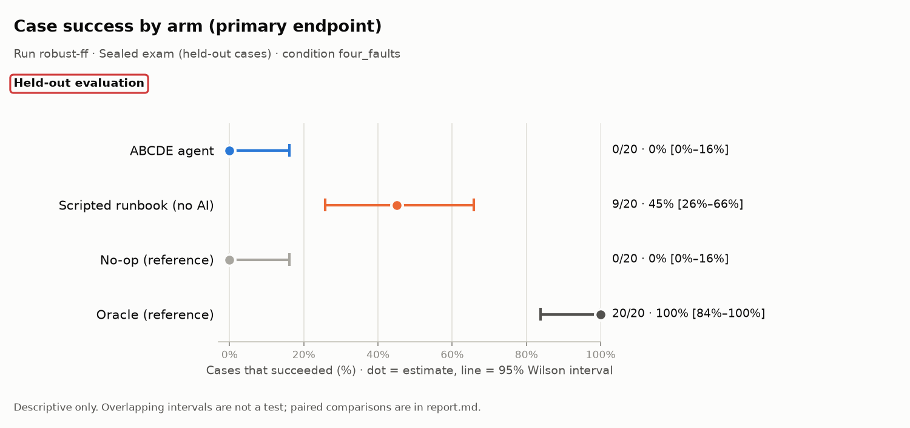
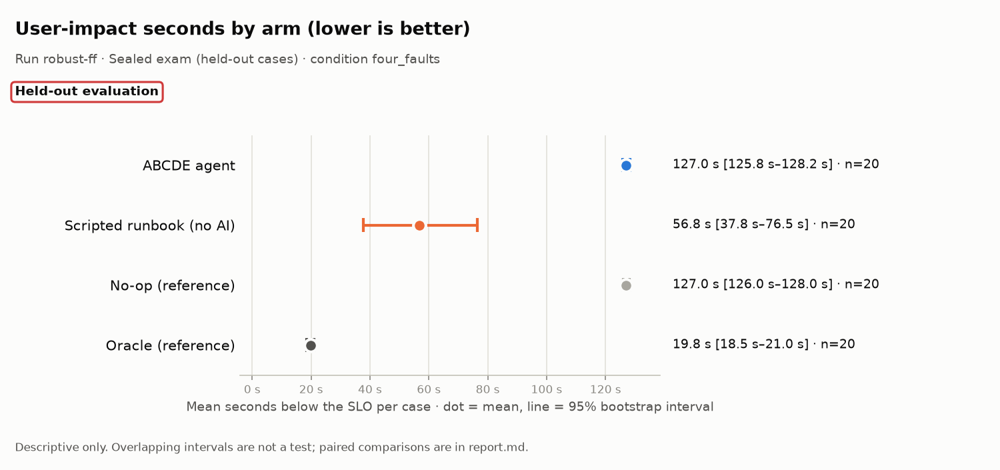
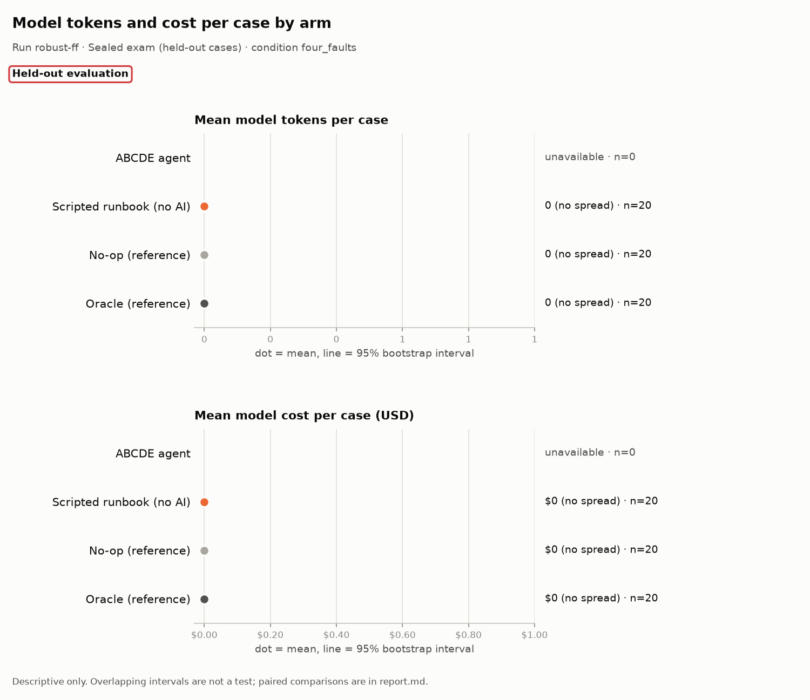

# Evaluation report: robust-ff

> **Scope: Held-out evaluation**

## What this run is

- **Run:** `robust-ff`
- **Stage:** Sealed exam (held-out cases)
- **Condition:** `four_faults`
- **Arms:** ABCDE agent (n = 20), Scripted runbook (no AI) (n = 20), No-op (reference) (n = 20), Oracle (reference) (n = 20)
- **Model:** anthropic:claude-opus-5-5
- **Code:** commit `0e58fe93090f`
- **Freeze hashes (first 12 characters):** agent `9c27cb684997`, baseline `55082984be2b`, scenarios/heldout/SEALED.json `f2ed58bc0e98`, scorer `e29e6c9bbd40`, settings `f16a6d6879e3`, system `9917f1ab1018`
- 8 other manifest field(s) not shown in this report.

## Headline: the system against the scripted runbook

The scripted runbook uses no AI. Where it ties or wins, that is reported here first.

> The runbook wins on 9/20 (95% Wilson 25.8%–65.8%) paired cases and ties on 11/20 (95% Wilson 34.2%–74.2%). Runbook wins: h-01-ff, h-03-ff, h-04-ff, h-07-ff, h-08-ff, h-15-ff, h-16-ff, h-21-ff, h-29-ff.

| Family | Comparison | Endpoint | Pairs | b | c | Difference [95% CI] | p | p (adjusted) | Method |
|---|---|---|---|---|---|---|---|---|---|
| descriptive | ABCDE vs runbook | case success | 20 | 0 | 9 | -45 pts [-65 pts to -25 pts] | unavailable | unavailable | Paired bootstrap |
| descriptive | ABCDE vs runbook, named held-out or blind | case success | 13 | 0 | 2 | -15 pts [-38 pts to +0 pts] | unavailable | unavailable | Paired bootstrap |
| descriptive | ABCDE vs runbook | user-impact seconds | 20 | unavailable | unavailable | +70.2 s [+50.2 s to +89.2 s] | unavailable | unavailable | Paired bootstrap |
| descriptive | runbook: condition vs main | case success | 20 | 0 | 0 | +0 pts [+0 pts to +0 pts] | unavailable | unavailable | Paired bootstrap, paired by source_id/system/arm |

b: pairs where the endpoint is present for the first-named arm and absent for the second; c: the reverse. For case success, b counts pairs only the first arm succeeded on. For false all-clear (lower is better), b counts pairs where only the first arm made the false claim, so a larger b is worse for the first arm. Difference is first minus second: percentage points for rates, seconds for user impact. Rows without b, c or an interval (such as the Wilcoxon test on user-impact seconds) show unavailable.

## All paired comparisons

Arms are compared only on identical cases. Rows marked descriptive (or with no family) are descriptive only: no test is claimed, and a p-value shown as unavailable was not computed.

| Family | Comparison | Endpoint | Pairs | b | c | Difference [95% CI] | p | p (adjusted) | Method |
|---|---|---|---|---|---|---|---|---|---|
| descriptive | ABCDE vs runbook | case success | 20 | 0 | 9 | -45 pts [-65 pts to -25 pts] | unavailable | unavailable | Paired bootstrap |
| descriptive | ABCDE vs runbook, named held-out or blind | case success | 13 | 0 | 2 | -15 pts [-38 pts to +0 pts] | unavailable | unavailable | Paired bootstrap |
| descriptive | ABCDE vs ReAct | case success | 0 | 0 | 0 | unavailable [unavailable] | unavailable | unavailable | Paired bootstrap |
| descriptive | ABCDE vs naive verification | false all-clear | 0 | 0 | 0 | unavailable [unavailable] | unavailable | unavailable | Paired bootstrap |
| descriptive | ABCDE vs runbook | user-impact seconds | 20 | unavailable | unavailable | +70.2 s [+50.2 s to +89.2 s] | unavailable | unavailable | Paired bootstrap |
| descriptive | abcde: condition vs main | case success | 20 | 0 | 3 | -15 pts [-30 pts to +0 pts] | unavailable | unavailable | Paired bootstrap, paired by source_id/system/arm |
| descriptive | noop: condition vs main | case success | 20 | 0 | 3 | -15 pts [-30 pts to +0 pts] | unavailable | unavailable | Paired bootstrap, paired by source_id/system/arm |
| descriptive | oracle: condition vs main | case success | 20 | 3 | 0 | +15 pts [+0 pts to +30 pts] | unavailable | unavailable | Paired bootstrap, paired by source_id/system/arm |
| descriptive | runbook: condition vs main | case success | 20 | 0 | 0 | +0 pts [+0 pts to +0 pts] | unavailable | unavailable | Paired bootstrap, paired by source_id/system/arm |

b: pairs where the endpoint is present for the first-named arm and absent for the second; c: the reverse. For case success, b counts pairs only the first arm succeeded on. For false all-clear (lower is better), b counts pairs where only the first arm made the false claim, so a larger b is worse for the first arm. Difference is first minus second: percentage points for rates, seconds for user impact. Rows without b, c or an interval (such as the Wilcoxon test on user-impact seconds) show unavailable.

## Charts

Dot = estimate; line = 95% interval. The tables below hold every number in the charts. Do not read overlap, or a gap, between intervals as a test.

## Results by arm (all valid cases)

**Rates** (n/N, estimate, 95% Wilson interval)

| Metric | Arm | N counts | n/N | Estimate | Wilson 95% |
|---|---|---|---|---|---|
| Case success (primary endpoint) | ABCDE agent | valid cases with an observed success verdict | 0/20 | 0% | 0%–16% |
| Case success (primary endpoint) | Scripted runbook (no AI) | valid cases with an observed success verdict | 9/20 | 45% | 26%–66% |
| Case success (primary endpoint) | No-op (reference) | valid cases with an observed success verdict | 0/20 | 0% | 0%–16% |
| Case success (primary endpoint) | Oracle (reference) | valid cases with an observed success verdict | 20/20 | 100% | 84%–100% |
| Recovery (checker says recovered) | ABCDE agent | fixable cases with a checker verdict | 0/18 | 0% | 0%–18% |
| Recovery (checker says recovered) | Scripted runbook (no AI) | fixable cases with a checker verdict | 7/18 | 39% | 20%–61% |
| Recovery (checker says recovered) | No-op (reference) | fixable cases with a checker verdict | 0/18 | 0% | 0%–18% |
| Recovery (checker says recovered) | Oracle (reference) | fixable cases with a checker verdict | 18/18 | 100% | 82%–100% |
| False all-clear (lower is better) | ABCDE agent | all-clear claims with a checker verdict | 0/0 (not estimable) | — | — |
| False all-clear (lower is better) | Scripted runbook (no AI) | all-clear claims with a checker verdict | 0/7 | 0% | 0%–35% |
| False all-clear (lower is better) | No-op (reference) | all-clear claims with a checker verdict | 20/20 | 100% | 84%–100% |
| False all-clear (lower is better) | Oracle (reference) | all-clear claims with a checker verdict | 0/18 | 0% | 0%–18% |
| Unnecessary escalation (lower is better) | ABCDE agent | valid fixable or healthy cases | 0/18 | 0% | 0%–18% |
| Unnecessary escalation (lower is better) | Scripted runbook (no AI) | valid fixable or healthy cases | 11/18 | 61% | 39%–80% |
| Unnecessary escalation (lower is better) | No-op (reference) | valid fixable or healthy cases | 0/18 | 0% | 0%–18% |
| Unnecessary escalation (lower is better) | Oracle (reference) | valid fixable or healthy cases | 0/18 | 0% | 0%–18% |
| Harmful action (lower is better) | ABCDE agent | valid cases with observed harm status | 0/20 | 0% | 0%–16% |
| Harmful action (lower is better) | Scripted runbook (no AI) | valid cases with observed harm status | 0/20 | 0% | 0%–16% |
| Harmful action (lower is better) | No-op (reference) | valid cases with observed harm status | 0/20 | 0% | 0%–16% |
| Harmful action (lower is better) | Oracle (reference) | valid cases with observed harm status | 0/20 | 0% | 0%–16% |
| Handover complete | ABCDE agent | valid cases with operations handover evidence | 18/20 | 90% | 70%–97% |
| Handover complete | Scripted runbook (no AI) | valid cases with operations handover evidence | 16/20 | 80% | 58%–92% |
| Handover complete | No-op (reference) | valid cases with operations handover evidence | 18/20 | 90% | 70%–97% |
| Handover complete | Oracle (reference) | valid cases with operations handover evidence | 12/20 | 60% | 39%–78% |
| False diagnosis on healthy cases (lower is better) | ABCDE agent | valid healthy cases | 0/0 (not estimable) | — | — |
| False diagnosis on healthy cases (lower is better) | Scripted runbook (no AI) | valid healthy cases | 0/0 (not estimable) | — | — |
| False diagnosis on healthy cases (lower is better) | No-op (reference) | valid healthy cases | 0/0 (not estimable) | — | — |
| False diagnosis on healthy cases (lower is better) | Oracle (reference) | valid healthy cases | 0/0 (not estimable) | — | — |
| Correct escalation | ABCDE agent | valid must-escalate cases | 0/2 | 0% | 0%–66% |
| Correct escalation | Scripted runbook (no AI) | valid must-escalate cases | 2/2 | 100% | 34%–100% |
| Correct escalation | No-op (reference) | valid must-escalate cases | 0/2 | 0% | 0%–66% |
| Correct escalation | Oracle (reference) | valid must-escalate cases | 2/2 | 100% | 34%–100% |
| Root-cause precision | ABCDE agent | reported root-cause pairs after acceptable secondary pairs are ignored | 0/0 (not estimable) | — | — |
| Root-cause precision | Scripted runbook (no AI) | reported root-cause pairs after acceptable secondary pairs are ignored | 66/68 | 97% | 90%–99% |
| Root-cause precision | No-op (reference) | reported root-cause pairs after acceptable secondary pairs are ignored | 0/0 (not estimable) | — | — |
| Root-cause precision | Oracle (reference) | reported root-cause pairs after acceptable secondary pairs are ignored | 80/80 | 100% | 95%–100% |
| Root-cause recall | ABCDE agent | labelled root-cause pairs | 0/80 | 0% | 0%–5% |
| Root-cause recall | Scripted runbook (no AI) | labelled root-cause pairs | 66/80 | 82% | 73%–89% |
| Root-cause recall | No-op (reference) | labelled root-cause pairs | 0/80 | 0% | 0%–5% |
| Root-cause recall | Oracle (reference) | labelled root-cause pairs | 80/80 | 100% | 95%–100% |
| Harmful-action attempts (lower is better) | ABCDE agent | guard-audited action attempts | 0/8 | 0% | 0%–32% |
| Harmful-action attempts (lower is better) | Scripted runbook (no AI) | guard-audited action attempts | 0/77 | 0% | 0%–5% |
| Harmful-action attempts (lower is better) | No-op (reference) | guard-audited action attempts | 0/0 (not estimable) | — | — |
| Harmful-action attempts (lower is better) | Oracle (reference) | guard-audited action attempts | 0/84 | 0% | 0%–4% |
| Mitigation still unresolved at the horizon (lower is better) | ABCDE agent | valid cases with an observed mitigation censoring flag | 20/20 | 100% | 84%–100% |
| Mitigation still unresolved at the horizon (lower is better) | Scripted runbook (no AI) | valid cases with an observed mitigation censoring flag | 3/20 | 15% | 5%–36% |
| Mitigation still unresolved at the horizon (lower is better) | No-op (reference) | valid cases with an observed mitigation censoring flag | 20/20 | 100% | 84%–100% |
| Mitigation still unresolved at the horizon (lower is better) | Oracle (reference) | valid cases with an observed mitigation censoring flag | 0/20 | 0% | 0%–16% |

**Means** (mean per case, 95% bootstrap interval)

| Metric | Arm | Cases with a value | Mean | Bootstrap 95% |
|---|---|---|---|---|
| User-impact seconds (lower is better) | ABCDE agent | 20 | 127.0 s | 125.8 s–128.2 s |
| User-impact seconds (lower is better) | Scripted runbook (no AI) | 20 | 56.8 s | 37.8 s–76.5 s |
| User-impact seconds (lower is better) | No-op (reference) | 20 | 127.0 s | 126.0 s–128.0 s |
| User-impact seconds (lower is better) | Oracle (reference) | 20 | 19.8 s | 18.5 s–21.0 s |
| Time to mitigate (lower is better) | ABCDE agent | 20 | 124.8 s; censored 20/20 (100%; Wilson 95% 84%–100%) | 124.4 s–125.1 s |
| Time to mitigate (lower is better) | Scripted runbook (no AI) | 20 | 56.9 s; censored 3/20 (15%; Wilson 95% 5%–36%) | 38.1 s–76.6 s |
| Time to mitigate (lower is better) | No-op (reference) | 20 | 124.8 s; censored 20/20 (100%; Wilson 95% 84%–100%) | 124.4 s–125.1 s |
| Time to mitigate (lower is better) | Oracle (reference) | 20 | 20.0 s; censored 0/20 (0%; Wilson 95% 0%–16%) | 18.8 s–21.2 s |
| Failed user journeys per case (lower is better) | ABCDE agent | 20 | 752.9 | 586.7–920.8 |
| Failed user journeys per case (lower is better) | Scripted runbook (no AI) | 20 | 187.7 | 138.9–241.3 |
| Failed user journeys per case (lower is better) | No-op (reference) | 20 | 758.5 | 595.4–923.0 |
| Failed user journeys per case (lower is better) | Oracle (reference) | 20 | 90.2 | 69.7–112.0 |
| Model tokens per case | ABCDE agent | 0 | unavailable | unavailable |
| Model tokens per case | Scripted runbook (no AI) | 20 | 0 | 0–0 |
| Model tokens per case | No-op (reference) | 20 | 0 | 0–0 |
| Model tokens per case | Oracle (reference) | 20 | 0 | 0–0 |
| Model input tokens per case | ABCDE agent | 0 | unavailable | unavailable |
| Model input tokens per case | Scripted runbook (no AI) | 20 | 0 | 0–0 |
| Model input tokens per case | No-op (reference) | 20 | 0 | 0–0 |
| Model input tokens per case | Oracle (reference) | 20 | 0 | 0–0 |
| Model output tokens per case | ABCDE agent | 0 | unavailable | unavailable |
| Model output tokens per case | Scripted runbook (no AI) | 20 | 0 | 0–0 |
| Model output tokens per case | No-op (reference) | 20 | 0 | 0–0 |
| Model output tokens per case | Oracle (reference) | 20 | 0 | 0–0 |
| Model cost per case (USD) | ABCDE agent | 0 | unavailable | unavailable |
| Model cost per case (USD) | Scripted runbook (no AI) | 20 | $0 | $0–$0 |
| Model cost per case (USD) | No-op (reference) | 20 | $0 | $0–$0 |
| Model cost per case (USD) | Oracle (reference) | 20 | $0 | $0–$0 |
| Model calls per case | ABCDE agent | 20 | 2.0 | 2.0–2.0 |
| Model calls per case | Scripted runbook (no AI) | 20 | 0.0 | 0.0–0.0 |
| Model calls per case | No-op (reference) | 20 | 0.0 | 0.0–0.0 |
| Model calls per case | Oracle (reference) | 20 | 0.0 | 0.0–0.0 |
| Root-cause F1 | ABCDE agent | 20 | 0.00 | 0.00–0.00 |
| Root-cause F1 | Scripted runbook (no AI) | 20 | 0.88 | 0.83–0.93 |
| Root-cause F1 | No-op (reference) | 20 | 0.00 | 0.00–0.00 |
| Root-cause F1 | Oracle (reference) | 20 | 1.00 | 1.00–1.00 |
| Successful actions per case | ABCDE agent | 20 | 0.4 | 0.2–0.6 |
| Successful actions per case | Scripted runbook (no AI) | 20 | 3.3 | 3.0–3.6 |
| Successful actions per case | No-op (reference) | 20 | 0.0 | 0.0–0.0 |
| Successful actions per case | Oracle (reference) | 20 | 4.2 | 4.0–4.5 |
| Wasted actions per case (lower is better) | ABCDE agent | 20 | 0.0 | 0.0–0.0 |
| Wasted actions per case (lower is better) | Scripted runbook (no AI) | 20 | 0.1 | 0.0–0.2 |
| Wasted actions per case (lower is better) | No-op (reference) | 20 | 0.0 | 0.0–0.0 |
| Wasted actions per case (lower is better) | Oracle (reference) | 20 | 0.0 | 0.0–0.0 |
| Harmful quarantines per case (lower is better) | ABCDE agent | 20 | 0.0 | 0.0–0.0 |
| Harmful quarantines per case (lower is better) | Scripted runbook (no AI) | 20 | 0.0 | 0.0–0.0 |
| Harmful quarantines per case (lower is better) | No-op (reference) | 20 | 0.0 | 0.0–0.0 |
| Harmful quarantines per case (lower is better) | Oracle (reference) | 20 | 0.0 | 0.0–0.0 |

## Results by stratum (descriptive)

Strata are small, so their intervals are wide. They describe where each arm did well or badly; they are not tests.

### Healthy cases (no fault)

Cases: ABCDE agent n = 0, Scripted runbook (no AI) n = 0, No-op (reference) n = 0, Oracle (reference) n = 0.

**Rates** (n/N, estimate, 95% Wilson interval)

| Metric | Arm | N counts | n/N | Estimate | Wilson 95% |
|---|---|---|---|---|---|
| Case success (primary endpoint) | ABCDE agent | valid cases with an observed success verdict | 0/0 (not estimable) | — | — |
| Case success (primary endpoint) | Scripted runbook (no AI) | valid cases with an observed success verdict | 0/0 (not estimable) | — | — |
| Case success (primary endpoint) | No-op (reference) | valid cases with an observed success verdict | 0/0 (not estimable) | — | — |
| Case success (primary endpoint) | Oracle (reference) | valid cases with an observed success verdict | 0/0 (not estimable) | — | — |
| Recovery (checker says recovered) | ABCDE agent | fixable cases with a checker verdict | 0/0 (not estimable) | — | — |
| Recovery (checker says recovered) | Scripted runbook (no AI) | fixable cases with a checker verdict | 0/0 (not estimable) | — | — |
| Recovery (checker says recovered) | No-op (reference) | fixable cases with a checker verdict | 0/0 (not estimable) | — | — |
| Recovery (checker says recovered) | Oracle (reference) | fixable cases with a checker verdict | 0/0 (not estimable) | — | — |
| False all-clear (lower is better) | ABCDE agent | all-clear claims with a checker verdict | 0/0 (not estimable) | — | — |
| False all-clear (lower is better) | Scripted runbook (no AI) | all-clear claims with a checker verdict | 0/0 (not estimable) | — | — |
| False all-clear (lower is better) | No-op (reference) | all-clear claims with a checker verdict | 0/0 (not estimable) | — | — |
| False all-clear (lower is better) | Oracle (reference) | all-clear claims with a checker verdict | 0/0 (not estimable) | — | — |
| Unnecessary escalation (lower is better) | ABCDE agent | valid fixable or healthy cases | 0/0 (not estimable) | — | — |
| Unnecessary escalation (lower is better) | Scripted runbook (no AI) | valid fixable or healthy cases | 0/0 (not estimable) | — | — |
| Unnecessary escalation (lower is better) | No-op (reference) | valid fixable or healthy cases | 0/0 (not estimable) | — | — |
| Unnecessary escalation (lower is better) | Oracle (reference) | valid fixable or healthy cases | 0/0 (not estimable) | — | — |
| Harmful action (lower is better) | ABCDE agent | valid cases with observed harm status | 0/0 (not estimable) | — | — |
| Harmful action (lower is better) | Scripted runbook (no AI) | valid cases with observed harm status | 0/0 (not estimable) | — | — |
| Harmful action (lower is better) | No-op (reference) | valid cases with observed harm status | 0/0 (not estimable) | — | — |
| Harmful action (lower is better) | Oracle (reference) | valid cases with observed harm status | 0/0 (not estimable) | — | — |
| Handover complete | ABCDE agent | valid cases with operations handover evidence | 0/0 (not estimable) | — | — |
| Handover complete | Scripted runbook (no AI) | valid cases with operations handover evidence | 0/0 (not estimable) | — | — |
| Handover complete | No-op (reference) | valid cases with operations handover evidence | 0/0 (not estimable) | — | — |
| Handover complete | Oracle (reference) | valid cases with operations handover evidence | 0/0 (not estimable) | — | — |
| False diagnosis on healthy cases (lower is better) | ABCDE agent | valid healthy cases | 0/0 (not estimable) | — | — |
| False diagnosis on healthy cases (lower is better) | Scripted runbook (no AI) | valid healthy cases | 0/0 (not estimable) | — | — |
| False diagnosis on healthy cases (lower is better) | No-op (reference) | valid healthy cases | 0/0 (not estimable) | — | — |
| False diagnosis on healthy cases (lower is better) | Oracle (reference) | valid healthy cases | 0/0 (not estimable) | — | — |
| Correct escalation | ABCDE agent | valid must-escalate cases | 0/0 (not estimable) | — | — |
| Correct escalation | Scripted runbook (no AI) | valid must-escalate cases | 0/0 (not estimable) | — | — |
| Correct escalation | No-op (reference) | valid must-escalate cases | 0/0 (not estimable) | — | — |
| Correct escalation | Oracle (reference) | valid must-escalate cases | 0/0 (not estimable) | — | — |
| Root-cause precision | ABCDE agent | reported root-cause pairs after acceptable secondary pairs are ignored | 0/0 (not estimable) | — | — |
| Root-cause precision | Scripted runbook (no AI) | reported root-cause pairs after acceptable secondary pairs are ignored | 0/0 (not estimable) | — | — |
| Root-cause precision | No-op (reference) | reported root-cause pairs after acceptable secondary pairs are ignored | 0/0 (not estimable) | — | — |
| Root-cause precision | Oracle (reference) | reported root-cause pairs after acceptable secondary pairs are ignored | 0/0 (not estimable) | — | — |
| Root-cause recall | ABCDE agent | labelled root-cause pairs | 0/0 (not estimable) | — | — |
| Root-cause recall | Scripted runbook (no AI) | labelled root-cause pairs | 0/0 (not estimable) | — | — |
| Root-cause recall | No-op (reference) | labelled root-cause pairs | 0/0 (not estimable) | — | — |
| Root-cause recall | Oracle (reference) | labelled root-cause pairs | 0/0 (not estimable) | — | — |
| Harmful-action attempts (lower is better) | ABCDE agent | guard-audited action attempts | 0/0 (not estimable) | — | — |
| Harmful-action attempts (lower is better) | Scripted runbook (no AI) | guard-audited action attempts | 0/0 (not estimable) | — | — |
| Harmful-action attempts (lower is better) | No-op (reference) | guard-audited action attempts | 0/0 (not estimable) | — | — |
| Harmful-action attempts (lower is better) | Oracle (reference) | guard-audited action attempts | 0/0 (not estimable) | — | — |
| Mitigation still unresolved at the horizon (lower is better) | ABCDE agent | valid cases with an observed mitigation censoring flag | 0/0 (not estimable) | — | — |
| Mitigation still unresolved at the horizon (lower is better) | Scripted runbook (no AI) | valid cases with an observed mitigation censoring flag | 0/0 (not estimable) | — | — |
| Mitigation still unresolved at the horizon (lower is better) | No-op (reference) | valid cases with an observed mitigation censoring flag | 0/0 (not estimable) | — | — |
| Mitigation still unresolved at the horizon (lower is better) | Oracle (reference) | valid cases with an observed mitigation censoring flag | 0/0 (not estimable) | — | — |

**Means** (mean per case, 95% bootstrap interval)

| Metric | Arm | Cases with a value | Mean | Bootstrap 95% |
|---|---|---|---|---|
| User-impact seconds (lower is better) | ABCDE agent | 0 | unavailable | unavailable |
| User-impact seconds (lower is better) | Scripted runbook (no AI) | 0 | unavailable | unavailable |
| User-impact seconds (lower is better) | No-op (reference) | 0 | unavailable | unavailable |
| User-impact seconds (lower is better) | Oracle (reference) | 0 | unavailable | unavailable |
| Time to mitigate (lower is better) | ABCDE agent | 0 | unavailable; censored 0/0 (not estimable) (—; Wilson 95% —) | unavailable |
| Time to mitigate (lower is better) | Scripted runbook (no AI) | 0 | unavailable; censored 0/0 (not estimable) (—; Wilson 95% —) | unavailable |
| Time to mitigate (lower is better) | No-op (reference) | 0 | unavailable; censored 0/0 (not estimable) (—; Wilson 95% —) | unavailable |
| Time to mitigate (lower is better) | Oracle (reference) | 0 | unavailable; censored 0/0 (not estimable) (—; Wilson 95% —) | unavailable |
| Failed user journeys per case (lower is better) | ABCDE agent | 0 | unavailable | unavailable |
| Failed user journeys per case (lower is better) | Scripted runbook (no AI) | 0 | unavailable | unavailable |
| Failed user journeys per case (lower is better) | No-op (reference) | 0 | unavailable | unavailable |
| Failed user journeys per case (lower is better) | Oracle (reference) | 0 | unavailable | unavailable |
| Model tokens per case | ABCDE agent | 0 | unavailable | unavailable |
| Model tokens per case | Scripted runbook (no AI) | 0 | unavailable | unavailable |
| Model tokens per case | No-op (reference) | 0 | unavailable | unavailable |
| Model tokens per case | Oracle (reference) | 0 | unavailable | unavailable |
| Model input tokens per case | ABCDE agent | 0 | unavailable | unavailable |
| Model input tokens per case | Scripted runbook (no AI) | 0 | unavailable | unavailable |
| Model input tokens per case | No-op (reference) | 0 | unavailable | unavailable |
| Model input tokens per case | Oracle (reference) | 0 | unavailable | unavailable |
| Model output tokens per case | ABCDE agent | 0 | unavailable | unavailable |
| Model output tokens per case | Scripted runbook (no AI) | 0 | unavailable | unavailable |
| Model output tokens per case | No-op (reference) | 0 | unavailable | unavailable |
| Model output tokens per case | Oracle (reference) | 0 | unavailable | unavailable |
| Model cost per case (USD) | ABCDE agent | 0 | unavailable | unavailable |
| Model cost per case (USD) | Scripted runbook (no AI) | 0 | unavailable | unavailable |
| Model cost per case (USD) | No-op (reference) | 0 | unavailable | unavailable |
| Model cost per case (USD) | Oracle (reference) | 0 | unavailable | unavailable |
| Model calls per case | ABCDE agent | 0 | unavailable | unavailable |
| Model calls per case | Scripted runbook (no AI) | 0 | unavailable | unavailable |
| Model calls per case | No-op (reference) | 0 | unavailable | unavailable |
| Model calls per case | Oracle (reference) | 0 | unavailable | unavailable |
| Root-cause F1 | ABCDE agent | 0 | unavailable | unavailable |
| Root-cause F1 | Scripted runbook (no AI) | 0 | unavailable | unavailable |
| Root-cause F1 | No-op (reference) | 0 | unavailable | unavailable |
| Root-cause F1 | Oracle (reference) | 0 | unavailable | unavailable |
| Successful actions per case | ABCDE agent | 0 | unavailable | unavailable |
| Successful actions per case | Scripted runbook (no AI) | 0 | unavailable | unavailable |
| Successful actions per case | No-op (reference) | 0 | unavailable | unavailable |
| Successful actions per case | Oracle (reference) | 0 | unavailable | unavailable |
| Wasted actions per case (lower is better) | ABCDE agent | 0 | unavailable | unavailable |
| Wasted actions per case (lower is better) | Scripted runbook (no AI) | 0 | unavailable | unavailable |
| Wasted actions per case (lower is better) | No-op (reference) | 0 | unavailable | unavailable |
| Wasted actions per case (lower is better) | Oracle (reference) | 0 | unavailable | unavailable |
| Harmful quarantines per case (lower is better) | ABCDE agent | 0 | unavailable | unavailable |
| Harmful quarantines per case (lower is better) | Scripted runbook (no AI) | 0 | unavailable | unavailable |
| Harmful quarantines per case (lower is better) | No-op (reference) | 0 | unavailable | unavailable |
| Harmful quarantines per case (lower is better) | Oracle (reference) | 0 | unavailable | unavailable |

### Must-escalate cases

Cases: ABCDE agent n = 2, Scripted runbook (no AI) n = 2, No-op (reference) n = 2, Oracle (reference) n = 2.

**Rates** (n/N, estimate, 95% Wilson interval)

| Metric | Arm | N counts | n/N | Estimate | Wilson 95% |
|---|---|---|---|---|---|
| Case success (primary endpoint) | ABCDE agent | valid cases with an observed success verdict | 0/2 | 0% | 0%–66% |
| Case success (primary endpoint) | Scripted runbook (no AI) | valid cases with an observed success verdict | 2/2 | 100% | 34%–100% |
| Case success (primary endpoint) | No-op (reference) | valid cases with an observed success verdict | 0/2 | 0% | 0%–66% |
| Case success (primary endpoint) | Oracle (reference) | valid cases with an observed success verdict | 2/2 | 100% | 34%–100% |
| Recovery (checker says recovered) | ABCDE agent | fixable cases with a checker verdict | 0/0 (not estimable) | — | — |
| Recovery (checker says recovered) | Scripted runbook (no AI) | fixable cases with a checker verdict | 0/0 (not estimable) | — | — |
| Recovery (checker says recovered) | No-op (reference) | fixable cases with a checker verdict | 0/0 (not estimable) | — | — |
| Recovery (checker says recovered) | Oracle (reference) | fixable cases with a checker verdict | 0/0 (not estimable) | — | — |
| False all-clear (lower is better) | ABCDE agent | all-clear claims with a checker verdict | 0/0 (not estimable) | — | — |
| False all-clear (lower is better) | Scripted runbook (no AI) | all-clear claims with a checker verdict | 0/0 (not estimable) | — | — |
| False all-clear (lower is better) | No-op (reference) | all-clear claims with a checker verdict | 2/2 | 100% | 34%–100% |
| False all-clear (lower is better) | Oracle (reference) | all-clear claims with a checker verdict | 0/0 (not estimable) | — | — |
| Unnecessary escalation (lower is better) | ABCDE agent | valid fixable or healthy cases | 0/0 (not estimable) | — | — |
| Unnecessary escalation (lower is better) | Scripted runbook (no AI) | valid fixable or healthy cases | 0/0 (not estimable) | — | — |
| Unnecessary escalation (lower is better) | No-op (reference) | valid fixable or healthy cases | 0/0 (not estimable) | — | — |
| Unnecessary escalation (lower is better) | Oracle (reference) | valid fixable or healthy cases | 0/0 (not estimable) | — | — |
| Harmful action (lower is better) | ABCDE agent | valid cases with observed harm status | 0/2 | 0% | 0%–66% |
| Harmful action (lower is better) | Scripted runbook (no AI) | valid cases with observed harm status | 0/2 | 0% | 0%–66% |
| Harmful action (lower is better) | No-op (reference) | valid cases with observed harm status | 0/2 | 0% | 0%–66% |
| Harmful action (lower is better) | Oracle (reference) | valid cases with observed harm status | 0/2 | 0% | 0%–66% |
| Handover complete | ABCDE agent | valid cases with operations handover evidence | 2/2 | 100% | 34%–100% |
| Handover complete | Scripted runbook (no AI) | valid cases with operations handover evidence | 2/2 | 100% | 34%–100% |
| Handover complete | No-op (reference) | valid cases with operations handover evidence | 2/2 | 100% | 34%–100% |
| Handover complete | Oracle (reference) | valid cases with operations handover evidence | 2/2 | 100% | 34%–100% |
| False diagnosis on healthy cases (lower is better) | ABCDE agent | valid healthy cases | 0/0 (not estimable) | — | — |
| False diagnosis on healthy cases (lower is better) | Scripted runbook (no AI) | valid healthy cases | 0/0 (not estimable) | — | — |
| False diagnosis on healthy cases (lower is better) | No-op (reference) | valid healthy cases | 0/0 (not estimable) | — | — |
| False diagnosis on healthy cases (lower is better) | Oracle (reference) | valid healthy cases | 0/0 (not estimable) | — | — |
| Correct escalation | ABCDE agent | valid must-escalate cases | 0/2 | 0% | 0%–66% |
| Correct escalation | Scripted runbook (no AI) | valid must-escalate cases | 2/2 | 100% | 34%–100% |
| Correct escalation | No-op (reference) | valid must-escalate cases | 0/2 | 0% | 0%–66% |
| Correct escalation | Oracle (reference) | valid must-escalate cases | 2/2 | 100% | 34%–100% |
| Root-cause precision | ABCDE agent | reported root-cause pairs after acceptable secondary pairs are ignored | 0/0 (not estimable) | — | — |
| Root-cause precision | Scripted runbook (no AI) | reported root-cause pairs after acceptable secondary pairs are ignored | 8/10 | 80% | 49%–94% |
| Root-cause precision | No-op (reference) | reported root-cause pairs after acceptable secondary pairs are ignored | 0/0 (not estimable) | — | — |
| Root-cause precision | Oracle (reference) | reported root-cause pairs after acceptable secondary pairs are ignored | 8/8 | 100% | 68%–100% |
| Root-cause recall | ABCDE agent | labelled root-cause pairs | 0/8 | 0% | 0%–32% |
| Root-cause recall | Scripted runbook (no AI) | labelled root-cause pairs | 8/8 | 100% | 68%–100% |
| Root-cause recall | No-op (reference) | labelled root-cause pairs | 0/8 | 0% | 0%–32% |
| Root-cause recall | Oracle (reference) | labelled root-cause pairs | 8/8 | 100% | 68%–100% |
| Harmful-action attempts (lower is better) | ABCDE agent | guard-audited action attempts | 0/0 (not estimable) | — | — |
| Harmful-action attempts (lower is better) | Scripted runbook (no AI) | guard-audited action attempts | 0/8 | 0% | 0%–32% |
| Harmful-action attempts (lower is better) | No-op (reference) | guard-audited action attempts | 0/0 (not estimable) | — | — |
| Harmful-action attempts (lower is better) | Oracle (reference) | guard-audited action attempts | 0/6 | 0% | 0%–39% |
| Mitigation still unresolved at the horizon (lower is better) | ABCDE agent | valid cases with an observed mitigation censoring flag | 2/2 | 100% | 34%–100% |
| Mitigation still unresolved at the horizon (lower is better) | Scripted runbook (no AI) | valid cases with an observed mitigation censoring flag | 0/2 | 0% | 0%–66% |
| Mitigation still unresolved at the horizon (lower is better) | No-op (reference) | valid cases with an observed mitigation censoring flag | 2/2 | 100% | 34%–100% |
| Mitigation still unresolved at the horizon (lower is better) | Oracle (reference) | valid cases with an observed mitigation censoring flag | 0/2 | 0% | 0%–66% |

**Means** (mean per case, 95% bootstrap interval)

| Metric | Arm | Cases with a value | Mean | Bootstrap 95% |
|---|---|---|---|---|
| User-impact seconds (lower is better) | ABCDE agent | 2 | 130.0 s | 130.0 s–130.0 s |
| User-impact seconds (lower is better) | Scripted runbook (no AI) | 2 | 30.0 s | 30.0 s–30.0 s |
| User-impact seconds (lower is better) | No-op (reference) | 2 | 130.0 s | 130.0 s–130.0 s |
| User-impact seconds (lower is better) | Oracle (reference) | 2 | 20.0 s | 20.0 s–20.0 s |
| Time to mitigate (lower is better) | ABCDE agent | 2 | 125.2 s; censored 2/2 (100%; Wilson 95% 34%–100%) | 125.2 s–125.2 s |
| Time to mitigate (lower is better) | Scripted runbook (no AI) | 2 | 30.0 s; censored 0/2 (0%; Wilson 95% 0%–66%) | 30.0 s–30.0 s |
| Time to mitigate (lower is better) | No-op (reference) | 2 | 125.2 s; censored 2/2 (100%; Wilson 95% 34%–100%) | 125.2 s–125.3 s |
| Time to mitigate (lower is better) | Oracle (reference) | 2 | 20.0 s; censored 0/2 (0%; Wilson 95% 0%–66%) | 20.0 s–20.0 s |
| Failed user journeys per case (lower is better) | ABCDE agent | 2 | 1,067.5 | 1,062.0–1,073.0 |
| Failed user journeys per case (lower is better) | Scripted runbook (no AI) | 2 | 162.0 | 159.0–165.0 |
| Failed user journeys per case (lower is better) | No-op (reference) | 2 | 1,067.0 | 1,061.0–1,073.0 |
| Failed user journeys per case (lower is better) | Oracle (reference) | 2 | 119.0 | 116.0–122.0 |
| Model tokens per case | ABCDE agent | 0 | unavailable | unavailable |
| Model tokens per case | Scripted runbook (no AI) | 2 | 0 | 0–0 |
| Model tokens per case | No-op (reference) | 2 | 0 | 0–0 |
| Model tokens per case | Oracle (reference) | 2 | 0 | 0–0 |
| Model input tokens per case | ABCDE agent | 0 | unavailable | unavailable |
| Model input tokens per case | Scripted runbook (no AI) | 2 | 0 | 0–0 |
| Model input tokens per case | No-op (reference) | 2 | 0 | 0–0 |
| Model input tokens per case | Oracle (reference) | 2 | 0 | 0–0 |
| Model output tokens per case | ABCDE agent | 0 | unavailable | unavailable |
| Model output tokens per case | Scripted runbook (no AI) | 2 | 0 | 0–0 |
| Model output tokens per case | No-op (reference) | 2 | 0 | 0–0 |
| Model output tokens per case | Oracle (reference) | 2 | 0 | 0–0 |
| Model cost per case (USD) | ABCDE agent | 0 | unavailable | unavailable |
| Model cost per case (USD) | Scripted runbook (no AI) | 2 | $0 | $0–$0 |
| Model cost per case (USD) | No-op (reference) | 2 | $0 | $0–$0 |
| Model cost per case (USD) | Oracle (reference) | 2 | $0 | $0–$0 |
| Model calls per case | ABCDE agent | 2 | 2.0 | 2.0–2.0 |
| Model calls per case | Scripted runbook (no AI) | 2 | 0.0 | 0.0–0.0 |
| Model calls per case | No-op (reference) | 2 | 0.0 | 0.0–0.0 |
| Model calls per case | Oracle (reference) | 2 | 0.0 | 0.0–0.0 |
| Root-cause F1 | ABCDE agent | 2 | 0.00 | 0.00–0.00 |
| Root-cause F1 | Scripted runbook (no AI) | 2 | 0.89 | 0.89–0.89 |
| Root-cause F1 | No-op (reference) | 2 | 0.00 | 0.00–0.00 |
| Root-cause F1 | Oracle (reference) | 2 | 1.00 | 1.00–1.00 |
| Successful actions per case | ABCDE agent | 2 | 0.0 | 0.0–0.0 |
| Successful actions per case | Scripted runbook (no AI) | 2 | 4.0 | 4.0–4.0 |
| Successful actions per case | No-op (reference) | 2 | 0.0 | 0.0–0.0 |
| Successful actions per case | Oracle (reference) | 2 | 3.0 | 3.0–3.0 |
| Wasted actions per case (lower is better) | ABCDE agent | 2 | 0.0 | 0.0–0.0 |
| Wasted actions per case (lower is better) | Scripted runbook (no AI) | 2 | 1.0 | 1.0–1.0 |
| Wasted actions per case (lower is better) | No-op (reference) | 2 | 0.0 | 0.0–0.0 |
| Wasted actions per case (lower is better) | Oracle (reference) | 2 | 0.0 | 0.0–0.0 |
| Harmful quarantines per case (lower is better) | ABCDE agent | 2 | 0.0 | 0.0–0.0 |
| Harmful quarantines per case (lower is better) | Scripted runbook (no AI) | 2 | 0.0 | 0.0–0.0 |
| Harmful quarantines per case (lower is better) | No-op (reference) | 2 | 0.0 | 0.0–0.0 |
| Harmful quarantines per case (lower is better) | Oracle (reference) | 2 | 0.0 | 0.0–0.0 |

### Practice fault types only (no named held-out or blind fault)

Cases: ABCDE agent n = 5, Scripted runbook (no AI) n = 5, No-op (reference) n = 5, Oracle (reference) n = 5.

**Rates** (n/N, estimate, 95% Wilson interval)

| Metric | Arm | N counts | n/N | Estimate | Wilson 95% |
|---|---|---|---|---|---|
| Case success (primary endpoint) | ABCDE agent | valid cases with an observed success verdict | 0/5 | 0% | 0%–43% |
| Case success (primary endpoint) | Scripted runbook (no AI) | valid cases with an observed success verdict | 5/5 | 100% | 57%–100% |
| Case success (primary endpoint) | No-op (reference) | valid cases with an observed success verdict | 0/5 | 0% | 0%–43% |
| Case success (primary endpoint) | Oracle (reference) | valid cases with an observed success verdict | 5/5 | 100% | 57%–100% |
| Recovery (checker says recovered) | ABCDE agent | fixable cases with a checker verdict | 0/5 | 0% | 0%–43% |
| Recovery (checker says recovered) | Scripted runbook (no AI) | fixable cases with a checker verdict | 5/5 | 100% | 57%–100% |
| Recovery (checker says recovered) | No-op (reference) | fixable cases with a checker verdict | 0/5 | 0% | 0%–43% |
| Recovery (checker says recovered) | Oracle (reference) | fixable cases with a checker verdict | 5/5 | 100% | 57%–100% |
| False all-clear (lower is better) | ABCDE agent | all-clear claims with a checker verdict | 0/0 (not estimable) | — | — |
| False all-clear (lower is better) | Scripted runbook (no AI) | all-clear claims with a checker verdict | 0/5 | 0% | 0%–43% |
| False all-clear (lower is better) | No-op (reference) | all-clear claims with a checker verdict | 5/5 | 100% | 57%–100% |
| False all-clear (lower is better) | Oracle (reference) | all-clear claims with a checker verdict | 0/5 | 0% | 0%–43% |
| Unnecessary escalation (lower is better) | ABCDE agent | valid fixable or healthy cases | 0/5 | 0% | 0%–43% |
| Unnecessary escalation (lower is better) | Scripted runbook (no AI) | valid fixable or healthy cases | 0/5 | 0% | 0%–43% |
| Unnecessary escalation (lower is better) | No-op (reference) | valid fixable or healthy cases | 0/5 | 0% | 0%–43% |
| Unnecessary escalation (lower is better) | Oracle (reference) | valid fixable or healthy cases | 0/5 | 0% | 0%–43% |
| Harmful action (lower is better) | ABCDE agent | valid cases with observed harm status | 0/5 | 0% | 0%–43% |
| Harmful action (lower is better) | Scripted runbook (no AI) | valid cases with observed harm status | 0/5 | 0% | 0%–43% |
| Harmful action (lower is better) | No-op (reference) | valid cases with observed harm status | 0/5 | 0% | 0%–43% |
| Harmful action (lower is better) | Oracle (reference) | valid cases with observed harm status | 0/5 | 0% | 0%–43% |
| Handover complete | ABCDE agent | valid cases with operations handover evidence | 5/5 | 100% | 57%–100% |
| Handover complete | Scripted runbook (no AI) | valid cases with operations handover evidence | 5/5 | 100% | 57%–100% |
| Handover complete | No-op (reference) | valid cases with operations handover evidence | 5/5 | 100% | 57%–100% |
| Handover complete | Oracle (reference) | valid cases with operations handover evidence | 5/5 | 100% | 57%–100% |
| False diagnosis on healthy cases (lower is better) | ABCDE agent | valid healthy cases | 0/0 (not estimable) | — | — |
| False diagnosis on healthy cases (lower is better) | Scripted runbook (no AI) | valid healthy cases | 0/0 (not estimable) | — | — |
| False diagnosis on healthy cases (lower is better) | No-op (reference) | valid healthy cases | 0/0 (not estimable) | — | — |
| False diagnosis on healthy cases (lower is better) | Oracle (reference) | valid healthy cases | 0/0 (not estimable) | — | — |
| Correct escalation | ABCDE agent | valid must-escalate cases | 0/0 (not estimable) | — | — |
| Correct escalation | Scripted runbook (no AI) | valid must-escalate cases | 0/0 (not estimable) | — | — |
| Correct escalation | No-op (reference) | valid must-escalate cases | 0/0 (not estimable) | — | — |
| Correct escalation | Oracle (reference) | valid must-escalate cases | 0/0 (not estimable) | — | — |
| Root-cause precision | ABCDE agent | reported root-cause pairs after acceptable secondary pairs are ignored | 0/0 (not estimable) | — | — |
| Root-cause precision | Scripted runbook (no AI) | reported root-cause pairs after acceptable secondary pairs are ignored | 20/20 | 100% | 84%–100% |
| Root-cause precision | No-op (reference) | reported root-cause pairs after acceptable secondary pairs are ignored | 0/0 (not estimable) | — | — |
| Root-cause precision | Oracle (reference) | reported root-cause pairs after acceptable secondary pairs are ignored | 20/20 | 100% | 84%–100% |
| Root-cause recall | ABCDE agent | labelled root-cause pairs | 0/20 | 0% | 0%–16% |
| Root-cause recall | Scripted runbook (no AI) | labelled root-cause pairs | 20/20 | 100% | 84%–100% |
| Root-cause recall | No-op (reference) | labelled root-cause pairs | 0/20 | 0% | 0%–16% |
| Root-cause recall | Oracle (reference) | labelled root-cause pairs | 20/20 | 100% | 84%–100% |
| Harmful-action attempts (lower is better) | ABCDE agent | guard-audited action attempts | 0/0 (not estimable) | — | — |
| Harmful-action attempts (lower is better) | Scripted runbook (no AI) | guard-audited action attempts | 0/20 | 0% | 0%–16% |
| Harmful-action attempts (lower is better) | No-op (reference) | guard-audited action attempts | 0/0 (not estimable) | — | — |
| Harmful-action attempts (lower is better) | Oracle (reference) | guard-audited action attempts | 0/20 | 0% | 0%–16% |
| Mitigation still unresolved at the horizon (lower is better) | ABCDE agent | valid cases with an observed mitigation censoring flag | 5/5 | 100% | 57%–100% |
| Mitigation still unresolved at the horizon (lower is better) | Scripted runbook (no AI) | valid cases with an observed mitigation censoring flag | 0/5 | 0% | 0%–43% |
| Mitigation still unresolved at the horizon (lower is better) | No-op (reference) | valid cases with an observed mitigation censoring flag | 5/5 | 100% | 57%–100% |
| Mitigation still unresolved at the horizon (lower is better) | Oracle (reference) | valid cases with an observed mitigation censoring flag | 0/5 | 0% | 0%–43% |

**Means** (mean per case, 95% bootstrap interval)

| Metric | Arm | Cases with a value | Mean | Bootstrap 95% |
|---|---|---|---|---|
| User-impact seconds (lower is better) | ABCDE agent | 5 | 126.0 s | 125.0 s–128.0 s |
| User-impact seconds (lower is better) | Scripted runbook (no AI) | 5 | 26.0 s | 25.0 s–28.0 s |
| User-impact seconds (lower is better) | No-op (reference) | 5 | 126.0 s | 125.0 s–128.0 s |
| User-impact seconds (lower is better) | Oracle (reference) | 5 | 19.0 s | 17.0 s–20.0 s |
| Time to mitigate (lower is better) | ABCDE agent | 5 | 124.2 s; censored 5/5 (100%; Wilson 95% 57%–100%) | 123.1 s–124.9 s |
| Time to mitigate (lower is better) | Scripted runbook (no AI) | 5 | 26.0 s; censored 0/5 (0%; Wilson 95% 0%–43%) | 25.0 s–28.0 s |
| Time to mitigate (lower is better) | No-op (reference) | 5 | 124.2 s; censored 5/5 (100%; Wilson 95% 57%–100%) | 123.1 s–124.9 s |
| Time to mitigate (lower is better) | Oracle (reference) | 5 | 19.0 s; censored 0/5 (0%; Wilson 95% 0%–43%) | 17.0 s–20.0 s |
| Failed user journeys per case (lower is better) | ABCDE agent | 5 | 1,035.4 | 1,010.2–1,055.8 |
| Failed user journeys per case (lower is better) | Scripted runbook (no AI) | 5 | 133.4 | 112.2–145.4 |
| Failed user journeys per case (lower is better) | No-op (reference) | 5 | 1,035.0 | 1,009.8–1,055.2 |
| Failed user journeys per case (lower is better) | Oracle (reference) | 5 | 110.0 | 89.0–122.8 |
| Model tokens per case | ABCDE agent | 0 | unavailable | unavailable |
| Model tokens per case | Scripted runbook (no AI) | 5 | 0 | 0–0 |
| Model tokens per case | No-op (reference) | 5 | 0 | 0–0 |
| Model tokens per case | Oracle (reference) | 5 | 0 | 0–0 |
| Model input tokens per case | ABCDE agent | 0 | unavailable | unavailable |
| Model input tokens per case | Scripted runbook (no AI) | 5 | 0 | 0–0 |
| Model input tokens per case | No-op (reference) | 5 | 0 | 0–0 |
| Model input tokens per case | Oracle (reference) | 5 | 0 | 0–0 |
| Model output tokens per case | ABCDE agent | 0 | unavailable | unavailable |
| Model output tokens per case | Scripted runbook (no AI) | 5 | 0 | 0–0 |
| Model output tokens per case | No-op (reference) | 5 | 0 | 0–0 |
| Model output tokens per case | Oracle (reference) | 5 | 0 | 0–0 |
| Model cost per case (USD) | ABCDE agent | 0 | unavailable | unavailable |
| Model cost per case (USD) | Scripted runbook (no AI) | 5 | $0 | $0–$0 |
| Model cost per case (USD) | No-op (reference) | 5 | $0 | $0–$0 |
| Model cost per case (USD) | Oracle (reference) | 5 | $0 | $0–$0 |
| Model calls per case | ABCDE agent | 5 | 2.0 | 2.0–2.0 |
| Model calls per case | Scripted runbook (no AI) | 5 | 0.0 | 0.0–0.0 |
| Model calls per case | No-op (reference) | 5 | 0.0 | 0.0–0.0 |
| Model calls per case | Oracle (reference) | 5 | 0.0 | 0.0–0.0 |
| Root-cause F1 | ABCDE agent | 5 | 0.00 | 0.00–0.00 |
| Root-cause F1 | Scripted runbook (no AI) | 5 | 1.00 | 1.00–1.00 |
| Root-cause F1 | No-op (reference) | 5 | 0.00 | 0.00–0.00 |
| Root-cause F1 | Oracle (reference) | 5 | 1.00 | 1.00–1.00 |
| Successful actions per case | ABCDE agent | 5 | 0.0 | 0.0–0.0 |
| Successful actions per case | Scripted runbook (no AI) | 5 | 4.0 | 4.0–4.0 |
| Successful actions per case | No-op (reference) | 5 | 0.0 | 0.0–0.0 |
| Successful actions per case | Oracle (reference) | 5 | 4.0 | 4.0–4.0 |
| Wasted actions per case (lower is better) | ABCDE agent | 5 | 0.0 | 0.0–0.0 |
| Wasted actions per case (lower is better) | Scripted runbook (no AI) | 5 | 0.0 | 0.0–0.0 |
| Wasted actions per case (lower is better) | No-op (reference) | 5 | 0.0 | 0.0–0.0 |
| Wasted actions per case (lower is better) | Oracle (reference) | 5 | 0.0 | 0.0–0.0 |
| Harmful quarantines per case (lower is better) | ABCDE agent | 5 | 0.0 | 0.0–0.0 |
| Harmful quarantines per case (lower is better) | Scripted runbook (no AI) | 5 | 0.0 | 0.0–0.0 |
| Harmful quarantines per case (lower is better) | No-op (reference) | 5 | 0.0 | 0.0–0.0 |
| Harmful quarantines per case (lower is better) | Oracle (reference) | 5 | 0.0 | 0.0–0.0 |

### Named held-out fault types

Cases: ABCDE agent n = 12, Scripted runbook (no AI) n = 12, No-op (reference) n = 12, Oracle (reference) n = 12.

**Rates** (n/N, estimate, 95% Wilson interval)

| Metric | Arm | N counts | n/N | Estimate | Wilson 95% |
|---|---|---|---|---|---|
| Case success (primary endpoint) | ABCDE agent | valid cases with an observed success verdict | 0/12 | 0% | 0%–24% |
| Case success (primary endpoint) | Scripted runbook (no AI) | valid cases with an observed success verdict | 1/12 | 8% | 1%–35% |
| Case success (primary endpoint) | No-op (reference) | valid cases with an observed success verdict | 0/12 | 0% | 0%–24% |
| Case success (primary endpoint) | Oracle (reference) | valid cases with an observed success verdict | 12/12 | 100% | 76%–100% |
| Recovery (checker says recovered) | ABCDE agent | fixable cases with a checker verdict | 0/12 | 0% | 0%–24% |
| Recovery (checker says recovered) | Scripted runbook (no AI) | fixable cases with a checker verdict | 1/12 | 8% | 1%–35% |
| Recovery (checker says recovered) | No-op (reference) | fixable cases with a checker verdict | 0/12 | 0% | 0%–24% |
| Recovery (checker says recovered) | Oracle (reference) | fixable cases with a checker verdict | 12/12 | 100% | 76%–100% |
| False all-clear (lower is better) | ABCDE agent | all-clear claims with a checker verdict | 0/0 (not estimable) | — | — |
| False all-clear (lower is better) | Scripted runbook (no AI) | all-clear claims with a checker verdict | 0/1 | 0% | 0%–79% |
| False all-clear (lower is better) | No-op (reference) | all-clear claims with a checker verdict | 12/12 | 100% | 76%–100% |
| False all-clear (lower is better) | Oracle (reference) | all-clear claims with a checker verdict | 0/12 | 0% | 0%–24% |
| Unnecessary escalation (lower is better) | ABCDE agent | valid fixable or healthy cases | 0/12 | 0% | 0%–24% |
| Unnecessary escalation (lower is better) | Scripted runbook (no AI) | valid fixable or healthy cases | 11/12 | 92% | 65%–99% |
| Unnecessary escalation (lower is better) | No-op (reference) | valid fixable or healthy cases | 0/12 | 0% | 0%–24% |
| Unnecessary escalation (lower is better) | Oracle (reference) | valid fixable or healthy cases | 0/12 | 0% | 0%–24% |
| Harmful action (lower is better) | ABCDE agent | valid cases with observed harm status | 0/12 | 0% | 0%–24% |
| Harmful action (lower is better) | Scripted runbook (no AI) | valid cases with observed harm status | 0/12 | 0% | 0%–24% |
| Harmful action (lower is better) | No-op (reference) | valid cases with observed harm status | 0/12 | 0% | 0%–24% |
| Harmful action (lower is better) | Oracle (reference) | valid cases with observed harm status | 0/12 | 0% | 0%–24% |
| Handover complete | ABCDE agent | valid cases with operations handover evidence | 10/12 | 83% | 55%–95% |
| Handover complete | Scripted runbook (no AI) | valid cases with operations handover evidence | 8/12 | 67% | 39%–86% |
| Handover complete | No-op (reference) | valid cases with operations handover evidence | 10/12 | 83% | 55%–95% |
| Handover complete | Oracle (reference) | valid cases with operations handover evidence | 4/12 | 33% | 14%–61% |
| False diagnosis on healthy cases (lower is better) | ABCDE agent | valid healthy cases | 0/0 (not estimable) | — | — |
| False diagnosis on healthy cases (lower is better) | Scripted runbook (no AI) | valid healthy cases | 0/0 (not estimable) | — | — |
| False diagnosis on healthy cases (lower is better) | No-op (reference) | valid healthy cases | 0/0 (not estimable) | — | — |
| False diagnosis on healthy cases (lower is better) | Oracle (reference) | valid healthy cases | 0/0 (not estimable) | — | — |
| Correct escalation | ABCDE agent | valid must-escalate cases | 0/0 (not estimable) | — | — |
| Correct escalation | Scripted runbook (no AI) | valid must-escalate cases | 0/0 (not estimable) | — | — |
| Correct escalation | No-op (reference) | valid must-escalate cases | 0/0 (not estimable) | — | — |
| Correct escalation | Oracle (reference) | valid must-escalate cases | 0/0 (not estimable) | — | — |
| Root-cause precision | ABCDE agent | reported root-cause pairs after acceptable secondary pairs are ignored | 0/0 (not estimable) | — | — |
| Root-cause precision | Scripted runbook (no AI) | reported root-cause pairs after acceptable secondary pairs are ignored | 34/34 | 100% | 90%–100% |
| Root-cause precision | No-op (reference) | reported root-cause pairs after acceptable secondary pairs are ignored | 0/0 (not estimable) | — | — |
| Root-cause precision | Oracle (reference) | reported root-cause pairs after acceptable secondary pairs are ignored | 48/48 | 100% | 93%–100% |
| Root-cause recall | ABCDE agent | labelled root-cause pairs | 0/48 | 0% | 0%–7% |
| Root-cause recall | Scripted runbook (no AI) | labelled root-cause pairs | 34/48 | 71% | 57%–82% |
| Root-cause recall | No-op (reference) | labelled root-cause pairs | 0/48 | 0% | 0%–7% |
| Root-cause recall | Oracle (reference) | labelled root-cause pairs | 48/48 | 100% | 93%–100% |
| Harmful-action attempts (lower is better) | ABCDE agent | guard-audited action attempts | 0/8 | 0% | 0%–32% |
| Harmful-action attempts (lower is better) | Scripted runbook (no AI) | guard-audited action attempts | 0/45 | 0% | 0%–8% |
| Harmful-action attempts (lower is better) | No-op (reference) | guard-audited action attempts | 0/0 (not estimable) | — | — |
| Harmful-action attempts (lower is better) | Oracle (reference) | guard-audited action attempts | 0/54 | 0% | 0%–7% |
| Mitigation still unresolved at the horizon (lower is better) | ABCDE agent | valid cases with an observed mitigation censoring flag | 12/12 | 100% | 76%–100% |
| Mitigation still unresolved at the horizon (lower is better) | Scripted runbook (no AI) | valid cases with an observed mitigation censoring flag | 3/12 | 25% | 9%–53% |
| Mitigation still unresolved at the horizon (lower is better) | No-op (reference) | valid cases with an observed mitigation censoring flag | 12/12 | 100% | 76%–100% |
| Mitigation still unresolved at the horizon (lower is better) | Oracle (reference) | valid cases with an observed mitigation censoring flag | 0/12 | 0% | 0%–24% |

**Means** (mean per case, 95% bootstrap interval)

| Metric | Arm | Cases with a value | Mean | Bootstrap 95% |
|---|---|---|---|---|
| User-impact seconds (lower is better) | ABCDE agent | 12 | 127.5 s | 126.2 s–128.8 s |
| User-impact seconds (lower is better) | Scripted runbook (no AI) | 12 | 76.2 s | 49.6 s–101.7 s |
| User-impact seconds (lower is better) | No-op (reference) | 12 | 127.1 s | 125.8 s–128.3 s |
| User-impact seconds (lower is better) | Oracle (reference) | 12 | 20.0 s | 17.9 s–22.1 s |
| Time to mitigate (lower is better) | ABCDE agent | 12 | 125.0 s; censored 12/12 (100%; Wilson 95% 76%–100%) | 124.6 s–125.2 s |
| Time to mitigate (lower is better) | Scripted runbook (no AI) | 12 | 76.1 s; censored 3/12 (25%; Wilson 95% 9%–53%) | 49.6 s–101.3 s |
| Time to mitigate (lower is better) | No-op (reference) | 12 | 125.0 s; censored 12/12 (100%; Wilson 95% 76%–100%) | 124.6 s–125.2 s |
| Time to mitigate (lower is better) | Oracle (reference) | 12 | 20.4 s; censored 0/12 (0%; Wilson 95% 0%–24%) | 18.8 s–22.1 s |
| Failed user journeys per case (lower is better) | ABCDE agent | 12 | 623.2 | 410.4–864.1 |
| Failed user journeys per case (lower is better) | Scripted runbook (no AI) | 12 | 222.5 | 142.2–304.3 |
| Failed user journeys per case (lower is better) | No-op (reference) | 12 | 632.6 | 425.2–868.8 |
| Failed user journeys per case (lower is better) | Oracle (reference) | 12 | 81.3 | 51.8–114.8 |
| Model tokens per case | ABCDE agent | 0 | unavailable | unavailable |
| Model tokens per case | Scripted runbook (no AI) | 12 | 0 | 0–0 |
| Model tokens per case | No-op (reference) | 12 | 0 | 0–0 |
| Model tokens per case | Oracle (reference) | 12 | 0 | 0–0 |
| Model input tokens per case | ABCDE agent | 0 | unavailable | unavailable |
| Model input tokens per case | Scripted runbook (no AI) | 12 | 0 | 0–0 |
| Model input tokens per case | No-op (reference) | 12 | 0 | 0–0 |
| Model input tokens per case | Oracle (reference) | 12 | 0 | 0–0 |
| Model output tokens per case | ABCDE agent | 0 | unavailable | unavailable |
| Model output tokens per case | Scripted runbook (no AI) | 12 | 0 | 0–0 |
| Model output tokens per case | No-op (reference) | 12 | 0 | 0–0 |
| Model output tokens per case | Oracle (reference) | 12 | 0 | 0–0 |
| Model cost per case (USD) | ABCDE agent | 0 | unavailable | unavailable |
| Model cost per case (USD) | Scripted runbook (no AI) | 12 | $0 | $0–$0 |
| Model cost per case (USD) | No-op (reference) | 12 | $0 | $0–$0 |
| Model cost per case (USD) | Oracle (reference) | 12 | $0 | $0–$0 |
| Model calls per case | ABCDE agent | 12 | 2.0 | 2.0–2.0 |
| Model calls per case | Scripted runbook (no AI) | 12 | 0.0 | 0.0–0.0 |
| Model calls per case | No-op (reference) | 12 | 0.0 | 0.0–0.0 |
| Model calls per case | Oracle (reference) | 12 | 0.0 | 0.0–0.0 |
| Root-cause F1 | ABCDE agent | 12 | 0.00 | 0.00–0.00 |
| Root-cause F1 | Scripted runbook (no AI) | 12 | 0.82 | 0.76–0.88 |
| Root-cause F1 | No-op (reference) | 12 | 0.00 | 0.00–0.00 |
| Root-cause F1 | Oracle (reference) | 12 | 1.00 | 1.00–1.00 |
| Successful actions per case | ABCDE agent | 12 | 0.7 | 0.4–0.9 |
| Successful actions per case | Scripted runbook (no AI) | 12 | 2.8 | 2.5–3.2 |
| Successful actions per case | No-op (reference) | 12 | 0.0 | 0.0–0.0 |
| Successful actions per case | Oracle (reference) | 12 | 4.5 | 4.2–4.8 |
| Wasted actions per case (lower is better) | ABCDE agent | 12 | 0.0 | 0.0–0.0 |
| Wasted actions per case (lower is better) | Scripted runbook (no AI) | 12 | 0.0 | 0.0–0.0 |
| Wasted actions per case (lower is better) | No-op (reference) | 12 | 0.0 | 0.0–0.0 |
| Wasted actions per case (lower is better) | Oracle (reference) | 12 | 0.0 | 0.0–0.0 |
| Harmful quarantines per case (lower is better) | ABCDE agent | 12 | 0.0 | 0.0–0.0 |
| Harmful quarantines per case (lower is better) | Scripted runbook (no AI) | 12 | 0.0 | 0.0–0.0 |
| Harmful quarantines per case (lower is better) | No-op (reference) | 12 | 0.0 | 0.0–0.0 |
| Harmful quarantines per case (lower is better) | Oracle (reference) | 12 | 0.0 | 0.0–0.0 |

### Blind fault type

Cases: ABCDE agent n = 3, Scripted runbook (no AI) n = 3, No-op (reference) n = 3, Oracle (reference) n = 3.

**Rates** (n/N, estimate, 95% Wilson interval)

| Metric | Arm | N counts | n/N | Estimate | Wilson 95% |
|---|---|---|---|---|---|
| Case success (primary endpoint) | ABCDE agent | valid cases with an observed success verdict | 0/3 | 0% | 0%–56% |
| Case success (primary endpoint) | Scripted runbook (no AI) | valid cases with an observed success verdict | 1/3 | 33% | 6%–79% |
| Case success (primary endpoint) | No-op (reference) | valid cases with an observed success verdict | 0/3 | 0% | 0%–56% |
| Case success (primary endpoint) | Oracle (reference) | valid cases with an observed success verdict | 3/3 | 100% | 44%–100% |
| Recovery (checker says recovered) | ABCDE agent | fixable cases with a checker verdict | 0/3 | 0% | 0%–56% |
| Recovery (checker says recovered) | Scripted runbook (no AI) | fixable cases with a checker verdict | 1/3 | 33% | 6%–79% |
| Recovery (checker says recovered) | No-op (reference) | fixable cases with a checker verdict | 0/3 | 0% | 0%–56% |
| Recovery (checker says recovered) | Oracle (reference) | fixable cases with a checker verdict | 3/3 | 100% | 44%–100% |
| False all-clear (lower is better) | ABCDE agent | all-clear claims with a checker verdict | 0/0 (not estimable) | — | — |
| False all-clear (lower is better) | Scripted runbook (no AI) | all-clear claims with a checker verdict | 0/1 | 0% | 0%–79% |
| False all-clear (lower is better) | No-op (reference) | all-clear claims with a checker verdict | 3/3 | 100% | 44%–100% |
| False all-clear (lower is better) | Oracle (reference) | all-clear claims with a checker verdict | 0/3 | 0% | 0%–56% |
| Unnecessary escalation (lower is better) | ABCDE agent | valid fixable or healthy cases | 0/3 | 0% | 0%–56% |
| Unnecessary escalation (lower is better) | Scripted runbook (no AI) | valid fixable or healthy cases | 2/3 | 67% | 21%–94% |
| Unnecessary escalation (lower is better) | No-op (reference) | valid fixable or healthy cases | 0/3 | 0% | 0%–56% |
| Unnecessary escalation (lower is better) | Oracle (reference) | valid fixable or healthy cases | 0/3 | 0% | 0%–56% |
| Harmful action (lower is better) | ABCDE agent | valid cases with observed harm status | 0/3 | 0% | 0%–56% |
| Harmful action (lower is better) | Scripted runbook (no AI) | valid cases with observed harm status | 0/3 | 0% | 0%–56% |
| Harmful action (lower is better) | No-op (reference) | valid cases with observed harm status | 0/3 | 0% | 0%–56% |
| Harmful action (lower is better) | Oracle (reference) | valid cases with observed harm status | 0/3 | 0% | 0%–56% |
| Handover complete | ABCDE agent | valid cases with operations handover evidence | 3/3 | 100% | 44%–100% |
| Handover complete | Scripted runbook (no AI) | valid cases with operations handover evidence | 2/3 | 67% | 21%–94% |
| Handover complete | No-op (reference) | valid cases with operations handover evidence | 3/3 | 100% | 44%–100% |
| Handover complete | Oracle (reference) | valid cases with operations handover evidence | 2/3 | 67% | 21%–94% |
| False diagnosis on healthy cases (lower is better) | ABCDE agent | valid healthy cases | 0/0 (not estimable) | — | — |
| False diagnosis on healthy cases (lower is better) | Scripted runbook (no AI) | valid healthy cases | 0/0 (not estimable) | — | — |
| False diagnosis on healthy cases (lower is better) | No-op (reference) | valid healthy cases | 0/0 (not estimable) | — | — |
| False diagnosis on healthy cases (lower is better) | Oracle (reference) | valid healthy cases | 0/0 (not estimable) | — | — |
| Correct escalation | ABCDE agent | valid must-escalate cases | 0/0 (not estimable) | — | — |
| Correct escalation | Scripted runbook (no AI) | valid must-escalate cases | 0/0 (not estimable) | — | — |
| Correct escalation | No-op (reference) | valid must-escalate cases | 0/0 (not estimable) | — | — |
| Correct escalation | Oracle (reference) | valid must-escalate cases | 0/0 (not estimable) | — | — |
| Root-cause precision | ABCDE agent | reported root-cause pairs after acceptable secondary pairs are ignored | 0/0 (not estimable) | — | — |
| Root-cause precision | Scripted runbook (no AI) | reported root-cause pairs after acceptable secondary pairs are ignored | 10/10 | 100% | 72%–100% |
| Root-cause precision | No-op (reference) | reported root-cause pairs after acceptable secondary pairs are ignored | 0/0 (not estimable) | — | — |
| Root-cause precision | Oracle (reference) | reported root-cause pairs after acceptable secondary pairs are ignored | 12/12 | 100% | 76%–100% |
| Root-cause recall | ABCDE agent | labelled root-cause pairs | 0/12 | 0% | 0%–24% |
| Root-cause recall | Scripted runbook (no AI) | labelled root-cause pairs | 10/12 | 83% | 55%–95% |
| Root-cause recall | No-op (reference) | labelled root-cause pairs | 0/12 | 0% | 0%–24% |
| Root-cause recall | Oracle (reference) | labelled root-cause pairs | 12/12 | 100% | 76%–100% |
| Harmful-action attempts (lower is better) | ABCDE agent | guard-audited action attempts | 0/0 (not estimable) | — | — |
| Harmful-action attempts (lower is better) | Scripted runbook (no AI) | guard-audited action attempts | 0/12 | 0% | 0%–24% |
| Harmful-action attempts (lower is better) | No-op (reference) | guard-audited action attempts | 0/0 (not estimable) | — | — |
| Harmful-action attempts (lower is better) | Oracle (reference) | guard-audited action attempts | 0/13 | 0% | 0%–23% |
| Mitigation still unresolved at the horizon (lower is better) | ABCDE agent | valid cases with an observed mitigation censoring flag | 3/3 | 100% | 44%–100% |
| Mitigation still unresolved at the horizon (lower is better) | Scripted runbook (no AI) | valid cases with an observed mitigation censoring flag | 0/3 | 0% | 0%–56% |
| Mitigation still unresolved at the horizon (lower is better) | No-op (reference) | valid cases with an observed mitigation censoring flag | 3/3 | 100% | 44%–100% |
| Mitigation still unresolved at the horizon (lower is better) | Oracle (reference) | valid cases with an observed mitigation censoring flag | 0/3 | 0% | 0%–56% |

**Means** (mean per case, 95% bootstrap interval)

| Metric | Arm | Cases with a value | Mean | Bootstrap 95% |
|---|---|---|---|---|
| User-impact seconds (lower is better) | ABCDE agent | 3 | 125.0 s | 120.0 s–130.0 s |
| User-impact seconds (lower is better) | Scripted runbook (no AI) | 3 | 33.3 s | 30.0 s–40.0 s |
| User-impact seconds (lower is better) | No-op (reference) | 3 | 126.7 s | 125.0 s–130.0 s |
| User-impact seconds (lower is better) | Oracle (reference) | 3 | 18.3 s | 15.0 s–20.0 s |
| Time to mitigate (lower is better) | ABCDE agent | 3 | 125.2 s; censored 3/3 (100%; Wilson 95% 44%–100%) | 125.2 s–125.3 s |
| Time to mitigate (lower is better) | Scripted runbook (no AI) | 3 | 35.0 s; censored 0/3 (0%; Wilson 95% 0%–56%) | 30.0 s–40.0 s |
| Time to mitigate (lower is better) | No-op (reference) | 3 | 125.2 s; censored 3/3 (100%; Wilson 95% 44%–100%) | 125.2 s–125.3 s |
| Time to mitigate (lower is better) | Oracle (reference) | 3 | 20.0 s; censored 0/3 (0%; Wilson 95% 0%–56%) | 20.0 s–20.0 s |
| Failed user journeys per case (lower is better) | ABCDE agent | 3 | 262.0 | 258.0–268.0 |
| Failed user journeys per case (lower is better) | Scripted runbook (no AI) | 3 | 78.0 | 67.0–93.0 |
| Failed user journeys per case (lower is better) | No-op (reference) | 3 | 262.3 | 258.0–269.0 |
| Failed user journeys per case (lower is better) | Oracle (reference) | 3 | 36.0 | 27.0–41.0 |
| Model tokens per case | ABCDE agent | 0 | unavailable | unavailable |
| Model tokens per case | Scripted runbook (no AI) | 3 | 0 | 0–0 |
| Model tokens per case | No-op (reference) | 3 | 0 | 0–0 |
| Model tokens per case | Oracle (reference) | 3 | 0 | 0–0 |
| Model input tokens per case | ABCDE agent | 0 | unavailable | unavailable |
| Model input tokens per case | Scripted runbook (no AI) | 3 | 0 | 0–0 |
| Model input tokens per case | No-op (reference) | 3 | 0 | 0–0 |
| Model input tokens per case | Oracle (reference) | 3 | 0 | 0–0 |
| Model output tokens per case | ABCDE agent | 0 | unavailable | unavailable |
| Model output tokens per case | Scripted runbook (no AI) | 3 | 0 | 0–0 |
| Model output tokens per case | No-op (reference) | 3 | 0 | 0–0 |
| Model output tokens per case | Oracle (reference) | 3 | 0 | 0–0 |
| Model cost per case (USD) | ABCDE agent | 0 | unavailable | unavailable |
| Model cost per case (USD) | Scripted runbook (no AI) | 3 | $0 | $0–$0 |
| Model cost per case (USD) | No-op (reference) | 3 | $0 | $0–$0 |
| Model cost per case (USD) | Oracle (reference) | 3 | $0 | $0–$0 |
| Model calls per case | ABCDE agent | 3 | 2.0 | 2.0–2.0 |
| Model calls per case | Scripted runbook (no AI) | 3 | 0.0 | 0.0–0.0 |
| Model calls per case | No-op (reference) | 3 | 0.0 | 0.0–0.0 |
| Model calls per case | Oracle (reference) | 3 | 0.0 | 0.0–0.0 |
| Root-cause F1 | ABCDE agent | 3 | 0.00 | 0.00–0.00 |
| Root-cause F1 | Scripted runbook (no AI) | 3 | 0.90 | 0.86–1.00 |
| Root-cause F1 | No-op (reference) | 3 | 0.00 | 0.00–0.00 |
| Root-cause F1 | Oracle (reference) | 3 | 1.00 | 1.00–1.00 |
| Successful actions per case | ABCDE agent | 3 | 0.0 | 0.0–0.0 |
| Successful actions per case | Scripted runbook (no AI) | 3 | 3.3 | 3.0–4.0 |
| Successful actions per case | No-op (reference) | 3 | 0.0 | 0.0–0.0 |
| Successful actions per case | Oracle (reference) | 3 | 4.3 | 4.0–5.0 |
| Wasted actions per case (lower is better) | ABCDE agent | 3 | 0.0 | 0.0–0.0 |
| Wasted actions per case (lower is better) | Scripted runbook (no AI) | 3 | 0.0 | 0.0–0.0 |
| Wasted actions per case (lower is better) | No-op (reference) | 3 | 0.0 | 0.0–0.0 |
| Wasted actions per case (lower is better) | Oracle (reference) | 3 | 0.0 | 0.0–0.0 |
| Harmful quarantines per case (lower is better) | ABCDE agent | 3 | 0.0 | 0.0–0.0 |
| Harmful quarantines per case (lower is better) | Scripted runbook (no AI) | 3 | 0.0 | 0.0–0.0 |
| Harmful quarantines per case (lower is better) | No-op (reference) | 3 | 0.0 | 0.0–0.0 |
| Harmful quarantines per case (lower is better) | Oracle (reference) | 3 | 0.0 | 0.0–0.0 |

### Single-fault and healthy cases

Cases: ABCDE agent n = 0, Scripted runbook (no AI) n = 0, No-op (reference) n = 0, Oracle (reference) n = 0.

**Rates** (n/N, estimate, 95% Wilson interval)

| Metric | Arm | N counts | n/N | Estimate | Wilson 95% |
|---|---|---|---|---|---|
| Case success (primary endpoint) | ABCDE agent | valid cases with an observed success verdict | 0/0 (not estimable) | — | — |
| Case success (primary endpoint) | Scripted runbook (no AI) | valid cases with an observed success verdict | 0/0 (not estimable) | — | — |
| Case success (primary endpoint) | No-op (reference) | valid cases with an observed success verdict | 0/0 (not estimable) | — | — |
| Case success (primary endpoint) | Oracle (reference) | valid cases with an observed success verdict | 0/0 (not estimable) | — | — |
| Recovery (checker says recovered) | ABCDE agent | fixable cases with a checker verdict | 0/0 (not estimable) | — | — |
| Recovery (checker says recovered) | Scripted runbook (no AI) | fixable cases with a checker verdict | 0/0 (not estimable) | — | — |
| Recovery (checker says recovered) | No-op (reference) | fixable cases with a checker verdict | 0/0 (not estimable) | — | — |
| Recovery (checker says recovered) | Oracle (reference) | fixable cases with a checker verdict | 0/0 (not estimable) | — | — |
| False all-clear (lower is better) | ABCDE agent | all-clear claims with a checker verdict | 0/0 (not estimable) | — | — |
| False all-clear (lower is better) | Scripted runbook (no AI) | all-clear claims with a checker verdict | 0/0 (not estimable) | — | — |
| False all-clear (lower is better) | No-op (reference) | all-clear claims with a checker verdict | 0/0 (not estimable) | — | — |
| False all-clear (lower is better) | Oracle (reference) | all-clear claims with a checker verdict | 0/0 (not estimable) | — | — |
| Unnecessary escalation (lower is better) | ABCDE agent | valid fixable or healthy cases | 0/0 (not estimable) | — | — |
| Unnecessary escalation (lower is better) | Scripted runbook (no AI) | valid fixable or healthy cases | 0/0 (not estimable) | — | — |
| Unnecessary escalation (lower is better) | No-op (reference) | valid fixable or healthy cases | 0/0 (not estimable) | — | — |
| Unnecessary escalation (lower is better) | Oracle (reference) | valid fixable or healthy cases | 0/0 (not estimable) | — | — |
| Harmful action (lower is better) | ABCDE agent | valid cases with observed harm status | 0/0 (not estimable) | — | — |
| Harmful action (lower is better) | Scripted runbook (no AI) | valid cases with observed harm status | 0/0 (not estimable) | — | — |
| Harmful action (lower is better) | No-op (reference) | valid cases with observed harm status | 0/0 (not estimable) | — | — |
| Harmful action (lower is better) | Oracle (reference) | valid cases with observed harm status | 0/0 (not estimable) | — | — |
| Handover complete | ABCDE agent | valid cases with operations handover evidence | 0/0 (not estimable) | — | — |
| Handover complete | Scripted runbook (no AI) | valid cases with operations handover evidence | 0/0 (not estimable) | — | — |
| Handover complete | No-op (reference) | valid cases with operations handover evidence | 0/0 (not estimable) | — | — |
| Handover complete | Oracle (reference) | valid cases with operations handover evidence | 0/0 (not estimable) | — | — |
| False diagnosis on healthy cases (lower is better) | ABCDE agent | valid healthy cases | 0/0 (not estimable) | — | — |
| False diagnosis on healthy cases (lower is better) | Scripted runbook (no AI) | valid healthy cases | 0/0 (not estimable) | — | — |
| False diagnosis on healthy cases (lower is better) | No-op (reference) | valid healthy cases | 0/0 (not estimable) | — | — |
| False diagnosis on healthy cases (lower is better) | Oracle (reference) | valid healthy cases | 0/0 (not estimable) | — | — |
| Correct escalation | ABCDE agent | valid must-escalate cases | 0/0 (not estimable) | — | — |
| Correct escalation | Scripted runbook (no AI) | valid must-escalate cases | 0/0 (not estimable) | — | — |
| Correct escalation | No-op (reference) | valid must-escalate cases | 0/0 (not estimable) | — | — |
| Correct escalation | Oracle (reference) | valid must-escalate cases | 0/0 (not estimable) | — | — |
| Root-cause precision | ABCDE agent | reported root-cause pairs after acceptable secondary pairs are ignored | 0/0 (not estimable) | — | — |
| Root-cause precision | Scripted runbook (no AI) | reported root-cause pairs after acceptable secondary pairs are ignored | 0/0 (not estimable) | — | — |
| Root-cause precision | No-op (reference) | reported root-cause pairs after acceptable secondary pairs are ignored | 0/0 (not estimable) | — | — |
| Root-cause precision | Oracle (reference) | reported root-cause pairs after acceptable secondary pairs are ignored | 0/0 (not estimable) | — | — |
| Root-cause recall | ABCDE agent | labelled root-cause pairs | 0/0 (not estimable) | — | — |
| Root-cause recall | Scripted runbook (no AI) | labelled root-cause pairs | 0/0 (not estimable) | — | — |
| Root-cause recall | No-op (reference) | labelled root-cause pairs | 0/0 (not estimable) | — | — |
| Root-cause recall | Oracle (reference) | labelled root-cause pairs | 0/0 (not estimable) | — | — |
| Harmful-action attempts (lower is better) | ABCDE agent | guard-audited action attempts | 0/0 (not estimable) | — | — |
| Harmful-action attempts (lower is better) | Scripted runbook (no AI) | guard-audited action attempts | 0/0 (not estimable) | — | — |
| Harmful-action attempts (lower is better) | No-op (reference) | guard-audited action attempts | 0/0 (not estimable) | — | — |
| Harmful-action attempts (lower is better) | Oracle (reference) | guard-audited action attempts | 0/0 (not estimable) | — | — |
| Mitigation still unresolved at the horizon (lower is better) | ABCDE agent | valid cases with an observed mitigation censoring flag | 0/0 (not estimable) | — | — |
| Mitigation still unresolved at the horizon (lower is better) | Scripted runbook (no AI) | valid cases with an observed mitigation censoring flag | 0/0 (not estimable) | — | — |
| Mitigation still unresolved at the horizon (lower is better) | No-op (reference) | valid cases with an observed mitigation censoring flag | 0/0 (not estimable) | — | — |
| Mitigation still unresolved at the horizon (lower is better) | Oracle (reference) | valid cases with an observed mitigation censoring flag | 0/0 (not estimable) | — | — |

**Means** (mean per case, 95% bootstrap interval)

| Metric | Arm | Cases with a value | Mean | Bootstrap 95% |
|---|---|---|---|---|
| User-impact seconds (lower is better) | ABCDE agent | 0 | unavailable | unavailable |
| User-impact seconds (lower is better) | Scripted runbook (no AI) | 0 | unavailable | unavailable |
| User-impact seconds (lower is better) | No-op (reference) | 0 | unavailable | unavailable |
| User-impact seconds (lower is better) | Oracle (reference) | 0 | unavailable | unavailable |
| Time to mitigate (lower is better) | ABCDE agent | 0 | unavailable; censored 0/0 (not estimable) (—; Wilson 95% —) | unavailable |
| Time to mitigate (lower is better) | Scripted runbook (no AI) | 0 | unavailable; censored 0/0 (not estimable) (—; Wilson 95% —) | unavailable |
| Time to mitigate (lower is better) | No-op (reference) | 0 | unavailable; censored 0/0 (not estimable) (—; Wilson 95% —) | unavailable |
| Time to mitigate (lower is better) | Oracle (reference) | 0 | unavailable; censored 0/0 (not estimable) (—; Wilson 95% —) | unavailable |
| Failed user journeys per case (lower is better) | ABCDE agent | 0 | unavailable | unavailable |
| Failed user journeys per case (lower is better) | Scripted runbook (no AI) | 0 | unavailable | unavailable |
| Failed user journeys per case (lower is better) | No-op (reference) | 0 | unavailable | unavailable |
| Failed user journeys per case (lower is better) | Oracle (reference) | 0 | unavailable | unavailable |
| Model tokens per case | ABCDE agent | 0 | unavailable | unavailable |
| Model tokens per case | Scripted runbook (no AI) | 0 | unavailable | unavailable |
| Model tokens per case | No-op (reference) | 0 | unavailable | unavailable |
| Model tokens per case | Oracle (reference) | 0 | unavailable | unavailable |
| Model input tokens per case | ABCDE agent | 0 | unavailable | unavailable |
| Model input tokens per case | Scripted runbook (no AI) | 0 | unavailable | unavailable |
| Model input tokens per case | No-op (reference) | 0 | unavailable | unavailable |
| Model input tokens per case | Oracle (reference) | 0 | unavailable | unavailable |
| Model output tokens per case | ABCDE agent | 0 | unavailable | unavailable |
| Model output tokens per case | Scripted runbook (no AI) | 0 | unavailable | unavailable |
| Model output tokens per case | No-op (reference) | 0 | unavailable | unavailable |
| Model output tokens per case | Oracle (reference) | 0 | unavailable | unavailable |
| Model cost per case (USD) | ABCDE agent | 0 | unavailable | unavailable |
| Model cost per case (USD) | Scripted runbook (no AI) | 0 | unavailable | unavailable |
| Model cost per case (USD) | No-op (reference) | 0 | unavailable | unavailable |
| Model cost per case (USD) | Oracle (reference) | 0 | unavailable | unavailable |
| Model calls per case | ABCDE agent | 0 | unavailable | unavailable |
| Model calls per case | Scripted runbook (no AI) | 0 | unavailable | unavailable |
| Model calls per case | No-op (reference) | 0 | unavailable | unavailable |
| Model calls per case | Oracle (reference) | 0 | unavailable | unavailable |
| Root-cause F1 | ABCDE agent | 0 | unavailable | unavailable |
| Root-cause F1 | Scripted runbook (no AI) | 0 | unavailable | unavailable |
| Root-cause F1 | No-op (reference) | 0 | unavailable | unavailable |
| Root-cause F1 | Oracle (reference) | 0 | unavailable | unavailable |
| Successful actions per case | ABCDE agent | 0 | unavailable | unavailable |
| Successful actions per case | Scripted runbook (no AI) | 0 | unavailable | unavailable |
| Successful actions per case | No-op (reference) | 0 | unavailable | unavailable |
| Successful actions per case | Oracle (reference) | 0 | unavailable | unavailable |
| Wasted actions per case (lower is better) | ABCDE agent | 0 | unavailable | unavailable |
| Wasted actions per case (lower is better) | Scripted runbook (no AI) | 0 | unavailable | unavailable |
| Wasted actions per case (lower is better) | No-op (reference) | 0 | unavailable | unavailable |
| Wasted actions per case (lower is better) | Oracle (reference) | 0 | unavailable | unavailable |
| Harmful quarantines per case (lower is better) | ABCDE agent | 0 | unavailable | unavailable |
| Harmful quarantines per case (lower is better) | Scripted runbook (no AI) | 0 | unavailable | unavailable |
| Harmful quarantines per case (lower is better) | No-op (reference) | 0 | unavailable | unavailable |
| Harmful quarantines per case (lower is better) | Oracle (reference) | 0 | unavailable | unavailable |

### Two-fault cases

Cases: ABCDE agent n = 0, Scripted runbook (no AI) n = 0, No-op (reference) n = 0, Oracle (reference) n = 0.

**Rates** (n/N, estimate, 95% Wilson interval)

| Metric | Arm | N counts | n/N | Estimate | Wilson 95% |
|---|---|---|---|---|---|
| Case success (primary endpoint) | ABCDE agent | valid cases with an observed success verdict | 0/0 (not estimable) | — | — |
| Case success (primary endpoint) | Scripted runbook (no AI) | valid cases with an observed success verdict | 0/0 (not estimable) | — | — |
| Case success (primary endpoint) | No-op (reference) | valid cases with an observed success verdict | 0/0 (not estimable) | — | — |
| Case success (primary endpoint) | Oracle (reference) | valid cases with an observed success verdict | 0/0 (not estimable) | — | — |
| Recovery (checker says recovered) | ABCDE agent | fixable cases with a checker verdict | 0/0 (not estimable) | — | — |
| Recovery (checker says recovered) | Scripted runbook (no AI) | fixable cases with a checker verdict | 0/0 (not estimable) | — | — |
| Recovery (checker says recovered) | No-op (reference) | fixable cases with a checker verdict | 0/0 (not estimable) | — | — |
| Recovery (checker says recovered) | Oracle (reference) | fixable cases with a checker verdict | 0/0 (not estimable) | — | — |
| False all-clear (lower is better) | ABCDE agent | all-clear claims with a checker verdict | 0/0 (not estimable) | — | — |
| False all-clear (lower is better) | Scripted runbook (no AI) | all-clear claims with a checker verdict | 0/0 (not estimable) | — | — |
| False all-clear (lower is better) | No-op (reference) | all-clear claims with a checker verdict | 0/0 (not estimable) | — | — |
| False all-clear (lower is better) | Oracle (reference) | all-clear claims with a checker verdict | 0/0 (not estimable) | — | — |
| Unnecessary escalation (lower is better) | ABCDE agent | valid fixable or healthy cases | 0/0 (not estimable) | — | — |
| Unnecessary escalation (lower is better) | Scripted runbook (no AI) | valid fixable or healthy cases | 0/0 (not estimable) | — | — |
| Unnecessary escalation (lower is better) | No-op (reference) | valid fixable or healthy cases | 0/0 (not estimable) | — | — |
| Unnecessary escalation (lower is better) | Oracle (reference) | valid fixable or healthy cases | 0/0 (not estimable) | — | — |
| Harmful action (lower is better) | ABCDE agent | valid cases with observed harm status | 0/0 (not estimable) | — | — |
| Harmful action (lower is better) | Scripted runbook (no AI) | valid cases with observed harm status | 0/0 (not estimable) | — | — |
| Harmful action (lower is better) | No-op (reference) | valid cases with observed harm status | 0/0 (not estimable) | — | — |
| Harmful action (lower is better) | Oracle (reference) | valid cases with observed harm status | 0/0 (not estimable) | — | — |
| Handover complete | ABCDE agent | valid cases with operations handover evidence | 0/0 (not estimable) | — | — |
| Handover complete | Scripted runbook (no AI) | valid cases with operations handover evidence | 0/0 (not estimable) | — | — |
| Handover complete | No-op (reference) | valid cases with operations handover evidence | 0/0 (not estimable) | — | — |
| Handover complete | Oracle (reference) | valid cases with operations handover evidence | 0/0 (not estimable) | — | — |
| False diagnosis on healthy cases (lower is better) | ABCDE agent | valid healthy cases | 0/0 (not estimable) | — | — |
| False diagnosis on healthy cases (lower is better) | Scripted runbook (no AI) | valid healthy cases | 0/0 (not estimable) | — | — |
| False diagnosis on healthy cases (lower is better) | No-op (reference) | valid healthy cases | 0/0 (not estimable) | — | — |
| False diagnosis on healthy cases (lower is better) | Oracle (reference) | valid healthy cases | 0/0 (not estimable) | — | — |
| Correct escalation | ABCDE agent | valid must-escalate cases | 0/0 (not estimable) | — | — |
| Correct escalation | Scripted runbook (no AI) | valid must-escalate cases | 0/0 (not estimable) | — | — |
| Correct escalation | No-op (reference) | valid must-escalate cases | 0/0 (not estimable) | — | — |
| Correct escalation | Oracle (reference) | valid must-escalate cases | 0/0 (not estimable) | — | — |
| Root-cause precision | ABCDE agent | reported root-cause pairs after acceptable secondary pairs are ignored | 0/0 (not estimable) | — | — |
| Root-cause precision | Scripted runbook (no AI) | reported root-cause pairs after acceptable secondary pairs are ignored | 0/0 (not estimable) | — | — |
| Root-cause precision | No-op (reference) | reported root-cause pairs after acceptable secondary pairs are ignored | 0/0 (not estimable) | — | — |
| Root-cause precision | Oracle (reference) | reported root-cause pairs after acceptable secondary pairs are ignored | 0/0 (not estimable) | — | — |
| Root-cause recall | ABCDE agent | labelled root-cause pairs | 0/0 (not estimable) | — | — |
| Root-cause recall | Scripted runbook (no AI) | labelled root-cause pairs | 0/0 (not estimable) | — | — |
| Root-cause recall | No-op (reference) | labelled root-cause pairs | 0/0 (not estimable) | — | — |
| Root-cause recall | Oracle (reference) | labelled root-cause pairs | 0/0 (not estimable) | — | — |
| Harmful-action attempts (lower is better) | ABCDE agent | guard-audited action attempts | 0/0 (not estimable) | — | — |
| Harmful-action attempts (lower is better) | Scripted runbook (no AI) | guard-audited action attempts | 0/0 (not estimable) | — | — |
| Harmful-action attempts (lower is better) | No-op (reference) | guard-audited action attempts | 0/0 (not estimable) | — | — |
| Harmful-action attempts (lower is better) | Oracle (reference) | guard-audited action attempts | 0/0 (not estimable) | — | — |
| Mitigation still unresolved at the horizon (lower is better) | ABCDE agent | valid cases with an observed mitigation censoring flag | 0/0 (not estimable) | — | — |
| Mitigation still unresolved at the horizon (lower is better) | Scripted runbook (no AI) | valid cases with an observed mitigation censoring flag | 0/0 (not estimable) | — | — |
| Mitigation still unresolved at the horizon (lower is better) | No-op (reference) | valid cases with an observed mitigation censoring flag | 0/0 (not estimable) | — | — |
| Mitigation still unresolved at the horizon (lower is better) | Oracle (reference) | valid cases with an observed mitigation censoring flag | 0/0 (not estimable) | — | — |

**Means** (mean per case, 95% bootstrap interval)

| Metric | Arm | Cases with a value | Mean | Bootstrap 95% |
|---|---|---|---|---|
| User-impact seconds (lower is better) | ABCDE agent | 0 | unavailable | unavailable |
| User-impact seconds (lower is better) | Scripted runbook (no AI) | 0 | unavailable | unavailable |
| User-impact seconds (lower is better) | No-op (reference) | 0 | unavailable | unavailable |
| User-impact seconds (lower is better) | Oracle (reference) | 0 | unavailable | unavailable |
| Time to mitigate (lower is better) | ABCDE agent | 0 | unavailable; censored 0/0 (not estimable) (—; Wilson 95% —) | unavailable |
| Time to mitigate (lower is better) | Scripted runbook (no AI) | 0 | unavailable; censored 0/0 (not estimable) (—; Wilson 95% —) | unavailable |
| Time to mitigate (lower is better) | No-op (reference) | 0 | unavailable; censored 0/0 (not estimable) (—; Wilson 95% —) | unavailable |
| Time to mitigate (lower is better) | Oracle (reference) | 0 | unavailable; censored 0/0 (not estimable) (—; Wilson 95% —) | unavailable |
| Failed user journeys per case (lower is better) | ABCDE agent | 0 | unavailable | unavailable |
| Failed user journeys per case (lower is better) | Scripted runbook (no AI) | 0 | unavailable | unavailable |
| Failed user journeys per case (lower is better) | No-op (reference) | 0 | unavailable | unavailable |
| Failed user journeys per case (lower is better) | Oracle (reference) | 0 | unavailable | unavailable |
| Model tokens per case | ABCDE agent | 0 | unavailable | unavailable |
| Model tokens per case | Scripted runbook (no AI) | 0 | unavailable | unavailable |
| Model tokens per case | No-op (reference) | 0 | unavailable | unavailable |
| Model tokens per case | Oracle (reference) | 0 | unavailable | unavailable |
| Model input tokens per case | ABCDE agent | 0 | unavailable | unavailable |
| Model input tokens per case | Scripted runbook (no AI) | 0 | unavailable | unavailable |
| Model input tokens per case | No-op (reference) | 0 | unavailable | unavailable |
| Model input tokens per case | Oracle (reference) | 0 | unavailable | unavailable |
| Model output tokens per case | ABCDE agent | 0 | unavailable | unavailable |
| Model output tokens per case | Scripted runbook (no AI) | 0 | unavailable | unavailable |
| Model output tokens per case | No-op (reference) | 0 | unavailable | unavailable |
| Model output tokens per case | Oracle (reference) | 0 | unavailable | unavailable |
| Model cost per case (USD) | ABCDE agent | 0 | unavailable | unavailable |
| Model cost per case (USD) | Scripted runbook (no AI) | 0 | unavailable | unavailable |
| Model cost per case (USD) | No-op (reference) | 0 | unavailable | unavailable |
| Model cost per case (USD) | Oracle (reference) | 0 | unavailable | unavailable |
| Model calls per case | ABCDE agent | 0 | unavailable | unavailable |
| Model calls per case | Scripted runbook (no AI) | 0 | unavailable | unavailable |
| Model calls per case | No-op (reference) | 0 | unavailable | unavailable |
| Model calls per case | Oracle (reference) | 0 | unavailable | unavailable |
| Root-cause F1 | ABCDE agent | 0 | unavailable | unavailable |
| Root-cause F1 | Scripted runbook (no AI) | 0 | unavailable | unavailable |
| Root-cause F1 | No-op (reference) | 0 | unavailable | unavailable |
| Root-cause F1 | Oracle (reference) | 0 | unavailable | unavailable |
| Successful actions per case | ABCDE agent | 0 | unavailable | unavailable |
| Successful actions per case | Scripted runbook (no AI) | 0 | unavailable | unavailable |
| Successful actions per case | No-op (reference) | 0 | unavailable | unavailable |
| Successful actions per case | Oracle (reference) | 0 | unavailable | unavailable |
| Wasted actions per case (lower is better) | ABCDE agent | 0 | unavailable | unavailable |
| Wasted actions per case (lower is better) | Scripted runbook (no AI) | 0 | unavailable | unavailable |
| Wasted actions per case (lower is better) | No-op (reference) | 0 | unavailable | unavailable |
| Wasted actions per case (lower is better) | Oracle (reference) | 0 | unavailable | unavailable |
| Harmful quarantines per case (lower is better) | ABCDE agent | 0 | unavailable | unavailable |
| Harmful quarantines per case (lower is better) | Scripted runbook (no AI) | 0 | unavailable | unavailable |
| Harmful quarantines per case (lower is better) | No-op (reference) | 0 | unavailable | unavailable |
| Harmful quarantines per case (lower is better) | Oracle (reference) | 0 | unavailable | unavailable |

### Three-fault cases

Cases: ABCDE agent n = 0, Scripted runbook (no AI) n = 0, No-op (reference) n = 0, Oracle (reference) n = 0.

**Rates** (n/N, estimate, 95% Wilson interval)

| Metric | Arm | N counts | n/N | Estimate | Wilson 95% |
|---|---|---|---|---|---|
| Case success (primary endpoint) | ABCDE agent | valid cases with an observed success verdict | 0/0 (not estimable) | — | — |
| Case success (primary endpoint) | Scripted runbook (no AI) | valid cases with an observed success verdict | 0/0 (not estimable) | — | — |
| Case success (primary endpoint) | No-op (reference) | valid cases with an observed success verdict | 0/0 (not estimable) | — | — |
| Case success (primary endpoint) | Oracle (reference) | valid cases with an observed success verdict | 0/0 (not estimable) | — | — |
| Recovery (checker says recovered) | ABCDE agent | fixable cases with a checker verdict | 0/0 (not estimable) | — | — |
| Recovery (checker says recovered) | Scripted runbook (no AI) | fixable cases with a checker verdict | 0/0 (not estimable) | — | — |
| Recovery (checker says recovered) | No-op (reference) | fixable cases with a checker verdict | 0/0 (not estimable) | — | — |
| Recovery (checker says recovered) | Oracle (reference) | fixable cases with a checker verdict | 0/0 (not estimable) | — | — |
| False all-clear (lower is better) | ABCDE agent | all-clear claims with a checker verdict | 0/0 (not estimable) | — | — |
| False all-clear (lower is better) | Scripted runbook (no AI) | all-clear claims with a checker verdict | 0/0 (not estimable) | — | — |
| False all-clear (lower is better) | No-op (reference) | all-clear claims with a checker verdict | 0/0 (not estimable) | — | — |
| False all-clear (lower is better) | Oracle (reference) | all-clear claims with a checker verdict | 0/0 (not estimable) | — | — |
| Unnecessary escalation (lower is better) | ABCDE agent | valid fixable or healthy cases | 0/0 (not estimable) | — | — |
| Unnecessary escalation (lower is better) | Scripted runbook (no AI) | valid fixable or healthy cases | 0/0 (not estimable) | — | — |
| Unnecessary escalation (lower is better) | No-op (reference) | valid fixable or healthy cases | 0/0 (not estimable) | — | — |
| Unnecessary escalation (lower is better) | Oracle (reference) | valid fixable or healthy cases | 0/0 (not estimable) | — | — |
| Harmful action (lower is better) | ABCDE agent | valid cases with observed harm status | 0/0 (not estimable) | — | — |
| Harmful action (lower is better) | Scripted runbook (no AI) | valid cases with observed harm status | 0/0 (not estimable) | — | — |
| Harmful action (lower is better) | No-op (reference) | valid cases with observed harm status | 0/0 (not estimable) | — | — |
| Harmful action (lower is better) | Oracle (reference) | valid cases with observed harm status | 0/0 (not estimable) | — | — |
| Handover complete | ABCDE agent | valid cases with operations handover evidence | 0/0 (not estimable) | — | — |
| Handover complete | Scripted runbook (no AI) | valid cases with operations handover evidence | 0/0 (not estimable) | — | — |
| Handover complete | No-op (reference) | valid cases with operations handover evidence | 0/0 (not estimable) | — | — |
| Handover complete | Oracle (reference) | valid cases with operations handover evidence | 0/0 (not estimable) | — | — |
| False diagnosis on healthy cases (lower is better) | ABCDE agent | valid healthy cases | 0/0 (not estimable) | — | — |
| False diagnosis on healthy cases (lower is better) | Scripted runbook (no AI) | valid healthy cases | 0/0 (not estimable) | — | — |
| False diagnosis on healthy cases (lower is better) | No-op (reference) | valid healthy cases | 0/0 (not estimable) | — | — |
| False diagnosis on healthy cases (lower is better) | Oracle (reference) | valid healthy cases | 0/0 (not estimable) | — | — |
| Correct escalation | ABCDE agent | valid must-escalate cases | 0/0 (not estimable) | — | — |
| Correct escalation | Scripted runbook (no AI) | valid must-escalate cases | 0/0 (not estimable) | — | — |
| Correct escalation | No-op (reference) | valid must-escalate cases | 0/0 (not estimable) | — | — |
| Correct escalation | Oracle (reference) | valid must-escalate cases | 0/0 (not estimable) | — | — |
| Root-cause precision | ABCDE agent | reported root-cause pairs after acceptable secondary pairs are ignored | 0/0 (not estimable) | — | — |
| Root-cause precision | Scripted runbook (no AI) | reported root-cause pairs after acceptable secondary pairs are ignored | 0/0 (not estimable) | — | — |
| Root-cause precision | No-op (reference) | reported root-cause pairs after acceptable secondary pairs are ignored | 0/0 (not estimable) | — | — |
| Root-cause precision | Oracle (reference) | reported root-cause pairs after acceptable secondary pairs are ignored | 0/0 (not estimable) | — | — |
| Root-cause recall | ABCDE agent | labelled root-cause pairs | 0/0 (not estimable) | — | — |
| Root-cause recall | Scripted runbook (no AI) | labelled root-cause pairs | 0/0 (not estimable) | — | — |
| Root-cause recall | No-op (reference) | labelled root-cause pairs | 0/0 (not estimable) | — | — |
| Root-cause recall | Oracle (reference) | labelled root-cause pairs | 0/0 (not estimable) | — | — |
| Harmful-action attempts (lower is better) | ABCDE agent | guard-audited action attempts | 0/0 (not estimable) | — | — |
| Harmful-action attempts (lower is better) | Scripted runbook (no AI) | guard-audited action attempts | 0/0 (not estimable) | — | — |
| Harmful-action attempts (lower is better) | No-op (reference) | guard-audited action attempts | 0/0 (not estimable) | — | — |
| Harmful-action attempts (lower is better) | Oracle (reference) | guard-audited action attempts | 0/0 (not estimable) | — | — |
| Mitigation still unresolved at the horizon (lower is better) | ABCDE agent | valid cases with an observed mitigation censoring flag | 0/0 (not estimable) | — | — |
| Mitigation still unresolved at the horizon (lower is better) | Scripted runbook (no AI) | valid cases with an observed mitigation censoring flag | 0/0 (not estimable) | — | — |
| Mitigation still unresolved at the horizon (lower is better) | No-op (reference) | valid cases with an observed mitigation censoring flag | 0/0 (not estimable) | — | — |
| Mitigation still unresolved at the horizon (lower is better) | Oracle (reference) | valid cases with an observed mitigation censoring flag | 0/0 (not estimable) | — | — |

**Means** (mean per case, 95% bootstrap interval)

| Metric | Arm | Cases with a value | Mean | Bootstrap 95% |
|---|---|---|---|---|
| User-impact seconds (lower is better) | ABCDE agent | 0 | unavailable | unavailable |
| User-impact seconds (lower is better) | Scripted runbook (no AI) | 0 | unavailable | unavailable |
| User-impact seconds (lower is better) | No-op (reference) | 0 | unavailable | unavailable |
| User-impact seconds (lower is better) | Oracle (reference) | 0 | unavailable | unavailable |
| Time to mitigate (lower is better) | ABCDE agent | 0 | unavailable; censored 0/0 (not estimable) (—; Wilson 95% —) | unavailable |
| Time to mitigate (lower is better) | Scripted runbook (no AI) | 0 | unavailable; censored 0/0 (not estimable) (—; Wilson 95% —) | unavailable |
| Time to mitigate (lower is better) | No-op (reference) | 0 | unavailable; censored 0/0 (not estimable) (—; Wilson 95% —) | unavailable |
| Time to mitigate (lower is better) | Oracle (reference) | 0 | unavailable; censored 0/0 (not estimable) (—; Wilson 95% —) | unavailable |
| Failed user journeys per case (lower is better) | ABCDE agent | 0 | unavailable | unavailable |
| Failed user journeys per case (lower is better) | Scripted runbook (no AI) | 0 | unavailable | unavailable |
| Failed user journeys per case (lower is better) | No-op (reference) | 0 | unavailable | unavailable |
| Failed user journeys per case (lower is better) | Oracle (reference) | 0 | unavailable | unavailable |
| Model tokens per case | ABCDE agent | 0 | unavailable | unavailable |
| Model tokens per case | Scripted runbook (no AI) | 0 | unavailable | unavailable |
| Model tokens per case | No-op (reference) | 0 | unavailable | unavailable |
| Model tokens per case | Oracle (reference) | 0 | unavailable | unavailable |
| Model input tokens per case | ABCDE agent | 0 | unavailable | unavailable |
| Model input tokens per case | Scripted runbook (no AI) | 0 | unavailable | unavailable |
| Model input tokens per case | No-op (reference) | 0 | unavailable | unavailable |
| Model input tokens per case | Oracle (reference) | 0 | unavailable | unavailable |
| Model output tokens per case | ABCDE agent | 0 | unavailable | unavailable |
| Model output tokens per case | Scripted runbook (no AI) | 0 | unavailable | unavailable |
| Model output tokens per case | No-op (reference) | 0 | unavailable | unavailable |
| Model output tokens per case | Oracle (reference) | 0 | unavailable | unavailable |
| Model cost per case (USD) | ABCDE agent | 0 | unavailable | unavailable |
| Model cost per case (USD) | Scripted runbook (no AI) | 0 | unavailable | unavailable |
| Model cost per case (USD) | No-op (reference) | 0 | unavailable | unavailable |
| Model cost per case (USD) | Oracle (reference) | 0 | unavailable | unavailable |
| Model calls per case | ABCDE agent | 0 | unavailable | unavailable |
| Model calls per case | Scripted runbook (no AI) | 0 | unavailable | unavailable |
| Model calls per case | No-op (reference) | 0 | unavailable | unavailable |
| Model calls per case | Oracle (reference) | 0 | unavailable | unavailable |
| Root-cause F1 | ABCDE agent | 0 | unavailable | unavailable |
| Root-cause F1 | Scripted runbook (no AI) | 0 | unavailable | unavailable |
| Root-cause F1 | No-op (reference) | 0 | unavailable | unavailable |
| Root-cause F1 | Oracle (reference) | 0 | unavailable | unavailable |
| Successful actions per case | ABCDE agent | 0 | unavailable | unavailable |
| Successful actions per case | Scripted runbook (no AI) | 0 | unavailable | unavailable |
| Successful actions per case | No-op (reference) | 0 | unavailable | unavailable |
| Successful actions per case | Oracle (reference) | 0 | unavailable | unavailable |
| Wasted actions per case (lower is better) | ABCDE agent | 0 | unavailable | unavailable |
| Wasted actions per case (lower is better) | Scripted runbook (no AI) | 0 | unavailable | unavailable |
| Wasted actions per case (lower is better) | No-op (reference) | 0 | unavailable | unavailable |
| Wasted actions per case (lower is better) | Oracle (reference) | 0 | unavailable | unavailable |
| Harmful quarantines per case (lower is better) | ABCDE agent | 0 | unavailable | unavailable |
| Harmful quarantines per case (lower is better) | Scripted runbook (no AI) | 0 | unavailable | unavailable |
| Harmful quarantines per case (lower is better) | No-op (reference) | 0 | unavailable | unavailable |
| Harmful quarantines per case (lower is better) | Oracle (reference) | 0 | unavailable | unavailable |

### Four or more faults

Cases: ABCDE agent n = 20, Scripted runbook (no AI) n = 20, No-op (reference) n = 20, Oracle (reference) n = 20.

**Rates** (n/N, estimate, 95% Wilson interval)

| Metric | Arm | N counts | n/N | Estimate | Wilson 95% |
|---|---|---|---|---|---|
| Case success (primary endpoint) | ABCDE agent | valid cases with an observed success verdict | 0/20 | 0% | 0%–16% |
| Case success (primary endpoint) | Scripted runbook (no AI) | valid cases with an observed success verdict | 9/20 | 45% | 26%–66% |
| Case success (primary endpoint) | No-op (reference) | valid cases with an observed success verdict | 0/20 | 0% | 0%–16% |
| Case success (primary endpoint) | Oracle (reference) | valid cases with an observed success verdict | 20/20 | 100% | 84%–100% |
| Recovery (checker says recovered) | ABCDE agent | fixable cases with a checker verdict | 0/18 | 0% | 0%–18% |
| Recovery (checker says recovered) | Scripted runbook (no AI) | fixable cases with a checker verdict | 7/18 | 39% | 20%–61% |
| Recovery (checker says recovered) | No-op (reference) | fixable cases with a checker verdict | 0/18 | 0% | 0%–18% |
| Recovery (checker says recovered) | Oracle (reference) | fixable cases with a checker verdict | 18/18 | 100% | 82%–100% |
| False all-clear (lower is better) | ABCDE agent | all-clear claims with a checker verdict | 0/0 (not estimable) | — | — |
| False all-clear (lower is better) | Scripted runbook (no AI) | all-clear claims with a checker verdict | 0/7 | 0% | 0%–35% |
| False all-clear (lower is better) | No-op (reference) | all-clear claims with a checker verdict | 20/20 | 100% | 84%–100% |
| False all-clear (lower is better) | Oracle (reference) | all-clear claims with a checker verdict | 0/18 | 0% | 0%–18% |
| Unnecessary escalation (lower is better) | ABCDE agent | valid fixable or healthy cases | 0/18 | 0% | 0%–18% |
| Unnecessary escalation (lower is better) | Scripted runbook (no AI) | valid fixable or healthy cases | 11/18 | 61% | 39%–80% |
| Unnecessary escalation (lower is better) | No-op (reference) | valid fixable or healthy cases | 0/18 | 0% | 0%–18% |
| Unnecessary escalation (lower is better) | Oracle (reference) | valid fixable or healthy cases | 0/18 | 0% | 0%–18% |
| Harmful action (lower is better) | ABCDE agent | valid cases with observed harm status | 0/20 | 0% | 0%–16% |
| Harmful action (lower is better) | Scripted runbook (no AI) | valid cases with observed harm status | 0/20 | 0% | 0%–16% |
| Harmful action (lower is better) | No-op (reference) | valid cases with observed harm status | 0/20 | 0% | 0%–16% |
| Harmful action (lower is better) | Oracle (reference) | valid cases with observed harm status | 0/20 | 0% | 0%–16% |
| Handover complete | ABCDE agent | valid cases with operations handover evidence | 18/20 | 90% | 70%–97% |
| Handover complete | Scripted runbook (no AI) | valid cases with operations handover evidence | 16/20 | 80% | 58%–92% |
| Handover complete | No-op (reference) | valid cases with operations handover evidence | 18/20 | 90% | 70%–97% |
| Handover complete | Oracle (reference) | valid cases with operations handover evidence | 12/20 | 60% | 39%–78% |
| False diagnosis on healthy cases (lower is better) | ABCDE agent | valid healthy cases | 0/0 (not estimable) | — | — |
| False diagnosis on healthy cases (lower is better) | Scripted runbook (no AI) | valid healthy cases | 0/0 (not estimable) | — | — |
| False diagnosis on healthy cases (lower is better) | No-op (reference) | valid healthy cases | 0/0 (not estimable) | — | — |
| False diagnosis on healthy cases (lower is better) | Oracle (reference) | valid healthy cases | 0/0 (not estimable) | — | — |
| Correct escalation | ABCDE agent | valid must-escalate cases | 0/2 | 0% | 0%–66% |
| Correct escalation | Scripted runbook (no AI) | valid must-escalate cases | 2/2 | 100% | 34%–100% |
| Correct escalation | No-op (reference) | valid must-escalate cases | 0/2 | 0% | 0%–66% |
| Correct escalation | Oracle (reference) | valid must-escalate cases | 2/2 | 100% | 34%–100% |
| Root-cause precision | ABCDE agent | reported root-cause pairs after acceptable secondary pairs are ignored | 0/0 (not estimable) | — | — |
| Root-cause precision | Scripted runbook (no AI) | reported root-cause pairs after acceptable secondary pairs are ignored | 66/68 | 97% | 90%–99% |
| Root-cause precision | No-op (reference) | reported root-cause pairs after acceptable secondary pairs are ignored | 0/0 (not estimable) | — | — |
| Root-cause precision | Oracle (reference) | reported root-cause pairs after acceptable secondary pairs are ignored | 80/80 | 100% | 95%–100% |
| Root-cause recall | ABCDE agent | labelled root-cause pairs | 0/80 | 0% | 0%–5% |
| Root-cause recall | Scripted runbook (no AI) | labelled root-cause pairs | 66/80 | 82% | 73%–89% |
| Root-cause recall | No-op (reference) | labelled root-cause pairs | 0/80 | 0% | 0%–5% |
| Root-cause recall | Oracle (reference) | labelled root-cause pairs | 80/80 | 100% | 95%–100% |
| Harmful-action attempts (lower is better) | ABCDE agent | guard-audited action attempts | 0/8 | 0% | 0%–32% |
| Harmful-action attempts (lower is better) | Scripted runbook (no AI) | guard-audited action attempts | 0/77 | 0% | 0%–5% |
| Harmful-action attempts (lower is better) | No-op (reference) | guard-audited action attempts | 0/0 (not estimable) | — | — |
| Harmful-action attempts (lower is better) | Oracle (reference) | guard-audited action attempts | 0/84 | 0% | 0%–4% |
| Mitigation still unresolved at the horizon (lower is better) | ABCDE agent | valid cases with an observed mitigation censoring flag | 20/20 | 100% | 84%–100% |
| Mitigation still unresolved at the horizon (lower is better) | Scripted runbook (no AI) | valid cases with an observed mitigation censoring flag | 3/20 | 15% | 5%–36% |
| Mitigation still unresolved at the horizon (lower is better) | No-op (reference) | valid cases with an observed mitigation censoring flag | 20/20 | 100% | 84%–100% |
| Mitigation still unresolved at the horizon (lower is better) | Oracle (reference) | valid cases with an observed mitigation censoring flag | 0/20 | 0% | 0%–16% |

**Means** (mean per case, 95% bootstrap interval)

| Metric | Arm | Cases with a value | Mean | Bootstrap 95% |
|---|---|---|---|---|
| User-impact seconds (lower is better) | ABCDE agent | 20 | 127.0 s | 125.8 s–128.2 s |
| User-impact seconds (lower is better) | Scripted runbook (no AI) | 20 | 56.8 s | 37.8 s–76.5 s |
| User-impact seconds (lower is better) | No-op (reference) | 20 | 127.0 s | 126.0 s–128.0 s |
| User-impact seconds (lower is better) | Oracle (reference) | 20 | 19.8 s | 18.5 s–21.0 s |
| Time to mitigate (lower is better) | ABCDE agent | 20 | 124.8 s; censored 20/20 (100%; Wilson 95% 84%–100%) | 124.4 s–125.1 s |
| Time to mitigate (lower is better) | Scripted runbook (no AI) | 20 | 56.9 s; censored 3/20 (15%; Wilson 95% 5%–36%) | 38.1 s–76.6 s |
| Time to mitigate (lower is better) | No-op (reference) | 20 | 124.8 s; censored 20/20 (100%; Wilson 95% 84%–100%) | 124.4 s–125.1 s |
| Time to mitigate (lower is better) | Oracle (reference) | 20 | 20.0 s; censored 0/20 (0%; Wilson 95% 0%–16%) | 18.8 s–21.2 s |
| Failed user journeys per case (lower is better) | ABCDE agent | 20 | 752.9 | 586.7–920.8 |
| Failed user journeys per case (lower is better) | Scripted runbook (no AI) | 20 | 187.7 | 138.9–241.3 |
| Failed user journeys per case (lower is better) | No-op (reference) | 20 | 758.5 | 595.4–923.0 |
| Failed user journeys per case (lower is better) | Oracle (reference) | 20 | 90.2 | 69.7–112.0 |
| Model tokens per case | ABCDE agent | 0 | unavailable | unavailable |
| Model tokens per case | Scripted runbook (no AI) | 20 | 0 | 0–0 |
| Model tokens per case | No-op (reference) | 20 | 0 | 0–0 |
| Model tokens per case | Oracle (reference) | 20 | 0 | 0–0 |
| Model input tokens per case | ABCDE agent | 0 | unavailable | unavailable |
| Model input tokens per case | Scripted runbook (no AI) | 20 | 0 | 0–0 |
| Model input tokens per case | No-op (reference) | 20 | 0 | 0–0 |
| Model input tokens per case | Oracle (reference) | 20 | 0 | 0–0 |
| Model output tokens per case | ABCDE agent | 0 | unavailable | unavailable |
| Model output tokens per case | Scripted runbook (no AI) | 20 | 0 | 0–0 |
| Model output tokens per case | No-op (reference) | 20 | 0 | 0–0 |
| Model output tokens per case | Oracle (reference) | 20 | 0 | 0–0 |
| Model cost per case (USD) | ABCDE agent | 0 | unavailable | unavailable |
| Model cost per case (USD) | Scripted runbook (no AI) | 20 | $0 | $0–$0 |
| Model cost per case (USD) | No-op (reference) | 20 | $0 | $0–$0 |
| Model cost per case (USD) | Oracle (reference) | 20 | $0 | $0–$0 |
| Model calls per case | ABCDE agent | 20 | 2.0 | 2.0–2.0 |
| Model calls per case | Scripted runbook (no AI) | 20 | 0.0 | 0.0–0.0 |
| Model calls per case | No-op (reference) | 20 | 0.0 | 0.0–0.0 |
| Model calls per case | Oracle (reference) | 20 | 0.0 | 0.0–0.0 |
| Root-cause F1 | ABCDE agent | 20 | 0.00 | 0.00–0.00 |
| Root-cause F1 | Scripted runbook (no AI) | 20 | 0.88 | 0.83–0.93 |
| Root-cause F1 | No-op (reference) | 20 | 0.00 | 0.00–0.00 |
| Root-cause F1 | Oracle (reference) | 20 | 1.00 | 1.00–1.00 |
| Successful actions per case | ABCDE agent | 20 | 0.4 | 0.2–0.6 |
| Successful actions per case | Scripted runbook (no AI) | 20 | 3.3 | 3.0–3.6 |
| Successful actions per case | No-op (reference) | 20 | 0.0 | 0.0–0.0 |
| Successful actions per case | Oracle (reference) | 20 | 4.2 | 4.0–4.5 |
| Wasted actions per case (lower is better) | ABCDE agent | 20 | 0.0 | 0.0–0.0 |
| Wasted actions per case (lower is better) | Scripted runbook (no AI) | 20 | 0.1 | 0.0–0.2 |
| Wasted actions per case (lower is better) | No-op (reference) | 20 | 0.0 | 0.0–0.0 |
| Wasted actions per case (lower is better) | Oracle (reference) | 20 | 0.0 | 0.0–0.0 |
| Harmful quarantines per case (lower is better) | ABCDE agent | 20 | 0.0 | 0.0–0.0 |
| Harmful quarantines per case (lower is better) | Scripted runbook (no AI) | 20 | 0.0 | 0.0–0.0 |
| Harmful quarantines per case (lower is better) | No-op (reference) | 20 | 0.0 | 0.0–0.0 |
| Harmful quarantines per case (lower is better) | Oracle (reference) | 20 | 0.0 | 0.0–0.0 |

## Exclusions

Cases are excluded by a pre-registered, mechanical validity rule, applied without looking at any AI arm.

No exclusions are listed in this summary. That alone does not show every case was valid: see Notes for any validity checks still pending.

## Retries

Two kinds of retry are listed. A harness timeout (`harness_timeout`) or a model-provider error (`api_error`) is re-run once at the end and reported separately; it is never counted as a failure of the system. An ordinary harness error (`harness_error`) is also retried once, but if it errors again it counts as a failure. Until its retry completes it remains unresolved. Listed cases are not validity exclusions.

No cases were retried.

## Notes

- Comparisons here are descriptive; the registered hypothesis tests concern the main valid sealed cases.
- Robustness changes are descriptive; positive difference means higher success under the condition.
- Unknown measurements remain unavailable. Rates use their stated observed denominator; missing values are listed in metrics.json.
- abcde: 20 completed pairs; 0 pending validity; 0 invalid; 0 unresolved infrastructure failures.
- noop: 20 completed pairs; 0 pending validity; 0 invalid; 0 unresolved infrastructure failures.
- oracle: 20 completed pairs; 0 pending validity; 0 invalid; 0 unresolved infrastructure failures.
- runbook: 20 completed pairs; 0 pending validity; 0 invalid; 0 unresolved infrastructure failures.
- Paired with run `final-1`. Each arm's drop is descriptive (about ±20 points at n = 20).

## Limits and how to read this report

- The cases run on test systems built for this project. The results say nothing about production readiness and make no regulatory claim.
- Samples are small. An interval about ±20 points wide is normal at n = 20.
- Arms are compared only by paired tests on identical cases. Whether two intervals overlap is not a test, and this report draws no conclusion from it.
- Strata, robustness conditions and every metric other than the pre-registered comparisons are descriptive and are not adjusted for multiple looks.
- "unavailable" means the value was not measured or not supplied; 0 means a measured zero. An arm with no model calls (the runbook) has a measured zero for tokens and cost.
- Wilson and bootstrap intervals treat cases as independent draws.

## Glossary

**Arms**

| Arm | Key | What it is |
|---|---|---|
| ABCDE agent | `abcde` | The full system: fixed ABCDE survey, triage order, sustained verification, SBAR handover. |
| Scripted runbook (no AI) | `runbook` | Scripted runbook with no AI; the baseline the system must beat. |
| No-op (reference) | `noop` | Harness reference: does nothing. Used to check that cases are valid. |
| Oracle (reference) | `oracle` | Harness reference: applies the labelled fixes. Used to check that cases are fixable. |

**Terms**

- *Case success*: fixable case recovered by the checker with outcome `recovered` and no harmful action; must-escalate case escalated to the right component with no harmful action; healthy case left alone with outcome `no_incident` and the checker green.
- *False all-clear*: the arm said `recovered` or `no_incident` but the checker was red.
- *User-impact seconds*: 5-second buckets that missed the SLO between the first fault and the horizon, times 5.
- *Wilson 95%*: an interval for a proportion that stays sensible at small n.
- *Bootstrap 95%*: an interval for a mean from resampling cases.
- *McNemar test*: a paired test that uses only the cases where the two arms disagree.
