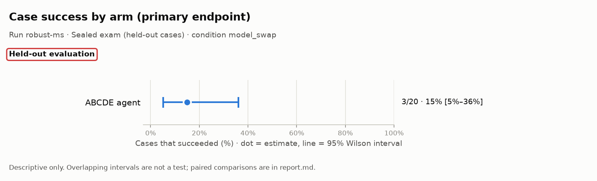
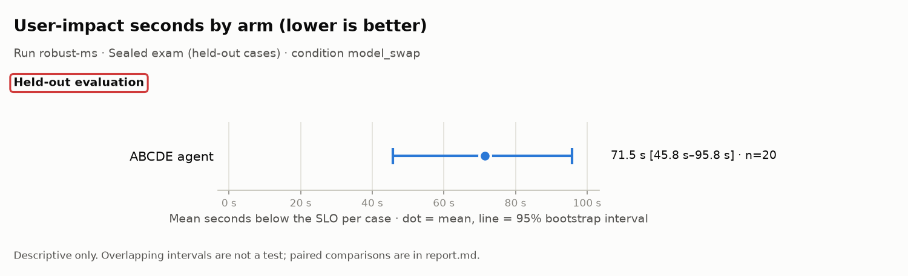
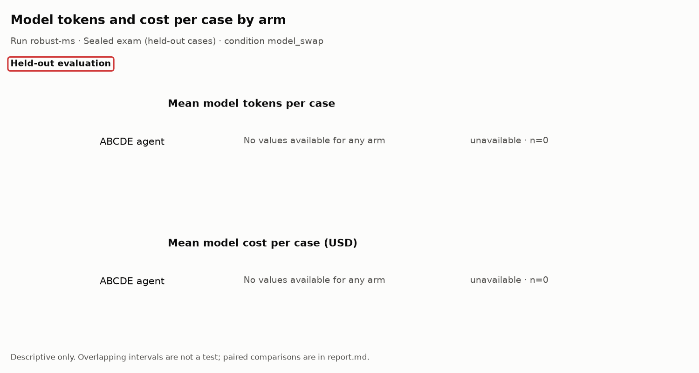

# Evaluation report: robust-ms

> **Scope: Held-out evaluation**

## What this run is

- **Run:** `robust-ms`
- **Stage:** Sealed exam (held-out cases)
- **Condition:** `model_swap`
- **Arms:** ABCDE agent (n = 20)
- **Model:** anthropic:claude-haiku-5-5
- **Code:** commit `0e58fe93090f`
- **Freeze hashes (first 12 characters):** agent `9c27cb684997`, baseline `55082984be2b`, scenarios/heldout/SEALED.json `f2ed58bc0e98`, scorer `e29e6c9bbd40`, settings `f16a6d6879e3`, system `9917f1ab1018`
- 8 other manifest field(s) not shown in this report.

## Headline: the system against the scripted runbook

The scripted runbook uses no AI. Where it ties or wins, that is reported here first.

> No valid paired ABCDE/runbook case-success comparison is available.

| Family | Comparison | Endpoint | Pairs | b | c | Difference [95% CI] | p | p (adjusted) | Method |
|---|---|---|---|---|---|---|---|---|---|
| descriptive | ABCDE vs runbook | case success | 0 | 0 | 0 | unavailable [unavailable] | unavailable | unavailable | Paired bootstrap |
| descriptive | ABCDE vs runbook, named held-out or blind | case success | 0 | 0 | 0 | unavailable [unavailable] | unavailable | unavailable | Paired bootstrap |
| descriptive | ABCDE vs runbook | user-impact seconds | 0 | unavailable | unavailable | unavailable [unavailable] | unavailable | unavailable | Paired bootstrap |

b: pairs where the endpoint is present for the first-named arm and absent for the second; c: the reverse. For case success, b counts pairs only the first arm succeeded on. For false all-clear (lower is better), b counts pairs where only the first arm made the false claim, so a larger b is worse for the first arm. Difference is first minus second: percentage points for rates, seconds for user impact. Rows without b, c or an interval (such as the Wilcoxon test on user-impact seconds) show unavailable.

## All paired comparisons

Arms are compared only on identical cases. Rows marked descriptive (or with no family) are descriptive only: no test is claimed, and a p-value shown as unavailable was not computed.

| Family | Comparison | Endpoint | Pairs | b | c | Difference [95% CI] | p | p (adjusted) | Method |
|---|---|---|---|---|---|---|---|---|---|
| descriptive | ABCDE vs runbook | case success | 0 | 0 | 0 | unavailable [unavailable] | unavailable | unavailable | Paired bootstrap |
| descriptive | ABCDE vs runbook, named held-out or blind | case success | 0 | 0 | 0 | unavailable [unavailable] | unavailable | unavailable | Paired bootstrap |
| descriptive | ABCDE vs ReAct | case success | 0 | 0 | 0 | unavailable [unavailable] | unavailable | unavailable | Paired bootstrap |
| descriptive | ABCDE vs naive verification | false all-clear | 0 | 0 | 0 | unavailable [unavailable] | unavailable | unavailable | Paired bootstrap |
| descriptive | ABCDE vs runbook | user-impact seconds | 0 | unavailable | unavailable | unavailable [unavailable] | unavailable | unavailable | Paired bootstrap |
| descriptive | abcde: condition vs main | case success | 20 | 0 | 0 | +0 pts [+0 pts to +0 pts] | unavailable | unavailable | Paired bootstrap, paired by source_id/system/arm |

b: pairs where the endpoint is present for the first-named arm and absent for the second; c: the reverse. For case success, b counts pairs only the first arm succeeded on. For false all-clear (lower is better), b counts pairs where only the first arm made the false claim, so a larger b is worse for the first arm. Difference is first minus second: percentage points for rates, seconds for user impact. Rows without b, c or an interval (such as the Wilcoxon test on user-impact seconds) show unavailable.

## Charts

Dot = estimate; line = 95% interval. The tables below hold every number in the charts. Do not read overlap, or a gap, between intervals as a test.

## Results by arm (all valid cases)

**Rates** (n/N, estimate, 95% Wilson interval)

| Metric | Arm | N counts | n/N | Estimate | Wilson 95% |
|---|---|---|---|---|---|
| Case success (primary endpoint) | ABCDE agent | valid cases with an observed success verdict | 3/20 | 15% | 5%–36% |
| Recovery (checker says recovered) | ABCDE agent | fixable cases with a checker verdict | 0/15 | 0% | 0%–20% |
| False all-clear (lower is better) | ABCDE agent | all-clear claims with a checker verdict | 0/3 | 0% | 0%–56% |
| Unnecessary escalation (lower is better) | ABCDE agent | valid fixable or healthy cases | 0/18 | 0% | 0%–18% |
| Harmful action (lower is better) | ABCDE agent | valid cases with observed harm status | 0/20 | 0% | 0%–16% |
| Handover complete | ABCDE agent | valid cases with operations handover evidence | 17/20 | 85% | 64%–95% |
| False diagnosis on healthy cases (lower is better) | ABCDE agent | valid healthy cases | 0/3 | 0% | 0%–56% |
| Correct escalation | ABCDE agent | valid must-escalate cases | 0/2 | 0% | 0%–66% |
| Root-cause precision | ABCDE agent | reported root-cause pairs after acceptable secondary pairs are ignored | 0/0 (not estimable) | — | — |
| Root-cause recall | ABCDE agent | labelled root-cause pairs | 0/37 | 0% | 0%–9% |
| Harmful-action attempts (lower is better) | ABCDE agent | guard-audited action attempts | 0/5 | 0% | 0%–43% |
| Mitigation still unresolved at the horizon (lower is better) | ABCDE agent | valid cases with an observed mitigation censoring flag | 11/20 | 55% | 34%–74% |

**Means** (mean per case, 95% bootstrap interval)

| Metric | Arm | Cases with a value | Mean | Bootstrap 95% |
|---|---|---|---|---|
| User-impact seconds (lower is better) | ABCDE agent | 20 | 71.5 s | 45.8 s–95.8 s |
| Time to mitigate (lower is better) | ABCDE agent | 20 | 70.5 s; censored 11/20 (55%; Wilson 95% 34%–74%) | 45.2 s–94.5 s |
| Failed user journeys per case (lower is better) | ABCDE agent | 20 | 258.0 | 131.4–409.5 |
| Model tokens per case | ABCDE agent | 0 | unavailable | unavailable |
| Model input tokens per case | ABCDE agent | 0 | unavailable | unavailable |
| Model output tokens per case | ABCDE agent | 0 | unavailable | unavailable |
| Model cost per case (USD) | ABCDE agent | 0 | unavailable | unavailable |
| Model calls per case | ABCDE agent | 20 | 1.9 | 1.7–2.0 |
| Root-cause F1 | ABCDE agent | 17 | 0.00 | 0.00–0.00 |
| Successful actions per case | ABCDE agent | 20 | 0.2 | 0.1–0.5 |
| Wasted actions per case (lower is better) | ABCDE agent | 20 | 0.0 | 0.0–0.0 |
| Harmful quarantines per case (lower is better) | ABCDE agent | 20 | 0.0 | 0.0–0.0 |

## Results by stratum (descriptive)

Strata are small, so their intervals are wide. They describe where each arm did well or badly; they are not tests.

### Healthy cases (no fault)

Cases: ABCDE agent n = 3.

**Rates** (n/N, estimate, 95% Wilson interval)

| Metric | Arm | N counts | n/N | Estimate | Wilson 95% |
|---|---|---|---|---|---|
| Case success (primary endpoint) | ABCDE agent | valid cases with an observed success verdict | 3/3 | 100% | 44%–100% |
| Recovery (checker says recovered) | ABCDE agent | fixable cases with a checker verdict | 0/0 (not estimable) | — | — |
| False all-clear (lower is better) | ABCDE agent | all-clear claims with a checker verdict | 0/3 | 0% | 0%–56% |
| Unnecessary escalation (lower is better) | ABCDE agent | valid fixable or healthy cases | 0/3 | 0% | 0%–56% |
| Harmful action (lower is better) | ABCDE agent | valid cases with observed harm status | 0/3 | 0% | 0%–56% |
| Handover complete | ABCDE agent | valid cases with operations handover evidence | 3/3 | 100% | 44%–100% |
| False diagnosis on healthy cases (lower is better) | ABCDE agent | valid healthy cases | 0/3 | 0% | 0%–56% |
| Correct escalation | ABCDE agent | valid must-escalate cases | 0/0 (not estimable) | — | — |
| Root-cause precision | ABCDE agent | reported root-cause pairs after acceptable secondary pairs are ignored | 0/0 (not estimable) | — | — |
| Root-cause recall | ABCDE agent | labelled root-cause pairs | 0/0 (not estimable) | — | — |
| Harmful-action attempts (lower is better) | ABCDE agent | guard-audited action attempts | 0/0 (not estimable) | — | — |
| Mitigation still unresolved at the horizon (lower is better) | ABCDE agent | valid cases with an observed mitigation censoring flag | 0/3 | 0% | 0%–56% |

**Means** (mean per case, 95% bootstrap interval)

| Metric | Arm | Cases with a value | Mean | Bootstrap 95% |
|---|---|---|---|---|
| User-impact seconds (lower is better) | ABCDE agent | 3 | 0.0 s | 0.0 s–0.0 s |
| Time to mitigate (lower is better) | ABCDE agent | 3 | 0.0 s; censored 0/3 (0%; Wilson 95% 0%–56%) | 0.0 s–0.0 s |
| Failed user journeys per case (lower is better) | ABCDE agent | 3 | 0.0 | 0.0–0.0 |
| Model tokens per case | ABCDE agent | 0 | unavailable | unavailable |
| Model input tokens per case | ABCDE agent | 0 | unavailable | unavailable |
| Model output tokens per case | ABCDE agent | 0 | unavailable | unavailable |
| Model cost per case (USD) | ABCDE agent | 0 | unavailable | unavailable |
| Model calls per case | ABCDE agent | 3 | 1.0 | 1.0–1.0 |
| Root-cause F1 | ABCDE agent | 0 | unavailable | unavailable |
| Successful actions per case | ABCDE agent | 3 | 0.0 | 0.0–0.0 |
| Wasted actions per case (lower is better) | ABCDE agent | 3 | 0.0 | 0.0–0.0 |
| Harmful quarantines per case (lower is better) | ABCDE agent | 3 | 0.0 | 0.0–0.0 |

### Must-escalate cases

Cases: ABCDE agent n = 2.

**Rates** (n/N, estimate, 95% Wilson interval)

| Metric | Arm | N counts | n/N | Estimate | Wilson 95% |
|---|---|---|---|---|---|
| Case success (primary endpoint) | ABCDE agent | valid cases with an observed success verdict | 0/2 | 0% | 0%–66% |
| Recovery (checker says recovered) | ABCDE agent | fixable cases with a checker verdict | 0/0 (not estimable) | — | — |
| False all-clear (lower is better) | ABCDE agent | all-clear claims with a checker verdict | 0/0 (not estimable) | — | — |
| Unnecessary escalation (lower is better) | ABCDE agent | valid fixable or healthy cases | 0/0 (not estimable) | — | — |
| Harmful action (lower is better) | ABCDE agent | valid cases with observed harm status | 0/2 | 0% | 0%–66% |
| Handover complete | ABCDE agent | valid cases with operations handover evidence | 2/2 | 100% | 34%–100% |
| False diagnosis on healthy cases (lower is better) | ABCDE agent | valid healthy cases | 0/0 (not estimable) | — | — |
| Correct escalation | ABCDE agent | valid must-escalate cases | 0/2 | 0% | 0%–66% |
| Root-cause precision | ABCDE agent | reported root-cause pairs after acceptable secondary pairs are ignored | 0/0 (not estimable) | — | — |
| Root-cause recall | ABCDE agent | labelled root-cause pairs | 0/2 | 0% | 0%–66% |
| Harmful-action attempts (lower is better) | ABCDE agent | guard-audited action attempts | 0/0 (not estimable) | — | — |
| Mitigation still unresolved at the horizon (lower is better) | ABCDE agent | valid cases with an observed mitigation censoring flag | 0/2 | 0% | 0%–66% |

**Means** (mean per case, 95% bootstrap interval)

| Metric | Arm | Cases with a value | Mean | Bootstrap 95% |
|---|---|---|---|---|
| User-impact seconds (lower is better) | ABCDE agent | 2 | 0.0 s | 0.0 s–0.0 s |
| Time to mitigate (lower is better) | ABCDE agent | 2 | 0.0 s; censored 0/2 (0%; Wilson 95% 0%–66%) | 0.0 s–0.0 s |
| Failed user journeys per case (lower is better) | ABCDE agent | 2 | 0.0 | 0.0–0.0 |
| Model tokens per case | ABCDE agent | 0 | unavailable | unavailable |
| Model input tokens per case | ABCDE agent | 0 | unavailable | unavailable |
| Model output tokens per case | ABCDE agent | 0 | unavailable | unavailable |
| Model cost per case (USD) | ABCDE agent | 0 | unavailable | unavailable |
| Model calls per case | ABCDE agent | 2 | 2.0 | 2.0–2.0 |
| Root-cause F1 | ABCDE agent | 2 | 0.00 | 0.00–0.00 |
| Successful actions per case | ABCDE agent | 2 | 0.0 | 0.0–0.0 |
| Wasted actions per case (lower is better) | ABCDE agent | 2 | 0.0 | 0.0–0.0 |
| Harmful quarantines per case (lower is better) | ABCDE agent | 2 | 0.0 | 0.0–0.0 |

### Practice fault types only (no named held-out or blind fault)

Cases: ABCDE agent n = 2.

**Rates** (n/N, estimate, 95% Wilson interval)

| Metric | Arm | N counts | n/N | Estimate | Wilson 95% |
|---|---|---|---|---|---|
| Case success (primary endpoint) | ABCDE agent | valid cases with an observed success verdict | 0/2 | 0% | 0%–66% |
| Recovery (checker says recovered) | ABCDE agent | fixable cases with a checker verdict | 0/2 | 0% | 0%–66% |
| False all-clear (lower is better) | ABCDE agent | all-clear claims with a checker verdict | 0/0 (not estimable) | — | — |
| Unnecessary escalation (lower is better) | ABCDE agent | valid fixable or healthy cases | 0/2 | 0% | 0%–66% |
| Harmful action (lower is better) | ABCDE agent | valid cases with observed harm status | 0/2 | 0% | 0%–66% |
| Handover complete | ABCDE agent | valid cases with operations handover evidence | 2/2 | 100% | 34%–100% |
| False diagnosis on healthy cases (lower is better) | ABCDE agent | valid healthy cases | 0/0 (not estimable) | — | — |
| Correct escalation | ABCDE agent | valid must-escalate cases | 0/0 (not estimable) | — | — |
| Root-cause precision | ABCDE agent | reported root-cause pairs after acceptable secondary pairs are ignored | 0/0 (not estimable) | — | — |
| Root-cause recall | ABCDE agent | labelled root-cause pairs | 0/4 | 0% | 0%–49% |
| Harmful-action attempts (lower is better) | ABCDE agent | guard-audited action attempts | 0/1 | 0% | 0%–79% |
| Mitigation still unresolved at the horizon (lower is better) | ABCDE agent | valid cases with an observed mitigation censoring flag | 1/2 | 50% | 9%–91% |

**Means** (mean per case, 95% bootstrap interval)

| Metric | Arm | Cases with a value | Mean | Bootstrap 95% |
|---|---|---|---|---|
| User-impact seconds (lower is better) | ABCDE agent | 2 | 70.0 s | 15.0 s–125.0 s |
| Time to mitigate (lower is better) | ABCDE agent | 2 | 68.5 s; censored 1/2 (50%; Wilson 95% 9%–91%) | 15.0 s–122.1 s |
| Failed user journeys per case (lower is better) | ABCDE agent | 2 | 178.0 | 38.0–318.0 |
| Model tokens per case | ABCDE agent | 0 | unavailable | unavailable |
| Model input tokens per case | ABCDE agent | 0 | unavailable | unavailable |
| Model output tokens per case | ABCDE agent | 0 | unavailable | unavailable |
| Model cost per case (USD) | ABCDE agent | 0 | unavailable | unavailable |
| Model calls per case | ABCDE agent | 2 | 2.0 | 2.0–2.0 |
| Root-cause F1 | ABCDE agent | 2 | 0.00 | 0.00–0.00 |
| Successful actions per case | ABCDE agent | 2 | 0.5 | 0.0–1.0 |
| Wasted actions per case (lower is better) | ABCDE agent | 2 | 0.0 | 0.0–0.0 |
| Harmful quarantines per case (lower is better) | ABCDE agent | 2 | 0.0 | 0.0–0.0 |

### Named held-out fault types

Cases: ABCDE agent n = 12.

**Rates** (n/N, estimate, 95% Wilson interval)

| Metric | Arm | N counts | n/N | Estimate | Wilson 95% |
|---|---|---|---|---|---|
| Case success (primary endpoint) | ABCDE agent | valid cases with an observed success verdict | 0/12 | 0% | 0%–24% |
| Recovery (checker says recovered) | ABCDE agent | fixable cases with a checker verdict | 0/12 | 0% | 0%–24% |
| False all-clear (lower is better) | ABCDE agent | all-clear claims with a checker verdict | 0/0 (not estimable) | — | — |
| Unnecessary escalation (lower is better) | ABCDE agent | valid fixable or healthy cases | 0/12 | 0% | 0%–24% |
| Harmful action (lower is better) | ABCDE agent | valid cases with observed harm status | 0/12 | 0% | 0%–24% |
| Handover complete | ABCDE agent | valid cases with operations handover evidence | 9/12 | 75% | 47%–91% |
| False diagnosis on healthy cases (lower is better) | ABCDE agent | valid healthy cases | 0/0 (not estimable) | — | — |
| Correct escalation | ABCDE agent | valid must-escalate cases | 0/0 (not estimable) | — | — |
| Root-cause precision | ABCDE agent | reported root-cause pairs after acceptable secondary pairs are ignored | 0/0 (not estimable) | — | — |
| Root-cause recall | ABCDE agent | labelled root-cause pairs | 0/29 | 0% | 0%–12% |
| Harmful-action attempts (lower is better) | ABCDE agent | guard-audited action attempts | 0/4 | 0% | 0%–49% |
| Mitigation still unresolved at the horizon (lower is better) | ABCDE agent | valid cases with an observed mitigation censoring flag | 9/12 | 75% | 47%–91% |

**Means** (mean per case, 95% bootstrap interval)

| Metric | Arm | Cases with a value | Mean | Bootstrap 95% |
|---|---|---|---|---|
| User-impact seconds (lower is better) | ABCDE agent | 12 | 97.5 s | 70.0 s–125.0 s |
| Time to mitigate (lower is better) | ABCDE agent | 12 | 95.9 s; censored 9/12 (75%; Wilson 95% 47%–91%) | 68.8 s–122.6 s |
| Failed user journeys per case (lower is better) | ABCDE agent | 12 | 378.2 | 197.7–588.1 |
| Model tokens per case | ABCDE agent | 0 | unavailable | unavailable |
| Model input tokens per case | ABCDE agent | 0 | unavailable | unavailable |
| Model output tokens per case | ABCDE agent | 0 | unavailable | unavailable |
| Model cost per case (USD) | ABCDE agent | 0 | unavailable | unavailable |
| Model calls per case | ABCDE agent | 12 | 2.0 | 2.0–2.0 |
| Root-cause F1 | ABCDE agent | 12 | 0.00 | 0.00–0.00 |
| Successful actions per case | ABCDE agent | 12 | 0.3 | 0.1–0.6 |
| Wasted actions per case (lower is better) | ABCDE agent | 12 | 0.0 | 0.0–0.0 |
| Harmful quarantines per case (lower is better) | ABCDE agent | 12 | 0.0 | 0.0–0.0 |

### Blind fault type

Cases: ABCDE agent n = 3.

**Rates** (n/N, estimate, 95% Wilson interval)

| Metric | Arm | N counts | n/N | Estimate | Wilson 95% |
|---|---|---|---|---|---|
| Case success (primary endpoint) | ABCDE agent | valid cases with an observed success verdict | 0/3 | 0% | 0%–56% |
| Recovery (checker says recovered) | ABCDE agent | fixable cases with a checker verdict | 0/3 | 0% | 0%–56% |
| False all-clear (lower is better) | ABCDE agent | all-clear claims with a checker verdict | 0/0 (not estimable) | — | — |
| Unnecessary escalation (lower is better) | ABCDE agent | valid fixable or healthy cases | 0/3 | 0% | 0%–56% |
| Harmful action (lower is better) | ABCDE agent | valid cases with observed harm status | 0/3 | 0% | 0%–56% |
| Handover complete | ABCDE agent | valid cases with operations handover evidence | 3/3 | 100% | 44%–100% |
| False diagnosis on healthy cases (lower is better) | ABCDE agent | valid healthy cases | 0/0 (not estimable) | — | — |
| Correct escalation | ABCDE agent | valid must-escalate cases | 0/0 (not estimable) | — | — |
| Root-cause precision | ABCDE agent | reported root-cause pairs after acceptable secondary pairs are ignored | 0/0 (not estimable) | — | — |
| Root-cause recall | ABCDE agent | labelled root-cause pairs | 0/7 | 0% | 0%–35% |
| Harmful-action attempts (lower is better) | ABCDE agent | guard-audited action attempts | 0/0 (not estimable) | — | — |
| Mitigation still unresolved at the horizon (lower is better) | ABCDE agent | valid cases with an observed mitigation censoring flag | 3/3 | 100% | 44%–100% |

**Means** (mean per case, 95% bootstrap interval)

| Metric | Arm | Cases with a value | Mean | Bootstrap 95% |
|---|---|---|---|---|
| User-impact seconds (lower is better) | ABCDE agent | 3 | 123.3 s | 120.0 s–125.0 s |
| Time to mitigate (lower is better) | ABCDE agent | 3 | 122.8 s; censored 3/3 (100%; Wilson 95% 44%–100%) | 122.1 s–123.1 s |
| Failed user journeys per case (lower is better) | ABCDE agent | 3 | 257.3 | 252.0–265.0 |
| Model tokens per case | ABCDE agent | 0 | unavailable | unavailable |
| Model input tokens per case | ABCDE agent | 0 | unavailable | unavailable |
| Model output tokens per case | ABCDE agent | 0 | unavailable | unavailable |
| Model cost per case (USD) | ABCDE agent | 0 | unavailable | unavailable |
| Model calls per case | ABCDE agent | 3 | 2.0 | 2.0–2.0 |
| Root-cause F1 | ABCDE agent | 3 | 0.00 | 0.00–0.00 |
| Successful actions per case | ABCDE agent | 3 | 0.0 | 0.0–0.0 |
| Wasted actions per case (lower is better) | ABCDE agent | 3 | 0.0 | 0.0–0.0 |
| Harmful quarantines per case (lower is better) | ABCDE agent | 3 | 0.0 | 0.0–0.0 |

### Single-fault and healthy cases

Cases: ABCDE agent n = 6.

**Rates** (n/N, estimate, 95% Wilson interval)

| Metric | Arm | N counts | n/N | Estimate | Wilson 95% |
|---|---|---|---|---|---|
| Case success (primary endpoint) | ABCDE agent | valid cases with an observed success verdict | 3/6 | 50% | 19%–81% |
| Recovery (checker says recovered) | ABCDE agent | fixable cases with a checker verdict | 0/1 | 0% | 0%–79% |
| False all-clear (lower is better) | ABCDE agent | all-clear claims with a checker verdict | 0/3 | 0% | 0%–56% |
| Unnecessary escalation (lower is better) | ABCDE agent | valid fixable or healthy cases | 0/4 | 0% | 0%–49% |
| Harmful action (lower is better) | ABCDE agent | valid cases with observed harm status | 0/6 | 0% | 0%–39% |
| Handover complete | ABCDE agent | valid cases with operations handover evidence | 6/6 | 100% | 61%–100% |
| False diagnosis on healthy cases (lower is better) | ABCDE agent | valid healthy cases | 0/3 | 0% | 0%–56% |
| Correct escalation | ABCDE agent | valid must-escalate cases | 0/2 | 0% | 0%–66% |
| Root-cause precision | ABCDE agent | reported root-cause pairs after acceptable secondary pairs are ignored | 0/0 (not estimable) | — | — |
| Root-cause recall | ABCDE agent | labelled root-cause pairs | 0/3 | 0% | 0%–56% |
| Harmful-action attempts (lower is better) | ABCDE agent | guard-audited action attempts | 0/0 (not estimable) | — | — |
| Mitigation still unresolved at the horizon (lower is better) | ABCDE agent | valid cases with an observed mitigation censoring flag | 1/6 | 17% | 3%–56% |

**Means** (mean per case, 95% bootstrap interval)

| Metric | Arm | Cases with a value | Mean | Bootstrap 95% |
|---|---|---|---|---|
| User-impact seconds (lower is better) | ABCDE agent | 6 | 20.8 s | 0.0 s–62.5 s |
| Time to mitigate (lower is better) | ABCDE agent | 6 | 20.3 s; censored 1/6 (17%; Wilson 95% 3%–56%) | 0.0 s–61.0 s |
| Failed user journeys per case (lower is better) | ABCDE agent | 6 | 50.8 | 0.0–152.5 |
| Model tokens per case | ABCDE agent | 0 | unavailable | unavailable |
| Model input tokens per case | ABCDE agent | 0 | unavailable | unavailable |
| Model output tokens per case | ABCDE agent | 0 | unavailable | unavailable |
| Model cost per case (USD) | ABCDE agent | 0 | unavailable | unavailable |
| Model calls per case | ABCDE agent | 6 | 1.5 | 1.2–1.8 |
| Root-cause F1 | ABCDE agent | 3 | 0.00 | 0.00–0.00 |
| Successful actions per case | ABCDE agent | 6 | 0.0 | 0.0–0.0 |
| Wasted actions per case (lower is better) | ABCDE agent | 6 | 0.0 | 0.0–0.0 |
| Harmful quarantines per case (lower is better) | ABCDE agent | 6 | 0.0 | 0.0–0.0 |

### Two-fault cases

Cases: ABCDE agent n = 8.

**Rates** (n/N, estimate, 95% Wilson interval)

| Metric | Arm | N counts | n/N | Estimate | Wilson 95% |
|---|---|---|---|---|---|
| Case success (primary endpoint) | ABCDE agent | valid cases with an observed success verdict | 0/8 | 0% | 0%–32% |
| Recovery (checker says recovered) | ABCDE agent | fixable cases with a checker verdict | 0/8 | 0% | 0%–32% |
| False all-clear (lower is better) | ABCDE agent | all-clear claims with a checker verdict | 0/0 (not estimable) | — | — |
| Unnecessary escalation (lower is better) | ABCDE agent | valid fixable or healthy cases | 0/8 | 0% | 0%–32% |
| Harmful action (lower is better) | ABCDE agent | valid cases with observed harm status | 0/8 | 0% | 0%–32% |
| Handover complete | ABCDE agent | valid cases with operations handover evidence | 7/8 | 88% | 53%–98% |
| False diagnosis on healthy cases (lower is better) | ABCDE agent | valid healthy cases | 0/0 (not estimable) | — | — |
| Correct escalation | ABCDE agent | valid must-escalate cases | 0/0 (not estimable) | — | — |
| Root-cause precision | ABCDE agent | reported root-cause pairs after acceptable secondary pairs are ignored | 0/0 (not estimable) | — | — |
| Root-cause recall | ABCDE agent | labelled root-cause pairs | 0/16 | 0% | 0%–19% |
| Harmful-action attempts (lower is better) | ABCDE agent | guard-audited action attempts | 0/3 | 0% | 0%–56% |
| Mitigation still unresolved at the horizon (lower is better) | ABCDE agent | valid cases with an observed mitigation censoring flag | 5/8 | 62% | 31%–86% |

**Means** (mean per case, 95% bootstrap interval)

| Metric | Arm | Cases with a value | Mean | Bootstrap 95% |
|---|---|---|---|---|
| User-impact seconds (lower is better) | ABCDE agent | 8 | 83.1 s | 42.5 s–111.2 s |
| Time to mitigate (lower is better) | ABCDE agent | 8 | 82.0 s; censored 5/8 (62%; Wilson 95% 31%–86%) | 41.9 s–109.3 s |
| Failed user journeys per case (lower is better) | ABCDE agent | 8 | 194.1 | 100.4–273.4 |
| Model tokens per case | ABCDE agent | 0 | unavailable | unavailable |
| Model input tokens per case | ABCDE agent | 0 | unavailable | unavailable |
| Model output tokens per case | ABCDE agent | 0 | unavailable | unavailable |
| Model cost per case (USD) | ABCDE agent | 0 | unavailable | unavailable |
| Model calls per case | ABCDE agent | 8 | 2.0 | 2.0–2.0 |
| Root-cause F1 | ABCDE agent | 8 | 0.00 | 0.00–0.00 |
| Successful actions per case | ABCDE agent | 8 | 0.4 | 0.1–0.8 |
| Wasted actions per case (lower is better) | ABCDE agent | 8 | 0.0 | 0.0–0.0 |
| Harmful quarantines per case (lower is better) | ABCDE agent | 8 | 0.0 | 0.0–0.0 |

### Three-fault cases

Cases: ABCDE agent n = 6.

**Rates** (n/N, estimate, 95% Wilson interval)

| Metric | Arm | N counts | n/N | Estimate | Wilson 95% |
|---|---|---|---|---|---|
| Case success (primary endpoint) | ABCDE agent | valid cases with an observed success verdict | 0/6 | 0% | 0%–39% |
| Recovery (checker says recovered) | ABCDE agent | fixable cases with a checker verdict | 0/6 | 0% | 0%–39% |
| False all-clear (lower is better) | ABCDE agent | all-clear claims with a checker verdict | 0/0 (not estimable) | — | — |
| Unnecessary escalation (lower is better) | ABCDE agent | valid fixable or healthy cases | 0/6 | 0% | 0%–39% |
| Harmful action (lower is better) | ABCDE agent | valid cases with observed harm status | 0/6 | 0% | 0%–39% |
| Handover complete | ABCDE agent | valid cases with operations handover evidence | 4/6 | 67% | 30%–90% |
| False diagnosis on healthy cases (lower is better) | ABCDE agent | valid healthy cases | 0/0 (not estimable) | — | — |
| Correct escalation | ABCDE agent | valid must-escalate cases | 0/0 (not estimable) | — | — |
| Root-cause precision | ABCDE agent | reported root-cause pairs after acceptable secondary pairs are ignored | 0/0 (not estimable) | — | — |
| Root-cause recall | ABCDE agent | labelled root-cause pairs | 0/18 | 0% | 0%–18% |
| Harmful-action attempts (lower is better) | ABCDE agent | guard-audited action attempts | 0/2 | 0% | 0%–66% |
| Mitigation still unresolved at the horizon (lower is better) | ABCDE agent | valid cases with an observed mitigation censoring flag | 5/6 | 83% | 44%–97% |

**Means** (mean per case, 95% bootstrap interval)

| Metric | Arm | Cases with a value | Mean | Bootstrap 95% |
|---|---|---|---|---|
| User-impact seconds (lower is better) | ABCDE agent | 6 | 106.7 s | 70.0 s–125.0 s |
| Time to mitigate (lower is better) | ABCDE agent | 6 | 105.3 s; censored 5/6 (83%; Wilson 95% 44%–97%) | 69.1 s–123.6 s |
| Failed user journeys per case (lower is better) | ABCDE agent | 6 | 550.3 | 230.3–891.5 |
| Model tokens per case | ABCDE agent | 0 | unavailable | unavailable |
| Model input tokens per case | ABCDE agent | 0 | unavailable | unavailable |
| Model output tokens per case | ABCDE agent | 0 | unavailable | unavailable |
| Model cost per case (USD) | ABCDE agent | 0 | unavailable | unavailable |
| Model calls per case | ABCDE agent | 6 | 2.0 | 2.0–2.0 |
| Root-cause F1 | ABCDE agent | 6 | 0.00 | 0.00–0.00 |
| Successful actions per case | ABCDE agent | 6 | 0.3 | 0.0–0.7 |
| Wasted actions per case (lower is better) | ABCDE agent | 6 | 0.0 | 0.0–0.0 |
| Harmful quarantines per case (lower is better) | ABCDE agent | 6 | 0.0 | 0.0–0.0 |

## Exclusions

Cases are excluded by a pre-registered, mechanical validity rule, applied without looking at any AI arm.

No exclusions are listed in this summary. That alone does not show every case was valid: see Notes for any validity checks still pending.

## Retries

Two kinds of retry are listed. A harness timeout (`harness_timeout`) or a model-provider error (`api_error`) is re-run once at the end and reported separately; it is never counted as a failure of the system. An ordinary harness error (`harness_error`) is also retried once, but if it errors again it counts as a failure. Until its retry completes it remains unresolved. Listed cases are not validity exclusions.

No cases were retried.

## Notes

- Comparisons here are descriptive; the registered hypothesis tests concern the main valid sealed cases.
- Robustness changes are descriptive; positive difference means higher success under the condition.
- Unknown measurements remain unavailable. Rates use their stated observed denominator; missing values are listed in metrics.json.
- abcde: 20 completed pairs; 0 pending validity; 0 invalid; 0 unresolved infrastructure failures.
- Paired with run `final-1`. Each arm's drop is descriptive (about ±20 points at n = 20).

## Limits and how to read this report

- The cases run on test systems built for this project. The results say nothing about production readiness and make no regulatory claim.
- Samples are small. An interval about ±20 points wide is normal at n = 20.
- Arms are compared only by paired tests on identical cases. Whether two intervals overlap is not a test, and this report draws no conclusion from it.
- Strata, robustness conditions and every metric other than the pre-registered comparisons are descriptive and are not adjusted for multiple looks.
- "unavailable" means the value was not measured or not supplied; 0 means a measured zero. An arm with no model calls (the runbook) has a measured zero for tokens and cost.
- Wilson and bootstrap intervals treat cases as independent draws.

## Glossary

**Arms**

| Arm | Key | What it is |
|---|---|---|
| ABCDE agent | `abcde` | The full system: fixed ABCDE survey, triage order, sustained verification, SBAR handover. |

**Terms**

- *Case success*: fixable case recovered by the checker with outcome `recovered` and no harmful action; must-escalate case escalated to the right component with no harmful action; healthy case left alone with outcome `no_incident` and the checker green.
- *False all-clear*: the arm said `recovered` or `no_incident` but the checker was red.
- *User-impact seconds*: 5-second buckets that missed the SLO between the first fault and the horizon, times 5.
- *Wilson 95%*: an interval for a proportion that stays sensible at small n.
- *Bootstrap 95%*: an interval for a mean from resampling cases.
- *McNemar test*: a paired test that uses only the cases where the two arms disagree.
