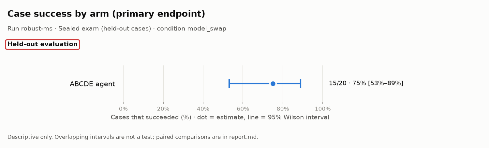
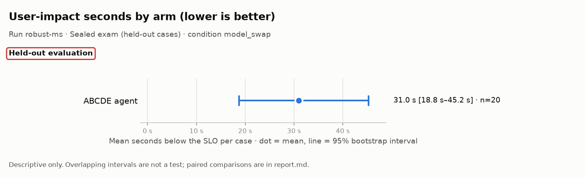
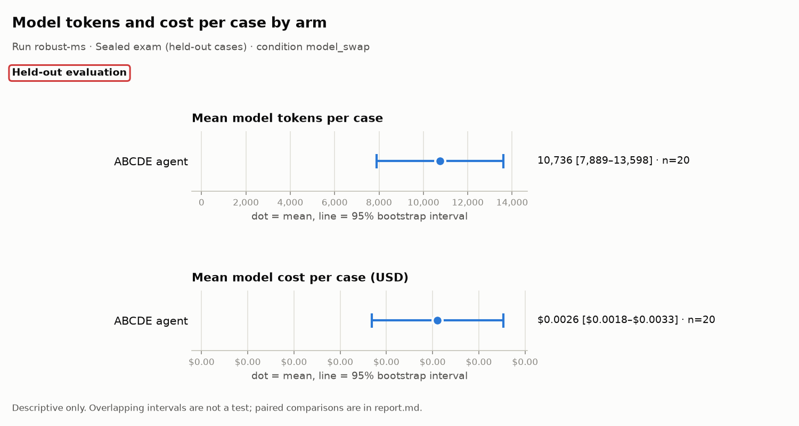

# Evaluation report: robust-ms

> **Scope: Held-out evaluation**

## What this run is

- **Run:** `robust-ms`
- **Stage:** Sealed exam (held-out cases)
- **Condition:** `model_swap`
- **Arms:** ABCDE agent (n = 20)
- **Model:** anthropic:claude-haiku-5-5
- **Code:** commit `0e58fe93090f`
- **Freeze hashes (first 12 characters):** agent `9c27cb684997`, baseline `55082984be2b`, scenarios/heldout/SEALED.json `f2ed58bc0e98`, scorer `e29e6c9bbd40`, settings `f16a6d6879e3`, system `9917f1ab1018`
- 8 other manifest field(s) not shown in this report.

## Headline: the system against the scripted runbook

The scripted runbook uses no AI. Where it ties or wins, that is reported here first.

> No valid paired ABCDE/runbook case-success comparison is available.

| Family | Comparison | Endpoint | Pairs | b | c | Difference [95% CI] | p | p (adjusted) | Method |
|---|---|---|---|---|---|---|---|---|---|
| descriptive | ABCDE vs runbook | case success | 0 | 0 | 0 | unavailable [unavailable] | unavailable | unavailable | Paired bootstrap |
| descriptive | ABCDE vs runbook, named held-out or blind | case success | 0 | 0 | 0 | unavailable [unavailable] | unavailable | unavailable | Paired bootstrap |
| descriptive | ABCDE vs runbook | user-impact seconds | 0 | unavailable | unavailable | unavailable [unavailable] | unavailable | unavailable | Paired bootstrap |

b: pairs where the endpoint is present for the first-named arm and absent for the second; c: the reverse. For case success, b counts pairs only the first arm succeeded on. For false all-clear (lower is better), b counts pairs where only the first arm made the false claim, so a larger b is worse for the first arm. Difference is first minus second: percentage points for rates, seconds for user impact. Rows without b, c or an interval (such as the Wilcoxon test on user-impact seconds) show unavailable.

## All paired comparisons

Arms are compared only on identical cases. Rows marked descriptive (or with no family) are descriptive only: no test is claimed, and a p-value shown as unavailable was not computed.

| Family | Comparison | Endpoint | Pairs | b | c | Difference [95% CI] | p | p (adjusted) | Method |
|---|---|---|---|---|---|---|---|---|---|
| descriptive | ABCDE vs runbook | case success | 0 | 0 | 0 | unavailable [unavailable] | unavailable | unavailable | Paired bootstrap |
| descriptive | ABCDE vs runbook, named held-out or blind | case success | 0 | 0 | 0 | unavailable [unavailable] | unavailable | unavailable | Paired bootstrap |
| descriptive | ABCDE vs ReAct | case success | 0 | 0 | 0 | unavailable [unavailable] | unavailable | unavailable | Paired bootstrap |
| descriptive | ABCDE vs naive verification | false all-clear | 0 | 0 | 0 | unavailable [unavailable] | unavailable | unavailable | Paired bootstrap |
| descriptive | ABCDE vs runbook | user-impact seconds | 0 | unavailable | unavailable | unavailable [unavailable] | unavailable | unavailable | Paired bootstrap |
| descriptive | abcde: condition vs main | case success | 20 | 0 | 5 | -25 pts [-45 pts to -5 pts] | unavailable | unavailable | Paired bootstrap, paired by source_id/system/arm |

b: pairs where the endpoint is present for the first-named arm and absent for the second; c: the reverse. For case success, b counts pairs only the first arm succeeded on. For false all-clear (lower is better), b counts pairs where only the first arm made the false claim, so a larger b is worse for the first arm. Difference is first minus second: percentage points for rates, seconds for user impact. Rows without b, c or an interval (such as the Wilcoxon test on user-impact seconds) show unavailable.

## Charts

Dot = estimate; line = 95% interval. The tables below hold every number in the charts. Do not read overlap, or a gap, between intervals as a test.

## Results by arm (all valid cases)

**Rates** (n/N, estimate, 95% Wilson interval)

| Metric | Arm | N counts | n/N | Estimate | Wilson 95% |
|---|---|---|---|---|---|
| Case success (primary endpoint) | ABCDE agent | valid cases with an observed success verdict | 15/20 | 75% | 53%–89% |
| Recovery (checker says recovered) | ABCDE agent | fixable cases with a checker verdict | 12/15 | 80% | 55%–93% |
| False all-clear (lower is better) | ABCDE agent | all-clear claims with a checker verdict | 2/15 | 13% | 4%–38% |
| Unnecessary escalation (lower is better) | ABCDE agent | valid fixable or healthy cases | 3/18 | 17% | 6%–39% |
| Harmful action (lower is better) | ABCDE agent | valid cases with observed harm status | 2/20 | 10% | 3%–30% |
| Handover complete | ABCDE agent | valid cases with operations handover evidence | 16/20 | 80% | 58%–92% |
| False diagnosis on healthy cases (lower is better) | ABCDE agent | valid healthy cases | 0/3 | 0% | 0%–56% |
| Correct escalation | ABCDE agent | valid must-escalate cases | 2/2 | 100% | 34%–100% |
| Root-cause precision | ABCDE agent | reported root-cause pairs after acceptable secondary pairs are ignored | 34/36 | 94% | 82%–98% |
| Root-cause recall | ABCDE agent | labelled root-cause pairs | 34/37 | 92% | 79%–97% |
| Harmful-action attempts (lower is better) | ABCDE agent | guard-audited action attempts | 0/47 | 0% | 0%–8% |
| Mitigation still unresolved at the horizon (lower is better) | ABCDE agent | valid cases with an observed mitigation censoring flag | 1/20 | 5% | 1%–24% |

**Means** (mean per case, 95% bootstrap interval)

| Metric | Arm | Cases with a value | Mean | Bootstrap 95% |
|---|---|---|---|---|
| User-impact seconds (lower is better) | ABCDE agent | 20 | 31.0 s | 18.8 s–45.2 s |
| Time to mitigate (lower is better) | ABCDE agent | 20 | 31.2 s; censored 1/20 (5%; Wilson 95% 1%–24%) | 18.9 s–45.1 s |
| Failed user journeys per case (lower is better) | ABCDE agent | 20 | 87.9 | 46.9–134.8 |
| Model tokens per case | ABCDE agent | 20 | 10,736 | 7,889–13,598 |
| Model input tokens per case | ABCDE agent | 20 | 7,044 | 5,228–8,873 |
| Model output tokens per case | ABCDE agent | 20 | 3,692 | 2,631–4,783 |
| Model cost per case (USD) | ABCDE agent | 20 | $0.0026 | $0.0018–$0.0033 |
| Model calls per case | ABCDE agent | 20 | 2.5 | 2.0–2.9 |
| Root-cause F1 | ABCDE agent | 17 | 0.93 | 0.84–1.00 |
| Successful actions per case | ABCDE agent | 20 | 2.4 | 1.6–3.0 |
| Wasted actions per case (lower is better) | ABCDE agent | 20 | 0.0 | 0.0–0.0 |
| Harmful quarantines per case (lower is better) | ABCDE agent | 20 | 0.1 | 0.0–0.2 |

## Results by stratum (descriptive)

Strata are small, so their intervals are wide. They describe where each arm did well or badly; they are not tests.

### Healthy cases (no fault)

Cases: ABCDE agent n = 3.

**Rates** (n/N, estimate, 95% Wilson interval)

| Metric | Arm | N counts | n/N | Estimate | Wilson 95% |
|---|---|---|---|---|---|
| Case success (primary endpoint) | ABCDE agent | valid cases with an observed success verdict | 3/3 | 100% | 44%–100% |
| Recovery (checker says recovered) | ABCDE agent | fixable cases with a checker verdict | 0/0 (not estimable) | — | — |
| False all-clear (lower is better) | ABCDE agent | all-clear claims with a checker verdict | 0/3 | 0% | 0%–56% |
| Unnecessary escalation (lower is better) | ABCDE agent | valid fixable or healthy cases | 0/3 | 0% | 0%–56% |
| Harmful action (lower is better) | ABCDE agent | valid cases with observed harm status | 0/3 | 0% | 0%–56% |
| Handover complete | ABCDE agent | valid cases with operations handover evidence | 3/3 | 100% | 44%–100% |
| False diagnosis on healthy cases (lower is better) | ABCDE agent | valid healthy cases | 0/3 | 0% | 0%–56% |
| Correct escalation | ABCDE agent | valid must-escalate cases | 0/0 (not estimable) | — | — |
| Root-cause precision | ABCDE agent | reported root-cause pairs after acceptable secondary pairs are ignored | 0/0 (not estimable) | — | — |
| Root-cause recall | ABCDE agent | labelled root-cause pairs | 0/0 (not estimable) | — | — |
| Harmful-action attempts (lower is better) | ABCDE agent | guard-audited action attempts | 0/0 (not estimable) | — | — |
| Mitigation still unresolved at the horizon (lower is better) | ABCDE agent | valid cases with an observed mitigation censoring flag | 0/3 | 0% | 0%–56% |

**Means** (mean per case, 95% bootstrap interval)

| Metric | Arm | Cases with a value | Mean | Bootstrap 95% |
|---|---|---|---|---|
| User-impact seconds (lower is better) | ABCDE agent | 3 | 0.0 s | 0.0 s–0.0 s |
| Time to mitigate (lower is better) | ABCDE agent | 3 | 0.0 s; censored 0/3 (0%; Wilson 95% 0%–56%) | 0.0 s–0.0 s |
| Failed user journeys per case (lower is better) | ABCDE agent | 3 | 0.0 | 0.0–0.0 |
| Model tokens per case | ABCDE agent | 3 | 937 | 901–988 |
| Model input tokens per case | ABCDE agent | 3 | 670 | 636–689 |
| Model output tokens per case | ABCDE agent | 3 | 266 | 235–299 |
| Model cost per case (USD) | ABCDE agent | 3 | $0.0002 | $0.0002–$0.0002 |
| Model calls per case | ABCDE agent | 3 | 1.0 | 1.0–1.0 |
| Root-cause F1 | ABCDE agent | 0 | unavailable | unavailable |
| Successful actions per case | ABCDE agent | 3 | 0.0 | 0.0–0.0 |
| Wasted actions per case (lower is better) | ABCDE agent | 3 | 0.0 | 0.0–0.0 |
| Harmful quarantines per case (lower is better) | ABCDE agent | 3 | 0.0 | 0.0–0.0 |

### Must-escalate cases

Cases: ABCDE agent n = 2.

**Rates** (n/N, estimate, 95% Wilson interval)

| Metric | Arm | N counts | n/N | Estimate | Wilson 95% |
|---|---|---|---|---|---|
| Case success (primary endpoint) | ABCDE agent | valid cases with an observed success verdict | 2/2 | 100% | 34%–100% |
| Recovery (checker says recovered) | ABCDE agent | fixable cases with a checker verdict | 0/0 (not estimable) | — | — |
| False all-clear (lower is better) | ABCDE agent | all-clear claims with a checker verdict | 0/0 (not estimable) | — | — |
| Unnecessary escalation (lower is better) | ABCDE agent | valid fixable or healthy cases | 0/0 (not estimable) | — | — |
| Harmful action (lower is better) | ABCDE agent | valid cases with observed harm status | 0/2 | 0% | 0%–66% |
| Handover complete | ABCDE agent | valid cases with operations handover evidence | 2/2 | 100% | 34%–100% |
| False diagnosis on healthy cases (lower is better) | ABCDE agent | valid healthy cases | 0/0 (not estimable) | — | — |
| Correct escalation | ABCDE agent | valid must-escalate cases | 2/2 | 100% | 34%–100% |
| Root-cause precision | ABCDE agent | reported root-cause pairs after acceptable secondary pairs are ignored | 2/2 | 100% | 34%–100% |
| Root-cause recall | ABCDE agent | labelled root-cause pairs | 2/2 | 100% | 34%–100% |
| Harmful-action attempts (lower is better) | ABCDE agent | guard-audited action attempts | 0/0 (not estimable) | — | — |
| Mitigation still unresolved at the horizon (lower is better) | ABCDE agent | valid cases with an observed mitigation censoring flag | 0/2 | 0% | 0%–66% |

**Means** (mean per case, 95% bootstrap interval)

| Metric | Arm | Cases with a value | Mean | Bootstrap 95% |
|---|---|---|---|---|
| User-impact seconds (lower is better) | ABCDE agent | 2 | 0.0 s | 0.0 s–0.0 s |
| Time to mitigate (lower is better) | ABCDE agent | 2 | 0.0 s; censored 0/2 (0%; Wilson 95% 0%–66%) | 0.0 s–0.0 s |
| Failed user journeys per case (lower is better) | ABCDE agent | 2 | 0.0 | 0.0–0.0 |
| Model tokens per case | ABCDE agent | 2 | 6,231 | 6,152–6,310 |
| Model input tokens per case | ABCDE agent | 2 | 4,544 | 4,532–4,556 |
| Model output tokens per case | ABCDE agent | 2 | 1,687 | 1,620–1,754 |
| Model cost per case (USD) | ABCDE agent | 2 | $0.0013 | $0.0013–$0.0013 |
| Model calls per case | ABCDE agent | 2 | 2.0 | 2.0–2.0 |
| Root-cause F1 | ABCDE agent | 2 | 1.00 | 1.00–1.00 |
| Successful actions per case | ABCDE agent | 2 | 0.0 | 0.0–0.0 |
| Wasted actions per case (lower is better) | ABCDE agent | 2 | 0.0 | 0.0–0.0 |
| Harmful quarantines per case (lower is better) | ABCDE agent | 2 | 0.0 | 0.0–0.0 |

### Practice fault types only (no named held-out or blind fault)

Cases: ABCDE agent n = 2.

**Rates** (n/N, estimate, 95% Wilson interval)

| Metric | Arm | N counts | n/N | Estimate | Wilson 95% |
|---|---|---|---|---|---|
| Case success (primary endpoint) | ABCDE agent | valid cases with an observed success verdict | 1/2 | 50% | 9%–91% |
| Recovery (checker says recovered) | ABCDE agent | fixable cases with a checker verdict | 1/2 | 50% | 9%–91% |
| False all-clear (lower is better) | ABCDE agent | all-clear claims with a checker verdict | 1/2 | 50% | 9%–91% |
| Unnecessary escalation (lower is better) | ABCDE agent | valid fixable or healthy cases | 0/2 | 0% | 0%–66% |
| Harmful action (lower is better) | ABCDE agent | valid cases with observed harm status | 1/2 | 50% | 9%–91% |
| Handover complete | ABCDE agent | valid cases with operations handover evidence | 2/2 | 100% | 34%–100% |
| False diagnosis on healthy cases (lower is better) | ABCDE agent | valid healthy cases | 0/0 (not estimable) | — | — |
| Correct escalation | ABCDE agent | valid must-escalate cases | 0/0 (not estimable) | — | — |
| Root-cause precision | ABCDE agent | reported root-cause pairs after acceptable secondary pairs are ignored | 3/4 | 75% | 30%–95% |
| Root-cause recall | ABCDE agent | labelled root-cause pairs | 3/4 | 75% | 30%–95% |
| Harmful-action attempts (lower is better) | ABCDE agent | guard-audited action attempts | 0/5 | 0% | 0%–43% |
| Mitigation still unresolved at the horizon (lower is better) | ABCDE agent | valid cases with an observed mitigation censoring flag | 0/2 | 0% | 0%–66% |

**Means** (mean per case, 95% bootstrap interval)

| Metric | Arm | Cases with a value | Mean | Bootstrap 95% |
|---|---|---|---|---|
| User-impact seconds (lower is better) | ABCDE agent | 2 | 20.0 s | 15.0 s–25.0 s |
| Time to mitigate (lower is better) | ABCDE agent | 2 | 20.0 s; censored 0/2 (0%; Wilson 95% 0%–66%) | 15.0 s–25.0 s |
| Failed user journeys per case (lower is better) | ABCDE agent | 2 | 47.0 | 38.0–56.0 |
| Model tokens per case | ABCDE agent | 2 | 7,812 | 7,505–8,120 |
| Model input tokens per case | ABCDE agent | 2 | 5,060 | 4,899–5,220 |
| Model output tokens per case | ABCDE agent | 2 | 2,753 | 2,606–2,900 |
| Model cost per case (USD) | ABCDE agent | 2 | $0.0019 | $0.0018–$0.0020 |
| Model calls per case | ABCDE agent | 2 | 2.0 | 2.0–2.0 |
| Root-cause F1 | ABCDE agent | 2 | 0.75 | 0.50–1.00 |
| Successful actions per case | ABCDE agent | 2 | 2.5 | 2.0–3.0 |
| Wasted actions per case (lower is better) | ABCDE agent | 2 | 0.0 | 0.0–0.0 |
| Harmful quarantines per case (lower is better) | ABCDE agent | 2 | 0.5 | 0.0–1.0 |

### Named held-out fault types

Cases: ABCDE agent n = 12.

**Rates** (n/N, estimate, 95% Wilson interval)

| Metric | Arm | N counts | n/N | Estimate | Wilson 95% |
|---|---|---|---|---|---|
| Case success (primary endpoint) | ABCDE agent | valid cases with an observed success verdict | 8/12 | 67% | 39%–86% |
| Recovery (checker says recovered) | ABCDE agent | fixable cases with a checker verdict | 10/12 | 83% | 55%–95% |
| False all-clear (lower is better) | ABCDE agent | all-clear claims with a checker verdict | 1/9 | 11% | 2%–43% |
| Unnecessary escalation (lower is better) | ABCDE agent | valid fixable or healthy cases | 3/12 | 25% | 9%–53% |
| Harmful action (lower is better) | ABCDE agent | valid cases with observed harm status | 1/12 | 8% | 1%–35% |
| Handover complete | ABCDE agent | valid cases with operations handover evidence | 8/12 | 67% | 39%–86% |
| False diagnosis on healthy cases (lower is better) | ABCDE agent | valid healthy cases | 0/0 (not estimable) | — | — |
| Correct escalation | ABCDE agent | valid must-escalate cases | 0/0 (not estimable) | — | — |
| Root-cause precision | ABCDE agent | reported root-cause pairs after acceptable secondary pairs are ignored | 27/28 | 96% | 82%–99% |
| Root-cause recall | ABCDE agent | labelled root-cause pairs | 27/29 | 93% | 78%–98% |
| Harmful-action attempts (lower is better) | ABCDE agent | guard-audited action attempts | 0/40 | 0% | 0%–9% |
| Mitigation still unresolved at the horizon (lower is better) | ABCDE agent | valid cases with an observed mitigation censoring flag | 1/12 | 8% | 1%–35% |

**Means** (mean per case, 95% bootstrap interval)

| Metric | Arm | Cases with a value | Mean | Bootstrap 95% |
|---|---|---|---|---|
| User-impact seconds (lower is better) | ABCDE agent | 12 | 46.7 s | 31.2 s–64.6 s |
| Time to mitigate (lower is better) | ABCDE agent | 12 | 46.5 s; censored 1/12 (8%; Wilson 95% 1%–35%) | 31.2 s–64.2 s |
| Failed user journeys per case (lower is better) | ABCDE agent | 12 | 134.0 | 77.5–195.4 |
| Model tokens per case | ABCDE agent | 12 | 14,796 | 11,967–17,490 |
| Model input tokens per case | ABCDE agent | 12 | 9,594 | 7,834–11,456 |
| Model output tokens per case | ABCDE agent | 12 | 5,202 | 4,033–6,254 |
| Model cost per case (USD) | ABCDE agent | 12 | $0.0036 | $0.0028–$0.0042 |
| Model calls per case | ABCDE agent | 12 | 3.0 | 2.7–3.3 |
| Root-cause F1 | ABCDE agent | 12 | 0.94 | 0.85–1.00 |
| Successful actions per case | ABCDE agent | 12 | 3.3 | 2.8–3.8 |
| Wasted actions per case (lower is better) | ABCDE agent | 12 | 0.0 | 0.0–0.0 |
| Harmful quarantines per case (lower is better) | ABCDE agent | 12 | 0.1 | 0.0–0.2 |

### Blind fault type

Cases: ABCDE agent n = 3.

**Rates** (n/N, estimate, 95% Wilson interval)

| Metric | Arm | N counts | n/N | Estimate | Wilson 95% |
|---|---|---|---|---|---|
| Case success (primary endpoint) | ABCDE agent | valid cases with an observed success verdict | 2/3 | 67% | 21%–94% |
| Recovery (checker says recovered) | ABCDE agent | fixable cases with a checker verdict | 3/3 | 100% | 44%–100% |
| False all-clear (lower is better) | ABCDE agent | all-clear claims with a checker verdict | 0/2 | 0% | 0%–66% |
| Unnecessary escalation (lower is better) | ABCDE agent | valid fixable or healthy cases | 1/3 | 33% | 6%–79% |
| Harmful action (lower is better) | ABCDE agent | valid cases with observed harm status | 0/3 | 0% | 0%–56% |
| Handover complete | ABCDE agent | valid cases with operations handover evidence | 2/3 | 67% | 21%–94% |
| False diagnosis on healthy cases (lower is better) | ABCDE agent | valid healthy cases | 0/0 (not estimable) | — | — |
| Correct escalation | ABCDE agent | valid must-escalate cases | 0/0 (not estimable) | — | — |
| Root-cause precision | ABCDE agent | reported root-cause pairs after acceptable secondary pairs are ignored | 7/7 | 100% | 65%–100% |
| Root-cause recall | ABCDE agent | labelled root-cause pairs | 7/7 | 100% | 65%–100% |
| Harmful-action attempts (lower is better) | ABCDE agent | guard-audited action attempts | 0/8 | 0% | 0%–32% |
| Mitigation still unresolved at the horizon (lower is better) | ABCDE agent | valid cases with an observed mitigation censoring flag | 0/3 | 0% | 0%–56% |

**Means** (mean per case, 95% bootstrap interval)

| Metric | Arm | Cases with a value | Mean | Bootstrap 95% |
|---|---|---|---|---|
| User-impact seconds (lower is better) | ABCDE agent | 3 | 33.3 s | 20.0 s–50.0 s |
| Time to mitigate (lower is better) | ABCDE agent | 3 | 35.0 s; censored 0/3 (0%; Wilson 95% 0%–56%) | 25.0 s–50.0 s |
| Failed user journeys per case (lower is better) | ABCDE agent | 3 | 73.7 | 54.0–111.0 |
| Model tokens per case | ABCDE agent | 3 | 11,277 | 6,286–20,544 |
| Model input tokens per case | ABCDE agent | 3 | 7,600 | 4,536–13,533 |
| Model output tokens per case | ABCDE agent | 3 | 3,677 | 1,750–7,011 |
| Model cost per case (USD) | ABCDE agent | 3 | $0.0026 | $0.0013–$0.0049 |
| Model calls per case | ABCDE agent | 3 | 2.7 | 2.0–4.0 |
| Root-cause F1 | ABCDE agent | 3 | 1.00 | 1.00–1.00 |
| Successful actions per case | ABCDE agent | 3 | 2.7 | 2.0–3.0 |
| Wasted actions per case (lower is better) | ABCDE agent | 3 | 0.0 | 0.0–0.0 |
| Harmful quarantines per case (lower is better) | ABCDE agent | 3 | 0.0 | 0.0–0.0 |

### Single-fault and healthy cases

Cases: ABCDE agent n = 6.

**Rates** (n/N, estimate, 95% Wilson interval)

| Metric | Arm | N counts | n/N | Estimate | Wilson 95% |
|---|---|---|---|---|---|
| Case success (primary endpoint) | ABCDE agent | valid cases with an observed success verdict | 6/6 | 100% | 61%–100% |
| Recovery (checker says recovered) | ABCDE agent | fixable cases with a checker verdict | 1/1 | 100% | 21%–100% |
| False all-clear (lower is better) | ABCDE agent | all-clear claims with a checker verdict | 0/4 | 0% | 0%–49% |
| Unnecessary escalation (lower is better) | ABCDE agent | valid fixable or healthy cases | 0/4 | 0% | 0%–49% |
| Harmful action (lower is better) | ABCDE agent | valid cases with observed harm status | 0/6 | 0% | 0%–39% |
| Handover complete | ABCDE agent | valid cases with operations handover evidence | 6/6 | 100% | 61%–100% |
| False diagnosis on healthy cases (lower is better) | ABCDE agent | valid healthy cases | 0/3 | 0% | 0%–56% |
| Correct escalation | ABCDE agent | valid must-escalate cases | 2/2 | 100% | 34%–100% |
| Root-cause precision | ABCDE agent | reported root-cause pairs after acceptable secondary pairs are ignored | 3/3 | 100% | 44%–100% |
| Root-cause recall | ABCDE agent | labelled root-cause pairs | 3/3 | 100% | 44%–100% |
| Harmful-action attempts (lower is better) | ABCDE agent | guard-audited action attempts | 0/1 | 0% | 0%–79% |
| Mitigation still unresolved at the horizon (lower is better) | ABCDE agent | valid cases with an observed mitigation censoring flag | 0/6 | 0% | 0%–39% |

**Means** (mean per case, 95% bootstrap interval)

| Metric | Arm | Cases with a value | Mean | Bootstrap 95% |
|---|---|---|---|---|
| User-impact seconds (lower is better) | ABCDE agent | 6 | 4.2 s | 0.0 s–12.5 s |
| Time to mitigate (lower is better) | ABCDE agent | 6 | 4.2 s; censored 0/6 (0%; Wilson 95% 0%–39%) | 0.0 s–12.5 s |
| Failed user journeys per case (lower is better) | ABCDE agent | 6 | 7.8 | 0.0–23.5 |
| Model tokens per case | ABCDE agent | 6 | 3,458 | 1,685–5,306 |
| Model input tokens per case | ABCDE agent | 6 | 2,560 | 1,266–3,891 |
| Model output tokens per case | ABCDE agent | 6 | 898 | 419–1,416 |
| Model cost per case (USD) | ABCDE agent | 6 | $0.0007 | $0.0003–$0.0011 |
| Model calls per case | ABCDE agent | 6 | 1.5 | 1.2–1.8 |
| Root-cause F1 | ABCDE agent | 3 | 1.00 | 1.00–1.00 |
| Successful actions per case | ABCDE agent | 6 | 0.2 | 0.0–0.5 |
| Wasted actions per case (lower is better) | ABCDE agent | 6 | 0.0 | 0.0–0.0 |
| Harmful quarantines per case (lower is better) | ABCDE agent | 6 | 0.0 | 0.0–0.0 |

### Two-fault cases

Cases: ABCDE agent n = 8.

**Rates** (n/N, estimate, 95% Wilson interval)

| Metric | Arm | N counts | n/N | Estimate | Wilson 95% |
|---|---|---|---|---|---|
| Case success (primary endpoint) | ABCDE agent | valid cases with an observed success verdict | 5/8 | 62% | 31%–86% |
| Recovery (checker says recovered) | ABCDE agent | fixable cases with a checker verdict | 6/8 | 75% | 41%–93% |
| False all-clear (lower is better) | ABCDE agent | all-clear claims with a checker verdict | 2/7 | 29% | 8%–64% |
| Unnecessary escalation (lower is better) | ABCDE agent | valid fixable or healthy cases | 1/8 | 12% | 2%–47% |
| Harmful action (lower is better) | ABCDE agent | valid cases with observed harm status | 2/8 | 25% | 7%–59% |
| Handover complete | ABCDE agent | valid cases with operations handover evidence | 7/8 | 88% | 53%–98% |
| False diagnosis on healthy cases (lower is better) | ABCDE agent | valid healthy cases | 0/0 (not estimable) | — | — |
| Correct escalation | ABCDE agent | valid must-escalate cases | 0/0 (not estimable) | — | — |
| Root-cause precision | ABCDE agent | reported root-cause pairs after acceptable secondary pairs are ignored | 14/16 | 88% | 64%–97% |
| Root-cause recall | ABCDE agent | labelled root-cause pairs | 14/16 | 88% | 64%–97% |
| Harmful-action attempts (lower is better) | ABCDE agent | guard-audited action attempts | 0/25 | 0% | 0%–13% |
| Mitigation still unresolved at the horizon (lower is better) | ABCDE agent | valid cases with an observed mitigation censoring flag | 0/8 | 0% | 0%–32% |

**Means** (mean per case, 95% bootstrap interval)

| Metric | Arm | Cases with a value | Mean | Bootstrap 95% |
|---|---|---|---|---|
| User-impact seconds (lower is better) | ABCDE agent | 8 | 27.5 s | 18.1 s–37.5 s |
| Time to mitigate (lower is better) | ABCDE agent | 8 | 28.1 s; censored 0/8 (0%; Wilson 95% 0%–32%) | 18.8 s–38.1 s |
| Failed user journeys per case (lower is better) | ABCDE agent | 8 | 61.9 | 42.9–82.8 |
| Model tokens per case | ABCDE agent | 8 | 10,580 | 8,164–13,210 |
| Model input tokens per case | ABCDE agent | 8 | 6,913 | 5,409–8,417 |
| Model output tokens per case | ABCDE agent | 8 | 3,667 | 2,678–4,884 |
| Model cost per case (USD) | ABCDE agent | 8 | $0.0025 | $0.0019–$0.0033 |
| Model calls per case | ABCDE agent | 8 | 2.5 | 2.1–2.9 |
| Root-cause F1 | ABCDE agent | 8 | 0.88 | 0.69–1.00 |
| Successful actions per case | ABCDE agent | 8 | 3.1 | 2.6–3.6 |
| Wasted actions per case (lower is better) | ABCDE agent | 8 | 0.0 | 0.0–0.0 |
| Harmful quarantines per case (lower is better) | ABCDE agent | 8 | 0.2 | 0.0–0.6 |

### Three-fault cases

Cases: ABCDE agent n = 6.

**Rates** (n/N, estimate, 95% Wilson interval)

| Metric | Arm | N counts | n/N | Estimate | Wilson 95% |
|---|---|---|---|---|---|
| Case success (primary endpoint) | ABCDE agent | valid cases with an observed success verdict | 4/6 | 67% | 30%–90% |
| Recovery (checker says recovered) | ABCDE agent | fixable cases with a checker verdict | 5/6 | 83% | 44%–97% |
| False all-clear (lower is better) | ABCDE agent | all-clear claims with a checker verdict | 0/4 | 0% | 0%–49% |
| Unnecessary escalation (lower is better) | ABCDE agent | valid fixable or healthy cases | 2/6 | 33% | 10%–70% |
| Harmful action (lower is better) | ABCDE agent | valid cases with observed harm status | 0/6 | 0% | 0%–39% |
| Handover complete | ABCDE agent | valid cases with operations handover evidence | 3/6 | 50% | 19%–81% |
| False diagnosis on healthy cases (lower is better) | ABCDE agent | valid healthy cases | 0/0 (not estimable) | — | — |
| Correct escalation | ABCDE agent | valid must-escalate cases | 0/0 (not estimable) | — | — |
| Root-cause precision | ABCDE agent | reported root-cause pairs after acceptable secondary pairs are ignored | 17/17 | 100% | 82%–100% |
| Root-cause recall | ABCDE agent | labelled root-cause pairs | 17/18 | 94% | 74%–99% |
| Harmful-action attempts (lower is better) | ABCDE agent | guard-audited action attempts | 0/21 | 0% | 0%–15% |
| Mitigation still unresolved at the horizon (lower is better) | ABCDE agent | valid cases with an observed mitigation censoring flag | 1/6 | 17% | 3%–56% |

**Means** (mean per case, 95% bootstrap interval)

| Metric | Arm | Cases with a value | Mean | Bootstrap 95% |
|---|---|---|---|---|
| User-impact seconds (lower is better) | ABCDE agent | 6 | 62.5 s | 38.3 s–91.7 s |
| Time to mitigate (lower is better) | ABCDE agent | 6 | 62.2 s; censored 1/6 (17%; Wilson 95% 3%–56%) | 38.3 s–90.9 s |
| Failed user journeys per case (lower is better) | ABCDE agent | 6 | 202.7 | 110.3–287.3 |
| Model tokens per case | ABCDE agent | 6 | 18,224 | 15,891–20,652 |
| Model input tokens per case | ABCDE agent | 6 | 11,702 | 9,824–13,900 |
| Model output tokens per case | ABCDE agent | 6 | 6,521 | 5,762–7,218 |
| Model cost per case (USD) | ABCDE agent | 6 | $0.0044 | $0.0040–$0.0049 |
| Model calls per case | ABCDE agent | 6 | 3.3 | 3.0–3.7 |
| Root-cause F1 | ABCDE agent | 6 | 0.97 | 0.90–1.00 |
| Successful actions per case | ABCDE agent | 6 | 3.5 | 2.8–4.0 |
| Wasted actions per case (lower is better) | ABCDE agent | 6 | 0.0 | 0.0–0.0 |
| Harmful quarantines per case (lower is better) | ABCDE agent | 6 | 0.0 | 0.0–0.0 |

## Exclusions

Cases are excluded by a pre-registered, mechanical validity rule, applied without looking at any AI arm.

No exclusions are listed in this summary. That alone does not show every case was valid: see Notes for any validity checks still pending.

## Retries

Two kinds of retry are listed. A harness timeout (`harness_timeout`) or a model-provider error (`api_error`) is re-run once at the end and reported separately; it is never counted as a failure of the system. An ordinary harness error (`harness_error`) is also retried once, but if it errors again it counts as a failure. Until its retry completes it remains unresolved. Listed cases are not validity exclusions.

No cases were retried.

## Notes

- Comparisons here are descriptive; the registered hypothesis tests concern the main valid sealed cases.
- Robustness changes are descriptive; positive difference means higher success under the condition.
- Unknown measurements remain unavailable. Rates use their stated observed denominator; missing values are listed in metrics.json.
- abcde: 20 completed pairs; 0 pending validity; 0 invalid; 0 unresolved infrastructure failures.
- Paired with run `final-1`. Each arm's drop is descriptive (about ±20 points at n = 20).

## Limits and how to read this report

- The cases run on test systems built for this project. The results say nothing about production readiness and make no regulatory claim.
- Samples are small. An interval about ±20 points wide is normal at n = 20.
- Arms are compared only by paired tests on identical cases. Whether two intervals overlap is not a test, and this report draws no conclusion from it.
- Strata, robustness conditions and every metric other than the pre-registered comparisons are descriptive and are not adjusted for multiple looks.
- "unavailable" means the value was not measured or not supplied; 0 means a measured zero. An arm with no model calls (the runbook) has a measured zero for tokens and cost.
- Wilson and bootstrap intervals treat cases as independent draws.

## Glossary

**Arms**

| Arm | Key | What it is |
|---|---|---|
| ABCDE agent | `abcde` | The full system: fixed ABCDE survey, triage order, sustained verification, SBAR handover. |

**Terms**

- *Case success*: fixable case recovered by the checker with outcome `recovered` and no harmful action; must-escalate case escalated to the right component with no harmful action; healthy case left alone with outcome `no_incident` and the checker green.
- *False all-clear*: the arm said `recovered` or `no_incident` but the checker was red.
- *User-impact seconds*: 5-second buckets that missed the SLO between the first fault and the horizon, times 5.
- *Wilson 95%*: an interval for a proportion that stays sensible at small n.
- *Bootstrap 95%*: an interval for a mean from resampling cases.
- *McNemar test*: a paired test that uses only the cases where the two arms disagree.
