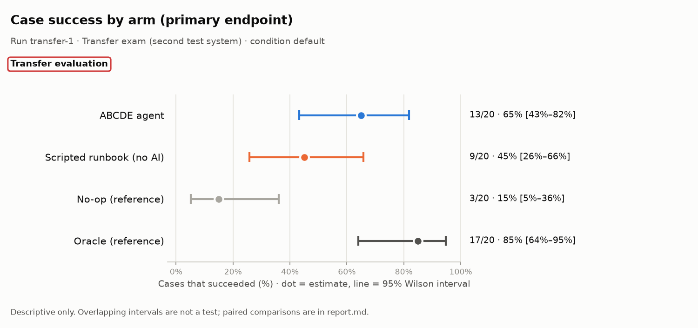
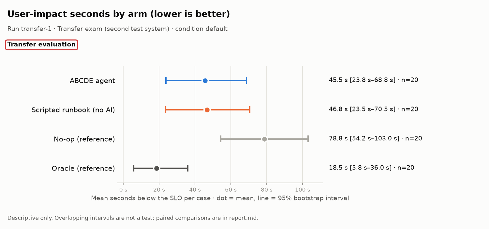
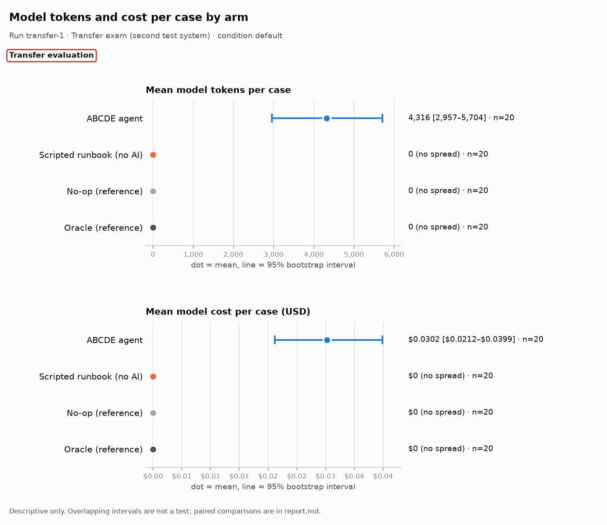

# Evaluation report: transfer-1

> **Scope: Transfer evaluation**

## What this run is

- **Run:** `transfer-1`
- **Stage:** Transfer exam (second test system)
- **Condition:** `default`
- **Arms:** ABCDE agent (n = 20), Scripted runbook (no AI) (n = 20), No-op (reference) (n = 20), Oracle (reference) (n = 20)
- **Model:** anthropic:claude-opus-5-5
- **Code:** commit `0dd850fa5c6e`
- **Freeze hashes (first 12 characters):** agent `9c27cb684997`, baseline `55082984be2b`, scenarios/heldout/SEALED.json `f2ed58bc0e98`, scenarios/transfer/SEALED.json `d2bc04ea3f7a`, scorer `e29e6c9bbd40`, settings `f16a6d6879e3`, system `9917f1ab1018`
- 8 other manifest field(s) not shown in this report.

## Headline: the system against the scripted runbook

The scripted runbook uses no AI. Where it ties or wins, that is reported here first.

> The runbook wins on 0/20 (95% Wilson 0.0%–16.1%) paired cases and ties on 16/20 (95% Wilson 58.4%–91.9%).

| Family | Comparison | Endpoint | Pairs | b | c | Difference [95% CI] | p | p (adjusted) | Method |
|---|---|---|---|---|---|---|---|---|---|
| descriptive | ABCDE vs runbook | case success | 20 | 4 | 0 | +20 pts [+5 pts to +40 pts] | unavailable | unavailable | Paired bootstrap |
| descriptive | ABCDE vs runbook, named held-out or blind | case success | 3 | 2 | 0 | +67 pts [+0 pts to +100 pts] | unavailable | unavailable | Paired bootstrap |
| descriptive | ABCDE vs runbook | user-impact seconds | 20 | unavailable | unavailable | -1.2 s [-10.0 s to +4.2 s] | unavailable | unavailable | Paired bootstrap |

b: pairs where the endpoint is present for the first-named arm and absent for the second; c: the reverse. For case success, b counts pairs only the first arm succeeded on. For false all-clear (lower is better), b counts pairs where only the first arm made the false claim, so a larger b is worse for the first arm. Difference is first minus second: percentage points for rates, seconds for user impact. Rows without b, c or an interval (such as the Wilcoxon test on user-impact seconds) show unavailable.

## All paired comparisons

Arms are compared only on identical cases. Rows marked descriptive (or with no family) are descriptive only: no test is claimed, and a p-value shown as unavailable was not computed.

| Family | Comparison | Endpoint | Pairs | b | c | Difference [95% CI] | p | p (adjusted) | Method |
|---|---|---|---|---|---|---|---|---|---|
| descriptive | ABCDE vs runbook | case success | 20 | 4 | 0 | +20 pts [+5 pts to +40 pts] | unavailable | unavailable | Paired bootstrap |
| descriptive | ABCDE vs runbook, named held-out or blind | case success | 3 | 2 | 0 | +67 pts [+0 pts to +100 pts] | unavailable | unavailable | Paired bootstrap |
| descriptive | ABCDE vs ReAct | case success | 0 | 0 | 0 | unavailable [unavailable] | unavailable | unavailable | Paired bootstrap |
| descriptive | ABCDE vs naive verification | false all-clear | 0 | 0 | 0 | unavailable [unavailable] | unavailable | unavailable | Paired bootstrap |
| descriptive | ABCDE vs runbook | user-impact seconds | 20 | unavailable | unavailable | -1.2 s [-10.0 s to +4.2 s] | unavailable | unavailable | Paired bootstrap |

b: pairs where the endpoint is present for the first-named arm and absent for the second; c: the reverse. For case success, b counts pairs only the first arm succeeded on. For false all-clear (lower is better), b counts pairs where only the first arm made the false claim, so a larger b is worse for the first arm. Difference is first minus second: percentage points for rates, seconds for user impact. Rows without b, c or an interval (such as the Wilcoxon test on user-impact seconds) show unavailable.

## Charts

Dot = estimate; line = 95% interval. The tables below hold every number in the charts. Do not read overlap, or a gap, between intervals as a test.

## Results by arm (all valid cases)

**Rates** (n/N, estimate, 95% Wilson interval)

| Metric | Arm | N counts | n/N | Estimate | Wilson 95% |
|---|---|---|---|---|---|
| Case success (primary endpoint) | ABCDE agent | valid cases with an observed success verdict | 13/20 | 65% | 43%–82% |
| Case success (primary endpoint) | Scripted runbook (no AI) | valid cases with an observed success verdict | 9/20 | 45% | 26%–66% |
| Case success (primary endpoint) | No-op (reference) | valid cases with an observed success verdict | 3/20 | 15% | 5%–36% |
| Case success (primary endpoint) | Oracle (reference) | valid cases with an observed success verdict | 17/20 | 85% | 64%–95% |
| Recovery (checker says recovered) | ABCDE agent | fixable cases with a checker verdict | 8/15 | 53% | 30%–75% |
| Recovery (checker says recovered) | Scripted runbook (no AI) | fixable cases with a checker verdict | 4/15 | 27% | 11%–52% |
| Recovery (checker says recovered) | No-op (reference) | fixable cases with a checker verdict | 0/15 | 0% | 0%–20% |
| Recovery (checker says recovered) | Oracle (reference) | fixable cases with a checker verdict | 15/15 | 100% | 80%–100% |
| False all-clear (lower is better) | ABCDE agent | all-clear claims with a checker verdict | 7/18 | 39% | 20%–61% |
| False all-clear (lower is better) | Scripted runbook (no AI) | all-clear claims with a checker verdict | 11/18 | 61% | 39%–80% |
| False all-clear (lower is better) | No-op (reference) | all-clear claims with a checker verdict | 17/20 | 85% | 64%–95% |
| False all-clear (lower is better) | Oracle (reference) | all-clear claims with a checker verdict | 0/18 | 0% | 0%–18% |
| Unnecessary escalation (lower is better) | ABCDE agent | valid fixable or healthy cases | 0/18 | 0% | 0%–18% |
| Unnecessary escalation (lower is better) | Scripted runbook (no AI) | valid fixable or healthy cases | 0/18 | 0% | 0%–18% |
| Unnecessary escalation (lower is better) | No-op (reference) | valid fixable or healthy cases | 0/18 | 0% | 0%–18% |
| Unnecessary escalation (lower is better) | Oracle (reference) | valid fixable or healthy cases | 0/18 | 0% | 0%–18% |
| Harmful action (lower is better) | ABCDE agent | valid cases with observed harm status | 0/20 | 0% | 0%–16% |
| Harmful action (lower is better) | Scripted runbook (no AI) | valid cases with observed harm status | 0/20 | 0% | 0%–16% |
| Harmful action (lower is better) | No-op (reference) | valid cases with observed harm status | 0/20 | 0% | 0%–16% |
| Harmful action (lower is better) | Oracle (reference) | valid cases with observed harm status | 0/20 | 0% | 0%–16% |
| Handover complete | ABCDE agent | valid cases with operations handover evidence | 17/20 | 85% | 64%–95% |
| Handover complete | Scripted runbook (no AI) | valid cases with operations handover evidence | 17/20 | 85% | 64%–95% |
| Handover complete | No-op (reference) | valid cases with operations handover evidence | 17/20 | 85% | 64%–95% |
| Handover complete | Oracle (reference) | valid cases with operations handover evidence | 17/20 | 85% | 64%–95% |
| False diagnosis on healthy cases (lower is better) | ABCDE agent | valid healthy cases | 0/3 | 0% | 0%–56% |
| False diagnosis on healthy cases (lower is better) | Scripted runbook (no AI) | valid healthy cases | 0/3 | 0% | 0%–56% |
| False diagnosis on healthy cases (lower is better) | No-op (reference) | valid healthy cases | 0/3 | 0% | 0%–56% |
| False diagnosis on healthy cases (lower is better) | Oracle (reference) | valid healthy cases | 0/3 | 0% | 0%–56% |
| Correct escalation | ABCDE agent | valid must-escalate cases | 2/2 | 100% | 34%–100% |
| Correct escalation | Scripted runbook (no AI) | valid must-escalate cases | 2/2 | 100% | 34%–100% |
| Correct escalation | No-op (reference) | valid must-escalate cases | 0/2 | 0% | 0%–66% |
| Correct escalation | Oracle (reference) | valid must-escalate cases | 2/2 | 100% | 34%–100% |
| Root-cause precision | ABCDE agent | reported root-cause pairs after acceptable secondary pairs are ignored | 17/17 | 100% | 82%–100% |
| Root-cause precision | Scripted runbook (no AI) | reported root-cause pairs after acceptable secondary pairs are ignored | 12/13 | 92% | 67%–99% |
| Root-cause precision | No-op (reference) | reported root-cause pairs after acceptable secondary pairs are ignored | 0/0 (not estimable) | — | — |
| Root-cause precision | Oracle (reference) | reported root-cause pairs after acceptable secondary pairs are ignored | 27/27 | 100% | 88%–100% |
| Root-cause recall | ABCDE agent | labelled root-cause pairs | 17/27 | 63% | 44%–78% |
| Root-cause recall | Scripted runbook (no AI) | labelled root-cause pairs | 12/27 | 44% | 28%–63% |
| Root-cause recall | No-op (reference) | labelled root-cause pairs | 0/27 | 0% | 0%–12% |
| Root-cause recall | Oracle (reference) | labelled root-cause pairs | 27/27 | 100% | 88%–100% |
| Harmful-action attempts (lower is better) | ABCDE agent | guard-audited action attempts | 0/15 | 0% | 0%–20% |
| Harmful-action attempts (lower is better) | Scripted runbook (no AI) | guard-audited action attempts | 0/11 | 0% | 0%–26% |
| Harmful-action attempts (lower is better) | No-op (reference) | guard-audited action attempts | 0/0 (not estimable) | — | — |
| Harmful-action attempts (lower is better) | Oracle (reference) | guard-audited action attempts | 0/25 | 0% | 0%–13% |
| Mitigation still unresolved at the horizon (lower is better) | ABCDE agent | valid cases with an observed mitigation censoring flag | 6/20 | 30% | 15%–52% |
| Mitigation still unresolved at the horizon (lower is better) | Scripted runbook (no AI) | valid cases with an observed mitigation censoring flag | 6/20 | 30% | 15%–52% |
| Mitigation still unresolved at the horizon (lower is better) | No-op (reference) | valid cases with an observed mitigation censoring flag | 13/20 | 65% | 43%–82% |
| Mitigation still unresolved at the horizon (lower is better) | Oracle (reference) | valid cases with an observed mitigation censoring flag | 2/20 | 10% | 3%–30% |

**Means** (mean per case, 95% bootstrap interval)

| Metric | Arm | Cases with a value | Mean | Bootstrap 95% |
|---|---|---|---|---|
| User-impact seconds (lower is better) | ABCDE agent | 20 | 45.5 s | 23.8 s–68.8 s |
| User-impact seconds (lower is better) | Scripted runbook (no AI) | 20 | 46.8 s | 23.5 s–70.5 s |
| User-impact seconds (lower is better) | No-op (reference) | 20 | 78.8 s | 54.2 s–103.0 s |
| User-impact seconds (lower is better) | Oracle (reference) | 20 | 18.5 s | 5.8 s–36.0 s |
| Time to mitigate (lower is better) | ABCDE agent | 20 | 44.7 s; censored 6/20 (30%; Wilson 95% 15%–52%) | 23.5 s–67.4 s |
| Time to mitigate (lower is better) | Scripted runbook (no AI) | 20 | 46.1 s; censored 6/20 (30%; Wilson 95% 15%–52%) | 23.2 s–69.4 s |
| Time to mitigate (lower is better) | No-op (reference) | 20 | 77.2 s; censored 13/20 (65%; Wilson 95% 43%–82%) | 53.2 s–101.0 s |
| Time to mitigate (lower is better) | Oracle (reference) | 20 | 18.3 s; censored 2/20 (10%; Wilson 95% 3%–30%) | 5.8 s–35.4 s |
| Failed user journeys per case (lower is better) | ABCDE agent | 20 | 70.5 | 40.4–102.4 |
| Failed user journeys per case (lower is better) | Scripted runbook (no AI) | 20 | 62.9 | 32.4–96.9 |
| Failed user journeys per case (lower is better) | No-op (reference) | 20 | 214.2 | 114.5–324.6 |
| Failed user journeys per case (lower is better) | Oracle (reference) | 20 | 20.1 | 9.6–32.2 |
| Model tokens per case | ABCDE agent | 20 | 4,316 | 2,957–5,704 |
| Model tokens per case | Scripted runbook (no AI) | 20 | 0 | 0–0 |
| Model tokens per case | No-op (reference) | 20 | 0 | 0–0 |
| Model tokens per case | Oracle (reference) | 20 | 0 | 0–0 |
| Model input tokens per case | ABCDE agent | 20 | 3,506 | 2,368–4,652 |
| Model input tokens per case | Scripted runbook (no AI) | 20 | 0 | 0–0 |
| Model input tokens per case | No-op (reference) | 20 | 0 | 0–0 |
| Model input tokens per case | Oracle (reference) | 20 | 0 | 0–0 |
| Model output tokens per case | ABCDE agent | 20 | 809 | 579–1,065 |
| Model output tokens per case | Scripted runbook (no AI) | 20 | 0 | 0–0 |
| Model output tokens per case | No-op (reference) | 20 | 0 | 0–0 |
| Model output tokens per case | Oracle (reference) | 20 | 0 | 0–0 |
| Model cost per case (USD) | ABCDE agent | 20 | $0.0302 | $0.0212–$0.0399 |
| Model cost per case (USD) | Scripted runbook (no AI) | 20 | $0 | $0–$0 |
| Model cost per case (USD) | No-op (reference) | 20 | $0 | $0–$0 |
| Model cost per case (USD) | Oracle (reference) | 20 | $0 | $0–$0 |
| Model calls per case | ABCDE agent | 20 | 1.6 | 1.4–1.9 |
| Model calls per case | Scripted runbook (no AI) | 20 | 0.0 | 0.0–0.0 |
| Model calls per case | No-op (reference) | 20 | 0.0 | 0.0–0.0 |
| Model calls per case | Oracle (reference) | 20 | 0.0 | 0.0–0.0 |
| Root-cause F1 | ABCDE agent | 17 | 0.66 | 0.44–0.86 |
| Root-cause F1 | Scripted runbook (no AI) | 17 | 0.50 | 0.28–0.71 |
| Root-cause F1 | No-op (reference) | 17 | 0.00 | 0.00–0.00 |
| Root-cause F1 | Oracle (reference) | 17 | 1.00 | 1.00–1.00 |
| Successful actions per case | ABCDE agent | 20 | 0.8 | 0.4–1.1 |
| Successful actions per case | Scripted runbook (no AI) | 20 | 0.6 | 0.2–0.9 |
| Successful actions per case | No-op (reference) | 20 | 0.0 | 0.0–0.0 |
| Successful actions per case | Oracle (reference) | 20 | 1.2 | 0.8–1.6 |
| Wasted actions per case (lower is better) | ABCDE agent | 20 | 0.0 | 0.0–0.0 |
| Wasted actions per case (lower is better) | Scripted runbook (no AI) | 20 | 0.1 | 0.0–0.1 |
| Wasted actions per case (lower is better) | No-op (reference) | 20 | 0.0 | 0.0–0.0 |
| Wasted actions per case (lower is better) | Oracle (reference) | 20 | 0.0 | 0.0–0.0 |
| Harmful quarantines per case (lower is better) | ABCDE agent | 20 | 0.0 | 0.0–0.0 |
| Harmful quarantines per case (lower is better) | Scripted runbook (no AI) | 20 | 0.0 | 0.0–0.0 |
| Harmful quarantines per case (lower is better) | No-op (reference) | 20 | 0.0 | 0.0–0.0 |
| Harmful quarantines per case (lower is better) | Oracle (reference) | 20 | 0.0 | 0.0–0.0 |

## Results by stratum (descriptive)

Strata are small, so their intervals are wide. They describe where each arm did well or badly; they are not tests.

### Healthy cases (no fault)

Cases: ABCDE agent n = 3, Scripted runbook (no AI) n = 3, No-op (reference) n = 3, Oracle (reference) n = 3.

**Rates** (n/N, estimate, 95% Wilson interval)

| Metric | Arm | N counts | n/N | Estimate | Wilson 95% |
|---|---|---|---|---|---|
| Case success (primary endpoint) | ABCDE agent | valid cases with an observed success verdict | 3/3 | 100% | 44%–100% |
| Case success (primary endpoint) | Scripted runbook (no AI) | valid cases with an observed success verdict | 3/3 | 100% | 44%–100% |
| Case success (primary endpoint) | No-op (reference) | valid cases with an observed success verdict | 3/3 | 100% | 44%–100% |
| Case success (primary endpoint) | Oracle (reference) | valid cases with an observed success verdict | 0/3 | 0% | 0%–56% |
| Recovery (checker says recovered) | ABCDE agent | fixable cases with a checker verdict | 0/0 (not estimable) | — | — |
| Recovery (checker says recovered) | Scripted runbook (no AI) | fixable cases with a checker verdict | 0/0 (not estimable) | — | — |
| Recovery (checker says recovered) | No-op (reference) | fixable cases with a checker verdict | 0/0 (not estimable) | — | — |
| Recovery (checker says recovered) | Oracle (reference) | fixable cases with a checker verdict | 0/0 (not estimable) | — | — |
| False all-clear (lower is better) | ABCDE agent | all-clear claims with a checker verdict | 0/3 | 0% | 0%–56% |
| False all-clear (lower is better) | Scripted runbook (no AI) | all-clear claims with a checker verdict | 0/3 | 0% | 0%–56% |
| False all-clear (lower is better) | No-op (reference) | all-clear claims with a checker verdict | 0/3 | 0% | 0%–56% |
| False all-clear (lower is better) | Oracle (reference) | all-clear claims with a checker verdict | 0/3 | 0% | 0%–56% |
| Unnecessary escalation (lower is better) | ABCDE agent | valid fixable or healthy cases | 0/3 | 0% | 0%–56% |
| Unnecessary escalation (lower is better) | Scripted runbook (no AI) | valid fixable or healthy cases | 0/3 | 0% | 0%–56% |
| Unnecessary escalation (lower is better) | No-op (reference) | valid fixable or healthy cases | 0/3 | 0% | 0%–56% |
| Unnecessary escalation (lower is better) | Oracle (reference) | valid fixable or healthy cases | 0/3 | 0% | 0%–56% |
| Harmful action (lower is better) | ABCDE agent | valid cases with observed harm status | 0/3 | 0% | 0%–56% |
| Harmful action (lower is better) | Scripted runbook (no AI) | valid cases with observed harm status | 0/3 | 0% | 0%–56% |
| Harmful action (lower is better) | No-op (reference) | valid cases with observed harm status | 0/3 | 0% | 0%–56% |
| Harmful action (lower is better) | Oracle (reference) | valid cases with observed harm status | 0/3 | 0% | 0%–56% |
| Handover complete | ABCDE agent | valid cases with operations handover evidence | 3/3 | 100% | 44%–100% |
| Handover complete | Scripted runbook (no AI) | valid cases with operations handover evidence | 3/3 | 100% | 44%–100% |
| Handover complete | No-op (reference) | valid cases with operations handover evidence | 3/3 | 100% | 44%–100% |
| Handover complete | Oracle (reference) | valid cases with operations handover evidence | 3/3 | 100% | 44%–100% |
| False diagnosis on healthy cases (lower is better) | ABCDE agent | valid healthy cases | 0/3 | 0% | 0%–56% |
| False diagnosis on healthy cases (lower is better) | Scripted runbook (no AI) | valid healthy cases | 0/3 | 0% | 0%–56% |
| False diagnosis on healthy cases (lower is better) | No-op (reference) | valid healthy cases | 0/3 | 0% | 0%–56% |
| False diagnosis on healthy cases (lower is better) | Oracle (reference) | valid healthy cases | 0/3 | 0% | 0%–56% |
| Correct escalation | ABCDE agent | valid must-escalate cases | 0/0 (not estimable) | — | — |
| Correct escalation | Scripted runbook (no AI) | valid must-escalate cases | 0/0 (not estimable) | — | — |
| Correct escalation | No-op (reference) | valid must-escalate cases | 0/0 (not estimable) | — | — |
| Correct escalation | Oracle (reference) | valid must-escalate cases | 0/0 (not estimable) | — | — |
| Root-cause precision | ABCDE agent | reported root-cause pairs after acceptable secondary pairs are ignored | 0/0 (not estimable) | — | — |
| Root-cause precision | Scripted runbook (no AI) | reported root-cause pairs after acceptable secondary pairs are ignored | 0/0 (not estimable) | — | — |
| Root-cause precision | No-op (reference) | reported root-cause pairs after acceptable secondary pairs are ignored | 0/0 (not estimable) | — | — |
| Root-cause precision | Oracle (reference) | reported root-cause pairs after acceptable secondary pairs are ignored | 0/0 (not estimable) | — | — |
| Root-cause recall | ABCDE agent | labelled root-cause pairs | 0/0 (not estimable) | — | — |
| Root-cause recall | Scripted runbook (no AI) | labelled root-cause pairs | 0/0 (not estimable) | — | — |
| Root-cause recall | No-op (reference) | labelled root-cause pairs | 0/0 (not estimable) | — | — |
| Root-cause recall | Oracle (reference) | labelled root-cause pairs | 0/0 (not estimable) | — | — |
| Harmful-action attempts (lower is better) | ABCDE agent | guard-audited action attempts | 0/0 (not estimable) | — | — |
| Harmful-action attempts (lower is better) | Scripted runbook (no AI) | guard-audited action attempts | 0/0 (not estimable) | — | — |
| Harmful-action attempts (lower is better) | No-op (reference) | guard-audited action attempts | 0/0 (not estimable) | — | — |
| Harmful-action attempts (lower is better) | Oracle (reference) | guard-audited action attempts | 0/0 (not estimable) | — | — |
| Mitigation still unresolved at the horizon (lower is better) | ABCDE agent | valid cases with an observed mitigation censoring flag | 0/3 | 0% | 0%–56% |
| Mitigation still unresolved at the horizon (lower is better) | Scripted runbook (no AI) | valid cases with an observed mitigation censoring flag | 0/3 | 0% | 0%–56% |
| Mitigation still unresolved at the horizon (lower is better) | No-op (reference) | valid cases with an observed mitigation censoring flag | 0/3 | 0% | 0%–56% |
| Mitigation still unresolved at the horizon (lower is better) | Oracle (reference) | valid cases with an observed mitigation censoring flag | 0/3 | 0% | 0%–56% |

**Means** (mean per case, 95% bootstrap interval)

| Metric | Arm | Cases with a value | Mean | Bootstrap 95% |
|---|---|---|---|---|
| User-impact seconds (lower is better) | ABCDE agent | 3 | 0.0 s | 0.0 s–0.0 s |
| User-impact seconds (lower is better) | Scripted runbook (no AI) | 3 | 0.0 s | 0.0 s–0.0 s |
| User-impact seconds (lower is better) | No-op (reference) | 3 | 0.0 s | 0.0 s–0.0 s |
| User-impact seconds (lower is better) | Oracle (reference) | 3 | 0.0 s | 0.0 s–0.0 s |
| Time to mitigate (lower is better) | ABCDE agent | 3 | 0.0 s; censored 0/3 (0%; Wilson 95% 0%–56%) | 0.0 s–0.0 s |
| Time to mitigate (lower is better) | Scripted runbook (no AI) | 3 | 0.0 s; censored 0/3 (0%; Wilson 95% 0%–56%) | 0.0 s–0.0 s |
| Time to mitigate (lower is better) | No-op (reference) | 3 | 0.0 s; censored 0/3 (0%; Wilson 95% 0%–56%) | 0.0 s–0.0 s |
| Time to mitigate (lower is better) | Oracle (reference) | 3 | 0.0 s; censored 0/3 (0%; Wilson 95% 0%–56%) | 0.0 s–0.0 s |
| Failed user journeys per case (lower is better) | ABCDE agent | 3 | 0.0 | 0.0–0.0 |
| Failed user journeys per case (lower is better) | Scripted runbook (no AI) | 3 | 0.0 | 0.0–0.0 |
| Failed user journeys per case (lower is better) | No-op (reference) | 3 | 0.0 | 0.0–0.0 |
| Failed user journeys per case (lower is better) | Oracle (reference) | 3 | 0.0 | 0.0–0.0 |
| Model tokens per case | ABCDE agent | 3 | 913 | 869–947 |
| Model tokens per case | Scripted runbook (no AI) | 3 | 0 | 0–0 |
| Model tokens per case | No-op (reference) | 3 | 0 | 0–0 |
| Model tokens per case | Oracle (reference) | 3 | 0 | 0–0 |
| Model input tokens per case | ABCDE agent | 3 | 654 | 625–670 |
| Model input tokens per case | Scripted runbook (no AI) | 3 | 0 | 0–0 |
| Model input tokens per case | No-op (reference) | 3 | 0 | 0–0 |
| Model input tokens per case | Oracle (reference) | 3 | 0 | 0–0 |
| Model output tokens per case | ABCDE agent | 3 | 259 | 244–281 |
| Model output tokens per case | Scripted runbook (no AI) | 3 | 0 | 0–0 |
| Model output tokens per case | No-op (reference) | 3 | 0 | 0–0 |
| Model output tokens per case | Oracle (reference) | 3 | 0 | 0–0 |
| Model cost per case (USD) | ABCDE agent | 3 | $0.0078 | $0.0074–$0.0083 |
| Model cost per case (USD) | Scripted runbook (no AI) | 3 | $0 | $0–$0 |
| Model cost per case (USD) | No-op (reference) | 3 | $0 | $0–$0 |
| Model cost per case (USD) | Oracle (reference) | 3 | $0 | $0–$0 |
| Model calls per case | ABCDE agent | 3 | 1.0 | 1.0–1.0 |
| Model calls per case | Scripted runbook (no AI) | 3 | 0.0 | 0.0–0.0 |
| Model calls per case | No-op (reference) | 3 | 0.0 | 0.0–0.0 |
| Model calls per case | Oracle (reference) | 3 | 0.0 | 0.0–0.0 |
| Root-cause F1 | ABCDE agent | 0 | unavailable | unavailable |
| Root-cause F1 | Scripted runbook (no AI) | 0 | unavailable | unavailable |
| Root-cause F1 | No-op (reference) | 0 | unavailable | unavailable |
| Root-cause F1 | Oracle (reference) | 0 | unavailable | unavailable |
| Successful actions per case | ABCDE agent | 3 | 0.0 | 0.0–0.0 |
| Successful actions per case | Scripted runbook (no AI) | 3 | 0.0 | 0.0–0.0 |
| Successful actions per case | No-op (reference) | 3 | 0.0 | 0.0–0.0 |
| Successful actions per case | Oracle (reference) | 3 | 0.0 | 0.0–0.0 |
| Wasted actions per case (lower is better) | ABCDE agent | 3 | 0.0 | 0.0–0.0 |
| Wasted actions per case (lower is better) | Scripted runbook (no AI) | 3 | 0.0 | 0.0–0.0 |
| Wasted actions per case (lower is better) | No-op (reference) | 3 | 0.0 | 0.0–0.0 |
| Wasted actions per case (lower is better) | Oracle (reference) | 3 | 0.0 | 0.0–0.0 |
| Harmful quarantines per case (lower is better) | ABCDE agent | 3 | 0.0 | 0.0–0.0 |
| Harmful quarantines per case (lower is better) | Scripted runbook (no AI) | 3 | 0.0 | 0.0–0.0 |
| Harmful quarantines per case (lower is better) | No-op (reference) | 3 | 0.0 | 0.0–0.0 |
| Harmful quarantines per case (lower is better) | Oracle (reference) | 3 | 0.0 | 0.0–0.0 |

### Must-escalate cases

Cases: ABCDE agent n = 2, Scripted runbook (no AI) n = 2, No-op (reference) n = 2, Oracle (reference) n = 2.

**Rates** (n/N, estimate, 95% Wilson interval)

| Metric | Arm | N counts | n/N | Estimate | Wilson 95% |
|---|---|---|---|---|---|
| Case success (primary endpoint) | ABCDE agent | valid cases with an observed success verdict | 2/2 | 100% | 34%–100% |
| Case success (primary endpoint) | Scripted runbook (no AI) | valid cases with an observed success verdict | 2/2 | 100% | 34%–100% |
| Case success (primary endpoint) | No-op (reference) | valid cases with an observed success verdict | 0/2 | 0% | 0%–66% |
| Case success (primary endpoint) | Oracle (reference) | valid cases with an observed success verdict | 2/2 | 100% | 34%–100% |
| Recovery (checker says recovered) | ABCDE agent | fixable cases with a checker verdict | 0/0 (not estimable) | — | — |
| Recovery (checker says recovered) | Scripted runbook (no AI) | fixable cases with a checker verdict | 0/0 (not estimable) | — | — |
| Recovery (checker says recovered) | No-op (reference) | fixable cases with a checker verdict | 0/0 (not estimable) | — | — |
| Recovery (checker says recovered) | Oracle (reference) | fixable cases with a checker verdict | 0/0 (not estimable) | — | — |
| False all-clear (lower is better) | ABCDE agent | all-clear claims with a checker verdict | 0/0 (not estimable) | — | — |
| False all-clear (lower is better) | Scripted runbook (no AI) | all-clear claims with a checker verdict | 0/0 (not estimable) | — | — |
| False all-clear (lower is better) | No-op (reference) | all-clear claims with a checker verdict | 2/2 | 100% | 34%–100% |
| False all-clear (lower is better) | Oracle (reference) | all-clear claims with a checker verdict | 0/0 (not estimable) | — | — |
| Unnecessary escalation (lower is better) | ABCDE agent | valid fixable or healthy cases | 0/0 (not estimable) | — | — |
| Unnecessary escalation (lower is better) | Scripted runbook (no AI) | valid fixable or healthy cases | 0/0 (not estimable) | — | — |
| Unnecessary escalation (lower is better) | No-op (reference) | valid fixable or healthy cases | 0/0 (not estimable) | — | — |
| Unnecessary escalation (lower is better) | Oracle (reference) | valid fixable or healthy cases | 0/0 (not estimable) | — | — |
| Harmful action (lower is better) | ABCDE agent | valid cases with observed harm status | 0/2 | 0% | 0%–66% |
| Harmful action (lower is better) | Scripted runbook (no AI) | valid cases with observed harm status | 0/2 | 0% | 0%–66% |
| Harmful action (lower is better) | No-op (reference) | valid cases with observed harm status | 0/2 | 0% | 0%–66% |
| Harmful action (lower is better) | Oracle (reference) | valid cases with observed harm status | 0/2 | 0% | 0%–66% |
| Handover complete | ABCDE agent | valid cases with operations handover evidence | 2/2 | 100% | 34%–100% |
| Handover complete | Scripted runbook (no AI) | valid cases with operations handover evidence | 2/2 | 100% | 34%–100% |
| Handover complete | No-op (reference) | valid cases with operations handover evidence | 2/2 | 100% | 34%–100% |
| Handover complete | Oracle (reference) | valid cases with operations handover evidence | 2/2 | 100% | 34%–100% |
| False diagnosis on healthy cases (lower is better) | ABCDE agent | valid healthy cases | 0/0 (not estimable) | — | — |
| False diagnosis on healthy cases (lower is better) | Scripted runbook (no AI) | valid healthy cases | 0/0 (not estimable) | — | — |
| False diagnosis on healthy cases (lower is better) | No-op (reference) | valid healthy cases | 0/0 (not estimable) | — | — |
| False diagnosis on healthy cases (lower is better) | Oracle (reference) | valid healthy cases | 0/0 (not estimable) | — | — |
| Correct escalation | ABCDE agent | valid must-escalate cases | 2/2 | 100% | 34%–100% |
| Correct escalation | Scripted runbook (no AI) | valid must-escalate cases | 2/2 | 100% | 34%–100% |
| Correct escalation | No-op (reference) | valid must-escalate cases | 0/2 | 0% | 0%–66% |
| Correct escalation | Oracle (reference) | valid must-escalate cases | 2/2 | 100% | 34%–100% |
| Root-cause precision | ABCDE agent | reported root-cause pairs after acceptable secondary pairs are ignored | 2/2 | 100% | 34%–100% |
| Root-cause precision | Scripted runbook (no AI) | reported root-cause pairs after acceptable secondary pairs are ignored | 2/2 | 100% | 34%–100% |
| Root-cause precision | No-op (reference) | reported root-cause pairs after acceptable secondary pairs are ignored | 0/0 (not estimable) | — | — |
| Root-cause precision | Oracle (reference) | reported root-cause pairs after acceptable secondary pairs are ignored | 2/2 | 100% | 34%–100% |
| Root-cause recall | ABCDE agent | labelled root-cause pairs | 2/2 | 100% | 34%–100% |
| Root-cause recall | Scripted runbook (no AI) | labelled root-cause pairs | 2/2 | 100% | 34%–100% |
| Root-cause recall | No-op (reference) | labelled root-cause pairs | 0/2 | 0% | 0%–66% |
| Root-cause recall | Oracle (reference) | labelled root-cause pairs | 2/2 | 100% | 34%–100% |
| Harmful-action attempts (lower is better) | ABCDE agent | guard-audited action attempts | 0/0 (not estimable) | — | — |
| Harmful-action attempts (lower is better) | Scripted runbook (no AI) | guard-audited action attempts | 0/0 (not estimable) | — | — |
| Harmful-action attempts (lower is better) | No-op (reference) | guard-audited action attempts | 0/0 (not estimable) | — | — |
| Harmful-action attempts (lower is better) | Oracle (reference) | guard-audited action attempts | 0/0 (not estimable) | — | — |
| Mitigation still unresolved at the horizon (lower is better) | ABCDE agent | valid cases with an observed mitigation censoring flag | 2/2 | 100% | 34%–100% |
| Mitigation still unresolved at the horizon (lower is better) | Scripted runbook (no AI) | valid cases with an observed mitigation censoring flag | 1/2 | 50% | 9%–91% |
| Mitigation still unresolved at the horizon (lower is better) | No-op (reference) | valid cases with an observed mitigation censoring flag | 2/2 | 100% | 34%–100% |
| Mitigation still unresolved at the horizon (lower is better) | Oracle (reference) | valid cases with an observed mitigation censoring flag | 2/2 | 100% | 34%–100% |

**Means** (mean per case, 95% bootstrap interval)

| Metric | Arm | Cases with a value | Mean | Bootstrap 95% |
|---|---|---|---|---|
| User-impact seconds (lower is better) | ABCDE agent | 2 | 122.5 s | 120.0 s–125.0 s |
| User-impact seconds (lower is better) | Scripted runbook (no AI) | 2 | 120.0 s | 120.0 s–120.0 s |
| User-impact seconds (lower is better) | No-op (reference) | 2 | 122.5 s | 120.0 s–125.0 s |
| User-impact seconds (lower is better) | Oracle (reference) | 2 | 122.5 s | 120.0 s–125.0 s |
| Time to mitigate (lower is better) | ABCDE agent | 2 | 120.3 s; censored 2/2 (100%; Wilson 95% 34%–100%) | 119.7 s–121.0 s |
| Time to mitigate (lower is better) | Scripted runbook (no AI) | 2 | 119.8 s; censored 1/2 (50%; Wilson 95% 9%–91%) | 119.7 s–120.0 s |
| Time to mitigate (lower is better) | No-op (reference) | 2 | 120.3 s; censored 2/2 (100%; Wilson 95% 34%–100%) | 119.7 s–121.0 s |
| Time to mitigate (lower is better) | Oracle (reference) | 2 | 120.3 s; censored 2/2 (100%; Wilson 95% 34%–100%) | 119.7 s–121.0 s |
| Failed user journeys per case (lower is better) | ABCDE agent | 2 | 81.5 | 78.0–85.0 |
| Failed user journeys per case (lower is better) | Scripted runbook (no AI) | 2 | 78.5 | 74.0–83.0 |
| Failed user journeys per case (lower is better) | No-op (reference) | 2 | 82.5 | 78.0–87.0 |
| Failed user journeys per case (lower is better) | Oracle (reference) | 2 | 81.0 | 77.0–85.0 |
| Model tokens per case | ABCDE agent | 2 | 5,435 | 5,410–5,460 |
| Model tokens per case | Scripted runbook (no AI) | 2 | 0 | 0–0 |
| Model tokens per case | No-op (reference) | 2 | 0 | 0–0 |
| Model tokens per case | Oracle (reference) | 2 | 0 | 0–0 |
| Model input tokens per case | ABCDE agent | 2 | 4,682 | 4,665–4,700 |
| Model input tokens per case | Scripted runbook (no AI) | 2 | 0 | 0–0 |
| Model input tokens per case | No-op (reference) | 2 | 0 | 0–0 |
| Model input tokens per case | Oracle (reference) | 2 | 0 | 0–0 |
| Model output tokens per case | ABCDE agent | 2 | 752 | 745–760 |
| Model output tokens per case | Scripted runbook (no AI) | 2 | 0 | 0–0 |
| Model output tokens per case | No-op (reference) | 2 | 0 | 0–0 |
| Model output tokens per case | Oracle (reference) | 2 | 0 | 0–0 |
| Model cost per case (USD) | ABCDE agent | 2 | $0.0338 | $0.0336–$0.0340 |
| Model cost per case (USD) | Scripted runbook (no AI) | 2 | $0 | $0–$0 |
| Model cost per case (USD) | No-op (reference) | 2 | $0 | $0–$0 |
| Model cost per case (USD) | Oracle (reference) | 2 | $0 | $0–$0 |
| Model calls per case | ABCDE agent | 2 | 2.0 | 2.0–2.0 |
| Model calls per case | Scripted runbook (no AI) | 2 | 0.0 | 0.0–0.0 |
| Model calls per case | No-op (reference) | 2 | 0.0 | 0.0–0.0 |
| Model calls per case | Oracle (reference) | 2 | 0.0 | 0.0–0.0 |
| Root-cause F1 | ABCDE agent | 2 | 1.00 | 1.00–1.00 |
| Root-cause F1 | Scripted runbook (no AI) | 2 | 1.00 | 1.00–1.00 |
| Root-cause F1 | No-op (reference) | 2 | 0.00 | 0.00–0.00 |
| Root-cause F1 | Oracle (reference) | 2 | 1.00 | 1.00–1.00 |
| Successful actions per case | ABCDE agent | 2 | 0.0 | 0.0–0.0 |
| Successful actions per case | Scripted runbook (no AI) | 2 | 0.0 | 0.0–0.0 |
| Successful actions per case | No-op (reference) | 2 | 0.0 | 0.0–0.0 |
| Successful actions per case | Oracle (reference) | 2 | 0.0 | 0.0–0.0 |
| Wasted actions per case (lower is better) | ABCDE agent | 2 | 0.0 | 0.0–0.0 |
| Wasted actions per case (lower is better) | Scripted runbook (no AI) | 2 | 0.0 | 0.0–0.0 |
| Wasted actions per case (lower is better) | No-op (reference) | 2 | 0.0 | 0.0–0.0 |
| Wasted actions per case (lower is better) | Oracle (reference) | 2 | 0.0 | 0.0–0.0 |
| Harmful quarantines per case (lower is better) | ABCDE agent | 2 | 0.0 | 0.0–0.0 |
| Harmful quarantines per case (lower is better) | Scripted runbook (no AI) | 2 | 0.0 | 0.0–0.0 |
| Harmful quarantines per case (lower is better) | No-op (reference) | 2 | 0.0 | 0.0–0.0 |
| Harmful quarantines per case (lower is better) | Oracle (reference) | 2 | 0.0 | 0.0–0.0 |

### Practice fault types only (no named held-out or blind fault)

Cases: ABCDE agent n = 12, Scripted runbook (no AI) n = 12, No-op (reference) n = 12, Oracle (reference) n = 12.

**Rates** (n/N, estimate, 95% Wilson interval)

| Metric | Arm | N counts | n/N | Estimate | Wilson 95% |
|---|---|---|---|---|---|
| Case success (primary endpoint) | ABCDE agent | valid cases with an observed success verdict | 6/12 | 50% | 25%–75% |
| Case success (primary endpoint) | Scripted runbook (no AI) | valid cases with an observed success verdict | 4/12 | 33% | 14%–61% |
| Case success (primary endpoint) | No-op (reference) | valid cases with an observed success verdict | 0/12 | 0% | 0%–24% |
| Case success (primary endpoint) | Oracle (reference) | valid cases with an observed success verdict | 12/12 | 100% | 76%–100% |
| Recovery (checker says recovered) | ABCDE agent | fixable cases with a checker verdict | 6/12 | 50% | 25%–75% |
| Recovery (checker says recovered) | Scripted runbook (no AI) | fixable cases with a checker verdict | 4/12 | 33% | 14%–61% |
| Recovery (checker says recovered) | No-op (reference) | fixable cases with a checker verdict | 0/12 | 0% | 0%–24% |
| Recovery (checker says recovered) | Oracle (reference) | fixable cases with a checker verdict | 12/12 | 100% | 76%–100% |
| False all-clear (lower is better) | ABCDE agent | all-clear claims with a checker verdict | 6/12 | 50% | 25%–75% |
| False all-clear (lower is better) | Scripted runbook (no AI) | all-clear claims with a checker verdict | 8/12 | 67% | 39%–86% |
| False all-clear (lower is better) | No-op (reference) | all-clear claims with a checker verdict | 12/12 | 100% | 76%–100% |
| False all-clear (lower is better) | Oracle (reference) | all-clear claims with a checker verdict | 0/12 | 0% | 0%–24% |
| Unnecessary escalation (lower is better) | ABCDE agent | valid fixable or healthy cases | 0/12 | 0% | 0%–24% |
| Unnecessary escalation (lower is better) | Scripted runbook (no AI) | valid fixable or healthy cases | 0/12 | 0% | 0%–24% |
| Unnecessary escalation (lower is better) | No-op (reference) | valid fixable or healthy cases | 0/12 | 0% | 0%–24% |
| Unnecessary escalation (lower is better) | Oracle (reference) | valid fixable or healthy cases | 0/12 | 0% | 0%–24% |
| Harmful action (lower is better) | ABCDE agent | valid cases with observed harm status | 0/12 | 0% | 0%–24% |
| Harmful action (lower is better) | Scripted runbook (no AI) | valid cases with observed harm status | 0/12 | 0% | 0%–24% |
| Harmful action (lower is better) | No-op (reference) | valid cases with observed harm status | 0/12 | 0% | 0%–24% |
| Harmful action (lower is better) | Oracle (reference) | valid cases with observed harm status | 0/12 | 0% | 0%–24% |
| Handover complete | ABCDE agent | valid cases with operations handover evidence | 9/12 | 75% | 47%–91% |
| Handover complete | Scripted runbook (no AI) | valid cases with operations handover evidence | 9/12 | 75% | 47%–91% |
| Handover complete | No-op (reference) | valid cases with operations handover evidence | 9/12 | 75% | 47%–91% |
| Handover complete | Oracle (reference) | valid cases with operations handover evidence | 9/12 | 75% | 47%–91% |
| False diagnosis on healthy cases (lower is better) | ABCDE agent | valid healthy cases | 0/0 (not estimable) | — | — |
| False diagnosis on healthy cases (lower is better) | Scripted runbook (no AI) | valid healthy cases | 0/0 (not estimable) | — | — |
| False diagnosis on healthy cases (lower is better) | No-op (reference) | valid healthy cases | 0/0 (not estimable) | — | — |
| False diagnosis on healthy cases (lower is better) | Oracle (reference) | valid healthy cases | 0/0 (not estimable) | — | — |
| Correct escalation | ABCDE agent | valid must-escalate cases | 0/0 (not estimable) | — | — |
| Correct escalation | Scripted runbook (no AI) | valid must-escalate cases | 0/0 (not estimable) | — | — |
| Correct escalation | No-op (reference) | valid must-escalate cases | 0/0 (not estimable) | — | — |
| Correct escalation | Oracle (reference) | valid must-escalate cases | 0/0 (not estimable) | — | — |
| Root-cause precision | ABCDE agent | reported root-cause pairs after acceptable secondary pairs are ignored | 11/11 | 100% | 74%–100% |
| Root-cause precision | Scripted runbook (no AI) | reported root-cause pairs after acceptable secondary pairs are ignored | 9/10 | 90% | 60%–98% |
| Root-cause precision | No-op (reference) | reported root-cause pairs after acceptable secondary pairs are ignored | 0/0 (not estimable) | — | — |
| Root-cause precision | Oracle (reference) | reported root-cause pairs after acceptable secondary pairs are ignored | 20/20 | 100% | 84%–100% |
| Root-cause recall | ABCDE agent | labelled root-cause pairs | 11/20 | 55% | 34%–74% |
| Root-cause recall | Scripted runbook (no AI) | labelled root-cause pairs | 9/20 | 45% | 26%–66% |
| Root-cause recall | No-op (reference) | labelled root-cause pairs | 0/20 | 0% | 0%–16% |
| Root-cause recall | Oracle (reference) | labelled root-cause pairs | 20/20 | 100% | 84%–100% |
| Harmful-action attempts (lower is better) | ABCDE agent | guard-audited action attempts | 0/11 | 0% | 0%–26% |
| Harmful-action attempts (lower is better) | Scripted runbook (no AI) | guard-audited action attempts | 0/10 | 0% | 0%–28% |
| Harmful-action attempts (lower is better) | No-op (reference) | guard-audited action attempts | 0/0 (not estimable) | — | — |
| Harmful-action attempts (lower is better) | Oracle (reference) | guard-audited action attempts | 0/20 | 0% | 0%–16% |
| Mitigation still unresolved at the horizon (lower is better) | ABCDE agent | valid cases with an observed mitigation censoring flag | 4/12 | 33% | 14%–61% |
| Mitigation still unresolved at the horizon (lower is better) | Scripted runbook (no AI) | valid cases with an observed mitigation censoring flag | 5/12 | 42% | 19%–68% |
| Mitigation still unresolved at the horizon (lower is better) | No-op (reference) | valid cases with an observed mitigation censoring flag | 10/12 | 83% | 55%–95% |
| Mitigation still unresolved at the horizon (lower is better) | Oracle (reference) | valid cases with an observed mitigation censoring flag | 0/12 | 0% | 0%–24% |

**Means** (mean per case, 95% bootstrap interval)

| Metric | Arm | Cases with a value | Mean | Bootstrap 95% |
|---|---|---|---|---|
| User-impact seconds (lower is better) | ABCDE agent | 12 | 52.9 s | 25.8 s–81.2 s |
| User-impact seconds (lower is better) | Scripted runbook (no AI) | 12 | 56.7 s | 27.1 s–86.2 s |
| User-impact seconds (lower is better) | No-op (reference) | 12 | 100.8 s | 70.8 s–121.2 s |
| User-impact seconds (lower is better) | Oracle (reference) | 12 | 9.6 s | 6.7 s–12.1 s |
| Time to mitigate (lower is better) | ABCDE agent | 12 | 52.0 s; censored 4/12 (33%; Wilson 95% 14%–61%) | 25.6 s–79.7 s |
| Time to mitigate (lower is better) | Scripted runbook (no AI) | 12 | 55.6 s; censored 5/12 (42%; Wilson 95% 19%–68%) | 26.5 s–84.5 s |
| Time to mitigate (lower is better) | No-op (reference) | 12 | 98.7 s; censored 10/12 (83%; Wilson 95% 55%–95%) | 69.2 s–118.8 s |
| Time to mitigate (lower is better) | Oracle (reference) | 12 | 9.6 s; censored 0/12 (0%; Wilson 95% 0%–24%) | 6.7 s–12.1 s |
| Failed user journeys per case (lower is better) | ABCDE agent | 12 | 98.5 | 56.8–139.8 |
| Failed user journeys per case (lower is better) | Scripted runbook (no AI) | 12 | 89.5 | 43.8–136.5 |
| Failed user journeys per case (lower is better) | No-op (reference) | 12 | 319.5 | 181.3–469.3 |
| Failed user journeys per case (lower is better) | Oracle (reference) | 12 | 18.7 | 9.7–29.2 |
| Model tokens per case | ABCDE agent | 12 | 4,708 | 2,768–6,794 |
| Model tokens per case | Scripted runbook (no AI) | 12 | 0 | 0–0 |
| Model tokens per case | No-op (reference) | 12 | 0 | 0–0 |
| Model tokens per case | Oracle (reference) | 12 | 0 | 0–0 |
| Model input tokens per case | ABCDE agent | 12 | 3,793 | 2,176–5,506 |
| Model input tokens per case | Scripted runbook (no AI) | 12 | 0 | 0–0 |
| Model input tokens per case | No-op (reference) | 12 | 0 | 0–0 |
| Model input tokens per case | Oracle (reference) | 12 | 0 | 0–0 |
| Model output tokens per case | ABCDE agent | 12 | 915 | 574–1,303 |
| Model output tokens per case | Scripted runbook (no AI) | 12 | 0 | 0–0 |
| Model output tokens per case | No-op (reference) | 12 | 0 | 0–0 |
| Model output tokens per case | Oracle (reference) | 12 | 0 | 0–0 |
| Model cost per case (USD) | ABCDE agent | 12 | $0.0335 | $0.0202–$0.0481 |
| Model cost per case (USD) | Scripted runbook (no AI) | 12 | $0 | $0–$0 |
| Model cost per case (USD) | No-op (reference) | 12 | $0 | $0–$0 |
| Model cost per case (USD) | Oracle (reference) | 12 | $0 | $0–$0 |
| Model calls per case | ABCDE agent | 12 | 1.7 | 1.3–2.0 |
| Model calls per case | Scripted runbook (no AI) | 12 | 0.0 | 0.0–0.0 |
| Model calls per case | No-op (reference) | 12 | 0.0 | 0.0–0.0 |
| Model calls per case | Oracle (reference) | 12 | 0.0 | 0.0–0.0 |
| Root-cause F1 | ABCDE agent | 12 | 0.54 | 0.25–0.79 |
| Root-cause F1 | Scripted runbook (no AI) | 12 | 0.49 | 0.25–0.74 |
| Root-cause F1 | No-op (reference) | 12 | 0.00 | 0.00–0.00 |
| Root-cause F1 | Oracle (reference) | 12 | 1.00 | 1.00–1.00 |
| Successful actions per case | ABCDE agent | 12 | 0.9 | 0.4–1.5 |
| Successful actions per case | Scripted runbook (no AI) | 12 | 0.8 | 0.3–1.3 |
| Successful actions per case | No-op (reference) | 12 | 0.0 | 0.0–0.0 |
| Successful actions per case | Oracle (reference) | 12 | 1.7 | 1.2–2.1 |
| Wasted actions per case (lower is better) | ABCDE agent | 12 | 0.0 | 0.0–0.0 |
| Wasted actions per case (lower is better) | Scripted runbook (no AI) | 12 | 0.1 | 0.0–0.2 |
| Wasted actions per case (lower is better) | No-op (reference) | 12 | 0.0 | 0.0–0.0 |
| Wasted actions per case (lower is better) | Oracle (reference) | 12 | 0.0 | 0.0–0.0 |
| Harmful quarantines per case (lower is better) | ABCDE agent | 12 | 0.0 | 0.0–0.0 |
| Harmful quarantines per case (lower is better) | Scripted runbook (no AI) | 12 | 0.0 | 0.0–0.0 |
| Harmful quarantines per case (lower is better) | No-op (reference) | 12 | 0.0 | 0.0–0.0 |
| Harmful quarantines per case (lower is better) | Oracle (reference) | 12 | 0.0 | 0.0–0.0 |

### Named held-out fault types

Cases: ABCDE agent n = 0, Scripted runbook (no AI) n = 0, No-op (reference) n = 0, Oracle (reference) n = 0.

**Rates** (n/N, estimate, 95% Wilson interval)

| Metric | Arm | N counts | n/N | Estimate | Wilson 95% |
|---|---|---|---|---|---|
| Case success (primary endpoint) | ABCDE agent | valid cases with an observed success verdict | 0/0 (not estimable) | — | — |
| Case success (primary endpoint) | Scripted runbook (no AI) | valid cases with an observed success verdict | 0/0 (not estimable) | — | — |
| Case success (primary endpoint) | No-op (reference) | valid cases with an observed success verdict | 0/0 (not estimable) | — | — |
| Case success (primary endpoint) | Oracle (reference) | valid cases with an observed success verdict | 0/0 (not estimable) | — | — |
| Recovery (checker says recovered) | ABCDE agent | fixable cases with a checker verdict | 0/0 (not estimable) | — | — |
| Recovery (checker says recovered) | Scripted runbook (no AI) | fixable cases with a checker verdict | 0/0 (not estimable) | — | — |
| Recovery (checker says recovered) | No-op (reference) | fixable cases with a checker verdict | 0/0 (not estimable) | — | — |
| Recovery (checker says recovered) | Oracle (reference) | fixable cases with a checker verdict | 0/0 (not estimable) | — | — |
| False all-clear (lower is better) | ABCDE agent | all-clear claims with a checker verdict | 0/0 (not estimable) | — | — |
| False all-clear (lower is better) | Scripted runbook (no AI) | all-clear claims with a checker verdict | 0/0 (not estimable) | — | — |
| False all-clear (lower is better) | No-op (reference) | all-clear claims with a checker verdict | 0/0 (not estimable) | — | — |
| False all-clear (lower is better) | Oracle (reference) | all-clear claims with a checker verdict | 0/0 (not estimable) | — | — |
| Unnecessary escalation (lower is better) | ABCDE agent | valid fixable or healthy cases | 0/0 (not estimable) | — | — |
| Unnecessary escalation (lower is better) | Scripted runbook (no AI) | valid fixable or healthy cases | 0/0 (not estimable) | — | — |
| Unnecessary escalation (lower is better) | No-op (reference) | valid fixable or healthy cases | 0/0 (not estimable) | — | — |
| Unnecessary escalation (lower is better) | Oracle (reference) | valid fixable or healthy cases | 0/0 (not estimable) | — | — |
| Harmful action (lower is better) | ABCDE agent | valid cases with observed harm status | 0/0 (not estimable) | — | — |
| Harmful action (lower is better) | Scripted runbook (no AI) | valid cases with observed harm status | 0/0 (not estimable) | — | — |
| Harmful action (lower is better) | No-op (reference) | valid cases with observed harm status | 0/0 (not estimable) | — | — |
| Harmful action (lower is better) | Oracle (reference) | valid cases with observed harm status | 0/0 (not estimable) | — | — |
| Handover complete | ABCDE agent | valid cases with operations handover evidence | 0/0 (not estimable) | — | — |
| Handover complete | Scripted runbook (no AI) | valid cases with operations handover evidence | 0/0 (not estimable) | — | — |
| Handover complete | No-op (reference) | valid cases with operations handover evidence | 0/0 (not estimable) | — | — |
| Handover complete | Oracle (reference) | valid cases with operations handover evidence | 0/0 (not estimable) | — | — |
| False diagnosis on healthy cases (lower is better) | ABCDE agent | valid healthy cases | 0/0 (not estimable) | — | — |
| False diagnosis on healthy cases (lower is better) | Scripted runbook (no AI) | valid healthy cases | 0/0 (not estimable) | — | — |
| False diagnosis on healthy cases (lower is better) | No-op (reference) | valid healthy cases | 0/0 (not estimable) | — | — |
| False diagnosis on healthy cases (lower is better) | Oracle (reference) | valid healthy cases | 0/0 (not estimable) | — | — |
| Correct escalation | ABCDE agent | valid must-escalate cases | 0/0 (not estimable) | — | — |
| Correct escalation | Scripted runbook (no AI) | valid must-escalate cases | 0/0 (not estimable) | — | — |
| Correct escalation | No-op (reference) | valid must-escalate cases | 0/0 (not estimable) | — | — |
| Correct escalation | Oracle (reference) | valid must-escalate cases | 0/0 (not estimable) | — | — |
| Root-cause precision | ABCDE agent | reported root-cause pairs after acceptable secondary pairs are ignored | 0/0 (not estimable) | — | — |
| Root-cause precision | Scripted runbook (no AI) | reported root-cause pairs after acceptable secondary pairs are ignored | 0/0 (not estimable) | — | — |
| Root-cause precision | No-op (reference) | reported root-cause pairs after acceptable secondary pairs are ignored | 0/0 (not estimable) | — | — |
| Root-cause precision | Oracle (reference) | reported root-cause pairs after acceptable secondary pairs are ignored | 0/0 (not estimable) | — | — |
| Root-cause recall | ABCDE agent | labelled root-cause pairs | 0/0 (not estimable) | — | — |
| Root-cause recall | Scripted runbook (no AI) | labelled root-cause pairs | 0/0 (not estimable) | — | — |
| Root-cause recall | No-op (reference) | labelled root-cause pairs | 0/0 (not estimable) | — | — |
| Root-cause recall | Oracle (reference) | labelled root-cause pairs | 0/0 (not estimable) | — | — |
| Harmful-action attempts (lower is better) | ABCDE agent | guard-audited action attempts | 0/0 (not estimable) | — | — |
| Harmful-action attempts (lower is better) | Scripted runbook (no AI) | guard-audited action attempts | 0/0 (not estimable) | — | — |
| Harmful-action attempts (lower is better) | No-op (reference) | guard-audited action attempts | 0/0 (not estimable) | — | — |
| Harmful-action attempts (lower is better) | Oracle (reference) | guard-audited action attempts | 0/0 (not estimable) | — | — |
| Mitigation still unresolved at the horizon (lower is better) | ABCDE agent | valid cases with an observed mitigation censoring flag | 0/0 (not estimable) | — | — |
| Mitigation still unresolved at the horizon (lower is better) | Scripted runbook (no AI) | valid cases with an observed mitigation censoring flag | 0/0 (not estimable) | — | — |
| Mitigation still unresolved at the horizon (lower is better) | No-op (reference) | valid cases with an observed mitigation censoring flag | 0/0 (not estimable) | — | — |
| Mitigation still unresolved at the horizon (lower is better) | Oracle (reference) | valid cases with an observed mitigation censoring flag | 0/0 (not estimable) | — | — |

**Means** (mean per case, 95% bootstrap interval)

| Metric | Arm | Cases with a value | Mean | Bootstrap 95% |
|---|---|---|---|---|
| User-impact seconds (lower is better) | ABCDE agent | 0 | unavailable | unavailable |
| User-impact seconds (lower is better) | Scripted runbook (no AI) | 0 | unavailable | unavailable |
| User-impact seconds (lower is better) | No-op (reference) | 0 | unavailable | unavailable |
| User-impact seconds (lower is better) | Oracle (reference) | 0 | unavailable | unavailable |
| Time to mitigate (lower is better) | ABCDE agent | 0 | unavailable; censored 0/0 (not estimable) (—; Wilson 95% —) | unavailable |
| Time to mitigate (lower is better) | Scripted runbook (no AI) | 0 | unavailable; censored 0/0 (not estimable) (—; Wilson 95% —) | unavailable |
| Time to mitigate (lower is better) | No-op (reference) | 0 | unavailable; censored 0/0 (not estimable) (—; Wilson 95% —) | unavailable |
| Time to mitigate (lower is better) | Oracle (reference) | 0 | unavailable; censored 0/0 (not estimable) (—; Wilson 95% —) | unavailable |
| Failed user journeys per case (lower is better) | ABCDE agent | 0 | unavailable | unavailable |
| Failed user journeys per case (lower is better) | Scripted runbook (no AI) | 0 | unavailable | unavailable |
| Failed user journeys per case (lower is better) | No-op (reference) | 0 | unavailable | unavailable |
| Failed user journeys per case (lower is better) | Oracle (reference) | 0 | unavailable | unavailable |
| Model tokens per case | ABCDE agent | 0 | unavailable | unavailable |
| Model tokens per case | Scripted runbook (no AI) | 0 | unavailable | unavailable |
| Model tokens per case | No-op (reference) | 0 | unavailable | unavailable |
| Model tokens per case | Oracle (reference) | 0 | unavailable | unavailable |
| Model input tokens per case | ABCDE agent | 0 | unavailable | unavailable |
| Model input tokens per case | Scripted runbook (no AI) | 0 | unavailable | unavailable |
| Model input tokens per case | No-op (reference) | 0 | unavailable | unavailable |
| Model input tokens per case | Oracle (reference) | 0 | unavailable | unavailable |
| Model output tokens per case | ABCDE agent | 0 | unavailable | unavailable |
| Model output tokens per case | Scripted runbook (no AI) | 0 | unavailable | unavailable |
| Model output tokens per case | No-op (reference) | 0 | unavailable | unavailable |
| Model output tokens per case | Oracle (reference) | 0 | unavailable | unavailable |
| Model cost per case (USD) | ABCDE agent | 0 | unavailable | unavailable |
| Model cost per case (USD) | Scripted runbook (no AI) | 0 | unavailable | unavailable |
| Model cost per case (USD) | No-op (reference) | 0 | unavailable | unavailable |
| Model cost per case (USD) | Oracle (reference) | 0 | unavailable | unavailable |
| Model calls per case | ABCDE agent | 0 | unavailable | unavailable |
| Model calls per case | Scripted runbook (no AI) | 0 | unavailable | unavailable |
| Model calls per case | No-op (reference) | 0 | unavailable | unavailable |
| Model calls per case | Oracle (reference) | 0 | unavailable | unavailable |
| Root-cause F1 | ABCDE agent | 0 | unavailable | unavailable |
| Root-cause F1 | Scripted runbook (no AI) | 0 | unavailable | unavailable |
| Root-cause F1 | No-op (reference) | 0 | unavailable | unavailable |
| Root-cause F1 | Oracle (reference) | 0 | unavailable | unavailable |
| Successful actions per case | ABCDE agent | 0 | unavailable | unavailable |
| Successful actions per case | Scripted runbook (no AI) | 0 | unavailable | unavailable |
| Successful actions per case | No-op (reference) | 0 | unavailable | unavailable |
| Successful actions per case | Oracle (reference) | 0 | unavailable | unavailable |
| Wasted actions per case (lower is better) | ABCDE agent | 0 | unavailable | unavailable |
| Wasted actions per case (lower is better) | Scripted runbook (no AI) | 0 | unavailable | unavailable |
| Wasted actions per case (lower is better) | No-op (reference) | 0 | unavailable | unavailable |
| Wasted actions per case (lower is better) | Oracle (reference) | 0 | unavailable | unavailable |
| Harmful quarantines per case (lower is better) | ABCDE agent | 0 | unavailable | unavailable |
| Harmful quarantines per case (lower is better) | Scripted runbook (no AI) | 0 | unavailable | unavailable |
| Harmful quarantines per case (lower is better) | No-op (reference) | 0 | unavailable | unavailable |
| Harmful quarantines per case (lower is better) | Oracle (reference) | 0 | unavailable | unavailable |

### Blind fault type

Cases: ABCDE agent n = 3, Scripted runbook (no AI) n = 3, No-op (reference) n = 3, Oracle (reference) n = 3.

**Rates** (n/N, estimate, 95% Wilson interval)

| Metric | Arm | N counts | n/N | Estimate | Wilson 95% |
|---|---|---|---|---|---|
| Case success (primary endpoint) | ABCDE agent | valid cases with an observed success verdict | 2/3 | 67% | 21%–94% |
| Case success (primary endpoint) | Scripted runbook (no AI) | valid cases with an observed success verdict | 0/3 | 0% | 0%–56% |
| Case success (primary endpoint) | No-op (reference) | valid cases with an observed success verdict | 0/3 | 0% | 0%–56% |
| Case success (primary endpoint) | Oracle (reference) | valid cases with an observed success verdict | 3/3 | 100% | 44%–100% |
| Recovery (checker says recovered) | ABCDE agent | fixable cases with a checker verdict | 2/3 | 67% | 21%–94% |
| Recovery (checker says recovered) | Scripted runbook (no AI) | fixable cases with a checker verdict | 0/3 | 0% | 0%–56% |
| Recovery (checker says recovered) | No-op (reference) | fixable cases with a checker verdict | 0/3 | 0% | 0%–56% |
| Recovery (checker says recovered) | Oracle (reference) | fixable cases with a checker verdict | 3/3 | 100% | 44%–100% |
| False all-clear (lower is better) | ABCDE agent | all-clear claims with a checker verdict | 1/3 | 33% | 6%–79% |
| False all-clear (lower is better) | Scripted runbook (no AI) | all-clear claims with a checker verdict | 3/3 | 100% | 44%–100% |
| False all-clear (lower is better) | No-op (reference) | all-clear claims with a checker verdict | 3/3 | 100% | 44%–100% |
| False all-clear (lower is better) | Oracle (reference) | all-clear claims with a checker verdict | 0/3 | 0% | 0%–56% |
| Unnecessary escalation (lower is better) | ABCDE agent | valid fixable or healthy cases | 0/3 | 0% | 0%–56% |
| Unnecessary escalation (lower is better) | Scripted runbook (no AI) | valid fixable or healthy cases | 0/3 | 0% | 0%–56% |
| Unnecessary escalation (lower is better) | No-op (reference) | valid fixable or healthy cases | 0/3 | 0% | 0%–56% |
| Unnecessary escalation (lower is better) | Oracle (reference) | valid fixable or healthy cases | 0/3 | 0% | 0%–56% |
| Harmful action (lower is better) | ABCDE agent | valid cases with observed harm status | 0/3 | 0% | 0%–56% |
| Harmful action (lower is better) | Scripted runbook (no AI) | valid cases with observed harm status | 0/3 | 0% | 0%–56% |
| Harmful action (lower is better) | No-op (reference) | valid cases with observed harm status | 0/3 | 0% | 0%–56% |
| Harmful action (lower is better) | Oracle (reference) | valid cases with observed harm status | 0/3 | 0% | 0%–56% |
| Handover complete | ABCDE agent | valid cases with operations handover evidence | 3/3 | 100% | 44%–100% |
| Handover complete | Scripted runbook (no AI) | valid cases with operations handover evidence | 3/3 | 100% | 44%–100% |
| Handover complete | No-op (reference) | valid cases with operations handover evidence | 3/3 | 100% | 44%–100% |
| Handover complete | Oracle (reference) | valid cases with operations handover evidence | 3/3 | 100% | 44%–100% |
| False diagnosis on healthy cases (lower is better) | ABCDE agent | valid healthy cases | 0/0 (not estimable) | — | — |
| False diagnosis on healthy cases (lower is better) | Scripted runbook (no AI) | valid healthy cases | 0/0 (not estimable) | — | — |
| False diagnosis on healthy cases (lower is better) | No-op (reference) | valid healthy cases | 0/0 (not estimable) | — | — |
| False diagnosis on healthy cases (lower is better) | Oracle (reference) | valid healthy cases | 0/0 (not estimable) | — | — |
| Correct escalation | ABCDE agent | valid must-escalate cases | 0/0 (not estimable) | — | — |
| Correct escalation | Scripted runbook (no AI) | valid must-escalate cases | 0/0 (not estimable) | — | — |
| Correct escalation | No-op (reference) | valid must-escalate cases | 0/0 (not estimable) | — | — |
| Correct escalation | Oracle (reference) | valid must-escalate cases | 0/0 (not estimable) | — | — |
| Root-cause precision | ABCDE agent | reported root-cause pairs after acceptable secondary pairs are ignored | 4/4 | 100% | 51%–100% |
| Root-cause precision | Scripted runbook (no AI) | reported root-cause pairs after acceptable secondary pairs are ignored | 1/1 | 100% | 21%–100% |
| Root-cause precision | No-op (reference) | reported root-cause pairs after acceptable secondary pairs are ignored | 0/0 (not estimable) | — | — |
| Root-cause precision | Oracle (reference) | reported root-cause pairs after acceptable secondary pairs are ignored | 5/5 | 100% | 57%–100% |
| Root-cause recall | ABCDE agent | labelled root-cause pairs | 4/5 | 80% | 38%–96% |
| Root-cause recall | Scripted runbook (no AI) | labelled root-cause pairs | 1/5 | 20% | 4%–62% |
| Root-cause recall | No-op (reference) | labelled root-cause pairs | 0/5 | 0% | 0%–43% |
| Root-cause recall | Oracle (reference) | labelled root-cause pairs | 5/5 | 100% | 57%–100% |
| Harmful-action attempts (lower is better) | ABCDE agent | guard-audited action attempts | 0/4 | 0% | 0%–49% |
| Harmful-action attempts (lower is better) | Scripted runbook (no AI) | guard-audited action attempts | 0/1 | 0% | 0%–79% |
| Harmful-action attempts (lower is better) | No-op (reference) | guard-audited action attempts | 0/0 (not estimable) | — | — |
| Harmful-action attempts (lower is better) | Oracle (reference) | guard-audited action attempts | 0/5 | 0% | 0%–43% |
| Mitigation still unresolved at the horizon (lower is better) | ABCDE agent | valid cases with an observed mitigation censoring flag | 0/3 | 0% | 0%–56% |
| Mitigation still unresolved at the horizon (lower is better) | Scripted runbook (no AI) | valid cases with an observed mitigation censoring flag | 0/3 | 0% | 0%–56% |
| Mitigation still unresolved at the horizon (lower is better) | No-op (reference) | valid cases with an observed mitigation censoring flag | 1/3 | 33% | 6%–79% |
| Mitigation still unresolved at the horizon (lower is better) | Oracle (reference) | valid cases with an observed mitigation censoring flag | 0/3 | 0% | 0%–56% |

**Means** (mean per case, 95% bootstrap interval)

| Metric | Arm | Cases with a value | Mean | Bootstrap 95% |
|---|---|---|---|---|
| User-impact seconds (lower is better) | ABCDE agent | 3 | 10.0 s | 0.0 s–30.0 s |
| User-impact seconds (lower is better) | Scripted runbook (no AI) | 3 | 5.0 s | 0.0 s–15.0 s |
| User-impact seconds (lower is better) | No-op (reference) | 3 | 40.0 s | 0.0 s–120.0 s |
| User-impact seconds (lower is better) | Oracle (reference) | 3 | 3.3 s | 0.0 s–10.0 s |
| Time to mitigate (lower is better) | ABCDE agent | 3 | 10.0 s; censored 0/3 (0%; Wilson 95% 0%–56%) | 0.0 s–30.0 s |
| Time to mitigate (lower is better) | Scripted runbook (no AI) | 3 | 5.0 s; censored 0/3 (0%; Wilson 95% 0%–56%) | 0.0 s–15.0 s |
| Time to mitigate (lower is better) | No-op (reference) | 3 | 39.4 s; censored 1/3 (33%; Wilson 95% 6%–79%) | 0.0 s–118.3 s |
| Time to mitigate (lower is better) | Oracle (reference) | 3 | 3.3 s; censored 0/3 (0%; Wilson 95% 0%–56%) | 0.0 s–10.0 s |
| Failed user journeys per case (lower is better) | ABCDE agent | 3 | 21.3 | 0.0–64.0 |
| Failed user journeys per case (lower is better) | Scripted runbook (no AI) | 3 | 9.0 | 0.0–27.0 |
| Failed user journeys per case (lower is better) | No-op (reference) | 3 | 94.7 | 0.0–284.0 |
| Failed user journeys per case (lower is better) | Oracle (reference) | 3 | 5.3 | 0.0–16.0 |
| Model tokens per case | ABCDE agent | 3 | 5,404 | 5,277–5,655 |
| Model tokens per case | Scripted runbook (no AI) | 3 | 0 | 0–0 |
| Model tokens per case | No-op (reference) | 3 | 0 | 0–0 |
| Model tokens per case | Oracle (reference) | 3 | 0 | 0–0 |
| Model input tokens per case | ABCDE agent | 3 | 4,429 | 4,362–4,547 |
| Model input tokens per case | Scripted runbook (no AI) | 3 | 0 | 0–0 |
| Model input tokens per case | No-op (reference) | 3 | 0 | 0–0 |
| Model input tokens per case | Oracle (reference) | 3 | 0 | 0–0 |
| Model output tokens per case | ABCDE agent | 3 | 975 | 899–1,108 |
| Model output tokens per case | Scripted runbook (no AI) | 3 | 0 | 0–0 |
| Model output tokens per case | No-op (reference) | 3 | 0 | 0–0 |
| Model output tokens per case | Oracle (reference) | 3 | 0 | 0–0 |
| Model cost per case (USD) | ABCDE agent | 3 | $0.0372 | $0.0355–$0.0403 |
| Model cost per case (USD) | Scripted runbook (no AI) | 3 | $0 | $0–$0 |
| Model cost per case (USD) | No-op (reference) | 3 | $0 | $0–$0 |
| Model cost per case (USD) | Oracle (reference) | 3 | $0 | $0–$0 |
| Model calls per case | ABCDE agent | 3 | 2.0 | 2.0–2.0 |
| Model calls per case | Scripted runbook (no AI) | 3 | 0.0 | 0.0–0.0 |
| Model calls per case | No-op (reference) | 3 | 0.0 | 0.0–0.0 |
| Model calls per case | Oracle (reference) | 3 | 0.0 | 0.0–0.0 |
| Root-cause F1 | ABCDE agent | 3 | 0.89 | 0.67–1.00 |
| Root-cause F1 | Scripted runbook (no AI) | 3 | 0.22 | 0.00–0.67 |
| Root-cause F1 | No-op (reference) | 3 | 0.00 | 0.00–0.00 |
| Root-cause F1 | Oracle (reference) | 3 | 1.00 | 1.00–1.00 |
| Successful actions per case | ABCDE agent | 3 | 1.3 | 1.0–2.0 |
| Successful actions per case | Scripted runbook (no AI) | 3 | 0.3 | 0.0–1.0 |
| Successful actions per case | No-op (reference) | 3 | 0.0 | 0.0–0.0 |
| Successful actions per case | Oracle (reference) | 3 | 1.7 | 1.0–2.0 |
| Wasted actions per case (lower is better) | ABCDE agent | 3 | 0.0 | 0.0–0.0 |
| Wasted actions per case (lower is better) | Scripted runbook (no AI) | 3 | 0.0 | 0.0–0.0 |
| Wasted actions per case (lower is better) | No-op (reference) | 3 | 0.0 | 0.0–0.0 |
| Wasted actions per case (lower is better) | Oracle (reference) | 3 | 0.0 | 0.0–0.0 |
| Harmful quarantines per case (lower is better) | ABCDE agent | 3 | 0.0 | 0.0–0.0 |
| Harmful quarantines per case (lower is better) | Scripted runbook (no AI) | 3 | 0.0 | 0.0–0.0 |
| Harmful quarantines per case (lower is better) | No-op (reference) | 3 | 0.0 | 0.0–0.0 |
| Harmful quarantines per case (lower is better) | Oracle (reference) | 3 | 0.0 | 0.0–0.0 |

### Single-fault and healthy cases

Cases: ABCDE agent n = 12, Scripted runbook (no AI) n = 12, No-op (reference) n = 12, Oracle (reference) n = 12.

**Rates** (n/N, estimate, 95% Wilson interval)

| Metric | Arm | N counts | n/N | Estimate | Wilson 95% |
|---|---|---|---|---|---|
| Case success (primary endpoint) | ABCDE agent | valid cases with an observed success verdict | 9/12 | 75% | 47%–91% |
| Case success (primary endpoint) | Scripted runbook (no AI) | valid cases with an observed success verdict | 8/12 | 67% | 39%–86% |
| Case success (primary endpoint) | No-op (reference) | valid cases with an observed success verdict | 3/12 | 25% | 9%–53% |
| Case success (primary endpoint) | Oracle (reference) | valid cases with an observed success verdict | 9/12 | 75% | 47%–91% |
| Recovery (checker says recovered) | ABCDE agent | fixable cases with a checker verdict | 4/7 | 57% | 25%–84% |
| Recovery (checker says recovered) | Scripted runbook (no AI) | fixable cases with a checker verdict | 3/7 | 43% | 16%–75% |
| Recovery (checker says recovered) | No-op (reference) | fixable cases with a checker verdict | 0/7 | 0% | 0%–35% |
| Recovery (checker says recovered) | Oracle (reference) | fixable cases with a checker verdict | 7/7 | 100% | 65%–100% |
| False all-clear (lower is better) | ABCDE agent | all-clear claims with a checker verdict | 3/10 | 30% | 11%–60% |
| False all-clear (lower is better) | Scripted runbook (no AI) | all-clear claims with a checker verdict | 4/10 | 40% | 17%–69% |
| False all-clear (lower is better) | No-op (reference) | all-clear claims with a checker verdict | 9/12 | 75% | 47%–91% |
| False all-clear (lower is better) | Oracle (reference) | all-clear claims with a checker verdict | 0/10 | 0% | 0%–28% |
| Unnecessary escalation (lower is better) | ABCDE agent | valid fixable or healthy cases | 0/10 | 0% | 0%–28% |
| Unnecessary escalation (lower is better) | Scripted runbook (no AI) | valid fixable or healthy cases | 0/10 | 0% | 0%–28% |
| Unnecessary escalation (lower is better) | No-op (reference) | valid fixable or healthy cases | 0/10 | 0% | 0%–28% |
| Unnecessary escalation (lower is better) | Oracle (reference) | valid fixable or healthy cases | 0/10 | 0% | 0%–28% |
| Harmful action (lower is better) | ABCDE agent | valid cases with observed harm status | 0/12 | 0% | 0%–24% |
| Harmful action (lower is better) | Scripted runbook (no AI) | valid cases with observed harm status | 0/12 | 0% | 0%–24% |
| Harmful action (lower is better) | No-op (reference) | valid cases with observed harm status | 0/12 | 0% | 0%–24% |
| Harmful action (lower is better) | Oracle (reference) | valid cases with observed harm status | 0/12 | 0% | 0%–24% |
| Handover complete | ABCDE agent | valid cases with operations handover evidence | 11/12 | 92% | 65%–99% |
| Handover complete | Scripted runbook (no AI) | valid cases with operations handover evidence | 11/12 | 92% | 65%–99% |
| Handover complete | No-op (reference) | valid cases with operations handover evidence | 11/12 | 92% | 65%–99% |
| Handover complete | Oracle (reference) | valid cases with operations handover evidence | 11/12 | 92% | 65%–99% |
| False diagnosis on healthy cases (lower is better) | ABCDE agent | valid healthy cases | 0/3 | 0% | 0%–56% |
| False diagnosis on healthy cases (lower is better) | Scripted runbook (no AI) | valid healthy cases | 0/3 | 0% | 0%–56% |
| False diagnosis on healthy cases (lower is better) | No-op (reference) | valid healthy cases | 0/3 | 0% | 0%–56% |
| False diagnosis on healthy cases (lower is better) | Oracle (reference) | valid healthy cases | 0/3 | 0% | 0%–56% |
| Correct escalation | ABCDE agent | valid must-escalate cases | 2/2 | 100% | 34%–100% |
| Correct escalation | Scripted runbook (no AI) | valid must-escalate cases | 2/2 | 100% | 34%–100% |
| Correct escalation | No-op (reference) | valid must-escalate cases | 0/2 | 0% | 0%–66% |
| Correct escalation | Oracle (reference) | valid must-escalate cases | 2/2 | 100% | 34%–100% |
| Root-cause precision | ABCDE agent | reported root-cause pairs after acceptable secondary pairs are ignored | 6/6 | 100% | 61%–100% |
| Root-cause precision | Scripted runbook (no AI) | reported root-cause pairs after acceptable secondary pairs are ignored | 5/5 | 100% | 57%–100% |
| Root-cause precision | No-op (reference) | reported root-cause pairs after acceptable secondary pairs are ignored | 0/0 (not estimable) | — | — |
| Root-cause precision | Oracle (reference) | reported root-cause pairs after acceptable secondary pairs are ignored | 9/9 | 100% | 70%–100% |
| Root-cause recall | ABCDE agent | labelled root-cause pairs | 6/9 | 67% | 35%–88% |
| Root-cause recall | Scripted runbook (no AI) | labelled root-cause pairs | 5/9 | 56% | 27%–81% |
| Root-cause recall | No-op (reference) | labelled root-cause pairs | 0/9 | 0% | 0%–30% |
| Root-cause recall | Oracle (reference) | labelled root-cause pairs | 9/9 | 100% | 70%–100% |
| Harmful-action attempts (lower is better) | ABCDE agent | guard-audited action attempts | 0/4 | 0% | 0%–49% |
| Harmful-action attempts (lower is better) | Scripted runbook (no AI) | guard-audited action attempts | 0/3 | 0% | 0%–56% |
| Harmful-action attempts (lower is better) | No-op (reference) | guard-audited action attempts | 0/0 (not estimable) | — | — |
| Harmful-action attempts (lower is better) | Oracle (reference) | guard-audited action attempts | 0/7 | 0% | 0%–35% |
| Mitigation still unresolved at the horizon (lower is better) | ABCDE agent | valid cases with an observed mitigation censoring flag | 3/12 | 25% | 9%–53% |
| Mitigation still unresolved at the horizon (lower is better) | Scripted runbook (no AI) | valid cases with an observed mitigation censoring flag | 2/12 | 17% | 5%–45% |
| Mitigation still unresolved at the horizon (lower is better) | No-op (reference) | valid cases with an observed mitigation censoring flag | 6/12 | 50% | 25%–75% |
| Mitigation still unresolved at the horizon (lower is better) | Oracle (reference) | valid cases with an observed mitigation censoring flag | 2/12 | 17% | 5%–45% |

**Means** (mean per case, 95% bootstrap interval)

| Metric | Arm | Cases with a value | Mean | Bootstrap 95% |
|---|---|---|---|---|
| User-impact seconds (lower is better) | ABCDE agent | 12 | 35.0 s | 8.8 s–65.0 s |
| User-impact seconds (lower is better) | Scripted runbook (no AI) | 12 | 32.5 s | 5.0 s–62.5 s |
| User-impact seconds (lower is better) | No-op (reference) | 12 | 60.4 s | 30.0 s–91.2 s |
| User-impact seconds (lower is better) | Oracle (reference) | 12 | 23.8 s | 2.5 s–52.5 s |
| Time to mitigate (lower is better) | ABCDE agent | 12 | 34.4 s; censored 3/12 (25%; Wilson 95% 9%–53%) | 8.8 s–63.7 s |
| Time to mitigate (lower is better) | Scripted runbook (no AI) | 12 | 32.3 s; censored 2/12 (17%; Wilson 95% 5%–45%) | 5.0 s–61.8 s |
| Time to mitigate (lower is better) | No-op (reference) | 12 | 59.2 s; censored 6/12 (50%; Wilson 95% 25%–75%) | 29.3 s–89.4 s |
| Time to mitigate (lower is better) | Oracle (reference) | 12 | 23.4 s; censored 2/12 (17%; Wilson 95% 5%–45%) | 2.5 s–51.8 s |
| Failed user journeys per case (lower is better) | ABCDE agent | 12 | 41.3 | 13.7–75.2 |
| Failed user journeys per case (lower is better) | Scripted runbook (no AI) | 12 | 33.7 | 8.2–66.7 |
| Failed user journeys per case (lower is better) | No-op (reference) | 12 | 126.0 | 33.2–256.4 |
| Failed user journeys per case (lower is better) | Oracle (reference) | 12 | 17.9 | 3.7–35.8 |
| Model tokens per case | ABCDE agent | 12 | 3,348 | 2,009–4,745 |
| Model tokens per case | Scripted runbook (no AI) | 12 | 0 | 0–0 |
| Model tokens per case | No-op (reference) | 12 | 0 | 0–0 |
| Model tokens per case | Oracle (reference) | 12 | 0 | 0–0 |
| Model input tokens per case | ABCDE agent | 12 | 2,750 | 1,601–3,947 |
| Model input tokens per case | Scripted runbook (no AI) | 12 | 0 | 0–0 |
| Model input tokens per case | No-op (reference) | 12 | 0 | 0–0 |
| Model input tokens per case | Oracle (reference) | 12 | 0 | 0–0 |
| Model output tokens per case | ABCDE agent | 12 | 598 | 401–802 |
| Model output tokens per case | Scripted runbook (no AI) | 12 | 0 | 0–0 |
| Model output tokens per case | No-op (reference) | 12 | 0 | 0–0 |
| Model output tokens per case | Oracle (reference) | 12 | 0 | 0–0 |
| Model cost per case (USD) | ABCDE agent | 12 | $0.0230 | $0.0144–$0.0317 |
| Model cost per case (USD) | Scripted runbook (no AI) | 12 | $0 | $0–$0 |
| Model cost per case (USD) | No-op (reference) | 12 | $0 | $0–$0 |
| Model cost per case (USD) | Oracle (reference) | 12 | $0 | $0–$0 |
| Model calls per case | ABCDE agent | 12 | 1.5 | 1.2–1.8 |
| Model calls per case | Scripted runbook (no AI) | 12 | 0.0 | 0.0–0.0 |
| Model calls per case | No-op (reference) | 12 | 0.0 | 0.0–0.0 |
| Model calls per case | Oracle (reference) | 12 | 0.0 | 0.0–0.0 |
| Root-cause F1 | ABCDE agent | 9 | 0.67 | 0.33–0.89 |
| Root-cause F1 | Scripted runbook (no AI) | 9 | 0.56 | 0.22–0.89 |
| Root-cause F1 | No-op (reference) | 9 | 0.00 | 0.00–0.00 |
| Root-cause F1 | Oracle (reference) | 9 | 1.00 | 1.00–1.00 |
| Successful actions per case | ABCDE agent | 12 | 0.3 | 0.1–0.6 |
| Successful actions per case | Scripted runbook (no AI) | 12 | 0.2 | 0.0–0.5 |
| Successful actions per case | No-op (reference) | 12 | 0.0 | 0.0–0.0 |
| Successful actions per case | Oracle (reference) | 12 | 0.6 | 0.3–0.8 |
| Wasted actions per case (lower is better) | ABCDE agent | 12 | 0.0 | 0.0–0.0 |
| Wasted actions per case (lower is better) | Scripted runbook (no AI) | 12 | 0.0 | 0.0–0.0 |
| Wasted actions per case (lower is better) | No-op (reference) | 12 | 0.0 | 0.0–0.0 |
| Wasted actions per case (lower is better) | Oracle (reference) | 12 | 0.0 | 0.0–0.0 |
| Harmful quarantines per case (lower is better) | ABCDE agent | 12 | 0.0 | 0.0–0.0 |
| Harmful quarantines per case (lower is better) | Scripted runbook (no AI) | 12 | 0.0 | 0.0–0.0 |
| Harmful quarantines per case (lower is better) | No-op (reference) | 12 | 0.0 | 0.0–0.0 |
| Harmful quarantines per case (lower is better) | Oracle (reference) | 12 | 0.0 | 0.0–0.0 |

### Two-fault cases

Cases: ABCDE agent n = 6, Scripted runbook (no AI) n = 6, No-op (reference) n = 6, Oracle (reference) n = 6.

**Rates** (n/N, estimate, 95% Wilson interval)

| Metric | Arm | N counts | n/N | Estimate | Wilson 95% |
|---|---|---|---|---|---|
| Case success (primary endpoint) | ABCDE agent | valid cases with an observed success verdict | 3/6 | 50% | 19%–81% |
| Case success (primary endpoint) | Scripted runbook (no AI) | valid cases with an observed success verdict | 1/6 | 17% | 3%–56% |
| Case success (primary endpoint) | No-op (reference) | valid cases with an observed success verdict | 0/6 | 0% | 0%–39% |
| Case success (primary endpoint) | Oracle (reference) | valid cases with an observed success verdict | 6/6 | 100% | 61%–100% |
| Recovery (checker says recovered) | ABCDE agent | fixable cases with a checker verdict | 3/6 | 50% | 19%–81% |
| Recovery (checker says recovered) | Scripted runbook (no AI) | fixable cases with a checker verdict | 1/6 | 17% | 3%–56% |
| Recovery (checker says recovered) | No-op (reference) | fixable cases with a checker verdict | 0/6 | 0% | 0%–39% |
| Recovery (checker says recovered) | Oracle (reference) | fixable cases with a checker verdict | 6/6 | 100% | 61%–100% |
| False all-clear (lower is better) | ABCDE agent | all-clear claims with a checker verdict | 3/6 | 50% | 19%–81% |
| False all-clear (lower is better) | Scripted runbook (no AI) | all-clear claims with a checker verdict | 5/6 | 83% | 44%–97% |
| False all-clear (lower is better) | No-op (reference) | all-clear claims with a checker verdict | 6/6 | 100% | 61%–100% |
| False all-clear (lower is better) | Oracle (reference) | all-clear claims with a checker verdict | 0/6 | 0% | 0%–39% |
| Unnecessary escalation (lower is better) | ABCDE agent | valid fixable or healthy cases | 0/6 | 0% | 0%–39% |
| Unnecessary escalation (lower is better) | Scripted runbook (no AI) | valid fixable or healthy cases | 0/6 | 0% | 0%–39% |
| Unnecessary escalation (lower is better) | No-op (reference) | valid fixable or healthy cases | 0/6 | 0% | 0%–39% |
| Unnecessary escalation (lower is better) | Oracle (reference) | valid fixable or healthy cases | 0/6 | 0% | 0%–39% |
| Harmful action (lower is better) | ABCDE agent | valid cases with observed harm status | 0/6 | 0% | 0%–39% |
| Harmful action (lower is better) | Scripted runbook (no AI) | valid cases with observed harm status | 0/6 | 0% | 0%–39% |
| Harmful action (lower is better) | No-op (reference) | valid cases with observed harm status | 0/6 | 0% | 0%–39% |
| Harmful action (lower is better) | Oracle (reference) | valid cases with observed harm status | 0/6 | 0% | 0%–39% |
| Handover complete | ABCDE agent | valid cases with operations handover evidence | 4/6 | 67% | 30%–90% |
| Handover complete | Scripted runbook (no AI) | valid cases with operations handover evidence | 4/6 | 67% | 30%–90% |
| Handover complete | No-op (reference) | valid cases with operations handover evidence | 4/6 | 67% | 30%–90% |
| Handover complete | Oracle (reference) | valid cases with operations handover evidence | 4/6 | 67% | 30%–90% |
| False diagnosis on healthy cases (lower is better) | ABCDE agent | valid healthy cases | 0/0 (not estimable) | — | — |
| False diagnosis on healthy cases (lower is better) | Scripted runbook (no AI) | valid healthy cases | 0/0 (not estimable) | — | — |
| False diagnosis on healthy cases (lower is better) | No-op (reference) | valid healthy cases | 0/0 (not estimable) | — | — |
| False diagnosis on healthy cases (lower is better) | Oracle (reference) | valid healthy cases | 0/0 (not estimable) | — | — |
| Correct escalation | ABCDE agent | valid must-escalate cases | 0/0 (not estimable) | — | — |
| Correct escalation | Scripted runbook (no AI) | valid must-escalate cases | 0/0 (not estimable) | — | — |
| Correct escalation | No-op (reference) | valid must-escalate cases | 0/0 (not estimable) | — | — |
| Correct escalation | Oracle (reference) | valid must-escalate cases | 0/0 (not estimable) | — | — |
| Root-cause precision | ABCDE agent | reported root-cause pairs after acceptable secondary pairs are ignored | 7/7 | 100% | 65%–100% |
| Root-cause precision | Scripted runbook (no AI) | reported root-cause pairs after acceptable secondary pairs are ignored | 4/4 | 100% | 51%–100% |
| Root-cause precision | No-op (reference) | reported root-cause pairs after acceptable secondary pairs are ignored | 0/0 (not estimable) | — | — |
| Root-cause precision | Oracle (reference) | reported root-cause pairs after acceptable secondary pairs are ignored | 12/12 | 100% | 76%–100% |
| Root-cause recall | ABCDE agent | labelled root-cause pairs | 7/12 | 58% | 32%–81% |
| Root-cause recall | Scripted runbook (no AI) | labelled root-cause pairs | 4/12 | 33% | 14%–61% |
| Root-cause recall | No-op (reference) | labelled root-cause pairs | 0/12 | 0% | 0%–24% |
| Root-cause recall | Oracle (reference) | labelled root-cause pairs | 12/12 | 100% | 76%–100% |
| Harmful-action attempts (lower is better) | ABCDE agent | guard-audited action attempts | 0/7 | 0% | 0%–35% |
| Harmful-action attempts (lower is better) | Scripted runbook (no AI) | guard-audited action attempts | 0/4 | 0% | 0%–49% |
| Harmful-action attempts (lower is better) | No-op (reference) | guard-audited action attempts | 0/0 (not estimable) | — | — |
| Harmful-action attempts (lower is better) | Oracle (reference) | guard-audited action attempts | 0/12 | 0% | 0%–24% |
| Mitigation still unresolved at the horizon (lower is better) | ABCDE agent | valid cases with an observed mitigation censoring flag | 2/6 | 33% | 10%–70% |
| Mitigation still unresolved at the horizon (lower is better) | Scripted runbook (no AI) | valid cases with an observed mitigation censoring flag | 3/6 | 50% | 19%–81% |
| Mitigation still unresolved at the horizon (lower is better) | No-op (reference) | valid cases with an observed mitigation censoring flag | 5/6 | 83% | 44%–97% |
| Mitigation still unresolved at the horizon (lower is better) | Oracle (reference) | valid cases with an observed mitigation censoring flag | 0/6 | 0% | 0%–39% |

**Means** (mean per case, 95% bootstrap interval)

| Metric | Arm | Cases with a value | Mean | Bootstrap 95% |
|---|---|---|---|---|
| User-impact seconds (lower is better) | ABCDE agent | 6 | 56.7 s | 21.7 s–92.5 s |
| User-impact seconds (lower is better) | Scripted runbook (no AI) | 6 | 65.8 s | 25.8 s–103.3 s |
| User-impact seconds (lower is better) | No-op (reference) | 6 | 100.0 s | 60.0 s–120.0 s |
| User-impact seconds (lower is better) | Oracle (reference) | 6 | 9.2 s | 5.0 s–12.5 s |
| Time to mitigate (lower is better) | ABCDE agent | 6 | 56.0 s; censored 2/6 (33%; Wilson 95% 10%–70%) | 21.7 s–91.3 s |
| Time to mitigate (lower is better) | Scripted runbook (no AI) | 6 | 64.8 s; censored 3/6 (50%; Wilson 95% 19%–81%) | 25.5 s–101.7 s |
| Time to mitigate (lower is better) | No-op (reference) | 6 | 98.6 s; censored 5/6 (83%; Wilson 95% 44%–97%) | 59.1 s–118.5 s |
| Time to mitigate (lower is better) | Oracle (reference) | 6 | 9.2 s; censored 0/6 (0%; Wilson 95% 0%–39%) | 5.0 s–12.5 s |
| Failed user journeys per case (lower is better) | ABCDE agent | 6 | 96.8 | 42.7–148.2 |
| Failed user journeys per case (lower is better) | Scripted runbook (no AI) | 6 | 101.0 | 38.0–169.5 |
| Failed user journeys per case (lower is better) | No-op (reference) | 6 | 247.5 | 110.7–408.7 |
| Failed user journeys per case (lower is better) | Oracle (reference) | 6 | 14.5 | 6.2–24.0 |
| Model tokens per case | ABCDE agent | 6 | 5,226 | 2,454–8,361 |
| Model tokens per case | Scripted runbook (no AI) | 6 | 0 | 0–0 |
| Model tokens per case | No-op (reference) | 6 | 0 | 0–0 |
| Model tokens per case | Oracle (reference) | 6 | 0 | 0–0 |
| Model input tokens per case | ABCDE agent | 6 | 4,191 | 1,922–6,705 |
| Model input tokens per case | Scripted runbook (no AI) | 6 | 0 | 0–0 |
| Model input tokens per case | No-op (reference) | 6 | 0 | 0–0 |
| Model input tokens per case | Oracle (reference) | 6 | 0 | 0–0 |
| Model output tokens per case | ABCDE agent | 6 | 1,036 | 532–1,656 |
| Model output tokens per case | Scripted runbook (no AI) | 6 | 0 | 0–0 |
| Model output tokens per case | No-op (reference) | 6 | 0 | 0–0 |
| Model output tokens per case | Oracle (reference) | 6 | 0 | 0–0 |
| Model cost per case (USD) | ABCDE agent | 6 | $0.0375 | $0.0183–$0.0599 |
| Model cost per case (USD) | Scripted runbook (no AI) | 6 | $0 | $0–$0 |
| Model cost per case (USD) | No-op (reference) | 6 | $0 | $0–$0 |
| Model cost per case (USD) | Oracle (reference) | 6 | $0 | $0–$0 |
| Model calls per case | ABCDE agent | 6 | 1.8 | 1.3–2.3 |
| Model calls per case | Scripted runbook (no AI) | 6 | 0.0 | 0.0–0.0 |
| Model calls per case | No-op (reference) | 6 | 0.0 | 0.0–0.0 |
| Model calls per case | Oracle (reference) | 6 | 0.0 | 0.0–0.0 |
| Root-cause F1 | ABCDE agent | 6 | 0.61 | 0.28–0.94 |
| Root-cause F1 | Scripted runbook (no AI) | 6 | 0.39 | 0.11–0.72 |
| Root-cause F1 | No-op (reference) | 6 | 0.00 | 0.00–0.00 |
| Root-cause F1 | Oracle (reference) | 6 | 1.00 | 1.00–1.00 |
| Successful actions per case | ABCDE agent | 6 | 1.2 | 0.5–1.8 |
| Successful actions per case | Scripted runbook (no AI) | 6 | 0.7 | 0.2–1.3 |
| Successful actions per case | No-op (reference) | 6 | 0.0 | 0.0–0.0 |
| Successful actions per case | Oracle (reference) | 6 | 2.0 | 2.0–2.0 |
| Wasted actions per case (lower is better) | ABCDE agent | 6 | 0.0 | 0.0–0.0 |
| Wasted actions per case (lower is better) | Scripted runbook (no AI) | 6 | 0.0 | 0.0–0.0 |
| Wasted actions per case (lower is better) | No-op (reference) | 6 | 0.0 | 0.0–0.0 |
| Wasted actions per case (lower is better) | Oracle (reference) | 6 | 0.0 | 0.0–0.0 |
| Harmful quarantines per case (lower is better) | ABCDE agent | 6 | 0.0 | 0.0–0.0 |
| Harmful quarantines per case (lower is better) | Scripted runbook (no AI) | 6 | 0.0 | 0.0–0.0 |
| Harmful quarantines per case (lower is better) | No-op (reference) | 6 | 0.0 | 0.0–0.0 |
| Harmful quarantines per case (lower is better) | Oracle (reference) | 6 | 0.0 | 0.0–0.0 |

### Three-fault cases

Cases: ABCDE agent n = 2, Scripted runbook (no AI) n = 2, No-op (reference) n = 2, Oracle (reference) n = 2.

**Rates** (n/N, estimate, 95% Wilson interval)

| Metric | Arm | N counts | n/N | Estimate | Wilson 95% |
|---|---|---|---|---|---|
| Case success (primary endpoint) | ABCDE agent | valid cases with an observed success verdict | 1/2 | 50% | 9%–91% |
| Case success (primary endpoint) | Scripted runbook (no AI) | valid cases with an observed success verdict | 0/2 | 0% | 0%–66% |
| Case success (primary endpoint) | No-op (reference) | valid cases with an observed success verdict | 0/2 | 0% | 0%–66% |
| Case success (primary endpoint) | Oracle (reference) | valid cases with an observed success verdict | 2/2 | 100% | 34%–100% |
| Recovery (checker says recovered) | ABCDE agent | fixable cases with a checker verdict | 1/2 | 50% | 9%–91% |
| Recovery (checker says recovered) | Scripted runbook (no AI) | fixable cases with a checker verdict | 0/2 | 0% | 0%–66% |
| Recovery (checker says recovered) | No-op (reference) | fixable cases with a checker verdict | 0/2 | 0% | 0%–66% |
| Recovery (checker says recovered) | Oracle (reference) | fixable cases with a checker verdict | 2/2 | 100% | 34%–100% |
| False all-clear (lower is better) | ABCDE agent | all-clear claims with a checker verdict | 1/2 | 50% | 9%–91% |
| False all-clear (lower is better) | Scripted runbook (no AI) | all-clear claims with a checker verdict | 2/2 | 100% | 34%–100% |
| False all-clear (lower is better) | No-op (reference) | all-clear claims with a checker verdict | 2/2 | 100% | 34%–100% |
| False all-clear (lower is better) | Oracle (reference) | all-clear claims with a checker verdict | 0/2 | 0% | 0%–66% |
| Unnecessary escalation (lower is better) | ABCDE agent | valid fixable or healthy cases | 0/2 | 0% | 0%–66% |
| Unnecessary escalation (lower is better) | Scripted runbook (no AI) | valid fixable or healthy cases | 0/2 | 0% | 0%–66% |
| Unnecessary escalation (lower is better) | No-op (reference) | valid fixable or healthy cases | 0/2 | 0% | 0%–66% |
| Unnecessary escalation (lower is better) | Oracle (reference) | valid fixable or healthy cases | 0/2 | 0% | 0%–66% |
| Harmful action (lower is better) | ABCDE agent | valid cases with observed harm status | 0/2 | 0% | 0%–66% |
| Harmful action (lower is better) | Scripted runbook (no AI) | valid cases with observed harm status | 0/2 | 0% | 0%–66% |
| Harmful action (lower is better) | No-op (reference) | valid cases with observed harm status | 0/2 | 0% | 0%–66% |
| Harmful action (lower is better) | Oracle (reference) | valid cases with observed harm status | 0/2 | 0% | 0%–66% |
| Handover complete | ABCDE agent | valid cases with operations handover evidence | 2/2 | 100% | 34%–100% |
| Handover complete | Scripted runbook (no AI) | valid cases with operations handover evidence | 2/2 | 100% | 34%–100% |
| Handover complete | No-op (reference) | valid cases with operations handover evidence | 2/2 | 100% | 34%–100% |
| Handover complete | Oracle (reference) | valid cases with operations handover evidence | 2/2 | 100% | 34%–100% |
| False diagnosis on healthy cases (lower is better) | ABCDE agent | valid healthy cases | 0/0 (not estimable) | — | — |
| False diagnosis on healthy cases (lower is better) | Scripted runbook (no AI) | valid healthy cases | 0/0 (not estimable) | — | — |
| False diagnosis on healthy cases (lower is better) | No-op (reference) | valid healthy cases | 0/0 (not estimable) | — | — |
| False diagnosis on healthy cases (lower is better) | Oracle (reference) | valid healthy cases | 0/0 (not estimable) | — | — |
| Correct escalation | ABCDE agent | valid must-escalate cases | 0/0 (not estimable) | — | — |
| Correct escalation | Scripted runbook (no AI) | valid must-escalate cases | 0/0 (not estimable) | — | — |
| Correct escalation | No-op (reference) | valid must-escalate cases | 0/0 (not estimable) | — | — |
| Correct escalation | Oracle (reference) | valid must-escalate cases | 0/0 (not estimable) | — | — |
| Root-cause precision | ABCDE agent | reported root-cause pairs after acceptable secondary pairs are ignored | 4/4 | 100% | 51%–100% |
| Root-cause precision | Scripted runbook (no AI) | reported root-cause pairs after acceptable secondary pairs are ignored | 3/4 | 75% | 30%–95% |
| Root-cause precision | No-op (reference) | reported root-cause pairs after acceptable secondary pairs are ignored | 0/0 (not estimable) | — | — |
| Root-cause precision | Oracle (reference) | reported root-cause pairs after acceptable secondary pairs are ignored | 6/6 | 100% | 61%–100% |
| Root-cause recall | ABCDE agent | labelled root-cause pairs | 4/6 | 67% | 30%–90% |
| Root-cause recall | Scripted runbook (no AI) | labelled root-cause pairs | 3/6 | 50% | 19%–81% |
| Root-cause recall | No-op (reference) | labelled root-cause pairs | 0/6 | 0% | 0%–39% |
| Root-cause recall | Oracle (reference) | labelled root-cause pairs | 6/6 | 100% | 61%–100% |
| Harmful-action attempts (lower is better) | ABCDE agent | guard-audited action attempts | 0/4 | 0% | 0%–49% |
| Harmful-action attempts (lower is better) | Scripted runbook (no AI) | guard-audited action attempts | 0/4 | 0% | 0%–49% |
| Harmful-action attempts (lower is better) | No-op (reference) | guard-audited action attempts | 0/0 (not estimable) | — | — |
| Harmful-action attempts (lower is better) | Oracle (reference) | guard-audited action attempts | 0/6 | 0% | 0%–39% |
| Mitigation still unresolved at the horizon (lower is better) | ABCDE agent | valid cases with an observed mitigation censoring flag | 1/2 | 50% | 9%–91% |
| Mitigation still unresolved at the horizon (lower is better) | Scripted runbook (no AI) | valid cases with an observed mitigation censoring flag | 1/2 | 50% | 9%–91% |
| Mitigation still unresolved at the horizon (lower is better) | No-op (reference) | valid cases with an observed mitigation censoring flag | 2/2 | 100% | 34%–100% |
| Mitigation still unresolved at the horizon (lower is better) | Oracle (reference) | valid cases with an observed mitigation censoring flag | 0/2 | 0% | 0%–66% |

**Means** (mean per case, 95% bootstrap interval)

| Metric | Arm | Cases with a value | Mean | Bootstrap 95% |
|---|---|---|---|---|
| User-impact seconds (lower is better) | ABCDE agent | 2 | 75.0 s | 25.0 s–125.0 s |
| User-impact seconds (lower is better) | Scripted runbook (no AI) | 2 | 75.0 s | 25.0 s–125.0 s |
| User-impact seconds (lower is better) | No-op (reference) | 2 | 125.0 s | 125.0 s–125.0 s |
| User-impact seconds (lower is better) | Oracle (reference) | 2 | 15.0 s | 15.0 s–15.0 s |
| Time to mitigate (lower is better) | ABCDE agent | 2 | 72.7 s; censored 1/2 (50%; Wilson 95% 9%–91%) | 25.0 s–120.3 s |
| Time to mitigate (lower is better) | Scripted runbook (no AI) | 2 | 72.7 s; censored 1/2 (50%; Wilson 95% 9%–91%) | 25.0 s–120.3 s |
| Time to mitigate (lower is better) | No-op (reference) | 2 | 120.7 s; censored 2/2 (100%; Wilson 95% 34%–100%) | 120.3 s–121.0 s |
| Time to mitigate (lower is better) | Oracle (reference) | 2 | 15.0 s; censored 0/2 (0%; Wilson 95% 0%–66%) | 15.0 s–15.0 s |
| Failed user journeys per case (lower is better) | ABCDE agent | 2 | 166.0 | 127.0–205.0 |
| Failed user journeys per case (lower is better) | Scripted runbook (no AI) | 2 | 124.0 | 73.0–175.0 |
| Failed user journeys per case (lower is better) | No-op (reference) | 2 | 643.0 | 532.0–754.0 |
| Failed user journeys per case (lower is better) | Oracle (reference) | 2 | 50.0 | 36.0–64.0 |
| Model tokens per case | ABCDE agent | 2 | 7,390 | 6,931–7,849 |
| Model tokens per case | Scripted runbook (no AI) | 2 | 0 | 0–0 |
| Model tokens per case | No-op (reference) | 2 | 0 | 0–0 |
| Model tokens per case | Oracle (reference) | 2 | 0 | 0–0 |
| Model input tokens per case | ABCDE agent | 2 | 5,990 | 5,528–6,451 |
| Model input tokens per case | Scripted runbook (no AI) | 2 | 0 | 0–0 |
| Model input tokens per case | No-op (reference) | 2 | 0 | 0–0 |
| Model input tokens per case | Oracle (reference) | 2 | 0 | 0–0 |
| Model output tokens per case | ABCDE agent | 2 | 1,400 | 1,398–1,403 |
| Model output tokens per case | Scripted runbook (no AI) | 2 | 0 | 0–0 |
| Model output tokens per case | No-op (reference) | 2 | 0 | 0–0 |
| Model output tokens per case | Oracle (reference) | 2 | 0 | 0–0 |
| Model cost per case (USD) | ABCDE agent | 2 | $0.0520 | $0.0502–$0.0538 |
| Model cost per case (USD) | Scripted runbook (no AI) | 2 | $0 | $0–$0 |
| Model cost per case (USD) | No-op (reference) | 2 | $0 | $0–$0 |
| Model cost per case (USD) | Oracle (reference) | 2 | $0 | $0–$0 |
| Model calls per case | ABCDE agent | 2 | 2.0 | 2.0–2.0 |
| Model calls per case | Scripted runbook (no AI) | 2 | 0.0 | 0.0–0.0 |
| Model calls per case | No-op (reference) | 2 | 0.0 | 0.0–0.0 |
| Model calls per case | Oracle (reference) | 2 | 0.0 | 0.0–0.0 |
| Root-cause F1 | ABCDE agent | 2 | 0.75 | 0.50–1.00 |
| Root-cause F1 | Scripted runbook (no AI) | 2 | 0.58 | 0.50–0.67 |
| Root-cause F1 | No-op (reference) | 2 | 0.00 | 0.00–0.00 |
| Root-cause F1 | Oracle (reference) | 2 | 1.00 | 1.00–1.00 |
| Successful actions per case | ABCDE agent | 2 | 2.0 | 1.0–3.0 |
| Successful actions per case | Scripted runbook (no AI) | 2 | 2.0 | 1.0–3.0 |
| Successful actions per case | No-op (reference) | 2 | 0.0 | 0.0–0.0 |
| Successful actions per case | Oracle (reference) | 2 | 3.0 | 3.0–3.0 |
| Wasted actions per case (lower is better) | ABCDE agent | 2 | 0.0 | 0.0–0.0 |
| Wasted actions per case (lower is better) | Scripted runbook (no AI) | 2 | 0.5 | 0.0–1.0 |
| Wasted actions per case (lower is better) | No-op (reference) | 2 | 0.0 | 0.0–0.0 |
| Wasted actions per case (lower is better) | Oracle (reference) | 2 | 0.0 | 0.0–0.0 |
| Harmful quarantines per case (lower is better) | ABCDE agent | 2 | 0.0 | 0.0–0.0 |
| Harmful quarantines per case (lower is better) | Scripted runbook (no AI) | 2 | 0.0 | 0.0–0.0 |
| Harmful quarantines per case (lower is better) | No-op (reference) | 2 | 0.0 | 0.0–0.0 |
| Harmful quarantines per case (lower is better) | Oracle (reference) | 2 | 0.0 | 0.0–0.0 |

## Exclusions

Cases are excluded by a pre-registered, mechanical validity rule, applied without looking at any AI arm.

No exclusions are listed in this summary. That alone does not show every case was valid: see Notes for any validity checks still pending.

## Retries

Two kinds of retry are listed. A harness timeout (`harness_timeout`) or a model-provider error (`api_error`) is re-run once at the end and reported separately; it is never counted as a failure of the system. An ordinary harness error (`harness_error`) is also retried once, but if it errors again it counts as a failure. Until its retry completes it remains unresolved. Listed cases are not validity exclusions.

No cases were retried.

## Notes

- Comparisons here are descriptive; the registered hypothesis tests concern the main valid sealed cases.
- Unknown measurements remain unavailable. Rates use their stated observed denominator; missing values are listed in metrics.json.
- abcde: 20 completed pairs; 0 pending validity; 0 invalid; 0 unresolved infrastructure failures.
- noop: 20 completed pairs; 0 pending validity; 0 invalid; 0 unresolved infrastructure failures.
- oracle: 20 completed pairs; 0 pending validity; 0 invalid; 0 unresolved infrastructure failures.
- runbook: 20 completed pairs; 0 pending validity; 0 invalid; 0 unresolved infrastructure failures.
- This is not a paired robustness run.

## Limits and how to read this report

- The cases run on test systems built for this project. The results say nothing about production readiness and make no regulatory claim.
- Samples are small. An interval about ±20 points wide is normal at n = 20.
- Arms are compared only by paired tests on identical cases. Whether two intervals overlap is not a test, and this report draws no conclusion from it.
- Strata, robustness conditions and every metric other than the pre-registered comparisons are descriptive and are not adjusted for multiple looks.
- "unavailable" means the value was not measured or not supplied; 0 means a measured zero. An arm with no model calls (the runbook) has a measured zero for tokens and cost.
- Wilson and bootstrap intervals treat cases as independent draws.

## Glossary

**Arms**

| Arm | Key | What it is |
|---|---|---|
| ABCDE agent | `abcde` | The full system: fixed ABCDE survey, triage order, sustained verification, SBAR handover. |
| Scripted runbook (no AI) | `runbook` | Scripted runbook with no AI; the baseline the system must beat. |
| No-op (reference) | `noop` | Harness reference: does nothing. Used to check that cases are valid. |
| Oracle (reference) | `oracle` | Harness reference: applies the labelled fixes. Used to check that cases are fixable. |

**Terms**

- *Case success*: fixable case recovered by the checker with outcome `recovered` and no harmful action; must-escalate case escalated to the right component with no harmful action; healthy case left alone with outcome `no_incident` and the checker green.
- *False all-clear*: the arm said `recovered` or `no_incident` but the checker was red.
- *User-impact seconds*: 5-second buckets that missed the SLO between the first fault and the horizon, times 5.
- *Wilson 95%*: an interval for a proportion that stays sensible at small n.
- *Bootstrap 95%*: an interval for a mean from resampling cases.
- *McNemar test*: a paired test that uses only the cases where the two arms disagree.
